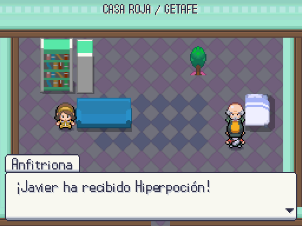

# Regalos de las casas ampliadas · 2026-10-12

El NPC real de las 29 casas con cortesía se llama Anfitrion. La configuración anterior lo registraba como VecinoRegalo, lo que hacía fallar el escaneo exacto R.2. Se corrigen las colocaciones y el generador de casas, sin cambiar flags, cantidades ni composición de los interiores.

Las ROM anteriores mantienen el objeto asignado a su ID antiguo mediante `legacy_placement`; las nuevas usan el ID canónico. Si existen ambos IDs en un parche, tiene prioridad el actual. Hablar otra vez no duplica el regalo.

| ROM con ID anterior | ROM con ID actual |
|---|---|
|  |  |

Capturas reales de Getafe/casa_1 a 512×384. Las imágenes muestran compatibilidad de entrega, no un rediseño del interior. La ampliación recibida en `2d7e07a1` se conserva; el arte sigue provisional hasta revisión de Javier.

Pruebas dirigidas: mundo 10/10, 1.030 aserciones; regalo real con ROM anterior/actual y repetición 1/1, 11 aserciones. Registro regenerado: 36 objetos. Arte 10.930 PNG, 0 errores/avisos; datos 0 errores y 3 avisos previos.

Suite completa: **503/503 tests, 29.307 aserciones, 663,04 s**, sin errores de script ni fugas al cerrar. Referencia dorada: 29 IDs renombrados y huella/input_hash actualizados; el resto del parche se conserva.
