# Primer repaso de densidad e interacciones · 2026-10-12

Capturas reales a 512×384 en el mismo punto y escala. Arte original de los packs; todo provisional, pendiente de Javier. Referencia: [pueblo de Añil](../referencias/anil_pueblo.png) y [ruta de Añil](../referencias/anil_ruta.png).

## Calles entre manzanas

| Antes | Después |
|---|---|
| 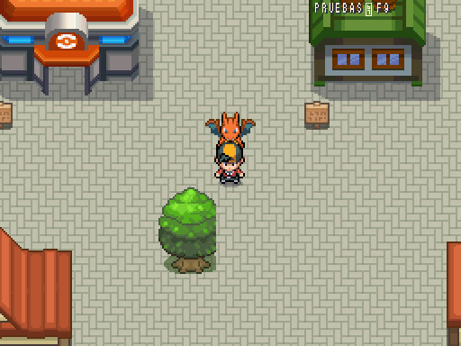 | 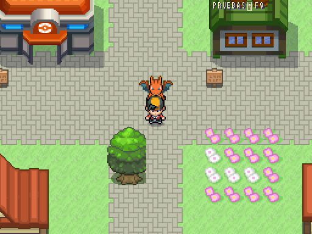 |

## Viviendas y vecinos

| Antes | Después |
|---|---|
| 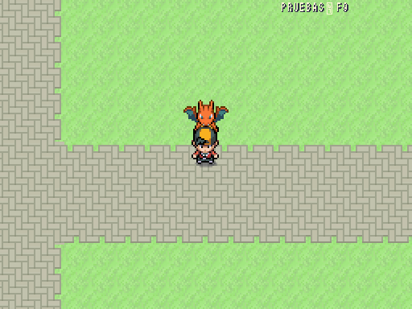 | 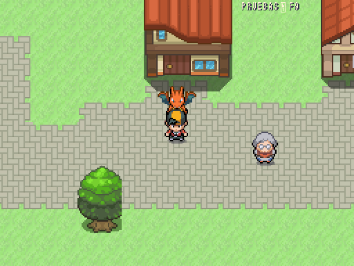 |

## Camino y ramales de fincas

| Antes | Después |
|---|---|
| 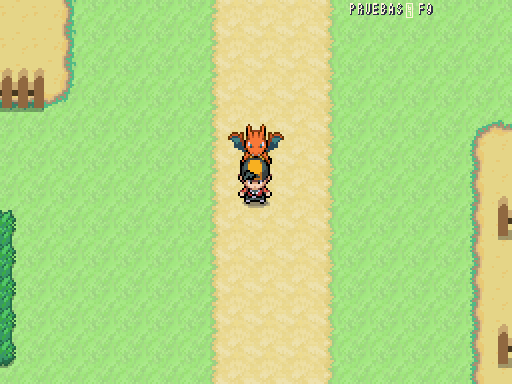 | 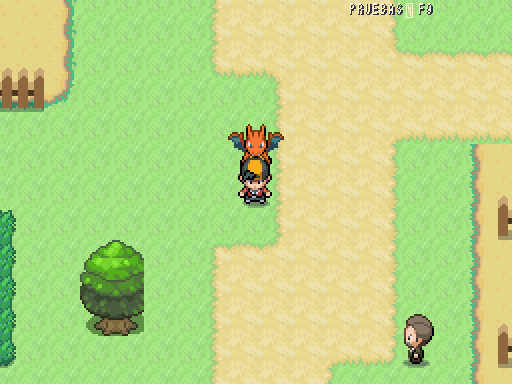 |

## Interior del supermercado

| Antes | Después |
|---|---|
| 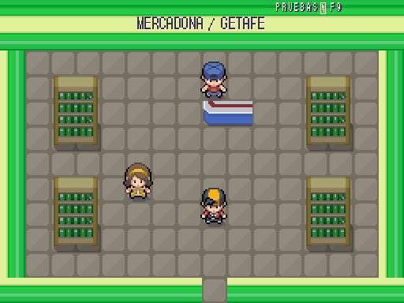 | 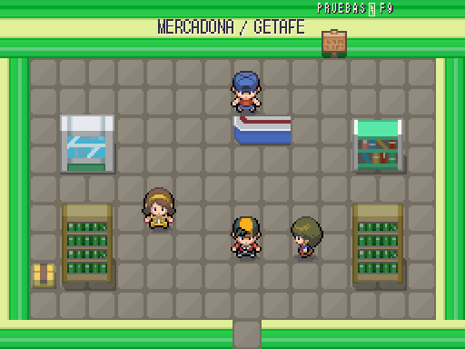 |

Getafe sustituye la losa de pavimento por calles y jardines, con ramales cortos hasta los portales. Añade tres viviendas, un puesto con compra real, cinco vecinos y carteles de orientación hacia Leganés y Ruta 24; se mantienen las conexiones de borde y los servicios anteriores. Ruta 24 incorpora dos edificios rurales, ramales hacia las fincas y un camino con curvas, dos vecinos y arbolado; conserva accesos/encuentros/entrenadores.

## Casa e interacciones

| Casa con cocina, cama, sofá, libros y PC real | Expositor con catálogo y precios reales |
|---|---|
| 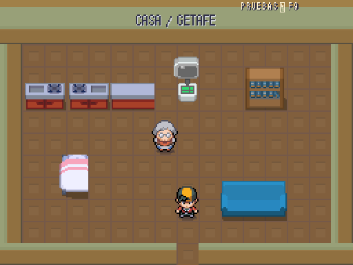 | 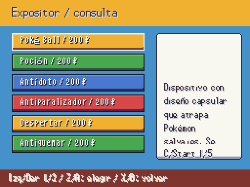 |

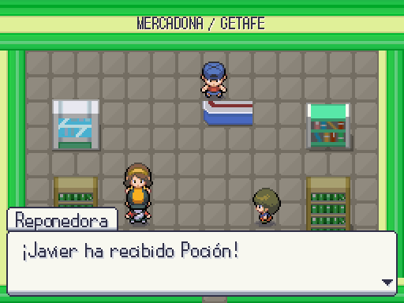

Mercadona cambia dos módulos por vitrinas originales del atlas, añade un aviso examinable y una compradora. La reponedora ofrece un objeto una vez por partida; puede rechazarse y no se pierde por mochila llena. El objeto se resuelve mediante DataDB, también bajo parche RandomLocke. Cantidad de demostración: una unidad; balance final pendiente Javier, parametrizado en `data/npc_rewards.json`.

La casa visitable está en el nuevo bloque oriental de Getafe y vuelve al mismo portal; su `zone_id` permanece Getafe. Libros y ordenador son examinables. No añade personajes famosos ni trama nueva. El resto de viviendas nuevas sigue sin interior; se distingue de la única casa abierta.

Validación: **11/11 pruebas dirigidas, 659 aserciones, 118,53 s**; entrada/salida de casa, PC, consulta de stock/precio, compra del puesto, rechazo del regalo, cambio por RandomLocke, persistencia, mochila llena y entrega única. Alcance de Getafe, Ruta 24, Mercadona y casa: **0 problemas**. Suite completa **490/490 tests, 23.184 aserciones, 551,83 s**, sin errores de script ni fugas al cerrar; se mantiene la espera deprecada antigua de GUT. Arte 10.926 PNG, 0 errores/avisos; datos 0 errores, 3 avisos previos.
