# Seis secuencias de ataque y habilidades en F9 · 2026-10-12

Capturas reales a 512×384, sin reescalar. Recursos originales EBDX/NikDie; tres PNG copiados intactos y registrados por tamaño/SHA-256. Presentación provisional, pendiente de Javier. Referencia: [combate de Añil](../referencias/anil_combate.png).

Las secuencias reutilizan los sprites a escala nativa y separan preparación, recorrido e impacto. Posiciones enteras, opacidad y cuadros originales; no estiran ni giran las imágenes. El modo rápido y las animaciones reducidas omiten las partículas y conservan el resultado del combate.

| Movimiento | Antes: efecto común del tipo | Después: fase propia |
|---|---|---|
| Rayo Hielo | 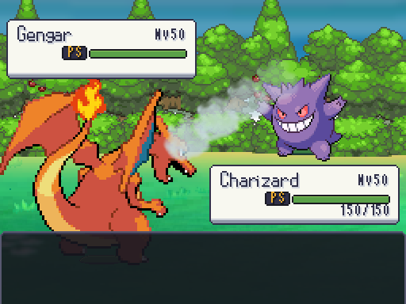 | 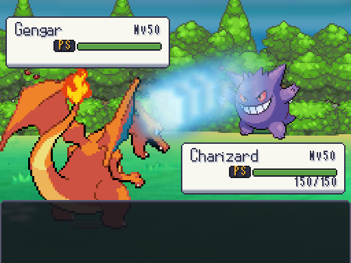 |
| Rayo | 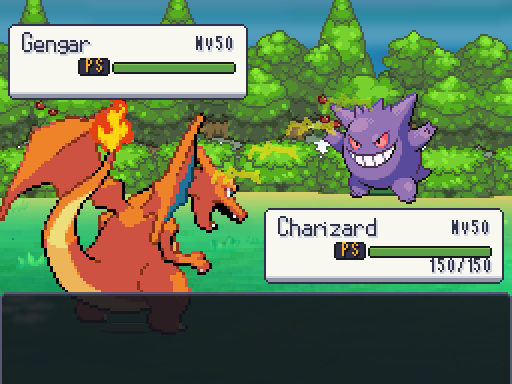 | 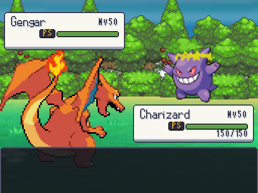 |
| Psíquico | 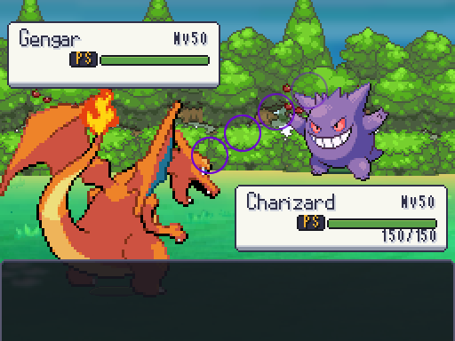 | 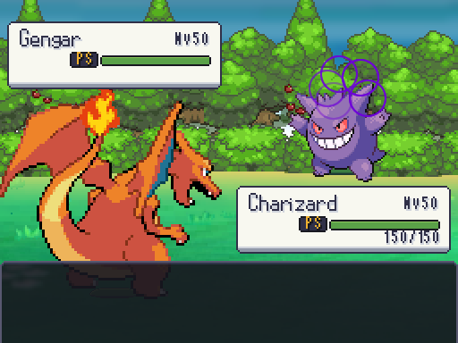 |
| Terremoto | 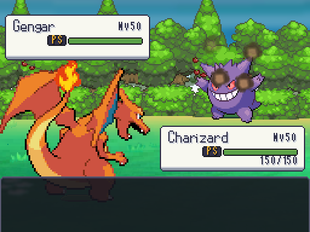 | 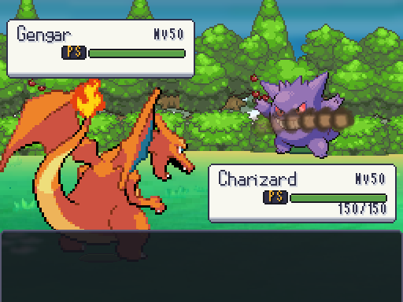 |
| Bola Sombra | 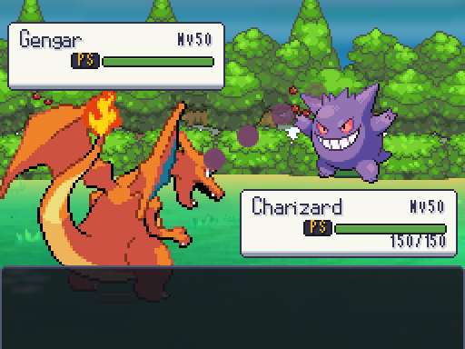 | 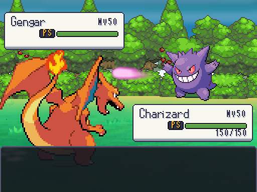 |
| Lanzallamas | 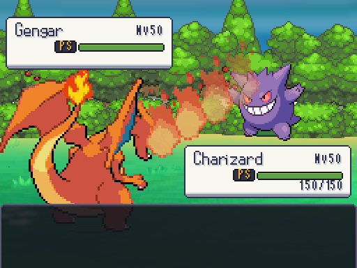 | 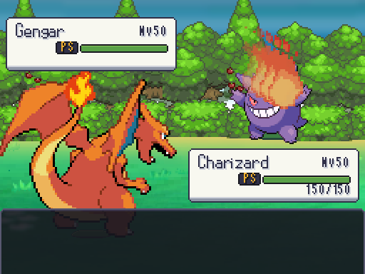 |

Rayo Hielo prepara un brillo y lanza el haz antes de la niebla; Rayo concentra electricidad y cae en el objetivo; Psíquico usa anillos de preparación, recorrido y cierre; Terremoto levanta polvo a ras del suelo; Bola Sombra concentra energía, lanza el proyectil y termina en destellos oscuros; Lanzallamas separa chorro e impacto. Duraciones totales: 0,55–0,65 s, con fases de 0,12–0,35 s y Tween lineal. La cámara y las cajas de PS permanecen legibles. Las capturas muestran instantes; para valorar el ritmo hay que reproducirlos en combate desde F9.

## Editor de habilidades y sets

| Antes | Después |
|---|---|
| 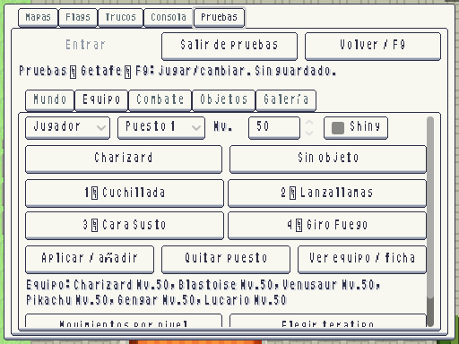 | 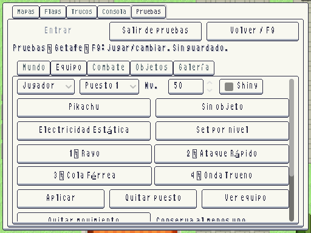 |

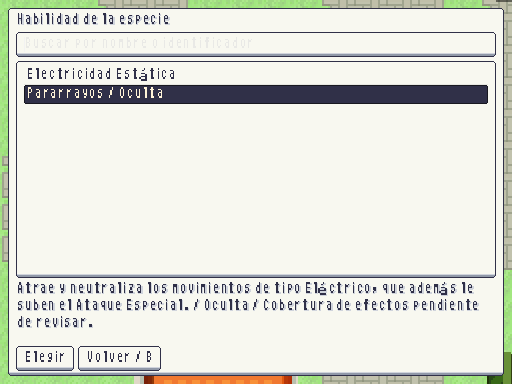

F9 → Equipo permite elegir únicamente habilidades de la especie, incluidas las ocultas. El selector muestra descripción y advierte del estado de cobertura del efecto; C/Start permite leer textos largos sin elegir ni aplicar nada. Cambiar un objeto conserva la habilidad elegida. «Set por nivel» prepara los movimientos actuales de DataDB para el nivel seleccionado, y «Aplicar» confirma el borrador; las elecciones manuales siguen disponibles para experimentar. Las pruebas rechazan habilidades ajenas a la especie sin sustituir el Pokémon. Todo permanece en la sesión temporal.

Validación dirigida: animaciones 8/8 pruebas, 4.969 aserciones; habilidades y sets 2/2, 22 aserciones; controles de catálogos 4/4, 27 aserciones. La auditoría distingue catálogo, efectos registrados y animaciones, en [cobertura_combate](../cobertura_combate/README.md).
