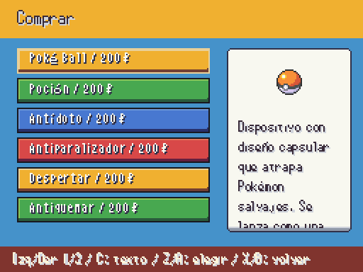
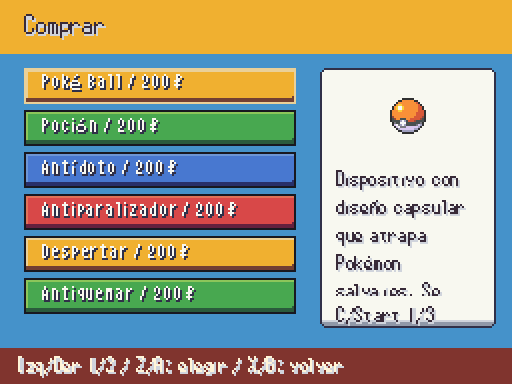
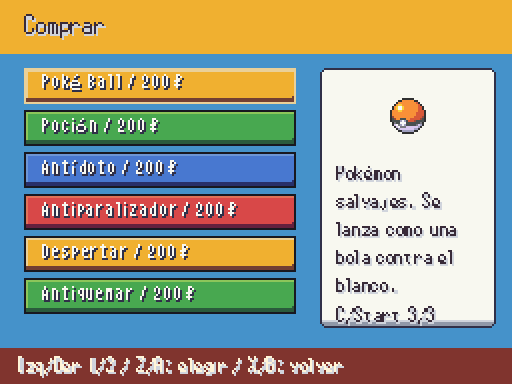
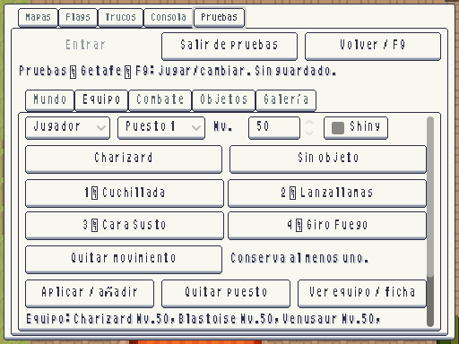

# Lectura de objetos y sets de pruebas · 2026-10-11

**PROVISIONAL — pendiente de revisión visual de Javier.** Pantallas reales a 512×384; se conserva el marco y el arte existentes. Cambio de interfaz, sin sprites nuevos ni reglas de combate nuevas.

| Compra anterior | Compra con lectura indicada |
|---|---|
|  |  |

La descripción ya estaba en un contenedor desplazable, pero el control C quedaba en una ayuda demasiado larga y recortada. Ahora el panel indica **C/Start y la página del texto** cuando hace falta. La ayuda de elegir/volver cabe completa. La lectura funciona también con animaciones reducidas; cambiar de objeto vuelve al principio y oculta las páginas si su descripción cabe.

C en teclado o Start en mando avanza por el texto; después del final vuelve al principio. No selecciona el objeto ni modifica la compra. Lista y descripción mantienen controles independientes.

| Editor F9 anterior | Editor con retirada de movimientos |
|---|---|
|  |  |

**Quitar movimiento** ofrece solo los movimientos actuales. Cancelar conserva el set. Elegir uno compacta el set sin huecos; el último queda protegido. Cambios del editor se aplican mediante **Aplicar / añadir**, tanto para jugador como rival, únicamente en la sesión separada de F9. Se conserva la restauración de la partida original al salir.

Pruebas reales: teclado C, mando Start/abajo/B, lectura completa sin selección accidental y navegación a otro objeto; mando A/B para abrir, cancelar y retirar movimientos, compactación, aplicación y protección del último en ambos equipos. Pruebas dirigidas **16/16**, **100 aserciones**. Validación completa anotada en ESTADO.

Cierre completo del 2026-10-12: **482/482 tests, 20.287 aserciones, 523,74 s**; sin fugas al cerrar. Arte y datos sin errores.
