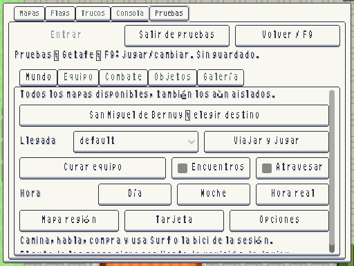
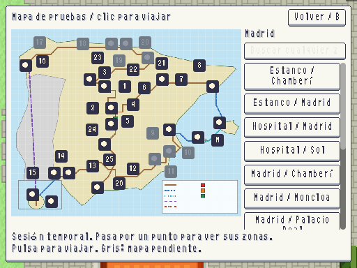

# Mapa de pruebas F9 · 2026-10-12

| Antes: elegir de una lista | Después: viajar pulsando el mapa |
|---|---|
|  |  |

Capturas reales a 512×384. **F9 → Mundo → Mapa**. Pulsar una ciudad/ruta viaja a su exterior; al pasar el ratón o enfocar un punto aparecen sus barrios e interiores a la derecha. Pulsar cualquier zona de ese panel viaja directamente, sin confirmar. El buscador abarca los **116 mapas** existentes, incluidos los seis de pruebas/muestras; los que todavía no existen aparecen grises y no admiten viaje. Primer clic inicia automáticamente la sesión temporal si aún no está activa. Salir de pruebas restaura la partida anterior.

Madrid llega a Sol, Barcelona a Eixample, Valencia a Ciutat Vella, Sevilla al Centro y Las Palmas a Vegueta/Triana. Madrid sur agrupa Getafe, Leganés y Móstoles. La llegada usa `default` si es válida y, en su defecto, la primera llegada válida; un mapa sin llegada no se carga. Se mantiene la lista con elección de spawn para pruebas avanzadas.

Plano documental existente `docs/mundo/mapa_region.svg`, sobrepuesto con controles de depuración. Es una herramienta de pruebas; el mapa de vuelo de la partida conserva su contrato y sus restricciones. Puntos recolocados a la posición cercana libre para poder pulsar cada uno sin solapamientos. Ratón, teclado y mando; B cancela sin iniciar sesión. Un diálogo/combate impide iniciar un viaje.

Validación dirigida: **3/3 tests, 2.281 aserciones**. Se prueban clics de ratón reales, inicio temporal, restauración del nombre original, viaje directo al hospital, búsqueda española, cancelación con mando, bloqueo durante diálogo y separación de los puntos. La capa de salida de GUT se oculta durante estos clics porque, a nivel 128, tapaba los botones; se restaura al terminar cada prueba. Captura reproducible: `godot --path . -s tools/arte/capture_ui.gd -- --screen=playtest_map`.

Presentación provisional, pendiente de revisión de Javier.

Cierre de la suite completa: **486/486 tests, 20.889 aserciones, 579,59 s**, sin errores de script ni fugas al terminar. Arte: 10.926 PNG, 0 errores/avisos; datos: 0 errores y 3 avisos previos.
