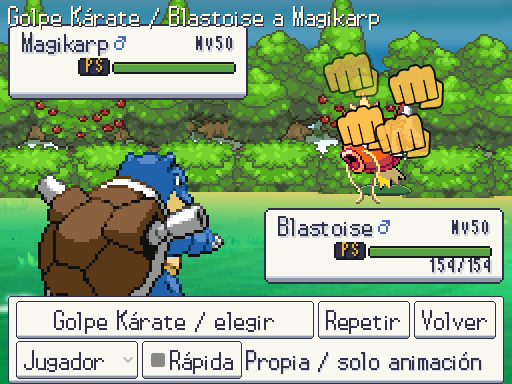
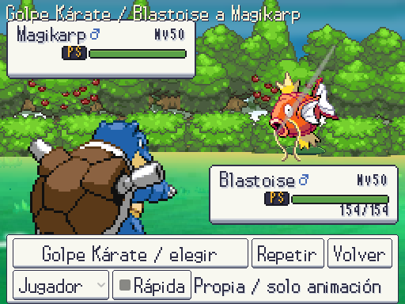
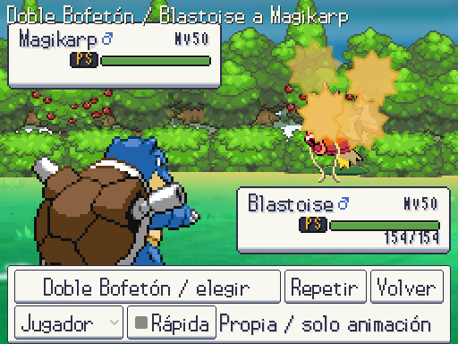
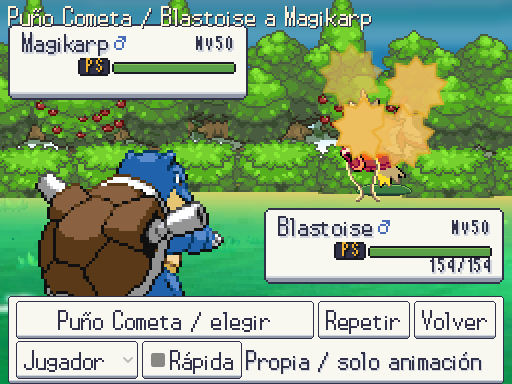
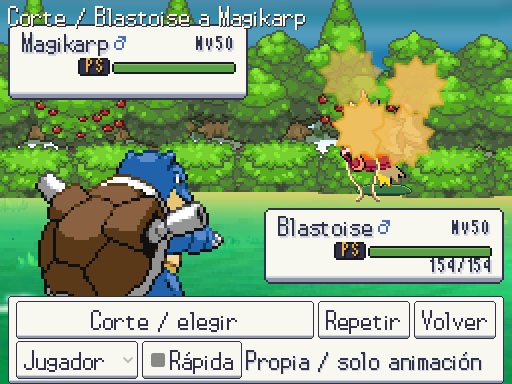
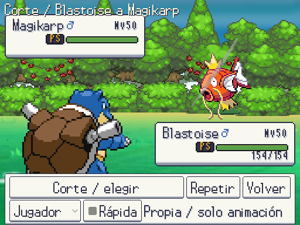
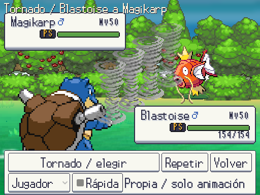
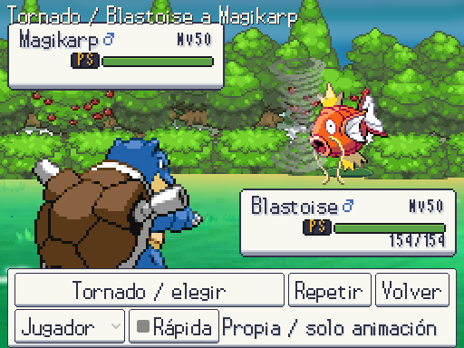
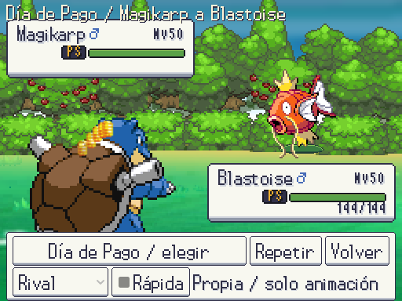
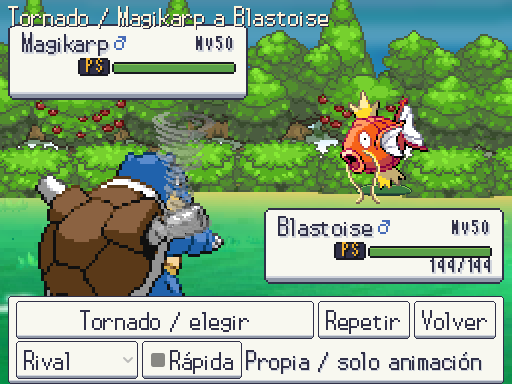

# Movimientos por índice de WikiDex · 2026-10-12

Continúa el catálogo completo pedido por Javier. Recursos originales NikDie/EBDX del pack 17, a tamaño nativo, sin estirar/girar sprites ni crear gráficos por código. Se reutilizan dos PNG y se copian cuatro intactos; procedencia/tamaño/SHA en `data/battle_motion_assets.json`. Arte provisional, pendiente de revisión de Javier; referencia [combate de Añil](../referencias/anil_combate.png).

La columna anterior muestra el efecto genérico del tipo/categoría en la misma vista de revisión; después muestra una fase de la nueva secuencia. Son capturas reales a 512×384. F9 → Pruebas → Galería → Animaciones → Elegir → buscar → Repetir; Jugador/Rival permite ver ambos lados. La vista no aplica daño, efectos ni consume recursos.

| Movimiento | Antes | Después |
|---|---|---|
| Destructor |  |  |
| Golpe Karate |  |  |
| Doble Bofetón |  |  |
| Puño Cometa |  |  |
| Megapuño |  |  |
| Día de Pago |  |  |
| Corte |  |  |
| Tornado |  |  |

Destructor presenta un impacto centrado; Golpe Karate un corte vertical y destellos; Doble Bofetón alterna impactos laterales. Puño Cometa intercala puño y estrellas; Megapuño recorre más distancia y acaba con una dispersión más amplia. Día de Pago lanza una moneda y abre el abanico; Corte recorre una diagonal; Tornado anima los cuadros originales del torbellino. Los golpes múltiples representan una sucesión visual, no el número efectivo de aciertos del motor. La animación mantiene posiciones enteras, vuelve a la posición inicial y libera todos los FX. Las fases duran 0,14–0,50 s, con el avance habitual de 0,25 s donde corresponde. Rápida/reducida omite partículas.

Revisión adicional en la vista real: los ocho movimientos reproducidos desde Jugador y Rival, **16 reproducciones**, sin FX sobrante ni desplazamiento del Pokémon al acabar. Dos capturas de la orientación inversa:

| Día de Pago desde Rival | Tornado desde Rival |
|---|---|
|  |  |

Total actual: **38 movimientos canónicos con animación propia**, 897 de WikiDex pendientes de secuencia propia; conservan la presentación por tipo. Datos/efectos/sets y animación se siguen por separado en [el inventario completo](../cobertura_combate/README.md). Pruebas dirigidas: animaciones **10/10, 6.978 aserciones** y auditoría WikiDex **3/3**. Validación completa: **508/508 tests, 32.113 aserciones, 721,27 s**, sin fugas al cerrar. Arte **10.951 PNG, 0 errores/avisos**; datos 0 errores y 3 avisos previos.
