# Ocho movimientos y vista de animaciones F9 · 2026-10-12

Recursos originales de EBDX/NikDie, copiados intactos del pack 17. Escala nativa y posiciones enteras; no se estiran ni giran los sprites. Surf usa un recorte nativo de la ilustración de la ola, sin modificar el PNG. Arte provisional, pendiente de Javier. Referencia: [combate de Añil](../referencias/anil_combate.png).

| Movimiento | Antes: efecto del tipo | Después: fase propia |
|---|---|---|
| Surf | 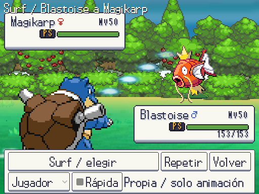 | 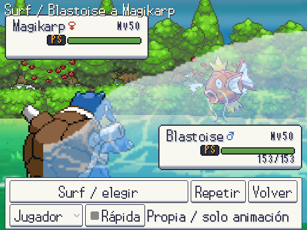 |
| Hidrobomba | 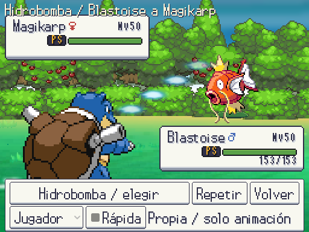 | 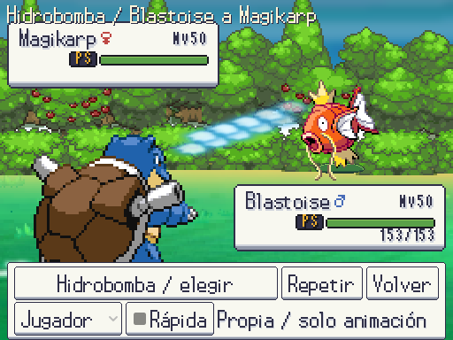 |
| Protección |  | 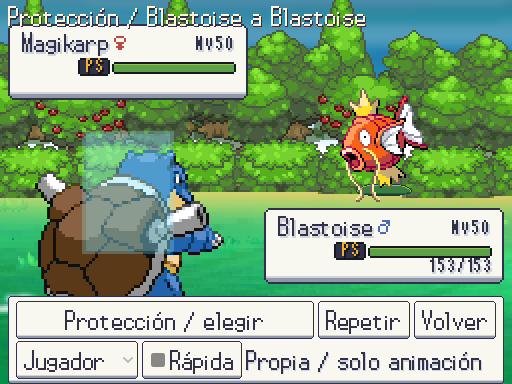 |
| Recuperación | 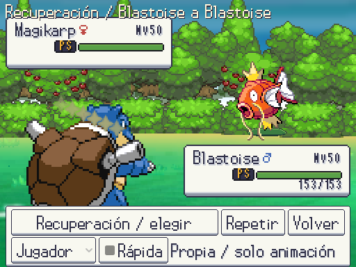 | 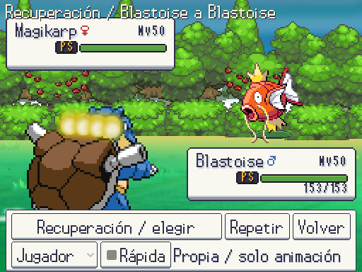 |
| Danza Espada | 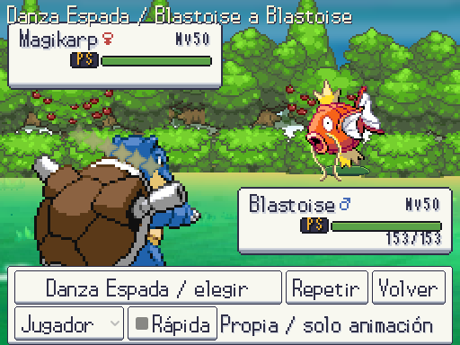 | 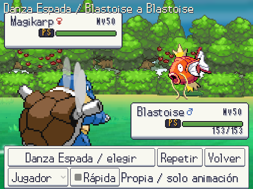 |
| Puño Fuego | 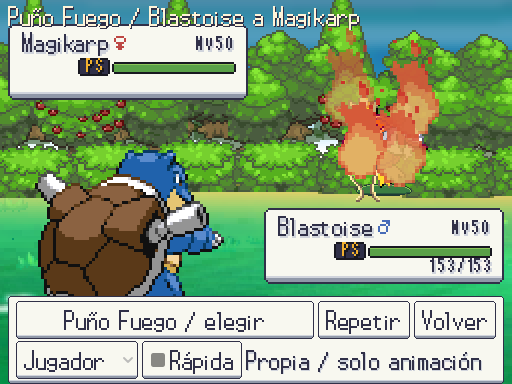 |  |
| Puño Hielo | 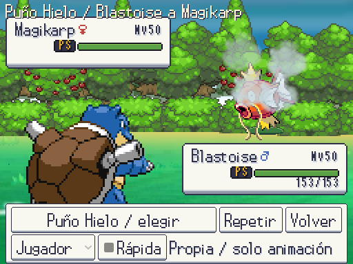 |  |
| Puño Trueno |  | 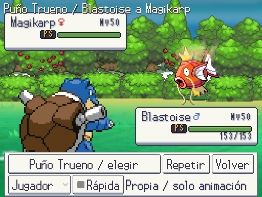 |

Surf cruza el campo con la cresta de la ola y acaba en salpicaduras. Hidrobomba separa preparación, chorro estrecho e impacto. Protección rodea al usuario con la barrera original; Recuperación eleva luz alrededor del usuario; Danza Espada hace circular las hojas antes de cerrar con luz. Los puños combinan el avance del Pokémon, un golpe con el recurso de puño y el elemento correspondiente. Las fases duran 0,12–0,50 s; los puños añaden el avance habitual de 0,25 s. La cámara y las cajas de datos permanecen legibles. El modo rápido y las preferencias de animaciones reducidas omiten las partículas.

## Repetir desde F9

F9 → Pruebas → Galería → **Animaciones / elegir y repetir**. Usa el Pokémon seleccionado y aplicado en Equipo y un oponente de la sesión (si el puesto está vacío, usa el primero), y el entorno escogido en Combate. «Elegir» abre la búsqueda de todos los movimientos; «Repetir» o Z/A reproduce; Jugador/Rival cambia quién lo usa; X/B vuelve. Si se vuelve durante un efecto, termina sus fases y cierra limpiamente. Las descripciones siguen accesibles en el selector. Elegir un movimiento no reutiliza A/Z para activar el botón de debajo.

| Acceso en Galería | Vista con controles |
|---|---|
| 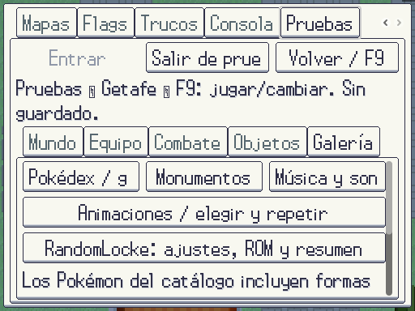 | 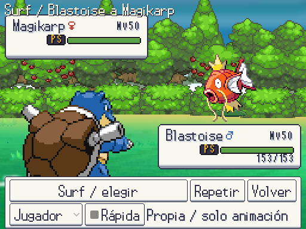 |

Es una revisión de presentación: no consume PS, PP ni objetos, no aplica el efecto del movimiento y no cambia los equipos ni preferencias. Los movimientos sin secuencia propia conservan el efecto común de tipo/categoría. El combate de verdad sigue disponible en la pestaña Combate.

Pruebas dirigidas: animaciones 9/9, 6.155 aserciones; vista 3/3, 37 aserciones (mando, selección/cancelación, ambos lados, regreso durante el efecto y modo reducido). Total: 30 movimientos con secuencia visual propia, separados de la cobertura del motor en [la auditoría](../cobertura_combate/README.md).

Validación completa: **507/507 tests, 30.938 aserciones, 701,01 s**. Tras integrar Ruta 10: interfaz **170/170**, mapas **5/5** y dorado **1/1**; arte **10.947 PNG, 0 errores/avisos**, datos 0 errores y 3 avisos previos. Las dos ejecuciones de interfaz/completa cierran sin fugas; las pruebas aisladas de sesión pueden conservar recursos en caché al cerrar su proceso.
