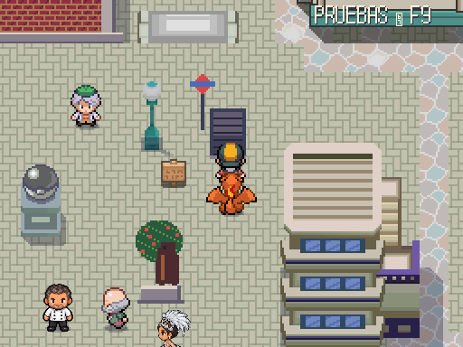
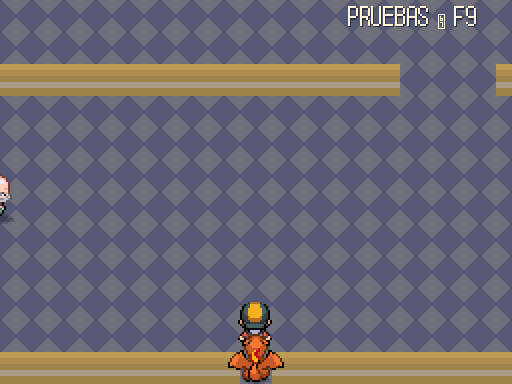
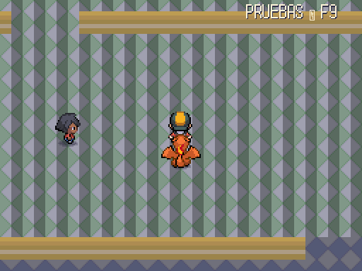
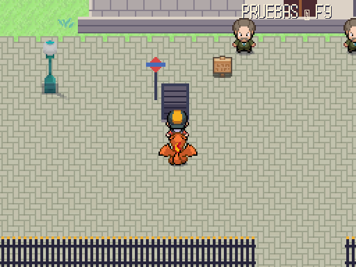

# Calle de la Victoria · 2026-10-15 (Agente 4)

Capturas reales a 512×384, de día (`godot --path . -s res://tools/mundo/capturar_calle_victoria.gd`). Mapa `calle_victoria/tunel`, pintado por `maps/_pintura/pintar_calle_victoria.gd`. PROVISIONAL hasta que lo apruebe Javier.

| Boca de Sol (`madrid/centro`) | Andén abandonado (llegada desde Sol) |
|---|---|
|  |  |

| Cloacas (mitad del recorrido) | Boca del Palacio Real (`madrid/palacio_real`) |
|---|---|
|  |  |

- Corta arriba y larga abajo (DECISIONES_JAVIER_2026-10-13 §3): 20×62 casillas en zigzag, de la boca de Sol a la del Palacio Real.
- Cuatro entrenadores de nivel 54–58 (`data/trainers/calle_victoria.json`), tres carteles y un vagabundo.
- En los packs locales no hay alcantarillas ni Metro: suelo y paredes del tileset de interiores que ya había. **PENDIENTE JAVIER:** el pack definitivo.
