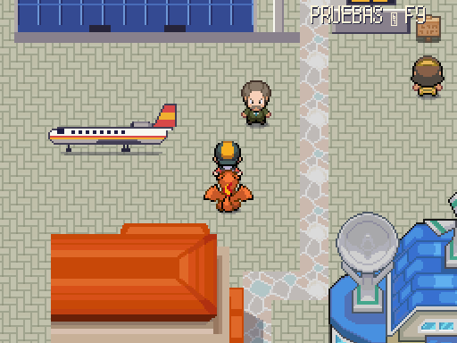
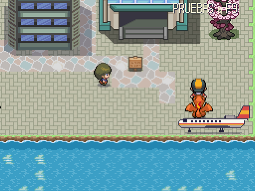

# Falcon aparcado en los aeropuertos · 2026-10-15 (Agente 4)

Capturas reales a 512×384, de día (`godot --path . -s res://tools/mundo/capturar_calle_victoria.gd -- falcon`). PROVISIONAL hasta que lo apruebe Javier.

| Playa del Inglés (`playa_del_ingles/exterior`) | Vigo, Peinador (`vigo/exterior`) |
|---|---|
|  |  |

- Pieza dibujada a mano: `assets/_fuentes/mundo/falcon.px2` (80×32 del arte, 5×2 casillas a ×2). Fuente 383 de `hecho_a_mano/piezas.json`, que estaba libre. Avión oficial de perfil: tres motores atrás, ventanillas, línea roja y amarilla, bandera en la cola, tren de aterrizaje y sombra. Colores de la paleta maestra.
- Colocado con `maps/_tools/poner_pieza.gd` y con carteles puestos con `maps/_tools/poner_cartel.gd`, sin repintar. En Playa del Inglés, delante de la terminal (ancla en (2, 10), cartel `CartelHangar` en (7, 10)). Ya había un cartel sin dibujo, `CartelFalcon` (11, 1), que habla del avión. En Peinador, en la esquina del área de la pasarela (ancla en (51, 37), cartel `CartelFalcon` en (55, 35)).
- No tapa pasarelas ni caminos: alcance con 0 problemas en los dos exteriores. Los bordes y la pasarela del avión se pasan igual.
