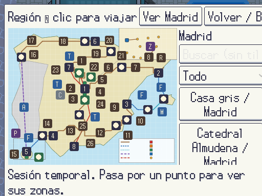
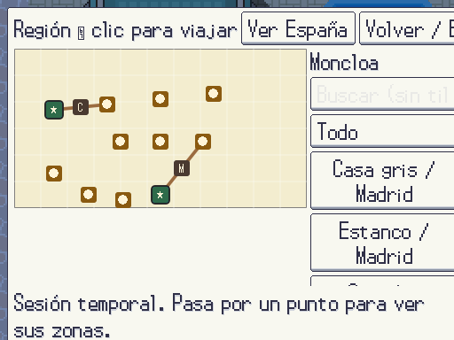
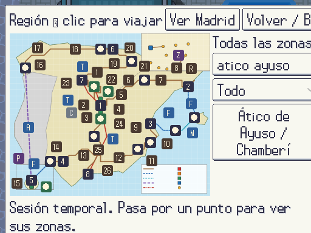
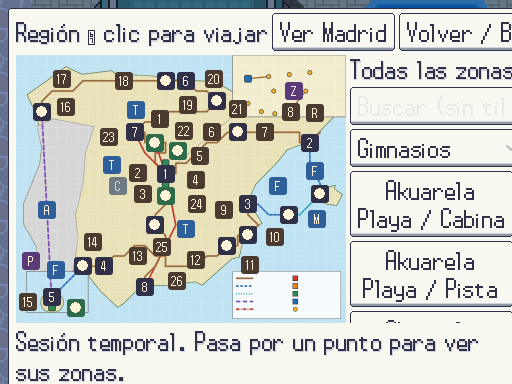
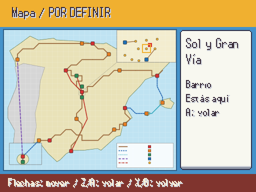
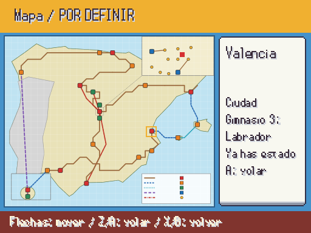
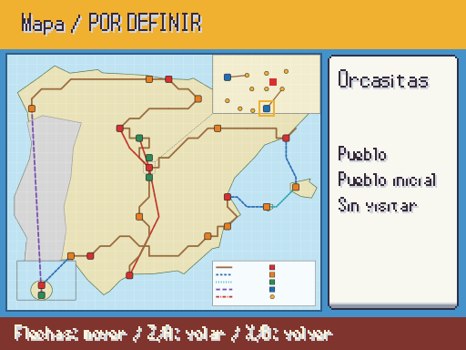

# Mapa de la región: F9 y mapa regional del juego · 2026-10-15 (Agente 4)

Capturas reales a 512×384, sacadas con `godot --path . -s res://tools/mundo/capturar_mapa_region.gd` (necesita ventana). El plano es `docs/mundo/mapa_region.svg`, regenerado desde `data/region.json` con `tools/mundo/mapa_region_svg.py`; Godot no pinta los textos del SVG, así que los nombres los ponen las pantallas. Todo PROVISIONAL hasta que lo apruebe Javier.

## F9 → Mundo → Mapa

| Vista de España (Madrid señalado) | Recuadro de Madrid y alrededores (Moncloa señalado) |
|---|---|
|  |  |

| Búsqueda sin tildes («atico ayuso») | Filtro: gimnasios (32 salas, Quirón y ático) |
|---|---|
|  |  |

- Un punto por cada lugar de `data/region.json`: 24 ciudades y pueblos (★ los pueblos iniciales, número = gimnasio), 9 barrios de Madrid y del sur, 30 rutas (más la Calle de la Victoria, en gris) y los ferris (F), el avión (A) y los AVE (T). «Z» abre el recuadro de Madrid; «P», las salas de pruebas.
- Cada punto agrupa sus mapas por id y por la puerta de salida: el Quirón y el laboratorio salen en Moncloa; las salas del gimnasio 1, en Sol; las estaciones y terminales, en su ciudad.
- Gris solo si el mapa no existe (la Calle de la Victoria). Los puntos no se solapan (test).

## Mapa regional del juego (menú de pausa)

| Estás en Madrid · Sol | Valencia, visitada: «A: volar» | Orcasitas, pueblo inicial |
|---|---|---|
|  |  |  |

- Salen todas las ciudades y pueblos, los barrios de Madrid, el sur de Madrid y las rutas. El cursor salta con las flechas al punto más cercano en esa dirección y llega a todos (test).
- A la derecha: nombre, tipo, pueblo inicial, gimnasio y si ya has estado o estás ahí. El punto rojo marca dónde estás.
- A vuela a un destino visitado si tienes la herramienta de Vuelo (es del sistema de medallas; aún no se da).

**PENDIENTE JAVIER:** el arte definitivo del mapa regional (ahora es el esquema aprobado como base, con la costa aproximada por coordenadas reales) y la forma de los puntos y del cursor.
