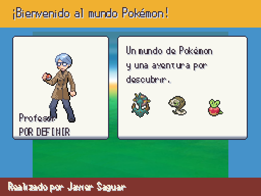
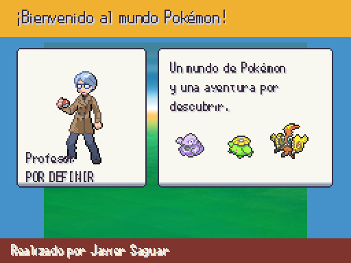

# Iniciales aleatorios por partida · sesión 2026-10-14

Antes: [intro previa con iniciales fijos](a3_professor_intro.png). Después: la misma pantalla presenta tres opciones generadas y conservadas en el estado de una partida normal, procedentes de todas las generaciones.

| Partida reproducible 53 | Partida reproducible 99 |
|---|---|
|  |  |

La primera ofrece Dhelmise, Silicobra y Applin; la segunda, Grimer, Skiploom y Tapu Koko. Son dos semillas de demostración; la partida nueva tira su propia oferta. La especie del rival se pide por ID y refiere otra opción de esa misma oferta. Al cargar la partida no se regenera. RandomLocke sigue usando su ROM. El profesor visible en esta comparativa aún es el provisional anterior: su sustitución por Unicoos es la tarea siguiente.

No se añade arte: iconos nativos existentes. Capturas reales a 512×384. Pruebas: generaciones 1–9, 60 ofertas sin duplicados, semilla reproducible, ofertas diferentes, JSON, rival coherente, copias desacopladas, ROM y guardados anteriores conservados. Suite y validadores en ESTADO.
