# Elección y vistas de los protagonistas · sesión 2026-10-14

Referencia de Javier: [los cuatro protagonistas](../referencias/javier_2026-10-13/protagonistas_cayetana_choni_cayetano_cani.webp). Antes: [protagonistas propuestos](protagonistas_propuestas.png), sexo sin identidad y hojas del pack. Después, elección persistente con diseño y origen. Todas las capturas nuevas proceden del juego a 512×384, sin componer arte por código.

| Personaje | Selección | Mapa de prueba | Espalda en la escena real |
|---|---|---|---|
| Cayetano | 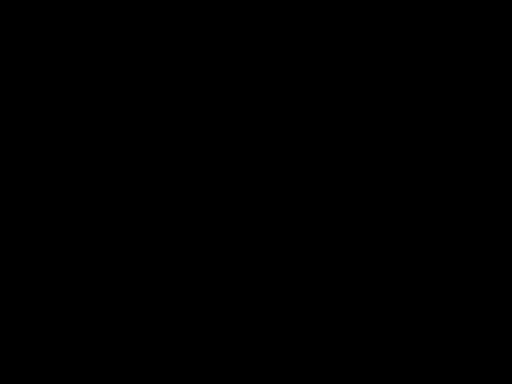 | 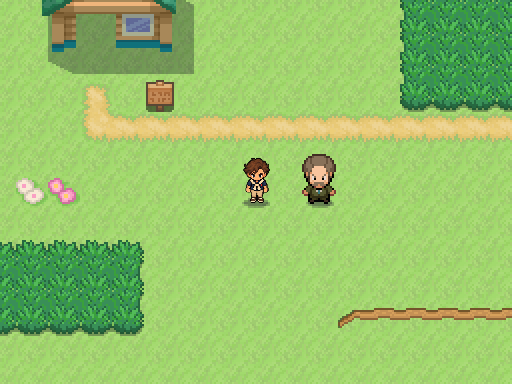 | 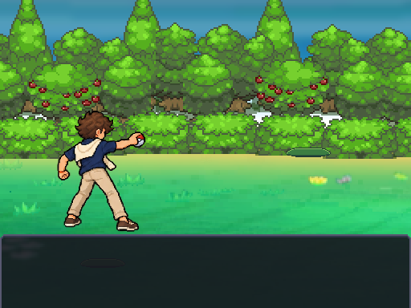 |
| Cani | 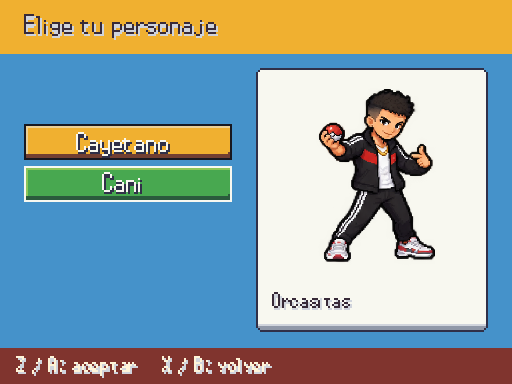 | 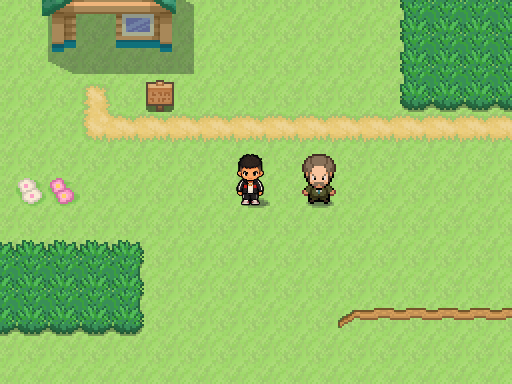 | 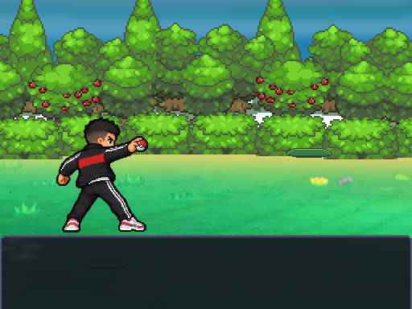 |
| Cayetana | 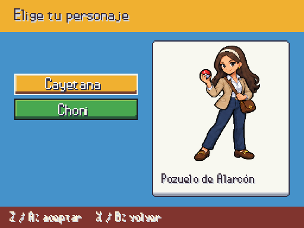 | 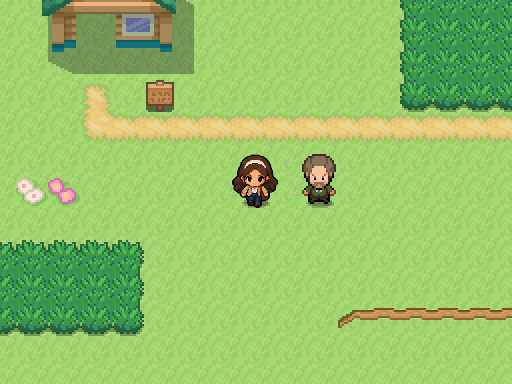 | 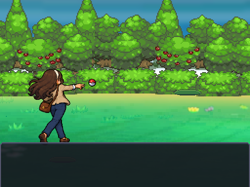 |
| Choni | 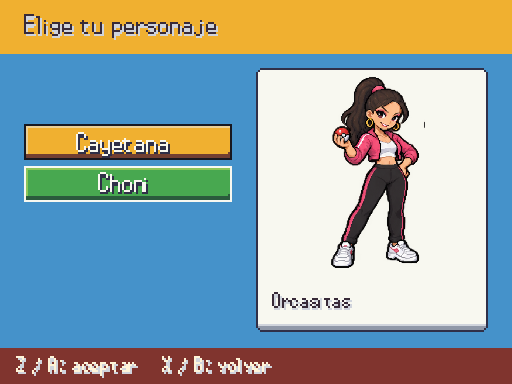 |  | 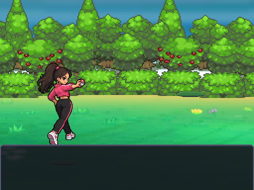 |

Los mapas mostrados son la sala exterior de pruebas para revisar el aspecto; no se han editado ciudades ni colocaciones de personajes. La partida nueva elige `pozuelo/exterior` para cayetano/cayetana y `orcasitas/exterior` para cani/choni, con llegada `default`, a cargo de B. Un destino ausente devuelve error sin reemplazar la partida. Cancelar la selección también conserva la sesión anterior.

Assets finales de esta entrega (provisionales hasta aprobación): `assets/sprites/characters/protagonistas/{cayetano,cani,cayetana,choni}.png`. Cada atlas contiene frente, espalda y dieciséis pasos; se conserva el archivo original y se consumen las regiones definidas en `data/protagonistas.json`. Bici/surf/pesca aún utilizan las variantes del pack anterior.

Verificación: ida y vuelta JSON de las cuatro identidades, migración v2→v3, cuarenta y ocho poses de caminar, altura/baseline, alfa y recursos existentes, rechazo de identidad inválida antes de mutar partida; suite y validadores anotados en ESTADO.
