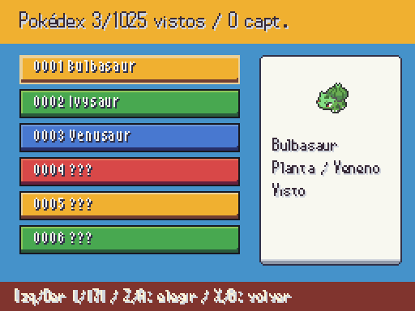
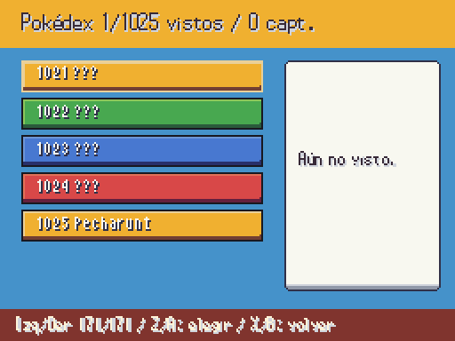

# Pokédex nacional · sesión 2026-10-14

Antes: [lista anterior sin total nacional](a3_dex.png). Después: la pantalla consulta las 1.025 especies base en orden nacional y muestra el total en el título. Las formas vistas siguen accesibles desde la ficha de su especie; una especie no vista sigue oculta.

| Primer folio | Último folio |
|---|---|
|  |  |

Capturas reales del juego a 512×384. Se marcaron como vistas tres primeras especies en el primer folio y Pecharunt en el último, para mostrar ambos extremos y el ocultamiento. Los iconos visibles son los del pack existente.

`data/pokemon_skins.json` define el contrato de ocho imágenes por especie (frente, espalda, icono y seguidor; normal y variocolor). Está vacío: las especies concretas siguen **PENDIENTE JAVIER**. El resolver ya conecta combate, ficha, Pokédex, intro y seguidor; usa los PNG originales si no hay asignación. El validador exigirá las ocho rutas antes de admitir una entrada.
