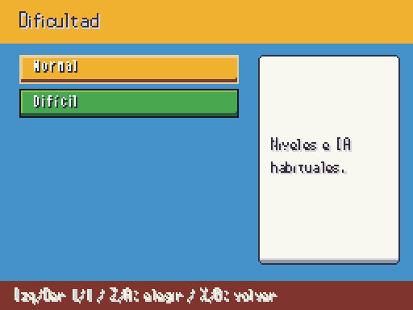
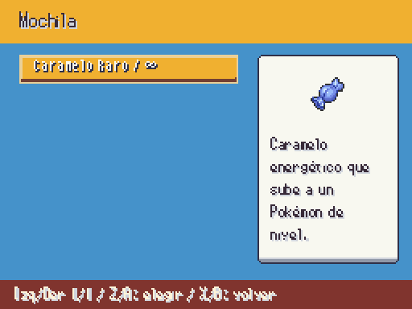

# Caramelos infinitos y dificultad · sesión 2026-10-14

Antes: [mochila de medicinas convencional](a3_bag.png). Después: RandomLocke muestra Caramelo Raro con ∞ en la mochila aunque no haya unidades guardadas. Usarlo sube un nivel hasta el tope del siguiente gimnasio; al alcanzar el tope deja de ser utilizable. En partidas normales sigue gastándose una unidad.

| Elección de dificultad | Mochila RandomLocke |
|---|---|
|  |  |

Capturas reales del juego a 512×384. El modo difícil es una elección al crear la partida: los rivales salvajes y entrenadores suben 10 % de nivel, redondeando hacia arriba, y su IA sube un grado. El tutorial no escala. La elección queda en el guardado; las partidas anteriores quedan en modo normal.

Los ocho límites provienen de `data/gimnasios.json` y las medallas obtenidas; al reunirlas todas, el máximo es 100. La opción se activa por defecto para una nueva ROM con reglas Locke sin cambiar los códigos de preset ya compartidos; un código pegado conserva exactamente sus ajustes.
