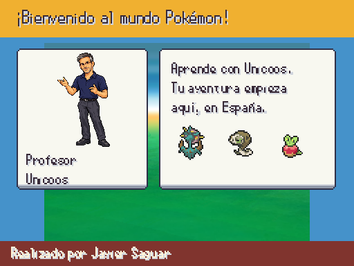
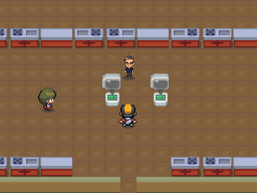

# Unicoos y laboratorio de Moncloa · sesión 2026-10-14

Referencia de Javier: [foto de Unicoos](../referencias/javier_2026-10-13/profesor_unicoos.png). Antes: [profesor provisional](a3_professor_intro.png) y [laboratorio sin profesor](madrid_laboratorio_mapa.png).

| Intro con retrato | Profesor en la marca del laboratorio |
|---|---|
|  |  |

Sprites nuevos: `assets/sprites/trainers/unicoos.png` y `assets/sprites/characters/unicoos_mapa.png`; gafas rectangulares, pelo con canas, barba corta y polo azul según referencia. PNG intactos, alfa y nearest, provisionales hasta aprobación de Javier. La figura de mapa es chibi para encajar con los otros NPCs; no usa el retrato reducido.

La intro indica el laboratorio y mantiene el paseo por Casa de Campo/Madrid Río hasta Moncloa. Unicoos recibe allí al jugador: tres opciones por DataDB, confirmación, mote en Locke, combate tutorial, curación, Pokédex y Poké Balls. Cancelar no entrega nada; las flags impiden repetir premios. La marca física es la entregada por B: no se han editado mapas ni personajes colocados.

Pruebas reales de preparación/idempotencia del actor y recorrido de la oferta al final del tutorial, con escenas y motor. Suite y validadores en ESTADO.
