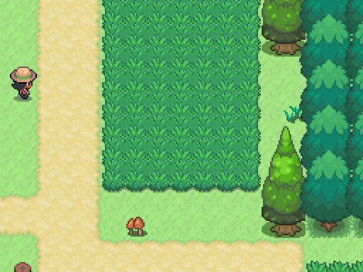
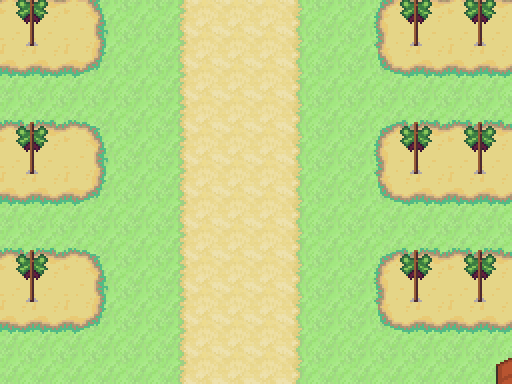
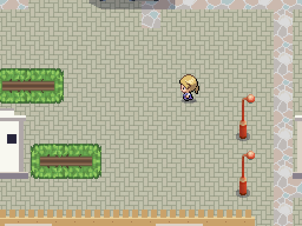
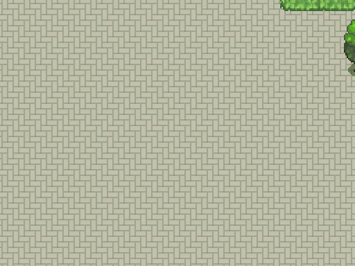
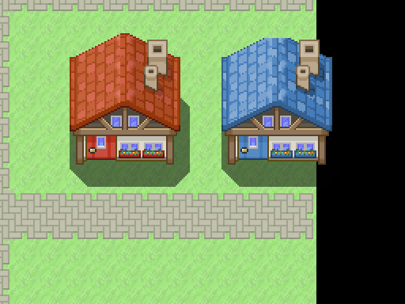
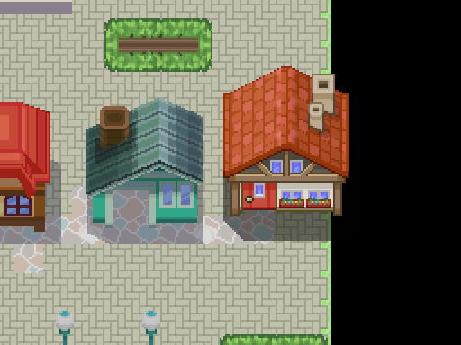
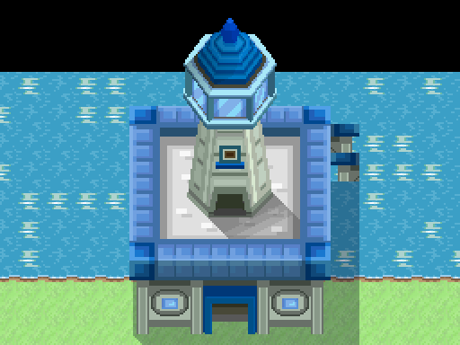
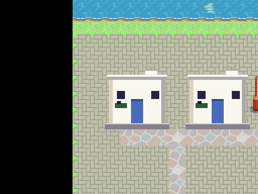
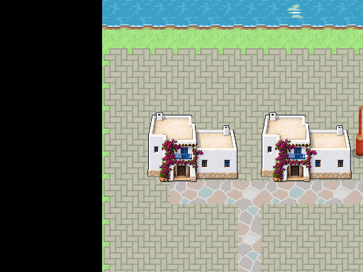

# Diagnóstico visual · Añil y mapas actuales · 2026-10-15

[Guía, conclusiones y tareas de los cinco agentes](../../../mundo/guia_composicion_anil_2026-10-15.md). [13 referencias originales de Javier](../../referencias/javier_2026-10-15/README.md). [Métricas reproducibles de 36 escenas y sus SHA-256](metricas.json).

Las capturas siguientes son del motor, **512×384 nativos**, 32 px por casilla y sin reescalar el PNG. Base publicada `623f9ba1`; se muestra el estado previo a las nuevas correcciones de composición. Se usa `MapLoader` con estado inicial, incluidas sus colocaciones y restricciones dinámicas; no se simulan medallas posteriores. No se presentan como una mejora ya hecha. El color negro en las capturas de los bordes señala suelo fuera del rectángulo del mapa.

| Captura de Spain | Centro en casillas | Referencia de composición | Qué se debe resolver |
|---|---|---|---|
| [Ruta 2, bosque](ruta_2_512.png) | (20,17) | 02 y 05 | Hierba lateral evitable y continuidad de límites |
| [Ruta 2, casa del borde](ruta_2_casa_cortada_512.png) | (31,61) | 08 y 11 | La casa de la derecha supera el límite; mover el conjunto de puerta y retorno |
| [Ruta 8](ruta_8_512.png) | (34,20) | 01, 04 y 07 | Explanada bajo el eje de Montserrat y hierba opcional |
| [Ruta 21](ruta_21_512.png) | (24,29) | 02 y 07 | El camino pintado deja los laterales abiertos y el tramo sin decisiones |
| [Ibiza](ibiza_512.png) | (28,22) | 08 y 12 | La superficie amplia no define calles, parcelas y accesos |
| [Málaga](malaga_512.png) | (45,53) | 09 y 10 | Una pantalla entera de adoquín sin estructura ni destino visible |
| [Pozuelo](pozuelo_512.png) | (25,20) | 08 y 11 | Delimitar jardines/parcelas y orientar a las puertas preservando el inicio seguro |
| [Bilbao, casa del borde](bilbao_casa_cortada_512.png) | (68,47) | 08 y 10 | La casa roja rebasa la zona con suelo; corregir fachada y todos los elementos del acceso |
| [Ruta 19, faro](ruta_19_faro_512.png) | (33,3) | 01 y 06 | Revisar volumen completo dentro del mapa y aproximación al faro |

## Recorrido y límites

Referencia: estudiar los [sectores conectados del bosque](../../referencias/javier_2026-10-15/02_ruta_bosque_desniveles.png) y la [ruta transformada en claros y pasos](../../referencias/javier_2026-10-15/05_ruta_antes_despues_bosque.png). En la base, 25/26 rutas numeradas permiten atravesarlas sin pisar ninguna casilla de encuentro; Ruta 3 sí requiere 26. El objetivo es dar función a la hierba y al terreno, no añadir más rectángulos de hierba.

## Ciudades y espacios vacíos

Referencia: [manzanas/plazas](../../referencias/javier_2026-10-15/10_ciudad_manzanas_plazas.png), [pueblo con río y molinos](../../referencias/javier_2026-10-15/11_pueblo_rio_molinos.png). En España se conservan barrios, playas, mercados y monumentos; se usan para enmarcar y dar destino a las calles.

Para la lectura del mapa completo se conservan las comparativas ya publicadas, que complementan las vistas nativas: [Ibiza](../tejido_urbano_2026-10-14/ibiza_exterior_despues.png), [Málaga](../tejido_urbano_2026-10-14/malaga_exterior_despues.png), [Pozuelo](../tejido_urbano_2026-10-14/pozuelo_exterior_despues.png), [Ruta 2](../tejido_urbano_2026-10-14/ruta_2_exterior_despues.png), [Ruta 5](../tejido_urbano_2026-10-14/ruta_5_exterior_despues.png) y [Ruta 8](../tejido_urbano_2026-10-14/ruta_8_exterior_despues.png). Son imágenes anteriores de sus respectivas entregas; los hashes de la escena auditada están en el JSON.

## Edificios fuera del suelo del mapa

No arreglarlo tapando la parte que falta: trasladar o ampliar el conjunto de edificio, puerta, Warp y llegada de retorno, y repetir el alcance. El diagnóstico usa el rectángulo de catálogo y necesita revisión visual cuando hay márgenes transparentes. Estos son tres hallazgos de 36 exteriores, no un certificado de que los demás mapas estén libres de cortes.

## Cómo registrar el después

La siguiente entrega debe conservar estas imágenes de diagnóstico y añadir su propio antes/después de igual centro y escala, con el resultado del alcance y de la auditoría de hierba. La aprobación visual sigue siendo de Javier. Las referencias originales no se usan como gráficos del juego.

## Primera fachada en rediseño: casa ibicenca

El trabajo de fachada ya iniciado se conserva: volúmenes blancos escalonados, terraza, carpintería azul, vegetación y **una entrada principal legible**. Estas dos capturas del motor usan el mismo encuadre. La segunda muestra el prototipo de fachada del worktree de interiores; **aún no está integrado en la base auditada** ni aprobado por Javier. No equivale a la entrega completa de las 76 entradas: debe cerrarse junto con el recibidor/dormitorio, acceso, retorno, colisiones y compatibilidad de guardados.

| Antes publicado | Prototipo en curso |
|---|---|
|  |  |

Se conserva el PNG original sin dibujar ni retocar sus píxeles por código. La geometría de colocación y el umbral deben coincidir con el Warp real; el responsable del interior conserva los cambios existentes antes de continuar.

Nota del recorrido local: las casillas que disparan un Warp se excluyen del grafo de caminos. Entrar por una puerta no cuenta como un rodeo dentro del mismo mapa. El total de suelo libre se mide físicamente e incluye las puertas, por lo que no es el tamaño de ese grafo.

## Validación y límites de la entrega

- 13 originales comprobados por bytes, dimensiones y SHA-256; enlaces locales revisados.
- Suite completa: **566/567**, 57.856/57.857 aserciones, 808,192 s. El único fallo es `test_se_genera_rapido`: 8.300 ms frente al límite existente de 3.000. Ya está registrado sobre main limpio en la sección de A2 de ESTADO. No se cambia ese requisito.
- Después de integrar las colocaciones recientes: composición 3/3 (6 aserciones), cobertura 6/6 (809), arte de personajes 9/9 (4.469).
- Arte: **11.430 PNG, 0 errores y 0 avisos**; datos: **0 errores, 2 avisos anteriores**.
- Las utilidades de diagnóstico preparan los mapas mediante MapLoader, generan JSON/PNG y devuelven 0. Al finalizar el proceso informan de 147 recursos retenidos; la limpieza de ese cierre sigue pendiente. No se confunde esta limitación de las utilidades con el fallo de rendimiento de la suite.

Las fachadas, interiores y mapas de los demás responsables siguen su curso; esta entrega publica referencias y diagnóstico, no certifica que sus correcciones ya estén realizadas.
