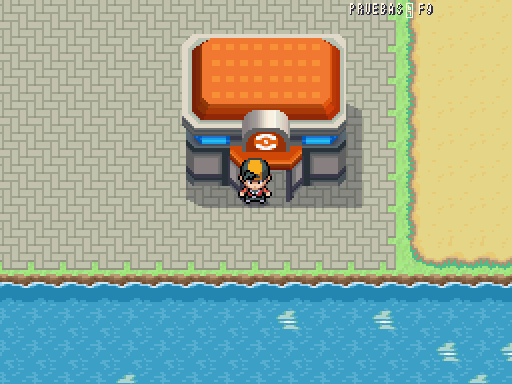
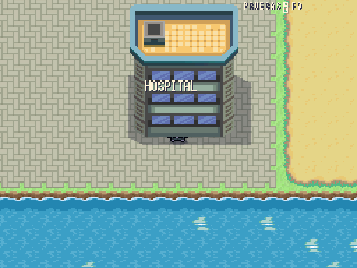
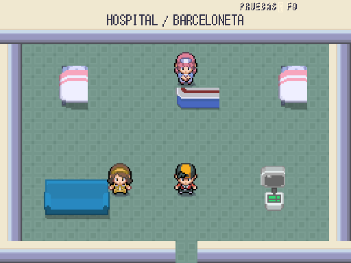

# Servicios de Barceloneta · 2026-10-12

| Fachada anterior | Entrada conectada |
|---|---|
|  |  |

Capturas reales a 512×384 en el mismo emplazamiento. Edificios ya colocados: se añaden puertas y llegadas al barrio correcto; el sanitario se sustituye por fachada urbana con rótulo Hospital donde corresponde. Calle, transportes, vecinos y entrenadores conservados.

| Interior | Servicio |
|---|---|
|  | Curación, PC y punto de recuperación |

Tiles y personajes originales de los packs, sin dibujo procedural ni reescalado. Misma plantilla de servicios publicada, con nombre y destino propios; no se presenta como hospital real ni se atribuye a arquitectura aprobada. Referencia de escala: [pueblo de Añil](../referencias/anil_pueblo.png); el repositorio no contiene referencia específica de interiores. **PROVISIONAL, pendiente Javier**.

Validación conjunta: 61 parejas de puertas por `Player._after_step`, barrio de retorno y ausencia de reentrada; curación, PC y compras. **7/7 tests, 630 aserciones, 113,81 s**. Todos los interiores son alcanzables; Palma/Ibiza requieren Surf para su salida marítima.
