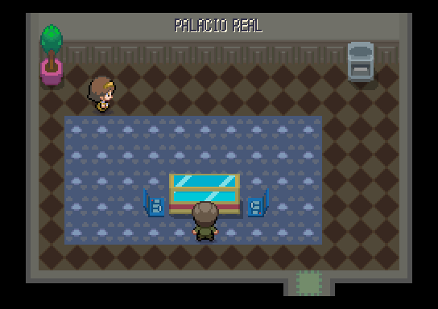
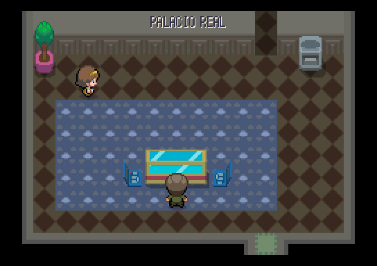
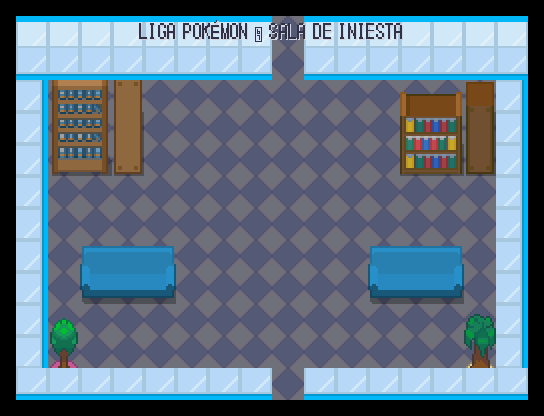
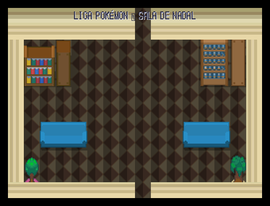
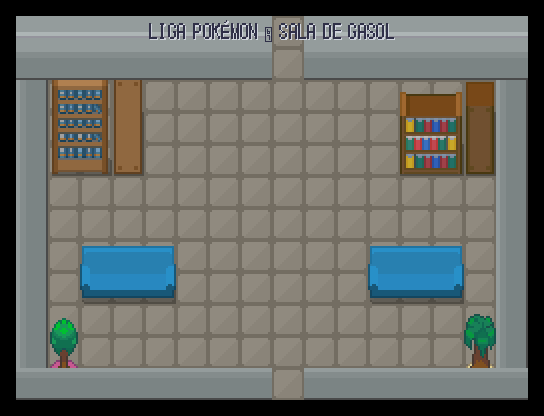
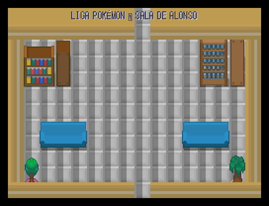
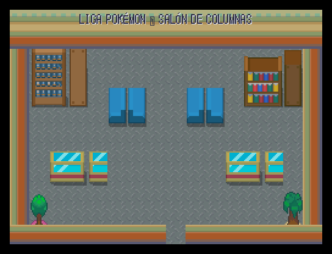

# Cierre del 15 de octubre: Palacio y Liga

Se recuperan las cinco salas ya pintadas en `3630bac6` y se resuelve la petición 89. La escalera del Palacio tiene un paso al fondo a la primera sala y una aparición de regreso junto a él. Un ujier ocupa el paso con menos de ocho medallas y desaparece al tener las ocho. Cada ujier del Alto Mando deja avanzar al ganar su combate; al vencer al Líder Supremo se activa `liga_superada`.

Las capturas siguientes muestran la decoración de las escenas, sin las colocaciones dinámicas por datos. Los miembros, ujieres y control de medallas se comprueban en `tests/mundo/test_personajes_colocados.gd`. Arte provisional pendiente de Javier.

| Sala | Antes | Después |
|---|---|---|
| Escalera del Palacio |  |  |
| Iniesta | Sala recuperada de la rama sin integrar |  |
| Nadal | Sala recuperada de la rama sin integrar |  |
| Gasol | Sala recuperada de la rama sin integrar |  |
| Alonso | Sala recuperada de la rama sin integrar |  |
| Líder Supremo | Sala recuperada de la rama sin integrar |  |

## Rutas recuperadas

Las comparativas de las rutas 5–8 y 16 están en [seguimiento](../seguimiento.md#ciudades-y-rutas-al-nivel-de-añil-agente-5-2026-10-15). La [auditoría física del cierre](cierre_2026-10-15/rutas_auditadas.json) confirma el paso obligado por 2, 4, 3, 2 y 3 casillas de encuentros respectivamente, en ambos sentidos. No se repintaron exteriores ni se cambiaron sus puertas.
