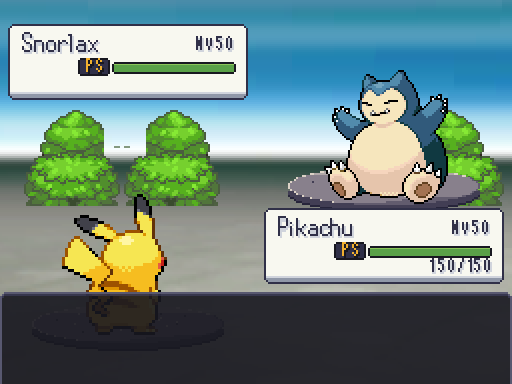
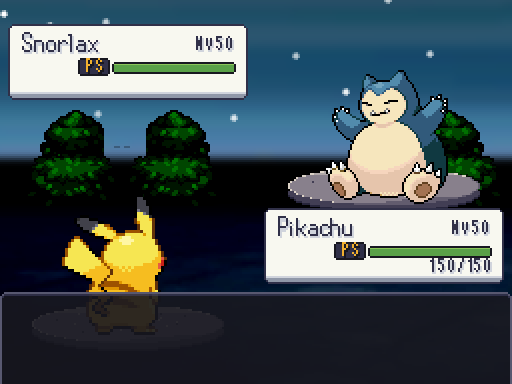

# Árboles del fondo de ciudad · 25 de octubre de 2026

Javier señala los árboles cortados en la captura de Pikachu contra Snorlax. Se recompone `frente_ciudad` y se integra en el ambiente de ciudad existente; no se cambia el motor, la interfaz ni el resto de ambientes.

## Causa y corrección

La imagen de fondo mide 384×308 y se ve a ×2, desplazada (-128,-40). El encuadre de 512×384 solo enseña las columnas nativas 64–319. La composición anterior colocaba árboles que empezaban antes de la columna 64 o terminaban después de la 319. Además, varias copas quedaban detrás de la caja superior, dando un corte horizontal.

Se han colocado **tres grupos completos de árboles y arbustos** dentro del encuadre y debajo de la caja superior. Se conservan los píxeles del pack, el fondo de ciudad, las bases y los tintes. La superposición natural del Pokémon rival delante del paisaje se mantiene. La comprobación del follaje corresponde a la composición normal de la captura que señaló Javier.

El constructor admite ahora `--solo=frente_ciudad` para regenerar ese frente sin recomponer los otros fondos a partir de fachadas que han cambiado. [Registro de SHA-256](regeneracion.json): solo cambia `frente_ciudad.png`; el pack de árboles permanece idéntico. El capturador `--solo=ciudad` actualiza tanto día como noche.

| Vista | Antes | Después |
|---|---|---|
| Combate de día, 512×384 | [Captura](dia_antes.png) | [Captura](dia_despues.png) |
| Combate de noche, 512×384 | [Captura](noche_antes.png) | [Captura](noche_despues.png) |
| Frente transparente completo | [PNG](frente_antes.png) | [PNG](frente_despues.png) |

## Comprobaciones

**12/12 pruebas de fondos, 2.078 aserciones.** La nueva prueba instancia la pantalla real, toma la transformación del fondo y los rectángulos efectivos de las cajas, y comprueba que el follaje del PNG no queda fuera del encuadre ni debajo de las cajas de datos. También comprueba que la imagen anterior sí reproduce los dos recortes y que la corrección conserva follaje visible. No depende de repetir las coordenadas de la receta en el test.

Suite completa: **772/772, 92191 aserciones, 627.637 s**. Arte: **11.606 PNG, 0 errores y 0 avisos**. Datos: **0 errores y 0 avisos**. Grafo: **994 mapas, todos alcanzables y con vuelta**. Fuentes y capturas sin cambios durante la suite. Arte provisional hasta la revisión de Javier. La mejora general de interfaz y la variante de terraza de Madrid siguen en la [guía World Frontier](../../guia_world_frontier_2026-10-25.md).
