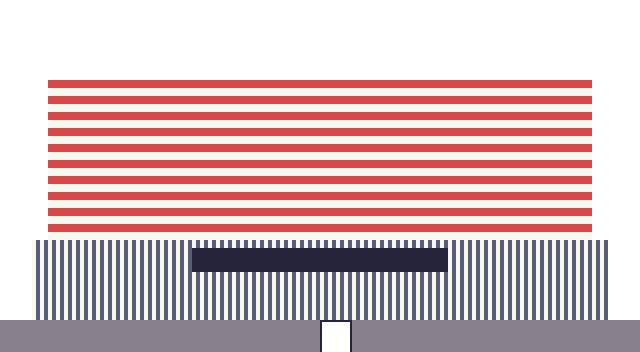
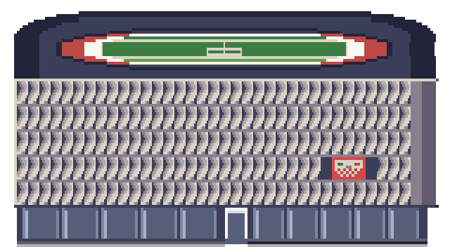
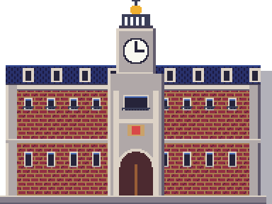
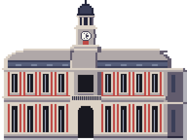
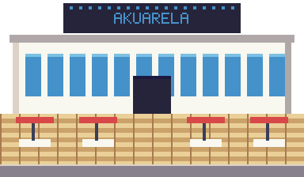
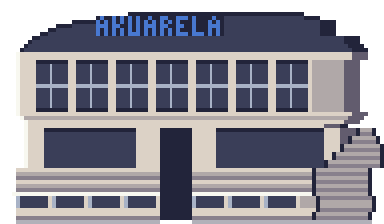
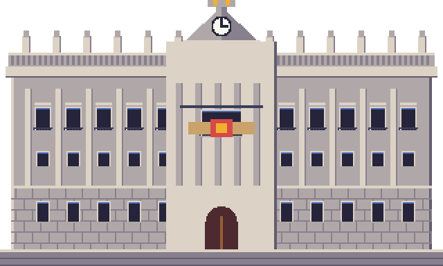
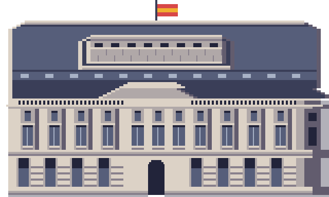
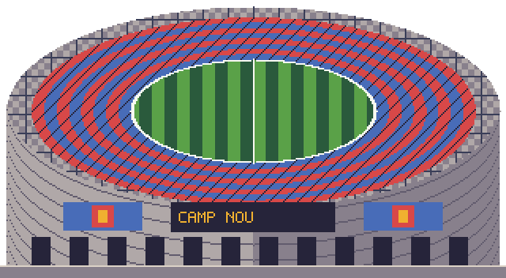
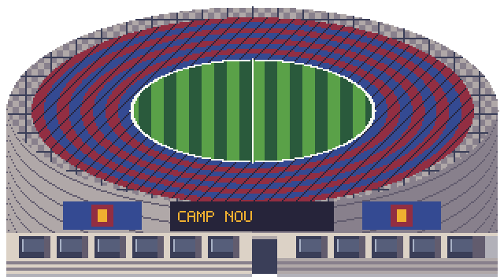

# Edificios reales · comparativas y seguimiento individual

Encargo de Javier iniciado el 19 de octubre de 2026. La revisión del catálogo encuentra **137 fuentes propias**, además de las tres piezas de packs señaladas como recortadas. No todas las fuentes propias son edificios: también hay árboles, rocas, estatuas y vehículos. El inventario conserva las 140 entradas y explica su estado individual. El catálogo inicial sigue conservado; con el teatro original, la nave del rodaje y los 30 módulos urbanos hay 169 fuentes propias registradas. Ninguna revisión o captura equivale a aprobación artística.

## Bloque 1 · piezas recortadas (20 de octubre)

Son recursos originales de packs, sin una fuente `.px2` propia. Se conserva su dibujo y se mueve el conjunto de ancla, puerta y aparición de regreso. No se cambia la identidad de ningún interior ni su salida. `mover_ancla.gd` admite ahora `--desde=x,y` para seleccionar la casa correcta cuando la misma pieza aparece varias veces.

| Pieza | Mapa | Ancla anterior → nueva | Puerta anterior → nueva | Pieza sola, antes / después | Mapa, antes / después |
|---|---|---|---|---|---|
| Casa de madera (casa completa azul del pack DPPt) | Ruta 2 | (32,62) → (31,62) | (33,61) → (32,61) | [antes](edificios_reales/piezas_antes/casa_madera.png), [después](edificios_reales/piezas_despues/casa_madera.png) | [antes](edificios_reales/ruta_2_exterior_antes.png), [después](edificios_reales/ruta_2_exterior_despues.png) |
| Casa de tejado rojo | Bilbao | (68,49) → (67,49) | (69,48) → (68,48) | [antes](edificios_reales/piezas_antes/casa_tejado_rojo.png), [después](edificios_reales/piezas_despues/casa_tejado_rojo.png) | [antes](edificios_reales/bilbao_exterior_antes.png), [después](edificios_reales/bilbao_exterior_despues.png) |
| Faro del pack HGSS | Ruta 19 | (30,9) → (30,12) | (33,8) → (33,11) | [antes](edificios_reales/piezas_antes/faro.png), [después](edificios_reales/piezas_despues/faro.png) | [antes](edificios_reales/ruta_19_exterior_antes.png), [después](edificios_reales/ruta_19_exterior_despues.png) |

**Fallo detectado y corregido:** bajar el faro dos casillas dejaba la puerta en el bordillo de la fila 10. Se baja una tercera casilla; puerta y retorno quedan debajo del bordillo y se llega desde el camino. Alcance final: **0 problemas** en los tres mapas. Las herramientas de captura y alcance avisan de recursos retenidos al terminar (148 recursos en esta pasada), aunque devuelven salida 0 cuando el recorrido es correcto; no se oculta este aviso.

Pruebas dirigidas: **3/3, 735 aserciones**. Suite completa del bloque: **614/614, 75.814 aserciones, 736,627 s**; arte **0 errores/0 avisos**, datos **0 errores/2 avisos anteriores**; grafo **952 mapas, todos alcanzables y con vuelta**. Comprobación del contrato de las 140 piezas, tres accesos con su interior y retorno libre, y la otra casa de Ruta 2 intacta. Se actualizan únicamente las posiciones de la puerta y retorno de Ruta 2 en el inventario antiguo del tejido urbano; Bilbao y Ruta 19 no estaban en ese inventario. No se repintan exteriores.

## Contrato y capturas iniciales

[Contrato inicial](edificios_reales/contrato_inicial.json): fuentes, tamaños en casillas, puerta y huella de colisión. Su prueba impedirá que un redibujo rompa mapas enlazados. [Colocaciones antes](edificios_reales/colocaciones_antes.json) y [después](edificios_reales/colocaciones_despues.json). Cada fuente tiene una captura nativa individual previa. Las capturas completas de mapa conservan la escala original, sin reescalado ni filtros.

## Fuentes arquitectónicas consultadas para el siguiente bloque

- Ayuntamiento de Valladolid: [fotografías oficiales](https://www.valladolid.es/es/servicios/galeria-multimedia/galeria-fotografica/monumentos/casa-consistorial), [descripción municipal](https://info.valladolid.es/disfruta/patrimonio/monumentos/casa-consistorial). El dibujo actual reutiliza el de Correos; faltan las torres de esquina, los tres arcos del pórtico y el balcón.
- Casa de Correos: [Turismo de Madrid](https://www.esmadrid.com/informacion-turistica/real-casa-correos).
- San Mamés: [arquitectura y visita del estadio](https://sanmames.athletic-club.eus/san-mames/), [prototipo de fachada](https://www.athletic-club.eus/noticias/2011/11/12/instalacion-del-prototipo-de-fachada-de-smb/).
- Camp Nou: [instalaciones oficiales](https://www.fcbarcelona.es/es/club/instalaciones), [dossier con planos y secciones](https://www.fcbarcelona.com/fcbarcelona/document/2021/11/04/7c46b292-2dbc-4172-b03d-86f307308c48/DOSSIER_ESPAI_B_CAS-1-.pdf). El encargo del juego lo sitúa en obras; no se da una reconstrucción futura como edificio acabado.
- Palacio Real: [Patrimonio Nacional](https://www.patrimonionacional.es/visita/palacio-real-de-madrid), [plano de visita](https://www.patrimonionacional.es/sites/default/files/documents/palacio_real_visita_autoguiada__0.pdf).
- Akuarela: [dossier de su propietario con fotografías de salas y terraza](https://eventosgruposalamandra.com/es/salas/akuarela/).

Las fotografías solo se enlazan; no se copian al repositorio. Las referencias del 13 y 14 de octubre son de personajes; para arquitectura y composición se usan Añil y las ciudades aportadas el 15.

## Inventario individual de fuentes propias

Esta tabla registra el recorrido técnico completo del catálogo, sus usos y la captura previa. **El redibujo artístico está pendiente donde se indica**, y se hará pieza a pieza; el bloque 1 solo resuelve las tres colocaciones recortadas. Se empieza por los gimnasios y la Liga. Los objetos no arquitectónicos quedan separados por su motivo.

| Pieza | Casillas; puerta | Mapas donde se usa | Estado y motivo | Antes |
|---|---|---|---|---|
| `iglesia_san_miguel` | [5, 6]; [3, 0] | `pueblo_inicial/exterior`, `ruta_23/exterior` | Revisada en catálogo; pendiente de redibujo con su referencia real y comparativa | [pieza](edificios_reales/piezas_antes/iglesia_san_miguel.png) |
| `ermita_virgen_del_rio` | [3, 4]; [1, 0] | `getafe/exterior`, `mostoles/exterior`, `pueblo_inicial/exterior`, `puertollano/exterior`, `ruta_20/exterior` | Revisada en catálogo; pendiente de redibujo con su referencia real y comparativa | [pieza](edificios_reales/piezas_antes/ermita_virgen_del_rio.png) |
| `acueducto_segovia` | [14, 7]; [-1, -1] | `ruta_2/exterior` | Revisada en catálogo; pendiente de redibujo con su referencia real y comparativa | [pieza](edificios_reales/piezas_antes/acueducto_segovia.png) |
| `acueducto_segovia_tramo` | [14, 7]; [-1, -1] | `ruta_2/exterior` | Revisada en catálogo; pendiente de redibujo con su referencia real y comparativa | [pieza](edificios_reales/piezas_antes/acueducto_segovia_tramo.png) |
| `cruz_cuelgamuros` | [4, 10]; [-1, -1] | `ruta_3/exterior` | Revisada en catálogo; pendiente de redibujo con su referencia real y comparativa | [pieza](edificios_reales/piezas_antes/cruz_cuelgamuros.png) |
| `basilica_cuelgamuros` | [10, 5]; [4, 0] | `ruta_3/exterior` | Revisada en catálogo; pendiente de redibujo con su referencia real y comparativa | [pieza](edificios_reales/piezas_antes/basilica_cuelgamuros.png) |
| `monasterio_escorial` | [16, 8]; [7, 0] | `ruta_4/exterior` | Revisada en catálogo; pendiente de redibujo con su referencia real y comparativa | [pieza](edificios_reales/piezas_antes/monasterio_escorial.png) |
| `arco_victoria` | [8, 8]; [-1, -1] | `madrid/moncloa` | Revisada en catálogo; pendiente de redibujo con su referencia real y comparativa | [pieza](edificios_reales/piezas_antes/arco_victoria.png) |
| `templo_debod` | [6, 4]; [2, 0] | `madrid/moncloa` | Redibujado el 21 de octubre, provisional: gola estriada, disco solar alado, cuatro columnas, pronaos y escalinata; fuente 28, puerta y huella conservadas | [pieza](edificios_reales/piezas_antes/templo_debod.png) |
| `puerta_debod` | [3, 4]; [-1, -1] | `madrid/moncloa` | Redibujado el 21 de octubre, provisional: cornisa y disco a juego con el templo, jambas con relieves; silueta de opacos idéntica | [pieza](edificios_reales/piezas_antes/puerta_debod.png) |
| `faro_moncloa` | [3, 12]; [-1, -1] | `madrid/moncloa` | Revisada en catálogo; pendiente de redibujo con su referencia real y comparativa | [pieza](edificios_reales/piezas_antes/faro_moncloa.png) |
| `casa_correos` | [12, 9]; [5, 0] | `madrid/centro` | Redibujado, provisional; referencias reales, tamaño, puerta y huella conservados | [pieza](edificios_reales/piezas_antes/casa_correos.png) |
| `oso_madrono` | [2, 3]; [-1, -1] | `madrid/centro` | Monumento pendiente de redibujo, después de las fachadas prioritarias | [pieza](edificios_reales/piezas_antes/oso_madrono.png) |
| `soportales` | [4, 6]; [-1, -1] | `barcelona/ciutat_vella`, `bilbao/exterior`, `getafe/exterior`, `leganes/exterior`, `madrid/centro`, `malaga/exterior`, `palma/exterior`, `pamplona/exterior`, `ruta_5/exterior`, `santander/exterior`, `valencia/ciutat_vella`, `valladolid/exterior` | Revisada en catálogo; pendiente de redibujo con su referencia real y comparativa | [pieza](edificios_reales/piezas_antes/soportales.png) |
| `soportales_arco` | [4, 6]; [-1, -1] | `bilbao/exterior`, `madrid/centro`, `valladolid/exterior` | Revisada en catálogo; pendiente de redibujo con su referencia real y comparativa | [pieza](edificios_reales/piezas_antes/soportales_arco.png) |
| `casa_panaderia` | [12, 7]; [6, 0] | `madrid/centro` | Revisada en catálogo; pendiente de redibujo con su referencia real y comparativa | [pieza](edificios_reales/piezas_antes/casa_panaderia.png) |
| `mercado_san_miguel` | [8, 5]; [3, 0] | `madrid/centro`, `santander/exterior` | Revisada en catálogo; pendiente de redibujo con su referencia real y comparativa | [pieza](edificios_reales/piezas_antes/mercado_san_miguel.png) |
| `edificio_metropolis` | [6, 11]; [2, 0] | `madrid/centro` | Revisada en catálogo; pendiente de redibujo con su referencia real y comparativa | [pieza](edificios_reales/piezas_antes/edificio_metropolis.png) |
| `edificio_carrion` | [7, 12]; [3, 0] | `madrid/centro` | Revisada en catálogo; pendiente de redibujo con su referencia real y comparativa | [pieza](edificios_reales/piezas_antes/edificio_carrion.png) |
| `palacio_real` | [20, 12]; [9, 0] | `madrid/palacio_real` | Redibujado, provisional; referencias reales, tamaño, puerta y huella conservados | [pieza](edificios_reales/piezas_antes/palacio_real.png) |
| `catedral_almudena` | [10, 10]; [4, 0] | `madrid/palacio_real` | Revisada en catálogo; pendiente de redibujo con su referencia real y comparativa | [pieza](edificios_reales/piezas_antes/catedral_almudena.png) |
| `teatro_real` | [8, 7]; [3, 0] | `bilbao/exterior`, `madrid/palacio_real`, `santander/exterior`, `sevilla/rio` | Revisada en catálogo; pendiente de redibujo con su referencia real y comparativa | [pieza](edificios_reales/piezas_antes/teatro_real.png) |
| `felipe_iv` | [3, 6]; [-1, -1] | `madrid/palacio_real`, `pamplona/exterior` | Monumento pendiente de redibujo, después de las fachadas prioritarias | [pieza](edificios_reales/piezas_antes/felipe_iv.png) |
| `estatua_rey` | [1, 3]; [-1, -1] | `madrid/palacio_real` | Monumento pendiente de redibujo, después de las fachadas prioritarias | [pieza](edificios_reales/piezas_antes/estatua_rey.png) |
| `verja` | [1, 2]; [-1, -1] | `madrid/atico_ayuso`, `madrid/palacio_real`, `soto_del_real/exterior` | Revisada en catálogo; objeto no arquitectónico (sin fachada de edificio) | [pieza](edificios_reales/piezas_antes/verja.png) |
| `cibeles` | [4, 4]; [-1, -1] | `madrid/retiro` | Monumento pendiente de redibujo, después de las fachadas prioritarias | [pieza](edificios_reales/piezas_antes/cibeles.png) |
| `palacio_cibeles` | [10, 11]; [4, 0] | `madrid/retiro` | Revisada en catálogo; pendiente de redibujo con su referencia real y comparativa | [pieza](edificios_reales/piezas_antes/palacio_cibeles.png) |
| `puerta_alcala` | [8, 6]; [-1, -1] | `madrid/retiro` | Revisada en catálogo; pendiente de redibujo con su referencia real y comparativa | [pieza](edificios_reales/piezas_antes/puerta_alcala.png) |
| `congreso` | [10, 6]; [4, 0] | `madrid/retiro` | Redibujado el 21 de octubre, provisional: pórtico corintio, frontón con relieve, alas con ventanas, puerta de bronce y escalinata; huella fijada en piezas.json | [pieza](edificios_reales/piezas_antes/congreso.png) |
| `leon_congreso` | [2, 2]; [-1, -1] | `madrid/retiro`, `zaragoza/exterior` | Redibujado el 21 de octubre, provisional: león de bronce tumbado sobre pedestal con moldura; huella fijada en piezas.json | [pieza](edificios_reales/piezas_antes/leon_congreso.png) |
| `museo_prado` | [12, 6]; [5, 0] | `madrid/retiro` | Revisada en catálogo; pendiente de redibujo con su referencia real y comparativa | [pieza](edificios_reales/piezas_antes/museo_prado.png) |
| `fuente_neptuno` | [3, 3]; [-1, -1] | `madrid/retiro` | Monumento pendiente de redibujo, después de las fachadas prioritarias | [pieza](edificios_reales/piezas_antes/fuente_neptuno.png) |
| `estacion_atocha` | [14, 8]; [6, 0] | `madrid/retiro` | Revisada en catálogo; pendiente de redibujo con su referencia real y comparativa | [pieza](edificios_reales/piezas_antes/estacion_atocha.png) |
| `monumento_alfonso_xii` | [12, 7]; [-1, -1] | `madrid/retiro` | Revisada en catálogo; pendiente de redibujo con su referencia real y comparativa | [pieza](edificios_reales/piezas_antes/monumento_alfonso_xii.png) |
| `palacio_cristal` | [8, 7]; [3, 0] | `madrid/retiro` | Revisada en catálogo; pendiente de redibujo con su referencia real y comparativa | [pieza](edificios_reales/piezas_antes/palacio_cristal.png) |
| `boca_metro` | [2, 3]; [1, 0] | `madrid/centro`, `madrid/chamberi`, `madrid/palacio_real` | Revisada en catálogo; pendiente de redibujo con su referencia real y comparativa | [pieza](edificios_reales/piezas_antes/boca_metro.png) |
| `nave_logistica` | [10, 5]; [-1, -1] | `madrid_rio/exterior`, `puertollano/exterior`, `ruta_11/exterior`, `ruta_17/exterior`, `ruta_5/exterior`, `soto_del_real/exterior` | Revisada en catálogo; pendiente de redibujo con su referencia real y comparativa | [pieza](edificios_reales/piezas_antes/nave_logistica.png) |
| `universidad_alcala` | [12, 8]; [5, 0] | `ruta_5/exterior` | Revisada en catálogo; pendiente de redibujo con su referencia real y comparativa | [pieza](edificios_reales/piezas_antes/universidad_alcala.png) |
| `palacio_infantado` | [10, 7]; [4, 0] | `huelva/exterior`, `pamplona/exterior`, `ruta_5/exterior` | Revisada en catálogo; pendiente de redibujo con su referencia real y comparativa | [pieza](edificios_reales/piezas_antes/palacio_infantado.png) |
| `arco_medinaceli` | [6, 5]; [-1, -1] | `ruta_6/exterior` | Revisada en catálogo; pendiente de redibujo con su referencia real y comparativa | [pieza](edificios_reales/piezas_antes/arco_medinaceli.png) |
| `torre_mudejar` | [3, 10]; [-1, -1] | `ruta_6/exterior` | Revisada en catálogo; pendiente de redibujo con su referencia real y comparativa | [pieza](edificios_reales/piezas_antes/torre_mudejar.png) |
| `basilica_pilar` | [18, 11]; [8, 0] | `zaragoza/exterior` | Revisada en catálogo; pendiente de redibujo con su referencia real y comparativa | [pieza](edificios_reales/piezas_antes/basilica_pilar.png) |
| `la_seo` | [10, 9]; [6, 0] | `zaragoza/exterior` | Revisada en catálogo; pendiente de redibujo con su referencia real y comparativa | [pieza](edificios_reales/piezas_antes/la_seo.png) |
| `puente_piedra` | [4, 8]; [-1, -1] | Sin uso en mapas | Revisada en catálogo; sin colocación actual, pendiente de su revisión artística individual | [pieza](edificios_reales/piezas_antes/puente_piedra.png) |
| `escenario_festival` | [10, 6]; [-1, -1] | `playa_del_ingles/exterior`, `ruta_7/exterior` | Cubierta, equipo y tarima revisados el 21 de octubre; fuente 64 y acceso conservados; provisional | [pieza](edificios_reales/piezas_antes/escenario_festival.png) |
| `agujas_montserrat` | [12, 8]; [-1, -1] | `ruta_8/exterior` | Revisada en catálogo; objeto no arquitectónico (sin fachada de edificio) | [pieza](edificios_reales/piezas_antes/agujas_montserrat.png) |
| `monasterio_montserrat` | [10, 7]; [4, 0] | `ruta_8/exterior` | Revisada en catálogo; pendiente de redibujo con su referencia real y comparativa | [pieza](edificios_reales/piezas_antes/monasterio_montserrat.png) |
| `camp_nou` | [20, 11]; [10, 0] | `barcelona/les_corts` | Graderío, campo, cubierta parcial y acceso redibujados; contrato conservado; provisional | [pieza](edificios_reales/piezas_antes/camp_nou.png) |
| `grua` | [6, 13]; [-1, -1] | `barcelona/eixample`, `barcelona/les_corts`, `ruta_10/exterior` | Revisada en catálogo; objeto no arquitectónico (sin fachada de edificio) | [pieza](edificios_reales/piezas_antes/grua.png) |
| `sagrada_familia` | [12, 16]; [5, 0] | `barcelona/eixample` | Torres, remates y portadas redibujados a escala; relieve simplificado; contrato conservado; provisional | [pieza](edificios_reales/piezas_antes/sagrada_familia.png) |
| `casa_batllo` | [5, 9]; [2, 0] | `barcelona/eixample` | Revisada en catálogo; pendiente de redibujo con su referencia real y comparativa | [pieza](edificios_reales/piezas_antes/casa_batllo.png) |
| `la_pedrera` | [8, 8]; [3, 0] | `barcelona/eixample` | Revisada en catálogo; pendiente de redibujo con su referencia real y comparativa | [pieza](edificios_reales/piezas_antes/la_pedrera.png) |
| `monumento_colon` | [3, 12]; [-1, -1] | `barcelona/ciutat_vella` | Revisada en catálogo; pendiente de redibujo con su referencia real y comparativa | [pieza](edificios_reales/piezas_antes/monumento_colon.png) |
| `boqueria` | [8, 6]; [3, 0] | `barcelona/ciutat_vella` | Revisada en catálogo; pendiente de redibujo con su referencia real y comparativa | [pieza](edificios_reales/piezas_antes/boqueria.png) |
| `catedral_barcelona` | [10, 11]; [4, 0] | `barcelona/ciutat_vella` | Revisada en catálogo; pendiente de redibujo con su referencia real y comparativa | [pieza](edificios_reales/piezas_antes/catedral_barcelona.png) |
| `ferry` | [16, 7]; [-1, -1] | `barcelona/ciutat_vella`, `huelva/exterior`, `ibiza/exterior`, `las_palmas/canteras`, `palma/exterior`, `valencia/malvarrosa` | Revisada en catálogo; objeto no arquitectónico (sin fachada de edificio) | [pieza](edificios_reales/piezas_antes/ferry.png) |
| `catedral_palma` | [14, 10]; [6, 0] | `palma/exterior` | Revisada en catálogo; pendiente de redibujo con su referencia real y comparativa | [pieza](edificios_reales/piezas_antes/catedral_palma.png) |
| `castillo_bellver` | [8, 7]; [3, 0] | `palma/exterior` | Revisada en catálogo; pendiente de redibujo con su referencia real y comparativa | [pieza](edificios_reales/piezas_antes/castillo_bellver.png) |
| `es_vedra` | [8, 8]; [-1, -1] | `maritima_1/exterior` | Revisada en catálogo; objeto no arquitectónico (sin fachada de edificio) | [pieza](edificios_reales/piezas_antes/es_vedra.png) |
| `muralla_dalt_vila` | [8, 5]; [-1, -1] | `ibiza/exterior`, `malaga/exterior` | Revisada en catálogo; pendiente de redibujo con su referencia real y comparativa | [pieza](edificios_reales/piezas_antes/muralla_dalt_vila.png) |
| `catedral_ibiza` | [6, 7]; [3, 0] | `huelva/exterior`, `ibiza/exterior` | Revisada en catálogo; pendiente de redibujo con su referencia real y comparativa | [pieza](edificios_reales/piezas_antes/catedral_ibiza.png) |
| `casa_ibicenca` | [4, 4]; [1, 0] | `alicante/exterior`, `ibiza/exterior`, `ruta_10/exterior`, `ruta_14/exterior`, `ruta_15/exterior`, `sevilla/centro`, `sevilla/rio` | Revisada en catálogo; pendiente de redibujo con su referencia real y comparativa | [pieza](edificios_reales/piezas_antes/casa_ibicenca.png) |
| `club_ibiza` | [9, 6]; [4, 0] | `ibiza/exterior` | Revisada en catálogo; pendiente de redibujo con su referencia real y comparativa | [pieza](edificios_reales/piezas_antes/club_ibiza.png) |
| `palmera` | [3, 6]; [-1, -1] | `alicante/exterior`, `huelva/exterior`, `ibiza/exterior`, `las_palmas/canteras`, `las_palmas/vegueta_triana`, `malaga/exterior`, `murcia/exterior`, `playa_del_ingles/exterior`, `rocafonda/exterior`, `ruta_10/exterior`, `ruta_11/exterior`, `ruta_15/exterior`, `ruta_9/exterior`, `sevilla/centro`, `sevilla/maria_luisa`, `sevilla/rio`, `valencia/ciutat_vella`, `valencia/malvarrosa`, `valencia/turia` | Revisada en catálogo; objeto no arquitectónico (sin fachada de edificio) | [pieza](edificios_reales/piezas_antes/palmera.png) |
| `akuarela` | [12, 7]; [5, 0] | `valencia/malvarrosa` | Redibujado, provisional; referencias reales, tamaño, puerta y huella conservados | [pieza](edificios_reales/piezas_antes/akuarela.png) |
| `cepa_rioja` | [1, 2]; [-1, -1] | `ruta_16/exterior`, `ruta_21/exterior`, `ruta_8/exterior` | Revisada en catálogo; objeto no arquitectónico (sin fachada de edificio) | [pieza](edificios_reales/piezas_antes/cepa_rioja.png) |
| `catedral_burgos` | [5, 4]; [2, 0] | `bilbao/exterior`, `pamplona/exterior`, `ruta_17/exterior`, `ruta_22/exterior` | Revisada en catálogo; pendiente de redibujo con su referencia real y comparativa | [pieza](edificios_reales/piezas_antes/catedral_burgos.png) |
| `arbol_navidad_vigo` | [2, 3]; [-1, -1] | `vigo/exterior` | Revisada en catálogo; objeto no arquitectónico (sin fachada de edificio) | [pieza](edificios_reales/piezas_antes/arbol_navidad_vigo.png) |
| `sireno_vigo` | [1, 2]; [-1, -1] | `vigo/exterior` | Monumento pendiente de redibujo, después de las fachadas prioritarias | [pieza](edificios_reales/piezas_antes/sireno_vigo.png) |
| `cupula_milenio` | [2, 2]; [-1, -1] | `valladolid/exterior` | Revisada en catálogo; pendiente de redibujo con su referencia real y comparativa | [pieza](edificios_reales/piezas_antes/cupula_milenio.png) |
| `ayuntamiento_valladolid` | [12, 9]; [5, 0] | `valladolid/exterior` | Redibujado, provisional; referencia municipal, puerta y huella conservadas | [pieza](edificios_reales/piezas_antes/ayuntamiento_valladolid.png) |
| `san_pablo_valladolid` | [10, 8]; [5, 0] | `valladolid/exterior` | Revisada en catálogo; pendiente de redibujo con su referencia real y comparativa | [pieza](edificios_reales/piezas_antes/san_pablo_valladolid.png) |
| `catedral_valladolid` | [10, 9]; [6, 0] | `valladolid/exterior` | Revisada en catálogo; pendiente de redibujo con su referencia real y comparativa | [pieza](edificios_reales/piezas_antes/catedral_valladolid.png) |
| `conde_ansurez` | [2, 4]; [-1, -1] | `valladolid/exterior` | Monumento pendiente de redibujo, después de las fachadas prioritarias | [pieza](edificios_reales/piezas_antes/conde_ansurez.png) |
| `castillo_cuellar` | [5, 4]; [2, 0] | `ruta_23/exterior` | Revisada en catálogo; pendiente de redibujo con su referencia real y comparativa | [pieza](edificios_reales/piezas_antes/castillo_cuellar.png) |
| `sagrado_corazon_getafe` | [4, 4]; [-1, -1] | `getafe/exterior` | Monumento pendiente de redibujo, después de las fachadas prioritarias | [pieza](edificios_reales/piezas_antes/sagrado_corazon_getafe.png) |
| `magdalena_getafe` | [5, 6]; [3, 0] | `getafe/exterior` | Revisada en catálogo; pendiente de redibujo con su referencia real y comparativa | [pieza](edificios_reales/piezas_antes/magdalena_getafe.png) |
| `alhambra` | [8, 4]; [-1, -1] | `ruta_12/exterior` | Revisada en catálogo; pendiente de redibujo con su referencia real y comparativa | [pieza](edificios_reales/piezas_antes/alhambra.png) |
| `olivo` | [2, 2]; [-1, -1] | `ruta_13/exterior` | Revisada en catálogo; objeto no arquitectónico (sin fachada de edificio) | [pieza](edificios_reales/piezas_antes/olivo.png) |
| `mezquita` | [8, 5]; [-1, -1] | `ruta_13/exterior` | Revisada en catálogo; pendiente de redibujo con su referencia real y comparativa | [pieza](edificios_reales/piezas_antes/mezquita.png) |
| `giralda` | [4, 9]; [-1, -1] | `sevilla/centro` | Redibujado, provisional; tamaño, puerta y huella conservados | [pieza](edificios_reales/piezas_antes/giralda.png) |
| `catedral_sevilla` | [8, 6]; [3, 0] | `sevilla/centro` | Revisada en catálogo; pendiente de redibujo con su referencia real y comparativa | [pieza](edificios_reales/piezas_antes/catedral_sevilla.png) |
| `setas` | [8, 4]; [-1, -1] | `sevilla/centro` | Revisada en catálogo; pendiente de redibujo con su referencia real y comparativa | [pieza](edificios_reales/piezas_antes/setas.png) |
| `plaza_espana` | [12, 5]; [-1, -1] | `sevilla/maria_luisa` | Revisada en catálogo; pendiente de redibujo con su referencia real y comparativa | [pieza](edificios_reales/piezas_antes/plaza_espana.png) |
| `puerta_leon` | [6, 4]; [3, 0] | `sevilla/centro` | Revisada en catálogo; pendiente de redibujo con su referencia real y comparativa | [pieza](edificios_reales/piezas_antes/puerta_leon.png) |
| `puente_triana` | [12, 3]; [-1, -1] | Sin uso en mapas | Revisada en catálogo; sin colocación actual, pendiente de su revisión artística individual | [pieza](edificios_reales/piezas_antes/puente_triana.png) |
| `maestranza` | [8, 4]; [4, 0] | `pamplona/exterior`, `sevilla/rio` | Revisada en catálogo; pendiente de redibujo con su referencia real y comparativa | [pieza](edificios_reales/piezas_antes/maestranza.png) |
| `fe_descubridora` | [3, 7]; [-1, -1] | `huelva/exterior` | Monumento pendiente de redibujo, después de las fachadas prioritarias | [pieza](edificios_reales/piezas_antes/fe_descubridora.png) |
| `muelle_tinto` | [4, 10]; [-1, -1] | Sin uso en mapas | Revisada en catálogo; sin colocación actual, pendiente de su revisión artística individual | [pieza](edificios_reales/piezas_antes/muelle_tinto.png) |
| `catedral_santa_ana` | [6, 6]; [3, 0] | `las_palmas/vegueta_triana`, `santander/exterior` | Revisada en catálogo; pendiente de redibujo con su referencia real y comparativa | [pieza](edificios_reales/piezas_antes/catedral_santa_ana.png) |
| `castillo_luz` | [5, 4]; [2, 0] | `las_palmas/canteras`, `malaga/exterior` | Revisada en catálogo; pendiente de redibujo con su referencia real y comparativa | [pieza](edificios_reales/piezas_antes/castillo_luz.png) |
| `terminal_aeropuerto` | [10, 5]; [-1, -1] | `playa_del_ingles/exterior` | Revisada en catálogo; pendiente de redibujo con su referencia real y comparativa | [pieza](edificios_reales/piezas_antes/terminal_aeropuerto.png) |
| `mostrador_vuelos` | [3, 2]; [-1, -1] | `playa_del_ingles/exterior` | Revisada en catálogo; objeto no arquitectónico (sin fachada de edificio) | [pieza](edificios_reales/piezas_antes/mostrador_vuelos.png) |
| `san_salvador_leganes` | [5, 6]; [3, 0] | `leganes/exterior` | Revisada en catálogo; pendiente de redibujo con su referencia real y comparativa | [pieza](edificios_reales/piezas_antes/san_salvador_leganes.png) |
| `escultura_leganes` | [2, 2]; [-1, -1] | `leganes/exterior` | Monumento pendiente de redibujo, después de las fachadas prioritarias | [pieza](edificios_reales/piezas_antes/escultura_leganes.png) |
| `micalet_catedral` | [9, 12]; [5, 0] | `valencia/ciutat_vella` | Revisada en catálogo; pendiente de redibujo con su referencia real y comparativa | [pieza](edificios_reales/piezas_antes/micalet_catedral.png) |
| `lonja_seda` | [10, 7]; [4, 0] | `valencia/ciutat_vella` | Revisada en catálogo; pendiente de redibujo con su referencia real y comparativa | [pieza](edificios_reales/piezas_antes/lonja_seda.png) |
| `mercado_central` | [11, 7]; [5, 0] | `bilbao/exterior`, `valencia/ciutat_vella` | Revisada en catálogo; pendiente de redibujo con su referencia real y comparativa | [pieza](edificios_reales/piezas_antes/mercado_central.png) |
| `torres_serranos` | [9, 8]; [-1, -1] | `valencia/ciutat_vella` | Revisada en catálogo; pendiente de redibujo con su referencia real y comparativa | [pieza](edificios_reales/piezas_antes/torres_serranos.png) |
| `hemisferic` | [10, 5]; [-1, -1] | `valencia/turia` | Revisada en catálogo; pendiente de redibujo con su referencia real y comparativa | [pieza](edificios_reales/piezas_antes/hemisferic.png) |
| `museu_ciencies` | [14, 6]; [-1, -1] | `valencia/turia` | Revisada en catálogo; pendiente de redibujo con su referencia real y comparativa | [pieza](edificios_reales/piezas_antes/museu_ciencies.png) |
| `palau_arts` | [11, 8]; [-1, -1] | `valencia/turia` | Revisada en catálogo; pendiente de redibujo con su referencia real y comparativa | [pieza](edificios_reales/piezas_antes/palau_arts.png) |
| `fuente_peces` | [2, 2]; [-1, -1] | `mostoles/exterior` | Monumento pendiente de redibujo, después de las fachadas prioritarias | [pieza](edificios_reales/piezas_antes/fuente_peces.png) |
| `asuncion_mostoles` | [3, 4]; [1, 0] | `mostoles/exterior`, `puertollano/exterior` | Revisada en catálogo; pendiente de redibujo con su referencia real y comparativa | [pieza](edificios_reales/piezas_antes/asuncion_mostoles.png) |
| `molino_mancha` | [2, 3]; [1, 0] | `ruta_24/exterior` | Revisada en catálogo; pendiente de redibujo con su referencia real y comparativa | [pieza](edificios_reales/piezas_antes/molino_mancha.png) |
| `fuente_agria` | [3, 3]; [-1, -1] | `puertollano/exterior` | Monumento pendiente de redibujo, después de las fachadas prioritarias | [pieza](edificios_reales/piezas_antes/fuente_agria.png) |
| `castillete_minero` | [2, 4]; [-1, -1] | `puertollano/exterior` | Monumento pendiente de redibujo, después de las fachadas prioritarias | [pieza](edificios_reales/piezas_antes/castillete_minero.png) |
| `minero_puertollano` | [2, 4]; [-1, -1] | `puertollano/exterior` | Monumento pendiente de redibujo, después de las fachadas prioritarias | [pieza](edificios_reales/piezas_antes/minero_puertollano.png) |
| `roca_torcal` | [2, 3]; [-1, -1] | `ruta_26/exterior` | Revisada en catálogo; objeto no arquitectónico (sin fachada de edificio) | [pieza](edificios_reales/piezas_antes/roca_torcal.png) |
| `dolmen_antequera` | [3, 2]; [1, 0] | `ruta_26/exterior` | Revisada en catálogo; pendiente de redibujo con su referencia real y comparativa | [pieza](edificios_reales/piezas_antes/dolmen_antequera.png) |
| `catedral_malaga` | [10, 10]; [4, 0] | `malaga/exterior` | Revisada en catálogo; pendiente de redibujo con su referencia real y comparativa | [pieza](edificios_reales/piezas_antes/catedral_malaga.png) |
| `cubo_pompidou` | [2, 2]; [-1, -1] | `malaga/exterior` | Monumento pendiente de redibujo, después de las fachadas prioritarias | [pieza](edificios_reales/piezas_antes/cubo_pompidou.png) |
| `barraca` | [5, 6]; [2, 0] | `ruta_9/exterior` | Revisada en catálogo; pendiente de redibujo con su referencia real y comparativa | [pieza](edificios_reales/piezas_antes/barraca.png) |
| `palau_ducal_gandia` | [10, 7]; [5, 0] | `ruta_9/exterior` | Revisada en catálogo; pendiente de redibujo con su referencia real y comparativa | [pieza](edificios_reales/piezas_antes/palau_ducal_gandia.png) |
| `barca_albufera` | [4, 4]; [-1, -1] | `alicante/exterior`, `ruta_10/exterior`, `ruta_16/exterior`, `ruta_19/exterior`, `ruta_9/exterior`, `santander/exterior` | Revisada en catálogo; objeto no arquitectónico (sin fachada de edificio) | [pieza](edificios_reales/piezas_antes/barca_albufera.png) |
| `penon_ifach` | [8, 7]; [-1, -1] | `ruta_10/exterior` | Revisada en catálogo; objeto no arquitectónico (sin fachada de edificio) | [pieza](edificios_reales/piezas_antes/penon_ifach.png) |
| `iglesia_altea` | [6, 7]; [2, 0] | `ruta_10/exterior`, `ruta_19/exterior` | Revisada en catálogo; pendiente de redibujo con su referencia real y comparativa | [pieza](edificios_reales/piezas_antes/iglesia_altea.png) |
| `rascacielos_benidorm` | [3, 11]; [1, 0] | `ruta_10/exterior` | Revisada en catálogo; pendiente de redibujo con su referencia real y comparativa | [pieza](edificios_reales/piezas_antes/rascacielos_benidorm.png) |
| `intempo` | [5, 12]; [2, 0] | `ruta_10/exterior` | Revisada en catálogo; pendiente de redibujo con su referencia real y comparativa | [pieza](edificios_reales/piezas_antes/intempo.png) |
| `castillo_santa_barbara` | [12, 7]; [6, 0] | `alicante/exterior` | Revisada en catálogo; pendiente de redibujo con su referencia real y comparativa | [pieza](edificios_reales/piezas_antes/castillo_santa_barbara.png) |
| `explanada_mosaico` | [4, 2]; [-1, -1] | Sin uso en mapas | Revisada en catálogo; sin colocación actual, pendiente de su revisión artística individual | [pieza](edificios_reales/piezas_antes/explanada_mosaico.png) |
| `concatedral_san_nicolas` | [8, 8]; [4, 0] | `alicante/exterior` | Revisada en catálogo; pendiente de redibujo con su referencia real y comparativa | [pieza](edificios_reales/piezas_antes/concatedral_san_nicolas.png) |
| `casa_carbonell` | [8, 9]; [4, 0] | `alicante/exterior`, `rocafonda/exterior`, `santander/exterior` | Revisada en catálogo; pendiente de redibujo con su referencia real y comparativa | [pieza](edificios_reales/piezas_antes/casa_carbonell.png) |
| `dama_elche` | [2, 3]; [-1, -1] | `ruta_11/exterior` | Monumento pendiente de redibujo, después de las fachadas prioritarias | [pieza](edificios_reales/piezas_antes/dama_elche.png) |
| `basilica_elche` | [6, 7]; [3, 0] | `ruta_11/exterior` | Revisada en catálogo; pendiente de redibujo con su referencia real y comparativa | [pieza](edificios_reales/piezas_antes/basilica_elche.png) |
| `palmera_imperial` | [3, 7]; [-1, -1] | `ruta_11/exterior` | Revisada en catálogo; objeto no arquitectónico (sin fachada de edificio) | [pieza](edificios_reales/piezas_antes/palmera_imperial.png) |
| `catedral_murcia` | [10, 12]; [6, 0] | `murcia/exterior` | Revisada en catálogo; pendiente de redibujo con su referencia real y comparativa | [pieza](edificios_reales/piezas_antes/catedral_murcia.png) |
| `sardina_segura` | [3, 2]; [-1, -1] | `murcia/exterior` | Monumento pendiente de redibujo, después de las fachadas prioritarias | [pieza](edificios_reales/piezas_antes/sardina_segura.png) |
| `bernabeu` | [12, 6]; [-1, -1] | `madrid/bernabeu` | Redibujado, provisional; tamaño, puerta y huella conservados | [pieza](edificios_reales/piezas_antes/bernabeu.png) |
| `san_mames` | [20, 11]; [10, 0] | `bilbao/exterior` | Redibujado, provisional; envolvente de lamas, cubierta y entrada conservada | [pieza](edificios_reales/piezas_antes/san_mames.png) |
| `guggenheim` | [12, 8]; [6, 0] | `bilbao/exterior` | Pendiente: boceto descartado por volúmenes demasiado planos para el titanio y el atrio | [pieza](edificios_reales/piezas_antes/guggenheim.png) |
| `centro_botin` | [10, 6]; [4, 0] | `santander/exterior` | Redibujado, provisional; tamaño, puerta y huella conservados | [pieza](edificios_reales/piezas_antes/centro_botin.png) |
| `horreo` | [3, 4]; [1, 0] | `ruta_17/exterior` | Revisada en catálogo; pendiente de redibujo con su referencia real y comparativa | [pieza](edificios_reales/piezas_antes/horreo.png) |
| `basilica_covadonga` | [6, 8]; [2, 0] | `ruta_18/exterior` | Redibujado el 21 de octubre, provisional: caliza rosada, dos torres con agujas y cruz, rosetón, arquillos, portada de tres arcos y escalinata sobre la peña; huella fijada en piezas.json | [pieza](edificios_reales/piezas_antes/basilica_covadonga.png) |
| `cafe_iruna` | [8, 5]; [3, 0] | `pamplona/exterior` | Redibujado el 21 de octubre, provisional: casa de tres plantas con balcones, rótulo «CAFE IRUÑA» dibujado a mano, toldos y planta baja del café; huella fijada en piezas.json | [pieza](edificios_reales/piezas_antes/cafe_iruna.png) |
| `ruinas_rocafonda` | [5, 4]; [2, 0] | `rocafonda/exterior` | Revisada en catálogo; pendiente de redibujo con su referencia real y comparativa | [pieza](edificios_reales/piezas_antes/ruinas_rocafonda.png) |
| `falcon` | [5, 2]; [-1, -1] | `playa_del_ingles/exterior`, `vigo/exterior` | Revisada en catálogo; objeto no arquitectónico (sin fachada de edificio) | [pieza](edificios_reales/piezas_antes/falcon.png) |

## Bloque 2 · fachadas de gimnasios

### Casa Consistorial de Valladolid

El dibujo anterior reutilizaba Correos. Ahora tiene pabellones de esquina con sus tres vanos, cinco ventanas de arco en la planta noble, pórtico de tres arcos, balcón con bandera y torre del reloj con campanas. Se adapta la fachada de las fotografías municipales al lienzo de **192×144 píxeles del arte (12×9 casillas)** y puerta **(5,0)**. Fuente de atlas **353**, sin mover su ancla (30,18), puerta ni interior.

Referencias: [galería municipal](https://www.valladolid.es/es/servicios/galeria-multimedia/galeria-fotografica/monumentos/casa-consistorial), [descripción de planta y arquitectura](https://info.valladolid.es/disfruta/patrimonio/monumentos/casa-consistorial). Se buscó un plano público acotado: no se localizó uno accesible; no se presentan las medidas del juego como medidas reales. Las fuentes quedan también en la cabecera del `.px2`.

| Vista | Antes | Después |
|---|---|---|
| Pieza nativa |  |  |
| Misma escena y escala | [mapa](edificios_reales/ayuntamiento_valladolid_mapa_antes.png) | [mapa](edificios_reales/ayuntamiento_valladolid_mapa_despues.png) |

La captura «antes» se renderiza en la misma escena con el PNG anterior conservado; la escena del mapa no se modifica. No se descargan fotografías al repositorio.

**Compatibilidad:** la primera exportación añadía dos casillas sólidas al cuerpo de campanas. `piezas.json` admite ahora una `huella` explícita (lista de casillas relativas al ancla), además de `base` y `ninguna`. Valladolid declara exactamente su huella anterior: el cambio de silueta del tejado no altera calles ni accesos. El constructor comprueba que la lista esté dentro del lienzo. El contrato inicial de las 140 piezas pasa sin modificar sus expectativas.

Pruebas dirigidas: **3/3, 735 aserciones**. Alcance de Valladolid: **19 puertas, 0 problemas**. Arte provisional pendiente de Javier; el bloque sigue abierto hasta su comprobación conjunta.

### San Mamés

El rectángulo de franjas rojas y blancas se sustituye por una cubierta oscura con hueco del campo y una envolvente de cinco bandas de lamas claras. La planta baja queda retranqueada con paños de vidrio y un acceso enmarcado. El panel del escudo se simplifica a esta escala; no es una reproducción detallada del emblema. Se conserva el lienzo de **320×176 píxeles del arte (20×11 casillas)**, fuente **376**, puerta **(10,0)** y ancla **(1,14)**.

Referencias: [fotografías y explicación del proyectista](https://www.idom.com/proyecto/san-mames-estructura-y-fachada/), [ficha técnica de la envolvente](https://www.iasoglobal.com/downloads/fichas-at/estadios-y-recintos-deportivos/estadio%20san%20mames/at_ficha_estadio_san_mames_en.pdf), [arquitectura del estadio](https://sanmames.athletic-club.eus/san-mames/). No se copian fotos al repositorio. Las proporciones se adaptan al lienzo existente; no representan medidas reales.

| Vista | Antes | Después |
|---|---|---|
| Pieza nativa |  |  |
| Misma escena y escala | [mapa](edificios_reales/san_mames_mapa_antes.png) | [mapa](edificios_reales/san_mames_mapa_despues.png) |

Huella de colisión anterior declarada de forma explícita. No se cambia el mapa, la puerta ni el interior. Contrato: **3/3, 735 aserciones**. Bilbao: **19 puertas, 0 problemas de alcance**. Persisten los avisos de recursos retenidos al salir de la herramienta de alcance (148 recursos); no son fallos del recorrido. Arte provisional pendiente de Javier.

**Comprobación conjunta del bloque 2, primera pasada:** **612/614 pruebas**, **81.688/81.697 aserciones**, **816,937 s**. Fallan dos pruebas de `test_city_services.gd`: en `getafe/casa_vecina` no se abre el PC desde (8,5) ni se sale desde (8,11); en `getafe/casa_1` no se recoge el regalo desde (12,7). Los edificios redibujados pasan su contrato. El agente de interiores ha guardado una corrección de ambas casas en su rama (`686f0efe`); falta que llegue a main y repetir la suite. No se modifican sus mapas desde edificios. Arte: **11.494 PNG, 0 errores/avisos**. Datos: **0 errores, 2 avisos anteriores**. Grafo: **958 mapas, todos alcanzables y con vuelta**. No se da el bloque por integrado.

### Real Casa de Correos

La fachada anterior mezclaba ladrillo muy marcado y un reloj desproporcionado. Se redibujan los recuadros rojizos entre marcos de piedra clara, las dos plantas, el balcón sobre el portal, la cornisa, la profundidad del tejado y el templete del reloj. Se conserva el acceso en la casilla existente; el eje de la fachada se adapta a esa restricción. Los dos patios de la vista aérea histórica no se representan como salas ni accesos nuevos en este dibujo exterior.

Lienzo **12×9 casillas**, fuente **31**, puerta **[5, 0]**. Huella de colisión anterior declarada en el catálogo; no se cambia la escena exterior ni la identidad del interior.

Referencias consultadas el 20 de octubre de 2026: [fotografías de Turismo de Madrid](https://www.esmadrid.com/informacion-turistica/real-casa-correos), [planta de dos patios y vistas aéreas históricas de la Comunidad](https://www.comunidad.madrid/real-casa-correos). Las fotografías solo se enlazan. Las fuentes quedan también en la cabecera del `.px2`.

| Vista | Antes | Después |
|---|---|---|
| Pieza nativa |  |  |
| Misma escena y escala | [mapa](edificios_reales/casa_correos_mapa_antes.png) | [mapa](edificios_reales/casa_correos_mapa_despues.png) |

Contrato dirigido: **3/3, 735 aserciones**. Alcance de `madrid/centro`: **0 problemas**. Los avisos anteriores de recursos retenidos al salir de la herramienta siguen presentes. Arte provisional; falta la comprobación conjunta con la corrección de Getafe integrada.

### Akuarela Playa

Se sustituye la caja de ventanas azules por una cornisa curva clara, grandes ventanales divididos, pórtico, terraza pavimentada con barandilla y escalera exterior a la derecha. El rótulo se dibuja en píxeles del propio lienzo. La planta y las curvas se comprimen a la escala del juego; no se añade una segunda puerta ni se cambia el acceso al gimnasio.

Lienzo **12×7 casillas**, fuente **84**, puerta **[5, 0]**. Huella de colisión anterior declarada en el catálogo; no se cambia la escena exterior ni la identidad del interior.

Referencias consultadas el 20 de octubre de 2026: [fotografías y distribución del propietario](https://eventosgruposalamandra.com/es/salas/akuarela/), [fachada y escalera](https://eventosgruposalamandra.com/wp-content/uploads/2025/12/sala-akuarela-exterior-completo-1200x591.jpg), [dossier de salas](https://eventosgruposalamandra.com/wp-content/uploads/2026/03/dossier-salas-salamandra-2026-es.pdf). Las fotografías solo se enlazan. Las fuentes quedan también en la cabecera del `.px2`.

| Vista | Antes | Después |
|---|---|---|
| Pieza nativa |  |  |
| Misma escena y escala | [mapa](edificios_reales/akuarela_mapa_antes.png) | [mapa](edificios_reales/akuarela_mapa_despues.png) |

Contrato dirigido: **3/3, 735 aserciones**. Alcance de `valencia/malvarrosa`: **0 problemas**. Los avisos anteriores de recursos retenidos al salir de la herramienta siguen presentes. Arte provisional; falta la comprobación conjunta con la corrección de Getafe integrada.

### Palacio Real de Madrid

Se elimina el gran reloj frontal y se da profundidad a la cubierta, con el patio interior, balaustrada y pabellón central. La fachada distingue los pequeños vanos superiores, los balcones de la planta noble y el basamento con despiece horizontal. El acceso de la Liga sigue en su casilla. El escudo y las estatuas no se reproducen en detalle a esta escala; quedan pendientes de pulido artístico.

Lienzo **20×12 casillas**, fuente **39**, puerta **[9, 0]**. Huella de colisión anterior declarada en el catálogo; no se cambia la escena exterior ni la identidad del interior.

Referencias consultadas el 20 de octubre de 2026: [fotografías oficiales y vista aérea](https://www.esmadrid.com/informacion-turistica/palacio-real), [folleto de accesibilidad con distribución](https://www.patrimonionacional.es/sites/default/files/2020-06/folleto_palacio_real_accesibilidad_para_pmr.pdf). Las fotografías solo se enlazan. Las fuentes quedan también en la cabecera del `.px2`.

| Vista | Antes | Después |
|---|---|---|
| Pieza nativa |  |  |
| Misma escena y escala | [mapa](edificios_reales/palacio_real_mapa_antes.png) | [mapa](edificios_reales/palacio_real_mapa_despues.png) |

Contrato dirigido: **3/3, 735 aserciones**. Alcance de `madrid/palacio_real`: **0 problemas**. Los avisos anteriores de recursos retenidos al salir de la herramienta siguen presentes. Arte provisional; falta la comprobación conjunta con la corrección de Getafe integrada.

### Camp Nou · galería y acceso

Revisión parcial. Se conservan el óvalo del campo, el graderío y las lonas con el nombre. Se redibujan las 28 filas inferiores: galería acristalada con pilares, acceso central enmarcado y escalones. Se reduce la saturación del azul y del granate. El edificio continúa en obras como establece el mapa; no se presenta una cubierta futura como terminada. La geometría del graderío anterior queda pendiente de un redibujo más fiel.

Lienzo **20×11 casillas**, fuente **67**, puerta **[10, 0]**. Huella de colisión anterior declarada en el catálogo; no se cambia la escena exterior ni la identidad del interior.

Referencias consultadas el 20 de octubre de 2026: [foto oficial de Tribuna antes de las obras, de 2022](https://www.fcbarcelona.es/es/noticias/2663694/el-barca-y-spotify-dan-inicio-a-su-alianza-estrategica-que-unira-musica-y-deporte), [dossier de 2021 con planos y secciones e imágenes orientativas](https://www.fcbarcelona.com/fcbarcelona/document/2021/11/04/7c46b292-2dbc-4172-b03d-86f307308c48/DOSSIER_ESPAI_B_CAS-1-.pdf). Las fotografías solo se enlazan. Las fuentes quedan también en la cabecera del `.px2`.

| Vista | Antes | Después |
|---|---|---|
| Pieza nativa |  |  |
| Misma escena y escala | [mapa](edificios_reales/camp_nou_mapa_antes.png) | [mapa](edificios_reales/camp_nou_mapa_despues.png) |

Contrato dirigido: **3/3, 735 aserciones**. Alcance de `barcelona/les_corts`: **0 problemas**. Los avisos anteriores de recursos retenidos al salir de la herramienta siguen presentes. Arte provisional; falta la comprobación conjunta con la corrección de Getafe integrada.

## Cierre técnico del bloque 2

**Bloque 2 cerrado (20 de octubre):** seis fachadas revisadas: Ayuntamiento de Valladolid, San Mamés, Real Casa de Correos, Akuarela, Palacio Real y Camp Nou. Se conservan tamaño, fuente, puerta, ancla, huella e interiores. Camp Nou es una revisión parcial de su galería y acceso; el graderío aún necesita redibujo. El Palacio Real conserva pendiente el detalle de escudo y estatuas. Todo provisional.

Validación final: **625/625 pruebas, 85.504 aserciones, 821,136 s**; **11.568 PNG, 0 errores y 0 avisos**; datos **0 errores y 2 avisos anteriores** (movimientos sin script y estadísticas sin verificar); grafo **960 mapas, todos alcanzables y con vuelta**. Alcance en los seis exteriores: **116 puertas, 0 problemas**. Contrato de las 140 piezas: 3/3 pruebas y 735 aserciones.

Se conservan los fallos previos como historial: la primera pasada falló en dos pruebas de las casas de Getafe (corregidas por interiores en `686f0efe`, ya incorporado); la segunda pasó 624/625 y falló únicamente el umbral de generación de RandomLocke (3.845 ms frente a 3.000). La prueba aislada, sin cambiar código ni umbral, pasó 12/12 y generó en 2.830 ms. La suite final se ejecutó fijada a CPU 0 (`taskset -c 0`); generación en 2.652 ms. Las herramientas de alcance/captura siguen mostrando al salir los avisos anteriores de recursos retenidos, con código de salida 0.

**Siguiente bloque:** fachadas originales del teatro del Club de la Comedia en `sevilla/rio` y del plató portuario en `malaga/exterior`, autorizadas por Javier el 20 de octubre: «eso te lo puedes inventar». Se conservan sus accesos e interiores. Después siguen los monumentos identificados y el resto del catálogo. No se considera terminado el redibujo de todas las piezas.

Tras rebasar con las integraciones de interiores, ciudades y combate: contrato 3/3 (735 aserciones), arte 11.568 PNG sin errores ni avisos, datos 0 errores y **1 aviso restante** (estadísticas sin verificar), grafo **961 mapas conectados y con vuelta**, alcance sin problemas en los seis exteriores. La importación inicial se cerró con fallo de segmentación al procesar `slam.mp3`; repetida en CPU 0 terminó correctamente. La suite completa citada arriba corresponde a la base anterior al último rebase; no se atribuye esa ejecución a los cambios posteriores de otros responsables.

## Club de la Comedia · teatro original de Triana

Javier autoriza una fachada ficticia el 20 de octubre: «eso te lo puedes inventar». No se atribuye a un teatro real. La entrada existente estaba en la pieza genérica `teatro` del pack, en el ancla (8,31), no en `teatro_real` (que permanece intacto). Se dibuja una fuente propia `club_comedia` (384), de **6×6 casillas**, con cubierta de teja, revoco albero, balcones de hierro, zócalo cerámico, marquesina y cartel de máscaras. La escala se compara con `anil_pueblo.png`; no se modifica ningún recurso del pack.

Se mantienen exactamente la huella anterior, la puerta **(9,31)**, `sevilla/gimnasio_1` y su retorno **(9,32)**. El gimnasio ya conserva sus salas y su salida a la calle. El pintor también usa el nuevo ID para que una reconstrucción no restaure la fachada genérica. [Contrato de sustitución](edificios_reales/club_comedia_contrato.json). El contrato inicial de las 140 piezas se conserva intacto.

| Vista | Antes | Después |
|---|---|---|
| Pieza a escala nativa | [Pack intacto](edificios_reales/piezas_antes/club_comedia.png) | [Teatro original](edificios_reales/piezas_despues/club_comedia.png) |
| Sevilla, mismo mapa | [Antes](edificios_reales/club_comedia_mapa_antes.png) | [Después](edificios_reales/club_comedia_mapa_despues.png) |

Pruebas dirigidas: **4/4, 747 aserciones**; alcance de Sevilla/rio: **29 puertas, 0 problemas**. Se corrigió antes de validar un error de tipo en la nueva prueba y la conversión de las casillas del contrato a `Vector2i`. No se cambió la colisión para hacer pasar las pruebas. Suite conjunta terminada; resultado en el cierre del bloque. Arte provisional.

**Málaga:** la inspección del exterior actual encuentra la pasarela del gimnasio en (58,60), pero ninguna carpa ni fachada en `Entities/Objects` que la cubra. La referencia antigua a una carpa en ESTADO no describe la escena actual. Rutas y ciudades ha reservado este exterior para rehacer calles y manzanas; no se coloca un edificio ni se reserva por segunda vez. El plató original está autorizado, pero queda pendiente de disponer del mapa y reservar una huella que no invada el árbol (59,57), el entrenador (55,59), el Cubo Pompidou (61,61) ni el regreso (58,61).

**Cierre del bloque 3 (20 de octubre): 693/693 pruebas, 87150 aserciones, 763.906s; 11569 PNG sin errores ni avisos; datos 0 errores, 1 avisos.; 961 mapas, todos alcanzables y con vuelta.** Suite en CPU 0, sin modificar el proyecto durante la ejecución; ROM caos en 2.633 ms. Contrato y acceso del teatro: 4/4, 747 aserciones; Sevilla/rio, 29 puertas y 0 problemas. La reserva de Sevilla se libera al integrar. Persisten los avisos de recursos retenidos al cerrar las herramientas de mapas y los avisos de audio faltante de la suite. Todo el arte sigue provisional.

## Giralda

Se redibujan los paños de sebka, las tres parejas de ajimeces y el campanario de cinco vanos. Los cuerpos altos se escalonan y el Giraldillo se distingue en bronce verdoso. Se conserva la ausencia de puerta independiente; no se inventa una sala de torre ni se modifica la catedral enlazada.

Referencias: [Fotografías del Cabildo](https://www.catedraldesevilla.es/la-catedral/edificio/la-giralda/), [plano oficial del conjunto](https://www.catedraldesevilla.es/wp-content/uploads/2019/09/ES.pdf). Contrato conservado: **64×144, 4×9 casillas; fuente 153; sin puerta independiente**; ancla, huella y salidas existentes sin cambios. No se descargan fotos al repositorio.

| Vista | Antes | Después |
|---|---|---|
| Pieza nativa | [Antes](edificios_reales/piezas_antes/giralda.png) | [Después](edificios_reales/piezas_despues/giralda.png) |
| `sevilla/centro` | [Antes](edificios_reales/giralda_mapa_antes.png) | [Después](edificios_reales/giralda_mapa_despues.png) |

Contrato de edificios: **4/4, 747 aserciones**. Alcance: **32 puertas, 0 problemas**. Capturas de la base `0399811d`, con el PNG antiguo y el nuevo en la misma escena, sin repintar el mapa. Arte provisional; suite conjunta cerrada, resultado al final del bloque.

## Centro Botín

Dos cuerpos redondeados con vidrio en los frentes, cubiertas acanaladas, apoyos delgados, pasarela central y escalera. La escalera se adapta a la entrada ya enlazada: la elevación dibujada no abre nuevos pasos bajo el edificio ni añade salas.

Referencias: [Edificio y fotografías del propio centro](https://www.centrobotin.org/en/the-centro-botin/the-building/), [planos de visita](https://www.centrobotin.org/wp-content/uploads/2017/04/Centro-Botin_Mapas.pdf), [dibujos preparatorios](https://www.centrobotin.org/renzo-piano/). Contrato conservado: **160×96, 10×6 casillas; fuente 378; puerta (4,0)**; ancla, huella y salidas existentes sin cambios. No se descargan fotos al repositorio.

| Vista | Antes | Después |
|---|---|---|
| Pieza nativa | [Antes](edificios_reales/piezas_antes/centro_botin.png) | [Después](edificios_reales/piezas_despues/centro_botin.png) |
| `santander/exterior` | [Antes](edificios_reales/centro_botin_mapa_antes.png) | [Después](edificios_reales/centro_botin_mapa_despues.png) |

Contrato de edificios: **4/4, 747 aserciones**. Alcance: **16 puertas, 0 problemas**. Capturas de la base `0399811d`, con el PNG antiguo y el nuevo en la misma escena, sin repintar el mapa. Arte provisional; suite conjunta cerrada, resultado al final del bloque.

## Santiago Bernabéu

La caja anterior se sustituye por una envolvente curva de bandas horizontales, hueco de cubierta con una parte del campo visible y vestíbulo acristalado bajo el vuelo. Las bandas distinguen la parte clara ventilada y el lateral en sombra. Se buscaron planos públicos, pero no se consultó un plano acotado: las proporciones se dibujan a partir de las fotos y la explicación del proyectista.

Referencias: [Fotografías y proyecto de L35](https://www.l35.com/proyectos/estadio-santiago-bernabeu.html), [explicación del equipo proyectista](https://www.l35.com/actualidad/noticias-l35/el-equipo-de-arquitectos-gmp-l35-ribas-gana-la-remodelacion-del-estadio-santiago-bernabeu.html). Contrato conservado: **192×96, 12×6 casillas; fuente 375; catálogo anterior sin puerta**; ancla, huella y salidas existentes sin cambios. No se descargan fotos al repositorio.

| Vista | Antes | Después |
|---|---|---|
| Pieza nativa | [Antes](edificios_reales/piezas_antes/bernabeu.png) | [Después](edificios_reales/piezas_despues/bernabeu.png) |
| `madrid/bernabeu` | [Antes](edificios_reales/bernabeu_mapa_antes.png) | [Después](edificios_reales/bernabeu_mapa_despues.png) |

Contrato de edificios: **4/4, 747 aserciones**. Alcance: **5 puertas, 0 problemas**. Capturas de la base `0399811d`, con el PNG antiguo y el nuevo en la misma escena, sin repintar el mapa. Arte provisional; suite conjunta cerrada, resultado al final del bloque.

## Sagrada Família · remate de la torre de Jesús

Revisión parcial de las primeras 26 filas. El remate anterior parecía una estrella; se dibuja una cruz blanca de cuatro brazos con caras en sombra. Se conservan las demás torres y las portadas. La textura y el volumen de esas partes aún necesitan un redibujo completo: no se da la fachada por terminada.

Referencias: [Galería oficial actual de la cruz y la fachada del Nacimiento](https://sagradafamilia.org/es/galeria-fotografica), [cuaderno oficial con esquema de torres y planta](https://sagradafamilia.org/documents/20142/1693656/SF_Cuaderno_01_20260227_digital_AF.pdf/df51f59e-4bc2-544f-5630-0e52bf613947). Contrato conservado: **192×256, 12×16 casillas; fuente 69; puerta (5,0)**; ancla, huella y salidas existentes sin cambios. No se descargan fotos al repositorio.

| Vista | Antes | Después |
|---|---|---|
| Pieza nativa | [Antes](edificios_reales/piezas_antes/sagrada_familia.png) | [Después](edificios_reales/piezas_despues/sagrada_familia.png) |
| `barcelona/eixample` | [Antes](edificios_reales/sagrada_familia_mapa_antes.png) | [Después](edificios_reales/sagrada_familia_mapa_despues.png) |

Contrato de edificios: **4/4, 747 aserciones**. Alcance: **33 puertas, 0 problemas**. Capturas de la base `0399811d`, con el PNG antiguo y el nuevo en la misma escena, sin repintar el mapa. Arte provisional; suite conjunta cerrada, resultado al final del bloque.

### Acceso pendiente del Bernabéu

La pieza del estadio no tenía puerta en el catálogo y el mapa no tiene pasarela a un interior de estadio. Sus cinco salas actuales corresponden a otros edificios del barrio. El vestíbulo del primer redibujo no equivalía a un acceso funcional. Actualización del 21 de octubre: se prepara el hueco de entrada (19,14), sin pasarela todavía, como se detalla al final de esta comparativa; las salas propias siguen pendientes de Interiores. No se declara cumplida para este edificio la petición de entrada e interior personalizado.

### Boceto del plató de Málaga, todavía sin colocar

[Boceto de la nave](edificios_reales/plato_portuario_boceto.png) y [fuente editable](../bocetos/plato_portuario.px2). Propuesta de 5×5 casillas con puerta relativa (2,0). No forma parte del tileset ni aparece aún en el juego. Antes de colocarlo hay que liberar y reservar el exterior y comprobar el espacio: el árbol actual de (59,57) invade esa propuesta. El segundo boceto amplía el portón doble y baja la cubierta para reforzar el volumen industrial. Su colocación aún debe comprobarse con el mapa. No se copia una sede real.

**Bloque 4 cerrado (20 de octubre): 693/693 pruebas, 87150 aserciones, 761.252s.** Arte: 11.569 PNG, 0 errores y 0 avisos; datos: 0 errores y 1 aviso de estadísticas sin verificar; grafo: 961 mapas conectados y con vuelta. Suite fijada a CPU 0; ROM caos en 2562 ms. Contrato: 4/4 y 747 aserciones; alcance en Sevilla/centro, Santander, Bernabéu y Eixample: 86 puertas y 0 problemas. Se conservan los avisos anteriores de recursos retenidos al salir de las herramientas de mapas. Las cuatro revisiones son provisionales; la Sagrada Família sigue siendo parcial.

## Plató portuario de Málaga · acceso original al gimnasio

Fachada ficticia autorizada por Javier el 20 de octubre. Tras incorporar el rediseño de calles de Rutas y ciudades (`4bb1376e`), se reserva el exterior en `13430f13`. La pasarela existente estaba al aire libre: no se sustituye una carpa del pack ni se modifica ningún recurso prestado.

Nueva pieza propia **`plato_portuario`, fuente 385, 5×5 casillas (80×80 del arte)**. La nave de acceso tiene cubierta metálica baja, portón doble, ventanilla de producción y cartel de claqueta. Se coloca en **(56,60)** con puerta relativa **(2,0)**: la entrada permanece en **(58,60)** y el retorno en **(58,61)**. Conserva `malaga/gimnasio_1`, las cuatro salas existentes, los entrenadores y su puzle. La fachada no representa una sede real; el arte es provisional.

Se retiran los setos del solar de 5×5 casillas y se continúa el empedrado existente. Se mueve un árbol genérico de **(59,57) a (54,55)**, comprobando que sus dos casillas de base están libres. El resto del jardín, las palmeras, el Cubo Pompidou y los personajes no se trasladan. El cartel ahora indica la entrada por el portón. El pintor base también incorpora la pieza y ese texto; no se repinta el exterior enlazado.

| Vista | Antes | Después |
|---|---|---|
| Pieza | No había fachada en esa entrada | [Nave propia](edificios_reales/piezas_despues/plato_portuario.png) |
| Zona a escala nativa | [Sin fachada](edificios_reales/plato_portuario_detalle_antes.png) | [Entrada al rodaje](edificios_reales/plato_portuario_detalle_despues.png) |
| Málaga completo | [Antes](edificios_reales/plato_portuario_mapa_antes.png) | [Después](edificios_reales/plato_portuario_mapa_despues.png) |

[Contrato previo de las 25 pasarelas y del regreso](edificios_reales/plato_portuario_contrato.json). Pruebas dirigidas: **5/5, 836 aserciones**; se comprueban las 25 conexiones, el acceso al gimnasio, el retorno libre y la nueva posición del árbol, además del contrato inicial de 140 piezas y del teatro sevillano. Alcance de Málaga: **25 puertas, 0 problemas**. Suite conjunta terminada; resultado al cierre del bloque. Las herramientas de mapas mantienen los avisos anteriores de recursos retenidos al cerrar, con salida 0.

**Bloque 5 cerrado (20 de octubre): 694/694 pruebas, 87239 aserciones, 766.056s.** Arte: 11570 PNG, 0 errores y 0 avisos; datos: 0 errores y 1 aviso de estadísticas sin verificar; grafo: 961 mapas conectados y con vuelta. Suite fijada a CPU 0; ROM caos en 2550 ms. Pruebas de edificios y accesos: 5/5, 836 aserciones. Málaga conserva sus 25 pasarelas y da 0 problemas de alcance. Se libera su reserva al integrar. Las herramientas mantienen los avisos anteriores de recursos retenidos al salir; la suite también avisa del audio que falta. El teatro y el plató autorizados están colocados y conectados; todo el arte sigue provisional.

## Piezas urbanas · 20 de octubre de 2026

Petición de Rutas resuelta con **30 módulos nuevos, fuentes 386–415**. Son dibujos originales en `.px2`, con paleta maestra y luz arriba a la izquierda. Se conservan intactos los packs y los contratos de las 140 piezas iniciales. No se pinta ningún exterior reservado ni se cambia ninguna puerta.

| Familia | Uso y variantes | Colisión |
|---|---|---|
| Bordillo (16) | cuatro rectas, cuatro esquinas exteriores, cuatro entrantes y cuatro finales | ninguna; delimita visualmente una acera, no es el salto de una ruta |
| Tapia (10) | horizontal, vertical, cuatro esquinas y cuatro finales | base; los módulos que prolongan la pared por dos filas chocan en ambas |
| Jardineras (2) | horizontal de dos casillas y variante longitudinal; ambos extremos cerrados | dos casillas de base |
| Alcorques (2) | marco vacío para combinar con arbolado y versión con árbol propio | vacío transitable; con árbol, base de 2×2 |

Nombres `n/s/e/o`: orientación del borde. `esquina_no/ne/so/se` forma el perímetro exterior de un rectángulo; `entrante_*` cierra su esquina cóncava. La tapia horizontal ocupa un cuadro de 1×2, pero su pared está en la fila inferior. La vertical ocupa las dos filas: se repite cada dos casillas y termina con su remate. Las jardineras ya incluyen sus tapas. Ninguna pieza necesita rotación ni escala adicional.

**Para Rutas:** `Pintor.object_under(&"bordillo_n", casilla)` para bordillos y alcorque vacío; `Pintor.object(...)` para tapias, jardineras y árbol. También se pueden colocar por fuente y coordenada `(0,0)` desde `ExteriorTiles.objects()`. Todas las anclas corresponden al cuadro inferior izquierdo. No repintar mapas con puertas enlazadas: colocar únicamente las celdas necesarias y comprobar el alcance.

Diseño propio de mobiliario corriente, con la escala de [Añil](../referencias/anil_pueblo.png). Se consultó el [índice municipal de urbanización de Madrid](https://www.madrid.es/portales/munimadrid/es/Inicio/ViviendaYUrbanismo/Obras/Urbanizacion-espacio-publico/?vgnextchannel=ff08b52be5b80710VgnVCM2000001f4a900aRCRD&vgnextfmt=default&vgnextoid=3190e7bd62dc5910VgnVCM2000001f4a900aRCRD); no se afirma haber consultado sus planos acotados: el PDF de normalización supera el límite de lectura. Las piezas no reproducen modelos municipales concretos.

| Vista | Antes | Después |
|---|---|---|
| Montaje de revisión a escala nativa; misma casa, suelo y banco | [Piezas existentes](edificios_reales/urbanas_antes.png) | [Nuevos bordes, patio y vegetación](edificios_reales/urbanas_despues.png) |
| Catálogo identificado por número de fuente | No existía esta familia completa | [30 piezas](edificios_reales/urbanas_catalogo.png) |

Montaje reproducible con `godot --path . res://tools/arte/capturar_urbanas.tscn`. Es una escena de revisión, no una ciudad alterada. [Contrato de las nuevas piezas](edificios_reales/urbanas_contrato.json). Arte provisional, pendiente de Javier.

| ID | Fuente | Casillas | Celdas sólidas relativas al ancla |
|---|---|---|---|
| `bordillo_n` | 386 | [1, 1] | [] |
| `bordillo_s` | 387 | [1, 1] | [] |
| `bordillo_o` | 388 | [1, 1] | [] |
| `bordillo_e` | 389 | [1, 1] | [] |
| `bordillo_esquina_no` | 390 | [1, 1] | [] |
| `bordillo_esquina_ne` | 391 | [1, 1] | [] |
| `bordillo_esquina_so` | 392 | [1, 1] | [] |
| `bordillo_esquina_se` | 393 | [1, 1] | [] |
| `bordillo_entrante_no` | 394 | [1, 1] | [] |
| `bordillo_entrante_ne` | 395 | [1, 1] | [] |
| `bordillo_entrante_so` | 396 | [1, 1] | [] |
| `bordillo_entrante_se` | 397 | [1, 1] | [] |
| `bordillo_fin_n` | 398 | [1, 1] | [] |
| `bordillo_fin_s` | 399 | [1, 1] | [] |
| `bordillo_fin_o` | 400 | [1, 1] | [] |
| `bordillo_fin_e` | 401 | [1, 1] | [] |
| `tapia_horizontal` | 402 | [1, 2] | [[0, 0]] |
| `tapia_vertical` | 403 | [1, 2] | [[0, -1], [0, 0]] |
| `tapia_esquina_no` | 404 | [1, 2] | [[0, 0]] |
| `tapia_esquina_ne` | 405 | [1, 2] | [[0, 0]] |
| `tapia_esquina_so` | 406 | [1, 2] | [[0, -1], [0, 0]] |
| `tapia_esquina_se` | 407 | [1, 2] | [[0, -1], [0, 0]] |
| `tapia_fin_n` | 408 | [1, 2] | [[0, -1], [0, 0]] |
| `tapia_fin_s` | 409 | [1, 2] | [[0, -1], [0, 0]] |
| `tapia_fin_o` | 410 | [1, 2] | [[0, 0]] |
| `tapia_fin_e` | 411 | [1, 2] | [[0, 0]] |
| `jardinera_urbana` | 412 | [2, 2] | [[0, 0], [1, 0]] |
| `jardinera_urbana_vertical` | 413 | [1, 3] | [[0, -1], [0, 0]] |
| `alcorque_urbano` | 414 | [2, 2] | [] |
| `alcorque_arbol` | 415 | [2, 4] | [[0, -1], [1, -1], [0, 0], [1, 0]] |

Pruebas dirigidas de módulos: **2/2, 227 aserciones**. Se corrigió la lectura de imágenes de la primera versión de la prueba para usar texturas importadas, y el nombre de una farola en la herramienta de captura. **Tarea 1 cerrada (21 de octubre): 740/740 pruebas, 88262 aserciones, 817.015s.** Arte: 11.600 PNG, 0 errores y 0 avisos. Datos: 0 errores y 1 aviso anterior de estadísticas sin verificar. Grafo: 961 mapas alcanzables y con vuelta. Contrato inicial de edificios: 5/5 y 836 aserciones; módulos nuevos: 2/2 y 227 aserciones. Suite en CPU 0, sin editar el proyecto durante su ejecución. El montaje de capturas no modifica mapas. Se conservan los avisos anteriores de audio y de recursos retenidos de las herramientas. Arte provisional.

## Bernabéu · hueco de entrada preparado (21 de octubre)

Encargo expreso de Javier: preparar una puerta lógica y transitable **sin enlazarla aún a un interior**. Se dibuja el acceso de doble hoja dentro de la casilla relativa **(5,0)**. Con el ancla conservada **(14,14)**, la entrada queda en **(19,14)** y el futuro regreso en **(19,15)**. Se evita el cartel de (20,15). No se modifica la escena, ni se mueve un personaje o una conexión existente.

Fuente **375**, lienzo **192×96** del arte / **12×6 casillas**, ancla y lista previa de huella conservados. El constructor del TileSet excluye de la colisión únicamente la casilla declarada como puerta. Es la única excepción autorizada al contrato original de las 140 piezas; **ese JSON inicial no se reescribe**. [Autorización y contrato del acceso](edificios_reales/bernabeu_acceso_contrato.json), con copia previa de las cinco pasarelas del barrio.

La prueba verifica que puerta y futuro regreso están libres, las dos paredes laterales siguen sólidas, no existe un `Warp` en la nueva puerta y las cinco pasarelas conservan destino y aparición. **6/6 pruebas, 863 aserciones**. Alcance: **6 puertas físicas, 5 pasarelas, 0 problemas**. El estadio sigue sin salas propias: queda abierto el encargo a Interiores de **vestíbulo, vestuarios, palco y túnel**, documentado en reservas. Ninguna de las cinco salas actuales se reutiliza como estadio.

Referencia arquitectónica ya consultada: [proyecto y fotografías de L35](https://www.l35.com/proyectos/estadio-santiago-bernabeu.html). La posición del acceso se adapta a la calle del juego; no se atribuye a una numeración real de puertas. Dibujo e integración provisionales.

| Vista | Antes de preparar el acceso | Después |
|---|---|---|
| Pieza, escala nativa | [Sin hueco](edificios_reales/bernabeu_puerta_antes.png) | [Doble hoja y umbral](edificios_reales/bernabeu_puerta_despues.png) |
| Mismo mapa sin repintarlo | [Antes](edificios_reales/bernabeu_puerta_mapa_antes.png) | [Después](edificios_reales/bernabeu_puerta_mapa_despues.png) |

**Tarea 2 cerrada (21 de octubre): 751/751 pruebas, 88420 aserciones, 806.79s.** Arte: 11.605 PNG, 0 errores y 0 avisos. Datos: 0 errores y 1 aviso anterior de estadísticas sin verificar. Grafo: 961 mapas alcanzables y con vuelta. Edificios y acceso: 6/6 pruebas, 863 aserciones; alcance del Bernabéu: 6 puertas y 0 problemas. Cinco pasarelas del barrio intactas. Suite en CPU 0, sin editar el proyecto durante la ejecución. Se libera la reserva del exterior; las salas propias siguen pendientes. Arte provisional. Se mantienen los avisos anteriores de recursos retenidos al salir de las herramientas de mapas.

## Parciales terminados · 21 de octubre de 2026

Se revisan las tres piezas que habían quedado parciales. Todo el arte sigue **provisional**; una fuente redibujada no equivale a aprobación de Javier. Se conserva cada lienzo, fuente, puerta, ancla, huella y conexión. No se edita ningún mapa ni se repinta una ciudad. Las capturas antiguas de los bloques 2 y 4 se conservan; estas comparaciones usan la revisión parcial inmediatamente anterior.

**Camp Nou:** graderías con niveles y pasillos separados, campo rectangular marcado, cubierta de Tribuna y estructura expuesta del Gol Sur para mantener su condición de obras. Se conserva la galería y el rótulo del primer redibujo. El portal de vidrio se diferencia ahora de las ventanas y cae exactamente en la puerta (26,40). No se presenta la cubierta futura completa como construida. Referencias: [esquema de las gradas y obras de 2022, FC Barcelona](https://www.fcbarcelona.es/es/club/noticias/2689492/work-on-third-tier-of-spotify-camp-nou-to-be-brought-forward-to-the-break-for-the-qatar-world-cup), [fachada de Tribuna](https://www.fcbarcelona.es/es/noticias/2663694/el-barca-y-spotify-dan-inicio-a-su-alianza-estrategica-que-unira-musica-y-deporte). La obra se simplifica a la escala del juego.

**Sagrada Família:** se sustituyen las torres macizas y sus remates de aspecto de bandera por cuatro campanarios perforados y pináculos de mosaico. Se conserva la cruz de Jesús y se dibuja la estrella de María. Las tres portadas se distinguen mediante el ciprés con palomas, los vanos azulados, figuras, hojas y hornacinas de piedra. El relieve se simplifica; no se atribuye al dibujo una reproducción de todas las esculturas. Los portales laterales quedan cerrados y el central conserva el interior enlazado. Referencias: [galería de la basílica](https://sagradafamilia.org/es/galeria-fotografica), [explicación oficial de los tres portales y del ciprés](https://blog.sagradafamilia.org/es/escenas-nacimiento/), [esquema oficial de las torres y planta](https://sagradafamilia.org/documents/20142/1693656/SF_Cuaderno_01_20260227_digital_AF.pdf/df51f59e-4bc2-544f-5630-0e52bf613947).

**Palacio Real:** reloj, escudo coronado y figuras de piedra sobre la balaustrada. Las figuras se simplifican a esta escala y no son retratos identificados de esculturas concretas. Se diferencia la puerta de madera de la pared; usa la misma casilla (23,30) y el mismo vestíbulo. Referencias: [fotografías y vista aérea de Turismo de Madrid](https://www.esmadrid.com/informacion-turistica/palacio-real), [cuaderno de Patrimonio Nacional, fachada principal](https://www.patrimonionacional.es/sites/default/files/documents/cuaderno_profesorado_palacio_real_0.pdf).

Las fotografías solo se enlazan. Los píxeles de los nuevos dibujos están escritos en filas literales `.px2`; no se añaden algoritmos que dibujen formas ni se alteran los packs.

| Pieza | Fuente; casillas | Ancla | Puerta; regreso | Interior conservado |
|---|---|---|---|---|
| Camp Nou | 67; 20×11 | (16,40) | (26,40); (26,41) | `barcelona/gimnasio_1` |
| Sagrada Família | 69; 12×16 | (50,41) | (55,41); (55,42) | `barcelona/sala_eixample_55_41` |
| Palacio Real | 39; 20×12 | (14,30) | (23,30); (23,31) | `madrid/sala_palacio_real_23_30` |

| Pieza | Pieza antes / después | Detalle del mapa antes / después | Mapa completo antes / después |
|---|---|---|---|
| Camp Nou | [parcial](edificios_reales/camp_nou_parcial_previo.png), [revisada](edificios_reales/camp_nou_parcial_terminado.png) | [antes](edificios_reales/camp_nou_revision_final_detalle_antes.png), [después](edificios_reales/camp_nou_revision_final_detalle_despues.png) | [antes](edificios_reales/camp_nou_revision_final_mapa_antes.png), [después](edificios_reales/camp_nou_revision_final_mapa_despues.png) |
| Sagrada Família | [parcial](edificios_reales/sagrada_familia_parcial_previo.png), [revisada](edificios_reales/sagrada_familia_parcial_terminado.png) | [antes](edificios_reales/sagrada_familia_revision_final_detalle_antes.png), [después](edificios_reales/sagrada_familia_revision_final_detalle_despues.png) | [antes](edificios_reales/sagrada_familia_revision_final_mapa_antes.png), [después](edificios_reales/sagrada_familia_revision_final_mapa_despues.png) |
| Palacio Real | [parcial](edificios_reales/palacio_real_parcial_previo.png), [revisada](edificios_reales/palacio_real_parcial_terminado.png) | [antes](edificios_reales/palacio_real_revision_final_detalle_antes.png), [después](edificios_reales/palacio_real_revision_final_detalle_despues.png) | [antes](edificios_reales/palacio_real_revision_final_mapa_antes.png), [después](edificios_reales/palacio_real_revision_final_mapa_despues.png) |

Pruebas de edificios: **7/7, 890 aserciones**. Se añade la comprobación del interior y regreso real de estas tres fachadas, además del contrato inicial de 140 piezas y de los accesos anteriores. Alcance: **56 puertas, 0 problemas** (17 en Les Corts, 33 en Eixample y 6 en Palacio Real). Persisten al cerrar las herramientas los errores anteriores de liberación de recursos (`resources still in use`, RID), con salida 0; no se presentan como errores de recorrido. **Tarea 3 cerrada (21 de octubre), sobre la base `09292a13`: 763/763 pruebas, 90760 aserciones, 821.959s.** Arte: 11.605 PNG, 0 errores y 0 avisos. Datos: 0 errores y 1 aviso anterior de estadísticas sin verificar. Grafo: 961 mapas alcanzables y con vuelta en esa base. Edificios y accesos: 7/7 pruebas, 890 aserciones; alcance de los tres exteriores: 56 puertas, 0 problemas. La huella de las fuentes y capturas no cambia durante la ejecución completa. Las revisiones siguen pendientes de aprobación de Javier.

La primera suite del bloque 3 se interrumpió al detectar que una previsualización había escrito por error el PNG del escenario. Se restauró exactamente su versión anterior desde el commit de partida y el boceto se conservó fuera del proyecto. La herramienta externa de previsualización ahora rechaza cualquier salida al repositorio. La ejecución final se repite con una huella de las fuentes y capturas para comprobar que no cambian durante la suite.

Tras incorporar las publicaciones de los otros frentes: **7/7 pruebas de edificios, 891 aserciones; arte 11605 PNG sin errores ni avisos; datos 0 errores y 0 avisos; grafo 974 mapas, todos alcanzables y con vuelta**. La suite completa de 763 pruebas citada arriba corresponde a la base `09292a13`, no se atribuye a los cambios posteriores de los demás. Interiores ya enlazó el Bernabéu y añadió sus salas (`be0a0d1f`); se conserva su actualización del test y la petición deja de estar pendiente. Edificios no creó esas salas ni retiró sus enlaces.

## Gimnasios de Chamberí y Playa del Inglés · 21 de octubre de 2026

**Finca de Chamberí (`atico_jardin`):** la fachada verde de gimnasio genérico se sustituye por una finca con estuco ocre, mirador, balcones de hierro, portal de madera y terraza retranqueada. Es una adaptación de tipología urbana a partir de la [fotografía pública de Olavide y la descripción de Chamberí de Turismo de Madrid](https://www.esmadrid.com/descubre-chamberi); no representa una vivienda particular. Dibujo literal `assets/_fuentes/mundo/atico_chamberi.px2`, 128×96 píxeles a ×2.

El mismo objeto aparece en el exterior de Chamberí y en la terraza del ático. Se conserva en ambos: fuente **8**, coordenadas de atlas **(6,9)**, caja **8×6**, puerta relativa **(3,0)** y las 37 casillas de huella anteriores. El portal exterior sigue en **(31,32)** y vuelve a **(31,33)**, hacia `madrid/sala_chamberi_31_32`. La bajada desde la terraza mantiene su conexión a Chamberí. No se han repintado escenas, trasladado personajes ni cambiado interiores.

Para conservar estos identificadores, el constructor copia el dibujo propio en el rectángulo exacto de la hoja generada `edificios.png`, registrado en `assets/tilesets/exterior/revisiones/piezas.json`. Los archivos originales del pack permanecen intactos. La prueba compara todos los metadatos de la fuente 8 y los píxeles de la hoja fuera del rectángulo: ninguna pieza vecina cambia. El validador revisa la paleta maestra del nuevo PNG, aunque comparta carpeta general con los atlas de terceros. No cambia `exterior.tres`.

**Escenario (`escenario_festival`):** nueva cubierta, celosía de soporte, focos, altavoces suspendidos, pantalla, monitores y tarima con escalera. Referencias: [sistema de cubierta y ficha de Prolyte](https://www.prolyte.com/products/stage-roofs/mpt-roof), y [fotografía municipal de un escenario de playa de San Bartolomé de Tirajana](https://www.maspalomas.com/mnunotprensa/2980-soul-record-asistencia). Sirven para estructura y equipamiento; no se identifica el concierto del juego con ese festival real. Fuente **64**, lienzo **10×6**, huella anterior explícita y sin puerta de catálogo. El acceso existente al gimnasio sigue en **(48,23)**, con regreso **(48,24)**. La pieza compartida de Monegros conserva su colocación **(40,12)**.

| Comparativa | Antes | Después |
|---|---|---|
| Finca, pieza aislada | [Pieza](edificios_reales/atico_chamberi_previo.png) | [Pieza](edificios_reales/atico_chamberi_terminado.png) |
| Chamberí, detalle | [Mapa](edificios_reales/atico_chamberi_detalle_antes.png) | [Mapa](edificios_reales/atico_chamberi_detalle_despues.png) |
| Chamberí, mapa entero | [Mapa](edificios_reales/atico_chamberi_mapa_antes.png) | [Mapa](edificios_reales/atico_chamberi_mapa_despues.png) |
| Terraza del ático | [Mapa](edificios_reales/atico_terraza_mapa_antes.png) | [Mapa](edificios_reales/atico_terraza_mapa_despues.png) |
| Escenario, pieza aislada | [Pieza](edificios_reales/escenario_gimnasio_previo.png) | [Pieza](edificios_reales/escenario_gimnasio_terminado.png) |
| Playa del Inglés, detalle | [Mapa](edificios_reales/escenario_playa_detalle_antes.png) | [Mapa](edificios_reales/escenario_playa_detalle_despues.png) |
| Playa del Inglés, mapa entero | [Mapa](edificios_reales/escenario_playa_mapa_antes.png) | [Mapa](edificios_reales/escenario_playa_mapa_despues.png) |
| Monegros, detalle | [Mapa](edificios_reales/escenario_monegros_detalle_antes.png) | [Mapa](edificios_reales/escenario_monegros_detalle_despues.png) |
| Monegros, mapa entero | [Mapa](edificios_reales/escenario_monegros_mapa_antes.png) | [Mapa](edificios_reales/escenario_monegros_mapa_despues.png) |

El contrato nuevo `gimnasios_pendientes_contrato.json` es una instantánea de `966e9478`; el contrato inicial de las 140 piezas no se reescribe. Pruebas dirigidas: **3/3, 59 aserciones** para el atlas y los dos accesos; contrato anterior **7/7, 891 aserciones**. Alcance: **32 puertas comprobadas, 0 problemas** en los cuatro mapas. Arte: **11.606 PNG, 0 errores, 0 avisos**. Datos: **0 errores y 0 avisos**. Grafo: **974 mapas alcanzables y con vuelta**. Los comprobadores de mapas siguen mostrando al cerrar sus avisos anteriores de recursos/RID sin liberar; no se ocultan y no son problemas nuevos de acceso.

**Validación completa del bloque (21 de octubre, terminada desde Interiores tras cortarse la sesión de Edificios):** 771/771 pruebas, 92.186 aserciones; arte 11.606 PNG sin errores ni avisos; datos 0/0; grafo 994 mapas alcanzables y con vuelta. Integrado en `main`. Estas dos piezas siguen provisionales hasta que las apruebe Javier. Después continúan los monumentos identificados, servicios y casas del inventario; la pasada de personajes todavía está pendiente.

## Redibujo continuado · 21 de octubre de 2026 (bloque 1: Moncloa y Congreso)

La sesión de Edificios se cortó tras la tarea 4; Javier pide seguir sustituyendo los edificios actuales por diseños nuevos. Se sigue el mismo método: fuente `.px2` escrita a mano en texto, mismo lienzo, misma fuente del TileSet, misma puerta y misma huella (fijada en `piezas.json` cuando el dibujo nuevo ocupa otros píxeles), sin repintar ningún mapa. `objetos.json` no cambia en ninguna pieza. Las filas repetidas se escriben con segmentos elegidos a mano; no hay geometría ni texturas calculadas.

| Pieza | Antes | Después | En el mapa |
|---|---|---|---|
| Templo de Debod | [pieza](edificios_reales/piezas_antes/templo_debod.png) | [pieza](../../../assets/tilesets/exterior/hecho_a_mano/templo_debod.png) | [antes](edificios_reales/templo_debod_detalle_antes.png) · [después](edificios_reales/templo_debod_detalle_despues.png) |
| Puerta de Debod | [pieza](edificios_reales/piezas_antes/puerta_debod.png) | [pieza](../../../assets/tilesets/exterior/hecho_a_mano/puerta_debod.png) | (en la misma captura de Moncloa) |
| Congreso de los Diputados | [pieza](edificios_reales/piezas_antes/congreso.png) | [pieza](../../../assets/tilesets/exterior/hecho_a_mano/congreso.png) | [antes](edificios_reales/congreso_detalle_antes.png) · [después](edificios_reales/congreso_detalle_despues.png) |
| Leones del Congreso | [pieza](edificios_reales/piezas_antes/leon_congreso.png) | [pieza](../../../assets/tilesets/exterior/hecho_a_mano/leon_congreso.png) | (en la misma captura del Retiro; también en Zaragoza) |

Referencias: [Templo de Debod (esMadrid)](https://www.esmadrid.com/informacion-turistica/templo-de-debod) y [Palacio del Congreso](https://www.congreso.es/es/cem/palacio-congreso). Todo provisional hasta que lo apruebe Javier.

## Redibujo continuado · bloque 2: Café Iruña y Covadonga

| Pieza | Antes | Después | En el mapa |
|---|---|---|---|
| Café Iruña (Pamplona) | [pieza](edificios_reales/piezas_antes/cafe_iruna.png) | [pieza](../../../assets/tilesets/exterior/hecho_a_mano/cafe_iruna.png) | [antes](edificios_reales/cafe_iruna_detalle_antes.png) · [después](edificios_reales/cafe_iruna_detalle_despues.png) |
| Basílica de Covadonga (Ruta 18) | [pieza](edificios_reales/piezas_antes/basilica_covadonga.png) | [pieza](../../../assets/tilesets/exterior/hecho_a_mano/basilica_covadonga.png) | [antes](edificios_reales/basilica_covadonga_detalle_antes.png) · [después](edificios_reales/basilica_covadonga_detalle_despues.png) |

Mismo método que el bloque 1: lienzo, fuente, puerta y huella conservados, `objetos.json` sin cambios y ningún mapa repintado. Referencias: [plaza del Castillo (Visit Navarra)](https://www.visitnavarra.es/es/plaza-del-castillo) y [Basílica de Covadonga (Turismo de Asturias)](https://www.turismoasturias.es/descubre/cultura/patrimonio-cultural/basilica-de-covadonga). Provisional hasta que lo apruebe Javier.
