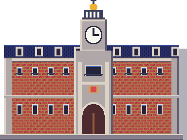
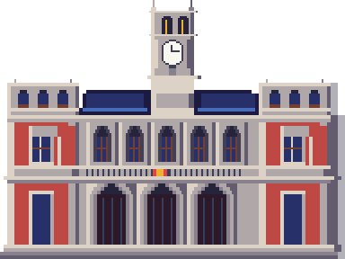

# Edificios reales · comparativas y seguimiento individual

Encargo de Javier iniciado el 19 de octubre de 2026. La revisión del catálogo encuentra **137 fuentes propias**, además de las tres piezas de packs señaladas como recortadas. No todas las fuentes propias son edificios: también hay árboles, rocas, estatuas y vehículos. El inventario conserva las 140 entradas y explica su estado individual. Ninguna revisión o captura equivale a aprobación artística.

## Bloque 1 · piezas recortadas (20 de octubre)

Son recursos originales de packs, sin una fuente `.px2` propia. Se conserva su dibujo y se mueve el conjunto de ancla, puerta y aparición de regreso. No se cambia la identidad de ningún interior ni su salida. `mover_ancla.gd` admite ahora `--desde=x,y` para seleccionar la casa correcta cuando la misma pieza aparece varias veces.

| Pieza | Mapa | Ancla anterior → nueva | Puerta anterior → nueva | Pieza sola, antes / después | Mapa, antes / después |
|---|---|---|---|---|---|
| Casa de madera (casa completa azul del pack DPPt) | Ruta 2 | (32,62) → (31,62) | (33,61) → (32,61) | [antes](edificios_reales/piezas_antes/casa_madera.png), [después](edificios_reales/piezas_despues/casa_madera.png) | [antes](edificios_reales/ruta_2_exterior_antes.png), [después](edificios_reales/ruta_2_exterior_despues.png) |
| Casa de tejado rojo | Bilbao | (68,49) → (67,49) | (69,48) → (68,48) | [antes](edificios_reales/piezas_antes/casa_tejado_rojo.png), [después](edificios_reales/piezas_despues/casa_tejado_rojo.png) | [antes](edificios_reales/bilbao_exterior_antes.png), [después](edificios_reales/bilbao_exterior_despues.png) |
| Faro del pack HGSS | Ruta 19 | (30,9) → (30,12) | (33,8) → (33,11) | [antes](edificios_reales/piezas_antes/faro.png), [después](edificios_reales/piezas_despues/faro.png) | [antes](edificios_reales/ruta_19_exterior_antes.png), [después](edificios_reales/ruta_19_exterior_despues.png) |

**Fallo detectado y corregido:** bajar el faro dos casillas dejaba la puerta en el bordillo de la fila 10. Se baja una tercera casilla; puerta y retorno quedan debajo del bordillo y se llega desde el camino. Alcance final: **0 problemas** en los tres mapas. Las herramientas de captura y alcance avisan de recursos retenidos al terminar (148 recursos en esta pasada), aunque devuelven salida 0 cuando el recorrido es correcto; no se oculta este aviso.

Pruebas dirigidas: **3/3, 735 aserciones**. Suite completa del bloque: **614/614, 75.814 aserciones, 736,627 s**; arte **0 errores/0 avisos**, datos **0 errores/2 avisos anteriores**; grafo **952 mapas, todos alcanzables y con vuelta**. Comprobación del contrato de las 140 piezas, tres accesos con su interior y retorno libre, y la otra casa de Ruta 2 intacta. Se actualizan únicamente las posiciones de la puerta y retorno de Ruta 2 en el inventario antiguo del tejido urbano; Bilbao y Ruta 19 no estaban en ese inventario. No se repintan exteriores.

## Contrato y capturas iniciales

[Contrato inicial](edificios_reales/contrato_inicial.json): fuentes, tamaños en casillas, puerta y huella de colisión. Su prueba impedirá que un redibujo rompa mapas enlazados. [Colocaciones antes](edificios_reales/colocaciones_antes.json) y [después](edificios_reales/colocaciones_despues.json). Cada fuente tiene una captura nativa individual previa. Las capturas completas de mapa conservan la escala original, sin reescalado ni filtros.

## Fuentes arquitectónicas consultadas para el siguiente bloque

- Ayuntamiento de Valladolid: [fotografías oficiales](https://www.valladolid.es/es/servicios/galeria-multimedia/galeria-fotografica/monumentos/casa-consistorial), [descripción municipal](https://info.valladolid.es/disfruta/patrimonio/monumentos/casa-consistorial). El dibujo actual reutiliza el de Correos; faltan las torres de esquina, los tres arcos del pórtico y el balcón.
- Casa de Correos: [Turismo de Madrid](https://www.esmadrid.com/informacion-turistica/real-casa-correos).
- San Mamés: [arquitectura y visita del estadio](https://sanmames.athletic-club.eus/san-mames/), [prototipo de fachada](https://www.athletic-club.eus/noticias/2011/11/12/instalacion-del-prototipo-de-fachada-de-smb/).
- Camp Nou: [instalaciones oficiales](https://www.fcbarcelona.es/es/club/instalaciones), [dossier con planos y secciones](https://www.fcbarcelona.com/fcbarcelona/document/2021/11/04/7c46b292-2dbc-4172-b03d-86f307308c48/DOSSIER_ESPAI_B_CAS-1-.pdf). El encargo del juego lo sitúa en obras; no se da una reconstrucción futura como edificio acabado.
- Palacio Real: [Patrimonio Nacional](https://www.patrimonionacional.es/visita/palacio-real-de-madrid), [plano de visita](https://www.patrimonionacional.es/sites/default/files/documents/palacio_real_visita_autoguiada__0.pdf).
- Akuarela: [dossier de su propietario con fotografías de salas y terraza](https://eventosgruposalamandra.com/es/salas/akuarela/).

Las fotografías solo se enlazan; no se copian al repositorio. Las referencias del 13 y 14 de octubre son de personajes; para arquitectura y composición se usan Añil y las ciudades aportadas el 15.

## Inventario individual de fuentes propias

Esta tabla registra el recorrido técnico completo del catálogo, sus usos y la captura previa. **El redibujo artístico está pendiente donde se indica**, y se hará pieza a pieza; el bloque 1 solo resuelve las tres colocaciones recortadas. Se empieza por los gimnasios y la Liga. Los objetos no arquitectónicos quedan separados por su motivo.

| Pieza | Casillas; puerta | Mapas donde se usa | Estado y motivo | Antes |
|---|---|---|---|---|
| `iglesia_san_miguel` | [5, 6]; [3, 0] | `pueblo_inicial/exterior`, `ruta_23/exterior` | Revisada en catálogo; pendiente de redibujo con su referencia real y comparativa | [pieza](edificios_reales/piezas_antes/iglesia_san_miguel.png) |
| `ermita_virgen_del_rio` | [3, 4]; [1, 0] | `getafe/exterior`, `mostoles/exterior`, `pueblo_inicial/exterior`, `puertollano/exterior`, `ruta_20/exterior` | Revisada en catálogo; pendiente de redibujo con su referencia real y comparativa | [pieza](edificios_reales/piezas_antes/ermita_virgen_del_rio.png) |
| `acueducto_segovia` | [14, 7]; [-1, -1] | `ruta_2/exterior` | Revisada en catálogo; pendiente de redibujo con su referencia real y comparativa | [pieza](edificios_reales/piezas_antes/acueducto_segovia.png) |
| `acueducto_segovia_tramo` | [14, 7]; [-1, -1] | `ruta_2/exterior` | Revisada en catálogo; pendiente de redibujo con su referencia real y comparativa | [pieza](edificios_reales/piezas_antes/acueducto_segovia_tramo.png) |
| `cruz_cuelgamuros` | [4, 10]; [-1, -1] | `ruta_3/exterior` | Revisada en catálogo; pendiente de redibujo con su referencia real y comparativa | [pieza](edificios_reales/piezas_antes/cruz_cuelgamuros.png) |
| `basilica_cuelgamuros` | [10, 5]; [4, 0] | `ruta_3/exterior` | Revisada en catálogo; pendiente de redibujo con su referencia real y comparativa | [pieza](edificios_reales/piezas_antes/basilica_cuelgamuros.png) |
| `monasterio_escorial` | [16, 8]; [7, 0] | `ruta_4/exterior` | Revisada en catálogo; pendiente de redibujo con su referencia real y comparativa | [pieza](edificios_reales/piezas_antes/monasterio_escorial.png) |
| `arco_victoria` | [8, 8]; [-1, -1] | `madrid/moncloa` | Revisada en catálogo; pendiente de redibujo con su referencia real y comparativa | [pieza](edificios_reales/piezas_antes/arco_victoria.png) |
| `templo_debod` | [6, 4]; [2, 0] | `madrid/moncloa` | Revisada en catálogo; pendiente de redibujo con su referencia real y comparativa | [pieza](edificios_reales/piezas_antes/templo_debod.png) |
| `puerta_debod` | [3, 4]; [-1, -1] | `madrid/moncloa` | Revisada en catálogo; pendiente de redibujo con su referencia real y comparativa | [pieza](edificios_reales/piezas_antes/puerta_debod.png) |
| `faro_moncloa` | [3, 12]; [-1, -1] | `madrid/moncloa` | Revisada en catálogo; pendiente de redibujo con su referencia real y comparativa | [pieza](edificios_reales/piezas_antes/faro_moncloa.png) |
| `casa_correos` | [12, 9]; [5, 0] | `madrid/centro` | Revisada en catálogo; pendiente de redibujo con su referencia real y comparativa | [pieza](edificios_reales/piezas_antes/casa_correos.png) |
| `oso_madrono` | [2, 3]; [-1, -1] | `madrid/centro` | Revisada en catálogo; objeto no arquitectónico (sin fachada de edificio) | [pieza](edificios_reales/piezas_antes/oso_madrono.png) |
| `soportales` | [4, 6]; [-1, -1] | `barcelona/ciutat_vella`, `bilbao/exterior`, `getafe/exterior`, `leganes/exterior`, `madrid/centro`, `malaga/exterior`, `palma/exterior`, `pamplona/exterior`, `ruta_5/exterior`, `santander/exterior`, `valencia/ciutat_vella`, `valladolid/exterior` | Revisada en catálogo; pendiente de redibujo con su referencia real y comparativa | [pieza](edificios_reales/piezas_antes/soportales.png) |
| `soportales_arco` | [4, 6]; [-1, -1] | `bilbao/exterior`, `madrid/centro`, `valladolid/exterior` | Revisada en catálogo; pendiente de redibujo con su referencia real y comparativa | [pieza](edificios_reales/piezas_antes/soportales_arco.png) |
| `casa_panaderia` | [12, 7]; [6, 0] | `madrid/centro` | Revisada en catálogo; pendiente de redibujo con su referencia real y comparativa | [pieza](edificios_reales/piezas_antes/casa_panaderia.png) |
| `mercado_san_miguel` | [8, 5]; [3, 0] | `madrid/centro`, `santander/exterior` | Revisada en catálogo; pendiente de redibujo con su referencia real y comparativa | [pieza](edificios_reales/piezas_antes/mercado_san_miguel.png) |
| `edificio_metropolis` | [6, 11]; [2, 0] | `madrid/centro` | Revisada en catálogo; pendiente de redibujo con su referencia real y comparativa | [pieza](edificios_reales/piezas_antes/edificio_metropolis.png) |
| `edificio_carrion` | [7, 12]; [3, 0] | `madrid/centro` | Revisada en catálogo; pendiente de redibujo con su referencia real y comparativa | [pieza](edificios_reales/piezas_antes/edificio_carrion.png) |
| `palacio_real` | [20, 12]; [9, 0] | `madrid/palacio_real` | Revisada en catálogo; pendiente de redibujo con su referencia real y comparativa | [pieza](edificios_reales/piezas_antes/palacio_real.png) |
| `catedral_almudena` | [10, 10]; [4, 0] | `madrid/palacio_real` | Revisada en catálogo; pendiente de redibujo con su referencia real y comparativa | [pieza](edificios_reales/piezas_antes/catedral_almudena.png) |
| `teatro_real` | [8, 7]; [3, 0] | `bilbao/exterior`, `madrid/palacio_real`, `santander/exterior`, `sevilla/rio` | Revisada en catálogo; pendiente de redibujo con su referencia real y comparativa | [pieza](edificios_reales/piezas_antes/teatro_real.png) |
| `felipe_iv` | [3, 6]; [-1, -1] | `madrid/palacio_real`, `pamplona/exterior` | Revisada en catálogo; objeto no arquitectónico (sin fachada de edificio) | [pieza](edificios_reales/piezas_antes/felipe_iv.png) |
| `estatua_rey` | [1, 3]; [-1, -1] | `madrid/palacio_real` | Revisada en catálogo; objeto no arquitectónico (sin fachada de edificio) | [pieza](edificios_reales/piezas_antes/estatua_rey.png) |
| `verja` | [1, 2]; [-1, -1] | `madrid/atico_ayuso`, `madrid/palacio_real`, `soto_del_real/exterior` | Revisada en catálogo; objeto no arquitectónico (sin fachada de edificio) | [pieza](edificios_reales/piezas_antes/verja.png) |
| `cibeles` | [4, 4]; [-1, -1] | `madrid/retiro` | Revisada en catálogo; objeto no arquitectónico (sin fachada de edificio) | [pieza](edificios_reales/piezas_antes/cibeles.png) |
| `palacio_cibeles` | [10, 11]; [4, 0] | `madrid/retiro` | Revisada en catálogo; pendiente de redibujo con su referencia real y comparativa | [pieza](edificios_reales/piezas_antes/palacio_cibeles.png) |
| `puerta_alcala` | [8, 6]; [-1, -1] | `madrid/retiro` | Revisada en catálogo; pendiente de redibujo con su referencia real y comparativa | [pieza](edificios_reales/piezas_antes/puerta_alcala.png) |
| `congreso` | [10, 6]; [4, 0] | `madrid/retiro` | Revisada en catálogo; pendiente de redibujo con su referencia real y comparativa | [pieza](edificios_reales/piezas_antes/congreso.png) |
| `leon_congreso` | [2, 2]; [-1, -1] | `madrid/retiro`, `zaragoza/exterior` | Revisada en catálogo; objeto no arquitectónico (sin fachada de edificio) | [pieza](edificios_reales/piezas_antes/leon_congreso.png) |
| `museo_prado` | [12, 6]; [5, 0] | `madrid/retiro` | Revisada en catálogo; pendiente de redibujo con su referencia real y comparativa | [pieza](edificios_reales/piezas_antes/museo_prado.png) |
| `fuente_neptuno` | [3, 3]; [-1, -1] | `madrid/retiro` | Revisada en catálogo; objeto no arquitectónico (sin fachada de edificio) | [pieza](edificios_reales/piezas_antes/fuente_neptuno.png) |
| `estacion_atocha` | [14, 8]; [6, 0] | `madrid/retiro` | Revisada en catálogo; pendiente de redibujo con su referencia real y comparativa | [pieza](edificios_reales/piezas_antes/estacion_atocha.png) |
| `monumento_alfonso_xii` | [12, 7]; [-1, -1] | `madrid/retiro` | Revisada en catálogo; pendiente de redibujo con su referencia real y comparativa | [pieza](edificios_reales/piezas_antes/monumento_alfonso_xii.png) |
| `palacio_cristal` | [8, 7]; [3, 0] | `madrid/retiro` | Revisada en catálogo; pendiente de redibujo con su referencia real y comparativa | [pieza](edificios_reales/piezas_antes/palacio_cristal.png) |
| `boca_metro` | [2, 3]; [1, 0] | `madrid/centro`, `madrid/chamberi`, `madrid/palacio_real` | Revisada en catálogo; pendiente de redibujo con su referencia real y comparativa | [pieza](edificios_reales/piezas_antes/boca_metro.png) |
| `nave_logistica` | [10, 5]; [-1, -1] | `madrid_rio/exterior`, `puertollano/exterior`, `ruta_11/exterior`, `ruta_17/exterior`, `ruta_5/exterior`, `soto_del_real/exterior` | Revisada en catálogo; pendiente de redibujo con su referencia real y comparativa | [pieza](edificios_reales/piezas_antes/nave_logistica.png) |
| `universidad_alcala` | [12, 8]; [5, 0] | `ruta_5/exterior` | Revisada en catálogo; pendiente de redibujo con su referencia real y comparativa | [pieza](edificios_reales/piezas_antes/universidad_alcala.png) |
| `palacio_infantado` | [10, 7]; [4, 0] | `huelva/exterior`, `pamplona/exterior`, `ruta_5/exterior` | Revisada en catálogo; pendiente de redibujo con su referencia real y comparativa | [pieza](edificios_reales/piezas_antes/palacio_infantado.png) |
| `arco_medinaceli` | [6, 5]; [-1, -1] | `ruta_6/exterior` | Revisada en catálogo; pendiente de redibujo con su referencia real y comparativa | [pieza](edificios_reales/piezas_antes/arco_medinaceli.png) |
| `torre_mudejar` | [3, 10]; [-1, -1] | `ruta_6/exterior` | Revisada en catálogo; pendiente de redibujo con su referencia real y comparativa | [pieza](edificios_reales/piezas_antes/torre_mudejar.png) |
| `basilica_pilar` | [18, 11]; [8, 0] | `zaragoza/exterior` | Revisada en catálogo; pendiente de redibujo con su referencia real y comparativa | [pieza](edificios_reales/piezas_antes/basilica_pilar.png) |
| `la_seo` | [10, 9]; [6, 0] | `zaragoza/exterior` | Revisada en catálogo; pendiente de redibujo con su referencia real y comparativa | [pieza](edificios_reales/piezas_antes/la_seo.png) |
| `puente_piedra` | [4, 8]; [-1, -1] | Sin uso en mapas | Revisada en catálogo; sin colocación actual, pendiente de su revisión artística individual | [pieza](edificios_reales/piezas_antes/puente_piedra.png) |
| `escenario_festival` | [10, 6]; [-1, -1] | `playa_del_ingles/exterior`, `ruta_7/exterior` | Revisada en catálogo; objeto no arquitectónico (sin fachada de edificio) | [pieza](edificios_reales/piezas_antes/escenario_festival.png) |
| `agujas_montserrat` | [12, 8]; [-1, -1] | `ruta_8/exterior` | Revisada en catálogo; objeto no arquitectónico (sin fachada de edificio) | [pieza](edificios_reales/piezas_antes/agujas_montserrat.png) |
| `monasterio_montserrat` | [10, 7]; [4, 0] | `ruta_8/exterior` | Revisada en catálogo; pendiente de redibujo con su referencia real y comparativa | [pieza](edificios_reales/piezas_antes/monasterio_montserrat.png) |
| `camp_nou` | [20, 11]; [10, 0] | `barcelona/les_corts` | Revisada en catálogo; pendiente de redibujo con su referencia real y comparativa | [pieza](edificios_reales/piezas_antes/camp_nou.png) |
| `grua` | [6, 13]; [-1, -1] | `barcelona/eixample`, `barcelona/les_corts`, `ruta_10/exterior` | Revisada en catálogo; objeto no arquitectónico (sin fachada de edificio) | [pieza](edificios_reales/piezas_antes/grua.png) |
| `sagrada_familia` | [12, 16]; [5, 0] | `barcelona/eixample` | Revisada en catálogo; pendiente de redibujo con su referencia real y comparativa | [pieza](edificios_reales/piezas_antes/sagrada_familia.png) |
| `casa_batllo` | [5, 9]; [2, 0] | `barcelona/eixample` | Revisada en catálogo; pendiente de redibujo con su referencia real y comparativa | [pieza](edificios_reales/piezas_antes/casa_batllo.png) |
| `la_pedrera` | [8, 8]; [3, 0] | `barcelona/eixample` | Revisada en catálogo; pendiente de redibujo con su referencia real y comparativa | [pieza](edificios_reales/piezas_antes/la_pedrera.png) |
| `monumento_colon` | [3, 12]; [-1, -1] | `barcelona/ciutat_vella` | Revisada en catálogo; pendiente de redibujo con su referencia real y comparativa | [pieza](edificios_reales/piezas_antes/monumento_colon.png) |
| `boqueria` | [8, 6]; [3, 0] | `barcelona/ciutat_vella` | Revisada en catálogo; pendiente de redibujo con su referencia real y comparativa | [pieza](edificios_reales/piezas_antes/boqueria.png) |
| `catedral_barcelona` | [10, 11]; [4, 0] | `barcelona/ciutat_vella` | Revisada en catálogo; pendiente de redibujo con su referencia real y comparativa | [pieza](edificios_reales/piezas_antes/catedral_barcelona.png) |
| `ferry` | [16, 7]; [-1, -1] | `barcelona/ciutat_vella`, `huelva/exterior`, `ibiza/exterior`, `las_palmas/canteras`, `palma/exterior`, `valencia/malvarrosa` | Revisada en catálogo; objeto no arquitectónico (sin fachada de edificio) | [pieza](edificios_reales/piezas_antes/ferry.png) |
| `catedral_palma` | [14, 10]; [6, 0] | `palma/exterior` | Revisada en catálogo; pendiente de redibujo con su referencia real y comparativa | [pieza](edificios_reales/piezas_antes/catedral_palma.png) |
| `castillo_bellver` | [8, 7]; [3, 0] | `palma/exterior` | Revisada en catálogo; pendiente de redibujo con su referencia real y comparativa | [pieza](edificios_reales/piezas_antes/castillo_bellver.png) |
| `es_vedra` | [8, 8]; [-1, -1] | `maritima_1/exterior` | Revisada en catálogo; objeto no arquitectónico (sin fachada de edificio) | [pieza](edificios_reales/piezas_antes/es_vedra.png) |
| `muralla_dalt_vila` | [8, 5]; [-1, -1] | `ibiza/exterior`, `malaga/exterior` | Revisada en catálogo; pendiente de redibujo con su referencia real y comparativa | [pieza](edificios_reales/piezas_antes/muralla_dalt_vila.png) |
| `catedral_ibiza` | [6, 7]; [3, 0] | `huelva/exterior`, `ibiza/exterior` | Revisada en catálogo; pendiente de redibujo con su referencia real y comparativa | [pieza](edificios_reales/piezas_antes/catedral_ibiza.png) |
| `casa_ibicenca` | [4, 4]; [1, 0] | `alicante/exterior`, `ibiza/exterior`, `ruta_10/exterior`, `ruta_14/exterior`, `ruta_15/exterior`, `sevilla/centro`, `sevilla/rio` | Revisada en catálogo; pendiente de redibujo con su referencia real y comparativa | [pieza](edificios_reales/piezas_antes/casa_ibicenca.png) |
| `club_ibiza` | [9, 6]; [4, 0] | `ibiza/exterior` | Revisada en catálogo; pendiente de redibujo con su referencia real y comparativa | [pieza](edificios_reales/piezas_antes/club_ibiza.png) |
| `palmera` | [3, 6]; [-1, -1] | `alicante/exterior`, `huelva/exterior`, `ibiza/exterior`, `las_palmas/canteras`, `las_palmas/vegueta_triana`, `malaga/exterior`, `murcia/exterior`, `playa_del_ingles/exterior`, `rocafonda/exterior`, `ruta_10/exterior`, `ruta_11/exterior`, `ruta_15/exterior`, `ruta_9/exterior`, `sevilla/centro`, `sevilla/maria_luisa`, `sevilla/rio`, `valencia/ciutat_vella`, `valencia/malvarrosa`, `valencia/turia` | Revisada en catálogo; objeto no arquitectónico (sin fachada de edificio) | [pieza](edificios_reales/piezas_antes/palmera.png) |
| `akuarela` | [12, 7]; [5, 0] | `valencia/malvarrosa` | Revisada en catálogo; pendiente de redibujo con su referencia real y comparativa | [pieza](edificios_reales/piezas_antes/akuarela.png) |
| `cepa_rioja` | [1, 2]; [-1, -1] | `ruta_16/exterior`, `ruta_21/exterior`, `ruta_8/exterior` | Revisada en catálogo; objeto no arquitectónico (sin fachada de edificio) | [pieza](edificios_reales/piezas_antes/cepa_rioja.png) |
| `catedral_burgos` | [5, 4]; [2, 0] | `bilbao/exterior`, `pamplona/exterior`, `ruta_17/exterior`, `ruta_22/exterior` | Revisada en catálogo; pendiente de redibujo con su referencia real y comparativa | [pieza](edificios_reales/piezas_antes/catedral_burgos.png) |
| `arbol_navidad_vigo` | [2, 3]; [-1, -1] | `vigo/exterior` | Revisada en catálogo; objeto no arquitectónico (sin fachada de edificio) | [pieza](edificios_reales/piezas_antes/arbol_navidad_vigo.png) |
| `sireno_vigo` | [1, 2]; [-1, -1] | `vigo/exterior` | Revisada en catálogo; objeto no arquitectónico (sin fachada de edificio) | [pieza](edificios_reales/piezas_antes/sireno_vigo.png) |
| `cupula_milenio` | [2, 2]; [-1, -1] | `valladolid/exterior` | Revisada en catálogo; pendiente de redibujo con su referencia real y comparativa | [pieza](edificios_reales/piezas_antes/cupula_milenio.png) |
| `ayuntamiento_valladolid` | [12, 9]; [5, 0] | `valladolid/exterior` | Redibujado, provisional; referencia municipal, puerta y huella conservadas | [pieza](edificios_reales/piezas_antes/ayuntamiento_valladolid.png) |
| `san_pablo_valladolid` | [10, 8]; [5, 0] | `valladolid/exterior` | Revisada en catálogo; pendiente de redibujo con su referencia real y comparativa | [pieza](edificios_reales/piezas_antes/san_pablo_valladolid.png) |
| `catedral_valladolid` | [10, 9]; [6, 0] | `valladolid/exterior` | Revisada en catálogo; pendiente de redibujo con su referencia real y comparativa | [pieza](edificios_reales/piezas_antes/catedral_valladolid.png) |
| `conde_ansurez` | [2, 4]; [-1, -1] | `valladolid/exterior` | Revisada en catálogo; objeto no arquitectónico (sin fachada de edificio) | [pieza](edificios_reales/piezas_antes/conde_ansurez.png) |
| `castillo_cuellar` | [5, 4]; [2, 0] | `ruta_23/exterior` | Revisada en catálogo; pendiente de redibujo con su referencia real y comparativa | [pieza](edificios_reales/piezas_antes/castillo_cuellar.png) |
| `sagrado_corazon_getafe` | [4, 4]; [-1, -1] | `getafe/exterior` | Revisada en catálogo; objeto no arquitectónico (sin fachada de edificio) | [pieza](edificios_reales/piezas_antes/sagrado_corazon_getafe.png) |
| `magdalena_getafe` | [5, 6]; [3, 0] | `getafe/exterior` | Revisada en catálogo; pendiente de redibujo con su referencia real y comparativa | [pieza](edificios_reales/piezas_antes/magdalena_getafe.png) |
| `alhambra` | [8, 4]; [-1, -1] | `ruta_12/exterior` | Revisada en catálogo; pendiente de redibujo con su referencia real y comparativa | [pieza](edificios_reales/piezas_antes/alhambra.png) |
| `olivo` | [2, 2]; [-1, -1] | `ruta_13/exterior` | Revisada en catálogo; objeto no arquitectónico (sin fachada de edificio) | [pieza](edificios_reales/piezas_antes/olivo.png) |
| `mezquita` | [8, 5]; [-1, -1] | `ruta_13/exterior` | Revisada en catálogo; pendiente de redibujo con su referencia real y comparativa | [pieza](edificios_reales/piezas_antes/mezquita.png) |
| `giralda` | [4, 9]; [-1, -1] | `sevilla/centro` | Revisada en catálogo; pendiente de redibujo con su referencia real y comparativa | [pieza](edificios_reales/piezas_antes/giralda.png) |
| `catedral_sevilla` | [8, 6]; [3, 0] | `sevilla/centro` | Revisada en catálogo; pendiente de redibujo con su referencia real y comparativa | [pieza](edificios_reales/piezas_antes/catedral_sevilla.png) |
| `setas` | [8, 4]; [-1, -1] | `sevilla/centro` | Revisada en catálogo; pendiente de redibujo con su referencia real y comparativa | [pieza](edificios_reales/piezas_antes/setas.png) |
| `plaza_espana` | [12, 5]; [-1, -1] | `sevilla/maria_luisa` | Revisada en catálogo; pendiente de redibujo con su referencia real y comparativa | [pieza](edificios_reales/piezas_antes/plaza_espana.png) |
| `puerta_leon` | [6, 4]; [3, 0] | `sevilla/centro` | Revisada en catálogo; pendiente de redibujo con su referencia real y comparativa | [pieza](edificios_reales/piezas_antes/puerta_leon.png) |
| `puente_triana` | [12, 3]; [-1, -1] | Sin uso en mapas | Revisada en catálogo; sin colocación actual, pendiente de su revisión artística individual | [pieza](edificios_reales/piezas_antes/puente_triana.png) |
| `maestranza` | [8, 4]; [4, 0] | `pamplona/exterior`, `sevilla/rio` | Revisada en catálogo; pendiente de redibujo con su referencia real y comparativa | [pieza](edificios_reales/piezas_antes/maestranza.png) |
| `fe_descubridora` | [3, 7]; [-1, -1] | `huelva/exterior` | Revisada en catálogo; objeto no arquitectónico (sin fachada de edificio) | [pieza](edificios_reales/piezas_antes/fe_descubridora.png) |
| `muelle_tinto` | [4, 10]; [-1, -1] | Sin uso en mapas | Revisada en catálogo; sin colocación actual, pendiente de su revisión artística individual | [pieza](edificios_reales/piezas_antes/muelle_tinto.png) |
| `catedral_santa_ana` | [6, 6]; [3, 0] | `las_palmas/vegueta_triana`, `santander/exterior` | Revisada en catálogo; pendiente de redibujo con su referencia real y comparativa | [pieza](edificios_reales/piezas_antes/catedral_santa_ana.png) |
| `castillo_luz` | [5, 4]; [2, 0] | `las_palmas/canteras`, `malaga/exterior` | Revisada en catálogo; pendiente de redibujo con su referencia real y comparativa | [pieza](edificios_reales/piezas_antes/castillo_luz.png) |
| `terminal_aeropuerto` | [10, 5]; [-1, -1] | `playa_del_ingles/exterior` | Revisada en catálogo; pendiente de redibujo con su referencia real y comparativa | [pieza](edificios_reales/piezas_antes/terminal_aeropuerto.png) |
| `mostrador_vuelos` | [3, 2]; [-1, -1] | `playa_del_ingles/exterior` | Revisada en catálogo; objeto no arquitectónico (sin fachada de edificio) | [pieza](edificios_reales/piezas_antes/mostrador_vuelos.png) |
| `san_salvador_leganes` | [5, 6]; [3, 0] | `leganes/exterior` | Revisada en catálogo; pendiente de redibujo con su referencia real y comparativa | [pieza](edificios_reales/piezas_antes/san_salvador_leganes.png) |
| `escultura_leganes` | [2, 2]; [-1, -1] | `leganes/exterior` | Revisada en catálogo; objeto no arquitectónico (sin fachada de edificio) | [pieza](edificios_reales/piezas_antes/escultura_leganes.png) |
| `micalet_catedral` | [9, 12]; [5, 0] | `valencia/ciutat_vella` | Revisada en catálogo; pendiente de redibujo con su referencia real y comparativa | [pieza](edificios_reales/piezas_antes/micalet_catedral.png) |
| `lonja_seda` | [10, 7]; [4, 0] | `valencia/ciutat_vella` | Revisada en catálogo; pendiente de redibujo con su referencia real y comparativa | [pieza](edificios_reales/piezas_antes/lonja_seda.png) |
| `mercado_central` | [11, 7]; [5, 0] | `bilbao/exterior`, `valencia/ciutat_vella` | Revisada en catálogo; pendiente de redibujo con su referencia real y comparativa | [pieza](edificios_reales/piezas_antes/mercado_central.png) |
| `torres_serranos` | [9, 8]; [-1, -1] | `valencia/ciutat_vella` | Revisada en catálogo; pendiente de redibujo con su referencia real y comparativa | [pieza](edificios_reales/piezas_antes/torres_serranos.png) |
| `hemisferic` | [10, 5]; [-1, -1] | `valencia/turia` | Revisada en catálogo; pendiente de redibujo con su referencia real y comparativa | [pieza](edificios_reales/piezas_antes/hemisferic.png) |
| `museu_ciencies` | [14, 6]; [-1, -1] | `valencia/turia` | Revisada en catálogo; pendiente de redibujo con su referencia real y comparativa | [pieza](edificios_reales/piezas_antes/museu_ciencies.png) |
| `palau_arts` | [11, 8]; [-1, -1] | `valencia/turia` | Revisada en catálogo; pendiente de redibujo con su referencia real y comparativa | [pieza](edificios_reales/piezas_antes/palau_arts.png) |
| `fuente_peces` | [2, 2]; [-1, -1] | `mostoles/exterior` | Revisada en catálogo; objeto no arquitectónico (sin fachada de edificio) | [pieza](edificios_reales/piezas_antes/fuente_peces.png) |
| `asuncion_mostoles` | [3, 4]; [1, 0] | `mostoles/exterior`, `puertollano/exterior` | Revisada en catálogo; pendiente de redibujo con su referencia real y comparativa | [pieza](edificios_reales/piezas_antes/asuncion_mostoles.png) |
| `molino_mancha` | [2, 3]; [1, 0] | `ruta_24/exterior` | Revisada en catálogo; pendiente de redibujo con su referencia real y comparativa | [pieza](edificios_reales/piezas_antes/molino_mancha.png) |
| `fuente_agria` | [3, 3]; [-1, -1] | `puertollano/exterior` | Revisada en catálogo; objeto no arquitectónico (sin fachada de edificio) | [pieza](edificios_reales/piezas_antes/fuente_agria.png) |
| `castillete_minero` | [2, 4]; [-1, -1] | `puertollano/exterior` | Revisada en catálogo; objeto no arquitectónico (sin fachada de edificio) | [pieza](edificios_reales/piezas_antes/castillete_minero.png) |
| `minero_puertollano` | [2, 4]; [-1, -1] | `puertollano/exterior` | Revisada en catálogo; objeto no arquitectónico (sin fachada de edificio) | [pieza](edificios_reales/piezas_antes/minero_puertollano.png) |
| `roca_torcal` | [2, 3]; [-1, -1] | `ruta_26/exterior` | Revisada en catálogo; objeto no arquitectónico (sin fachada de edificio) | [pieza](edificios_reales/piezas_antes/roca_torcal.png) |
| `dolmen_antequera` | [3, 2]; [1, 0] | `ruta_26/exterior` | Revisada en catálogo; pendiente de redibujo con su referencia real y comparativa | [pieza](edificios_reales/piezas_antes/dolmen_antequera.png) |
| `catedral_malaga` | [10, 10]; [4, 0] | `malaga/exterior` | Revisada en catálogo; pendiente de redibujo con su referencia real y comparativa | [pieza](edificios_reales/piezas_antes/catedral_malaga.png) |
| `cubo_pompidou` | [2, 2]; [-1, -1] | `malaga/exterior` | Revisada en catálogo; objeto no arquitectónico (sin fachada de edificio) | [pieza](edificios_reales/piezas_antes/cubo_pompidou.png) |
| `barraca` | [5, 6]; [2, 0] | `ruta_9/exterior` | Revisada en catálogo; pendiente de redibujo con su referencia real y comparativa | [pieza](edificios_reales/piezas_antes/barraca.png) |
| `palau_ducal_gandia` | [10, 7]; [5, 0] | `ruta_9/exterior` | Revisada en catálogo; pendiente de redibujo con su referencia real y comparativa | [pieza](edificios_reales/piezas_antes/palau_ducal_gandia.png) |
| `barca_albufera` | [4, 4]; [-1, -1] | `alicante/exterior`, `ruta_10/exterior`, `ruta_16/exterior`, `ruta_19/exterior`, `ruta_9/exterior`, `santander/exterior` | Revisada en catálogo; objeto no arquitectónico (sin fachada de edificio) | [pieza](edificios_reales/piezas_antes/barca_albufera.png) |
| `penon_ifach` | [8, 7]; [-1, -1] | `ruta_10/exterior` | Revisada en catálogo; objeto no arquitectónico (sin fachada de edificio) | [pieza](edificios_reales/piezas_antes/penon_ifach.png) |
| `iglesia_altea` | [6, 7]; [2, 0] | `ruta_10/exterior`, `ruta_19/exterior` | Revisada en catálogo; pendiente de redibujo con su referencia real y comparativa | [pieza](edificios_reales/piezas_antes/iglesia_altea.png) |
| `rascacielos_benidorm` | [3, 11]; [1, 0] | `ruta_10/exterior` | Revisada en catálogo; pendiente de redibujo con su referencia real y comparativa | [pieza](edificios_reales/piezas_antes/rascacielos_benidorm.png) |
| `intempo` | [5, 12]; [2, 0] | `ruta_10/exterior` | Revisada en catálogo; pendiente de redibujo con su referencia real y comparativa | [pieza](edificios_reales/piezas_antes/intempo.png) |
| `castillo_santa_barbara` | [12, 7]; [6, 0] | `alicante/exterior` | Revisada en catálogo; pendiente de redibujo con su referencia real y comparativa | [pieza](edificios_reales/piezas_antes/castillo_santa_barbara.png) |
| `explanada_mosaico` | [4, 2]; [-1, -1] | Sin uso en mapas | Revisada en catálogo; sin colocación actual, pendiente de su revisión artística individual | [pieza](edificios_reales/piezas_antes/explanada_mosaico.png) |
| `concatedral_san_nicolas` | [8, 8]; [4, 0] | `alicante/exterior` | Revisada en catálogo; pendiente de redibujo con su referencia real y comparativa | [pieza](edificios_reales/piezas_antes/concatedral_san_nicolas.png) |
| `casa_carbonell` | [8, 9]; [4, 0] | `alicante/exterior`, `rocafonda/exterior`, `santander/exterior` | Revisada en catálogo; pendiente de redibujo con su referencia real y comparativa | [pieza](edificios_reales/piezas_antes/casa_carbonell.png) |
| `dama_elche` | [2, 3]; [-1, -1] | `ruta_11/exterior` | Revisada en catálogo; objeto no arquitectónico (sin fachada de edificio) | [pieza](edificios_reales/piezas_antes/dama_elche.png) |
| `basilica_elche` | [6, 7]; [3, 0] | `ruta_11/exterior` | Revisada en catálogo; pendiente de redibujo con su referencia real y comparativa | [pieza](edificios_reales/piezas_antes/basilica_elche.png) |
| `palmera_imperial` | [3, 7]; [-1, -1] | `ruta_11/exterior` | Revisada en catálogo; objeto no arquitectónico (sin fachada de edificio) | [pieza](edificios_reales/piezas_antes/palmera_imperial.png) |
| `catedral_murcia` | [10, 12]; [6, 0] | `murcia/exterior` | Revisada en catálogo; pendiente de redibujo con su referencia real y comparativa | [pieza](edificios_reales/piezas_antes/catedral_murcia.png) |
| `sardina_segura` | [3, 2]; [-1, -1] | `murcia/exterior` | Revisada en catálogo; objeto no arquitectónico (sin fachada de edificio) | [pieza](edificios_reales/piezas_antes/sardina_segura.png) |
| `bernabeu` | [12, 6]; [-1, -1] | `madrid/bernabeu` | Revisada en catálogo; pendiente de redibujo con su referencia real y comparativa | [pieza](edificios_reales/piezas_antes/bernabeu.png) |
| `san_mames` | [20, 11]; [10, 0] | `bilbao/exterior` | Revisada en catálogo; pendiente de redibujo con su referencia real y comparativa | [pieza](edificios_reales/piezas_antes/san_mames.png) |
| `guggenheim` | [12, 8]; [6, 0] | `bilbao/exterior` | Revisada en catálogo; pendiente de redibujo con su referencia real y comparativa | [pieza](edificios_reales/piezas_antes/guggenheim.png) |
| `centro_botin` | [10, 6]; [4, 0] | `santander/exterior` | Revisada en catálogo; pendiente de redibujo con su referencia real y comparativa | [pieza](edificios_reales/piezas_antes/centro_botin.png) |
| `horreo` | [3, 4]; [1, 0] | `ruta_17/exterior` | Revisada en catálogo; pendiente de redibujo con su referencia real y comparativa | [pieza](edificios_reales/piezas_antes/horreo.png) |
| `basilica_covadonga` | [6, 8]; [2, 0] | `ruta_18/exterior` | Revisada en catálogo; pendiente de redibujo con su referencia real y comparativa | [pieza](edificios_reales/piezas_antes/basilica_covadonga.png) |
| `cafe_iruna` | [8, 5]; [3, 0] | `pamplona/exterior` | Revisada en catálogo; pendiente de redibujo con su referencia real y comparativa | [pieza](edificios_reales/piezas_antes/cafe_iruna.png) |
| `ruinas_rocafonda` | [5, 4]; [2, 0] | `rocafonda/exterior` | Revisada en catálogo; pendiente de redibujo con su referencia real y comparativa | [pieza](edificios_reales/piezas_antes/ruinas_rocafonda.png) |
| `falcon` | [5, 2]; [-1, -1] | `playa_del_ingles/exterior`, `vigo/exterior` | Revisada en catálogo; objeto no arquitectónico (sin fachada de edificio) | [pieza](edificios_reales/piezas_antes/falcon.png) |

## Bloque 2 · fachadas de gimnasios

### Casa Consistorial de Valladolid

El dibujo anterior reutilizaba Correos. Ahora tiene pabellones de esquina con sus tres vanos, cinco ventanas de arco en la planta noble, pórtico de tres arcos, balcón con bandera y torre del reloj con campanas. Se adapta la fachada de las fotografías municipales al lienzo de **192×144 píxeles del arte (12×9 casillas)** y puerta **(5,0)**. Fuente de atlas **353**, sin mover su ancla (30,18), puerta ni interior.

Referencias: [galería municipal](https://www.valladolid.es/es/servicios/galeria-multimedia/galeria-fotografica/monumentos/casa-consistorial), [descripción de planta y arquitectura](https://info.valladolid.es/disfruta/patrimonio/monumentos/casa-consistorial). Se buscó un plano público acotado: no se localizó uno accesible; no se presentan las medidas del juego como medidas reales. Las fuentes quedan también en la cabecera del `.px2`.

| Vista | Antes | Después |
|---|---|---|
| Pieza nativa |  |  |
| Misma escena y escala | [mapa](edificios_reales/ayuntamiento_valladolid_mapa_antes.png) | [mapa](edificios_reales/ayuntamiento_valladolid_mapa_despues.png) |

La captura «antes» se renderiza en la misma escena con el PNG anterior conservado; la escena del mapa no se modifica. No se descargan fotografías al repositorio.

**Compatibilidad:** la primera exportación añadía dos casillas sólidas al cuerpo de campanas. `piezas.json` admite ahora una `huella` explícita (lista de casillas relativas al ancla), además de `base` y `ninguna`. Valladolid declara exactamente su huella anterior: el cambio de silueta del tejado no altera calles ni accesos. El constructor comprueba que la lista esté dentro del lienzo. El contrato inicial de las 140 piezas pasa sin modificar sus expectativas.

Pruebas dirigidas: **3/3, 735 aserciones**. Alcance de Valladolid: **19 puertas, 0 problemas**. Arte provisional pendiente de Javier; el bloque sigue abierto hasta su comprobación conjunta.
