# Gimnasios por dentro · antes y después (2026-10-15, Agente 3)

Capturas a escala real (vista de pájaro) de cada sala. **Antes:** `main` al empezar la sesión (salas de 16×12 con el zigzag automático y casi sin muebles). **Después:** cada sala pintada a mano desde su plano en `maps/_pintura/gimnasios_salas.json` (ver [`docs/arte/gimnasios.md`](../gimnasios.md)). Se rehacen con:

```sh
godot --path . -s res://maps/_tools/captura_gimnasios.gd -- res://docs/arte/comparativas/gimnasios/despues <ciudad> flags=quiron_superado
```

Las capturas no ejecutan `MapLoader.prepare`, así que no salen los personajes colocados por datos (Ayuso en su ático); los vigilantes salen en su sitio de bloqueo (sin entrenadores ganados). Todo el arte es **PROVISIONAL** hasta que lo apruebe Javier.

## 1 · Madrid — Real Casa de Correos

| Sala | Antes | Después |
|---|---|---|
| Registro General | 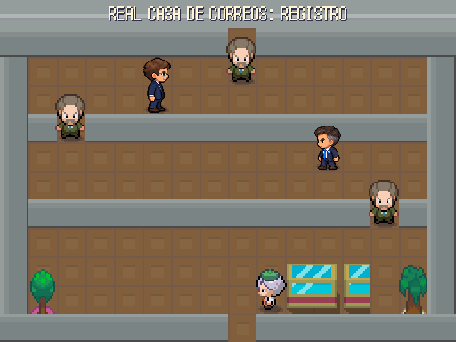 | 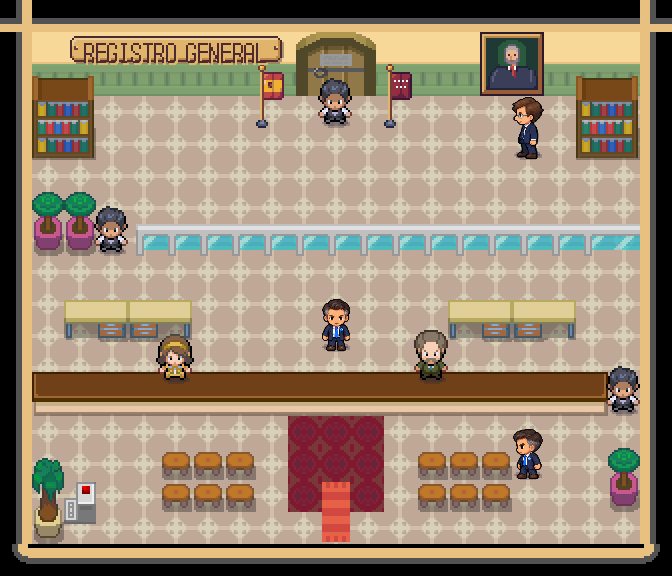 |
| Salón de Plenos (Grupo Popular) | 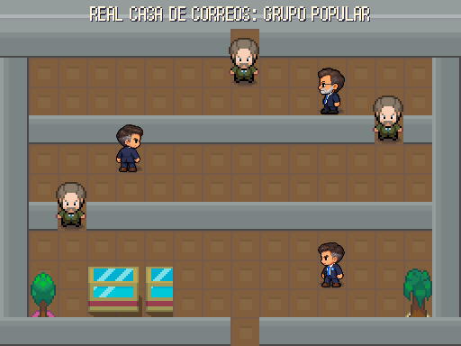 | 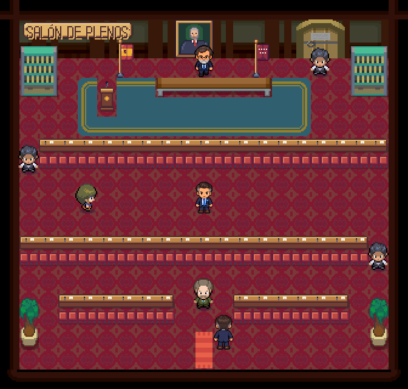 |
| Archivo de Títulos | 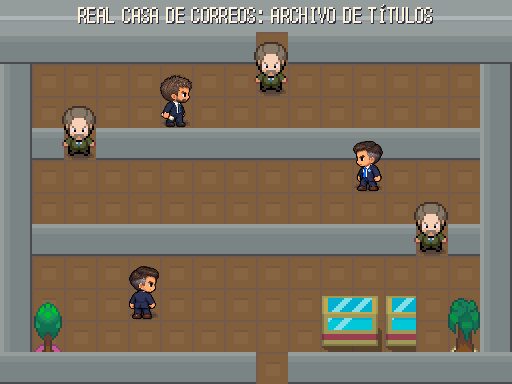 | 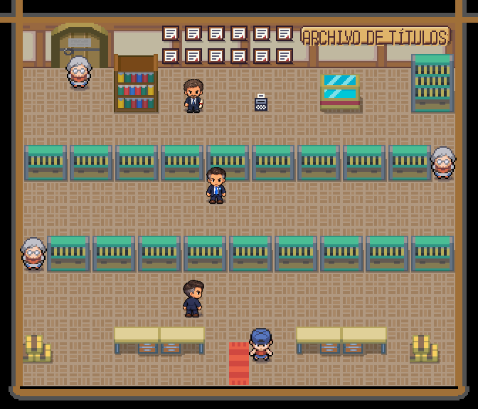 |
| Despacho de la Presidenta | 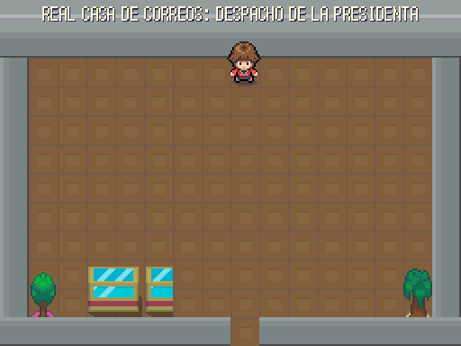 | 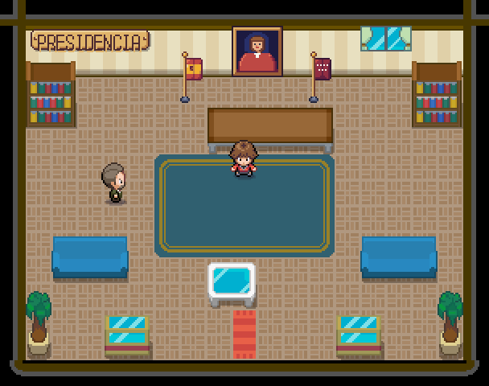 |
| Terraza del ático (Chamberí) | 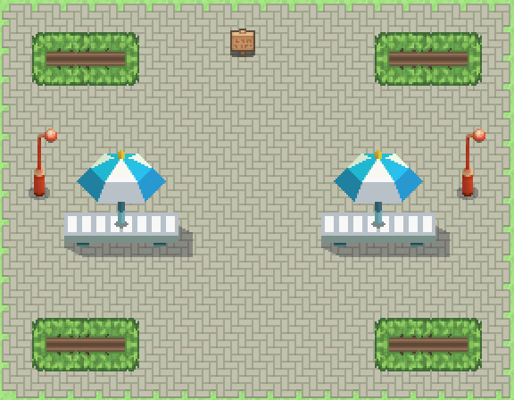 | 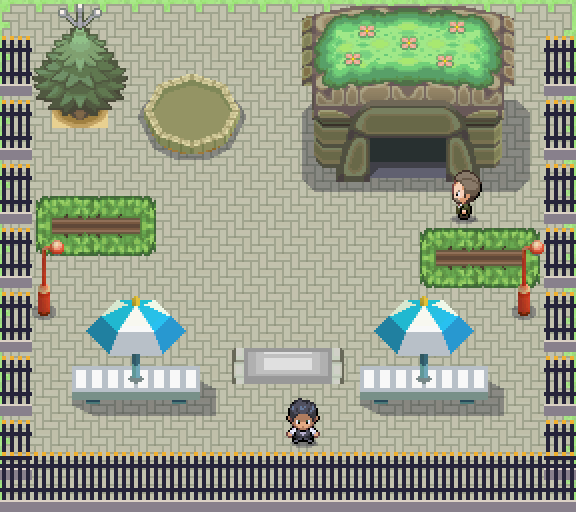 |

- **Registro:** mostrador corrido de madera con dos funcionarios (se les habla por encima), sala de espera con taburetes y el dispensador de turnos, mampara de cristal, jefatura con estanterías, las banderas de España y de la Comunidad junto a la puerta y el retrato del Rey.
- **Salón de Plenos:** dos filas de escaños que hacen de tabique (con el hueco en lados alternos), estrado con alfombra, mesa de la presidencia, atril, banderas, retrato y escaños del público.
- **Archivo de Títulos:** pasillos de archivadores, pared de títulos enmarcados, la vitrina del máster (cartel), trituradora y mesas de consulta.
- **Despacho:** retrato de la presidenta, banderas, mesa, alfombra, sofás, vitrinas y el jefe de gabinete. Ayuso te sube a su ático.
- **Ático:** la fachada del ático con su jardín (por su puerta se baja a Chamberí), barandilla de azotea, jardineras, mesas con sombrilla, la fuente, un camarero y un escolta. Ayuso espera en (8, 6), como dicen los datos.

## 2 · Barcelona — Spotify Camp Nou

| Sala | Antes | Después |
|---|---|---|
| Vestuario (Túnel de Vestuarios) | 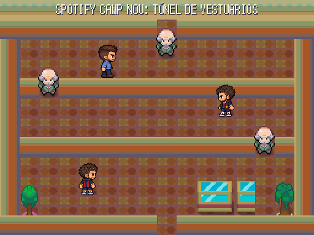 | 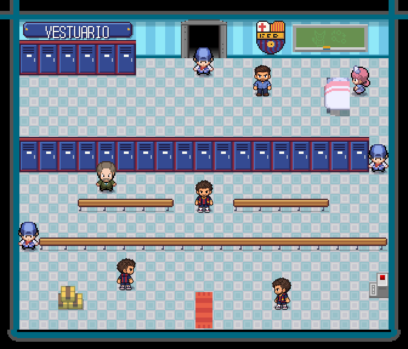 |
| Sala de Palancas | 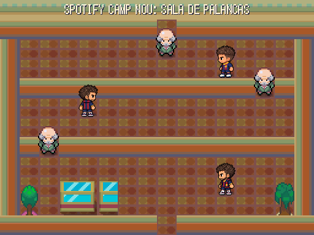 | 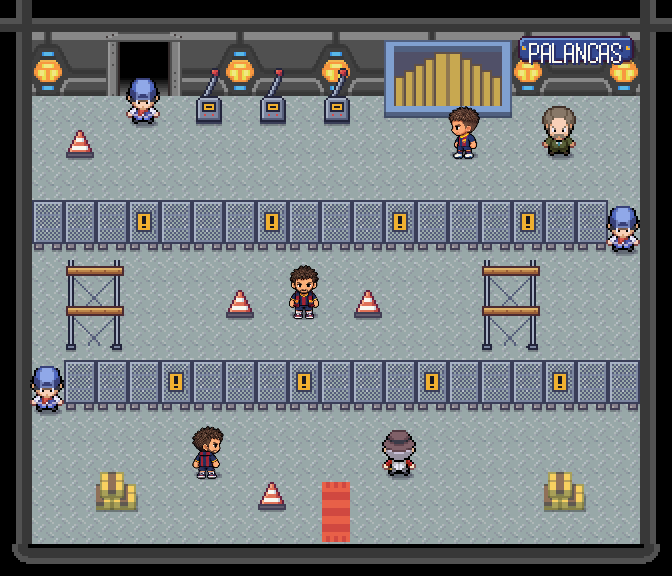 |
| Palco | 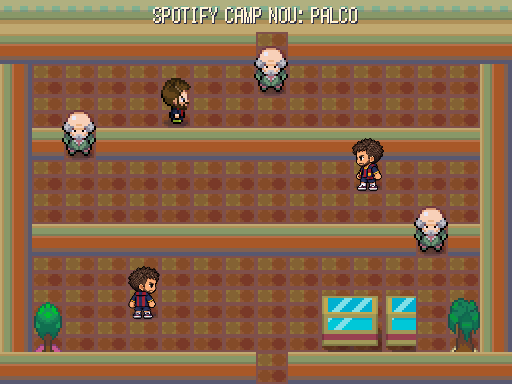 | 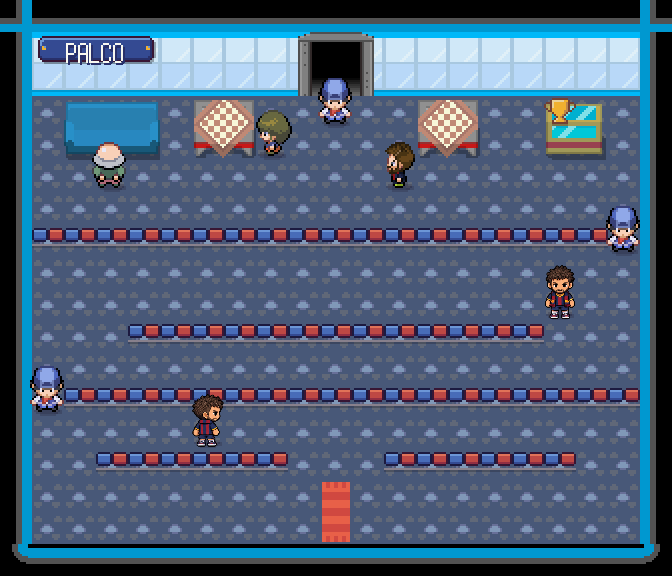 |
| Despacho del President | 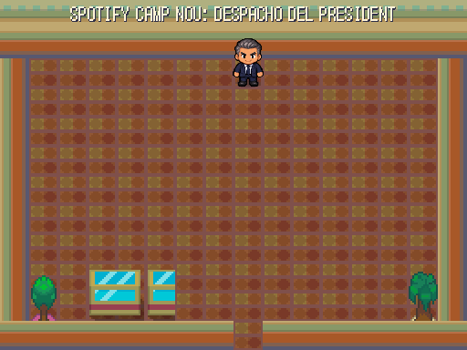 | 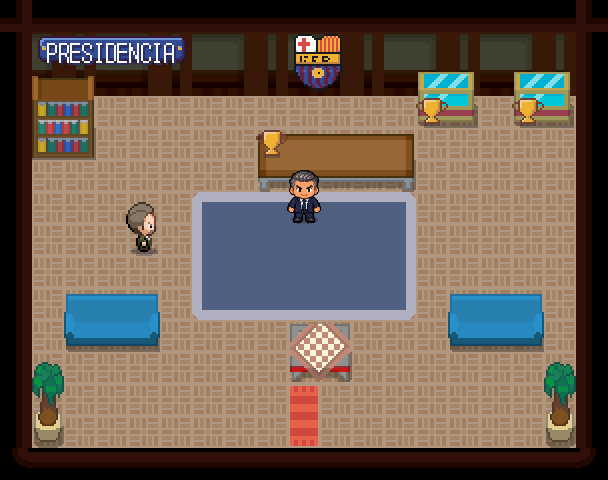 |

- **Vestuario:** taquillas azulgranas contra la pared y una isla de taquillas que hace de tabique, bancos corridos, la camilla del fisio, el escudo y la pizarra táctica, cajas del utillero y la fuente de agua.
- **Sala de Palancas:** el estadio en obras: vallas de malla con carteles de peligro, andamios, conos, el videomarcador y tres palancas con su cartel (lo que ya se ha vendido). Un jubilado mira la obra.
- **Palco:** el ventanal al campo, filas de butacas azules y granates que hacen de tabique, sofás, mesas del catering y la vitrina con la copa.
- **Despacho del President:** escudo, vitrinas con copas, mesa con su copa, alfombra, sofás y un directivo. Laporta espera en el centro.

## 3 · Valencia — Akuarela Playa

| Sala | Antes | Después |
|---|---|---|
| Pista | 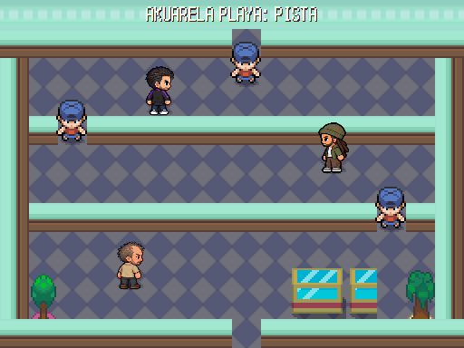 | 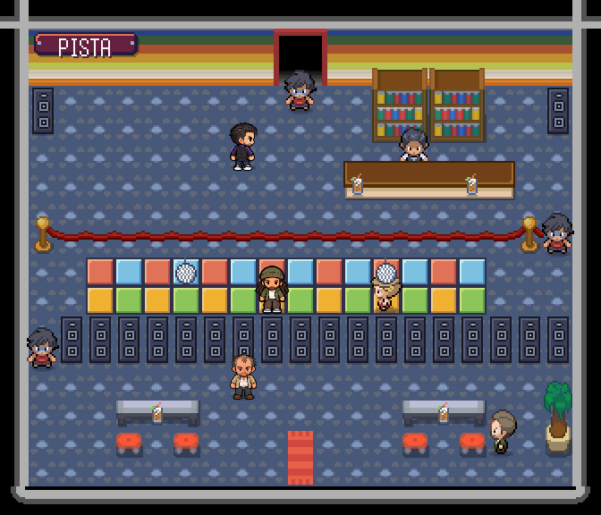 |
| Reservado | 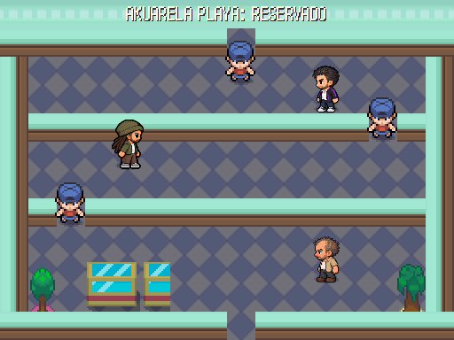 | 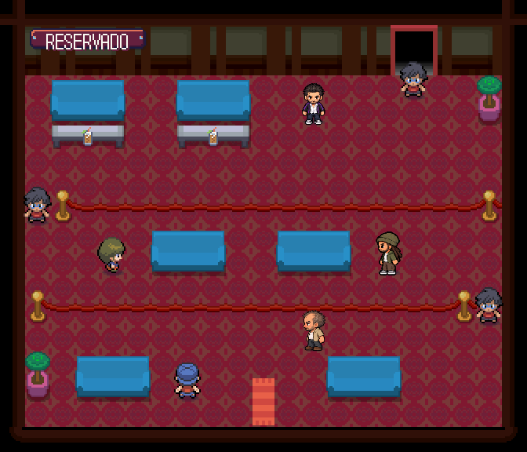 |
| Zona VIP | 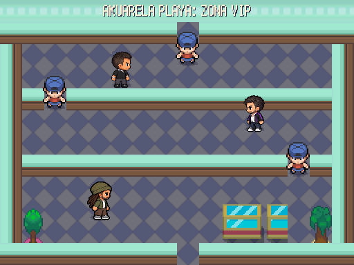 | 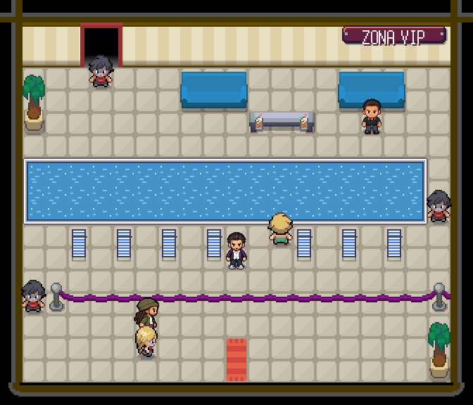 |
| Cabina | 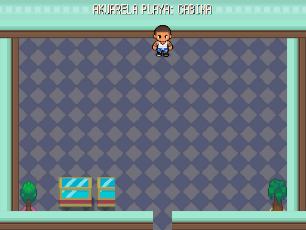 | 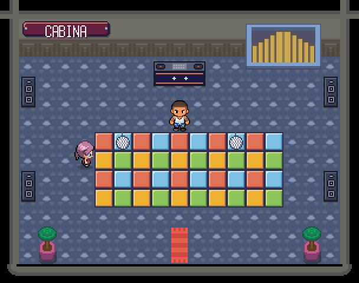 |

- **Pista:** pista de baldosas de luz con bolas de espejos, un muro de altavoces que hace de tabique, postes con cordón rojo, la barra con su estante de botellas, el camarero y cubatas en barra y mesas. Un cartel con el código de vestimenta.
- **Reservado:** sofás y mesas bajas con cubatas separados por cordones, la camarera y el relaciones públicas.
- **Zona VIP:** la piscina hace de tabique; tumbonas, sofás, cordón morado, el socorrista y una influencer.
- **Cabina:** la cabina del DJ con sus platos, pantallas de luces, altavoces y pista. Labrador espera delante.
