# Interiores personalizados · 2026-10-15

Antes (sala genérica de 16×12) y después (sala propia desde `data/interiores/<ciudad>.json`). Capturas a escala real con `maps/_tools/captura_interiores.gd`. Todo provisional: arte de Akizakura16 y textos pendientes de Javier.

## Ibiza

| Sala | Antes | Después |
|---|---|---|
| Casa de Margalida (recibidor) | 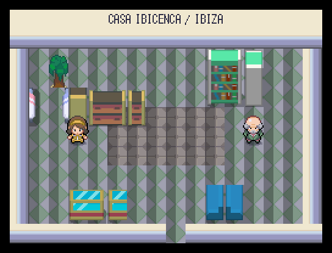 | 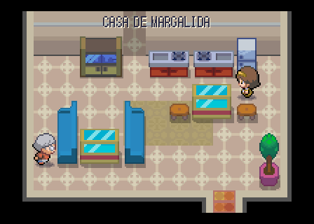 |
| Dormitorio de Toni | (no existía) | 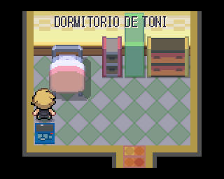 |
| Casa del DJ | 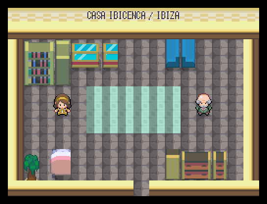 | 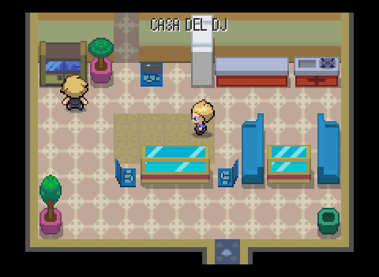 |
| Catedral de Ibiza | 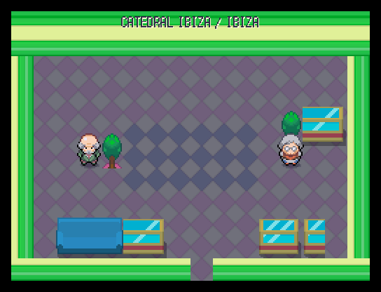 | 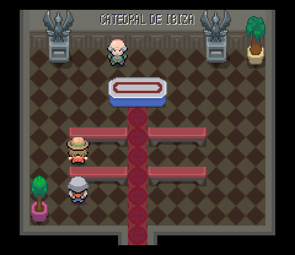 |
| Club Ibiza, la pista | 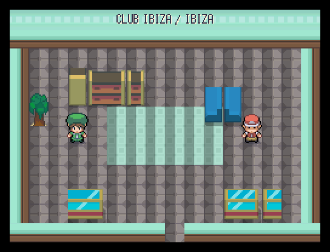 | 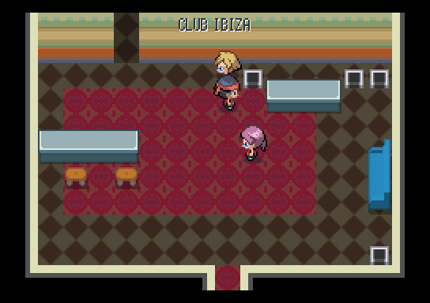 |
| Club Ibiza, la barra | (no existía) | 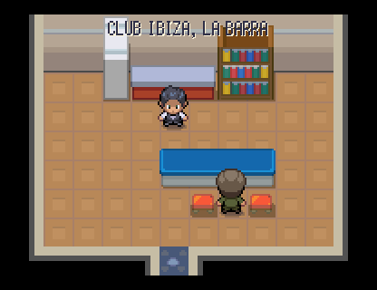 |
| Socorrismo | 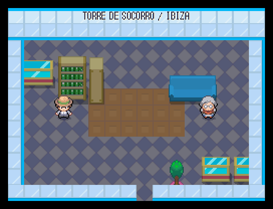 | 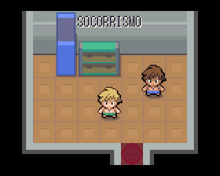 |
| Casa payesa de Can Marí | 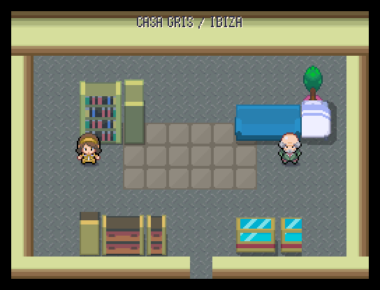 | 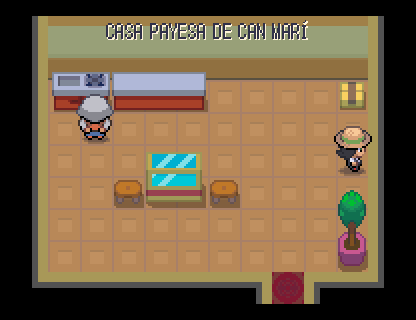 |
| Farmacia de guardia | 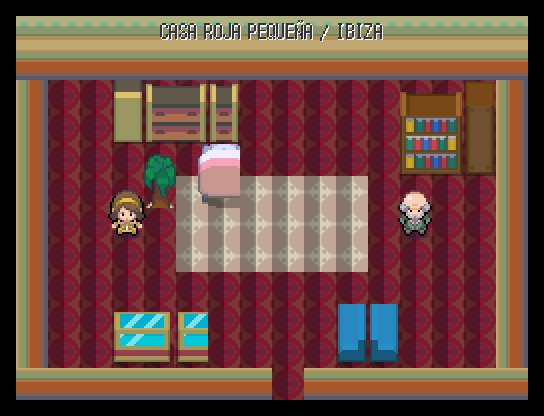 | 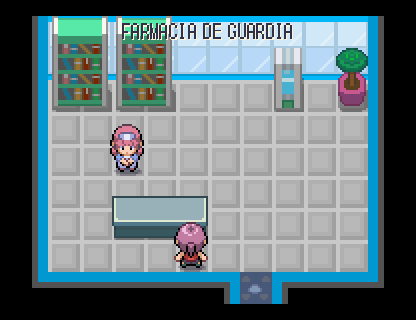 |

## Madrid

| Sala | Antes | Después |
|---|---|---|
| Bar de bocadillos de calamares | 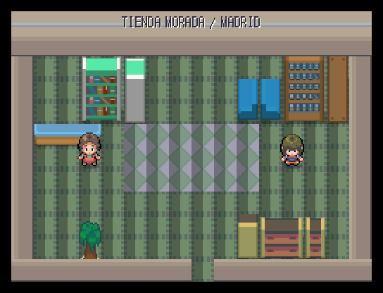 | 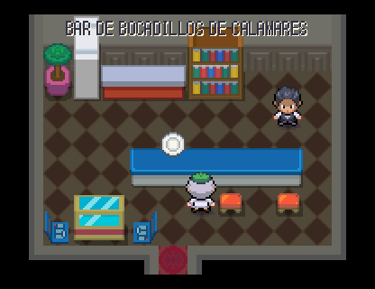 |
| Grandes almacenes de Preciados | 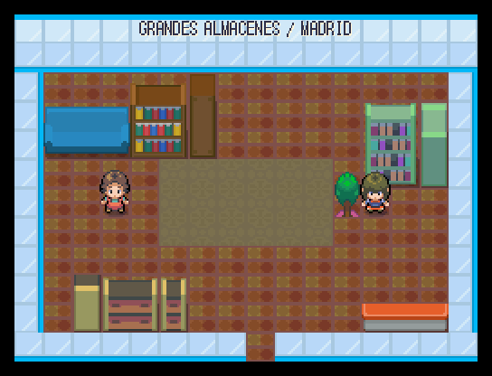 | 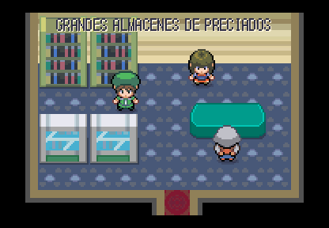 |
| Mercado de San Miguel | 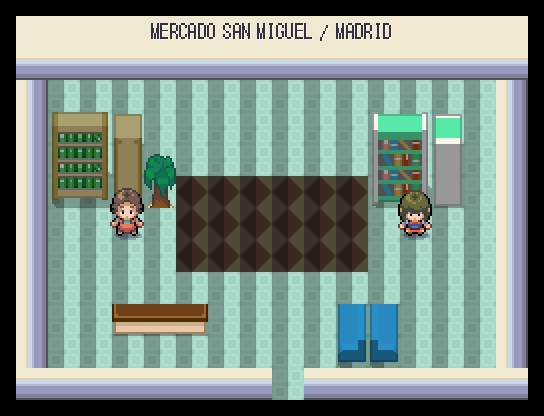 | 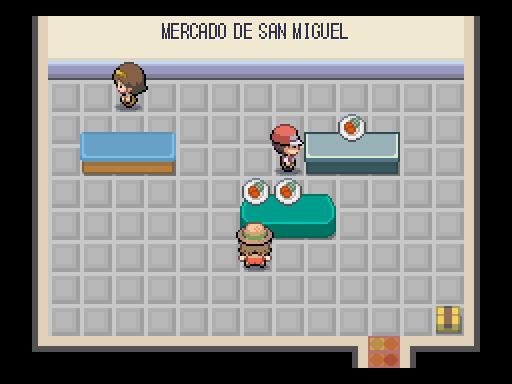 |
| Academia de oposiciones | 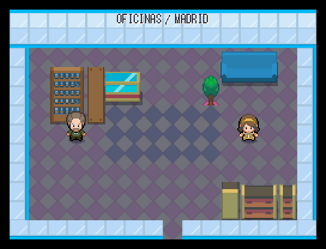 | 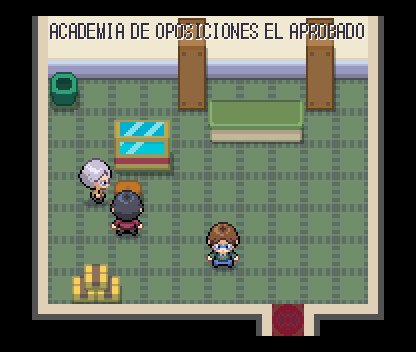 |
| Templo de Debod, pronaos | 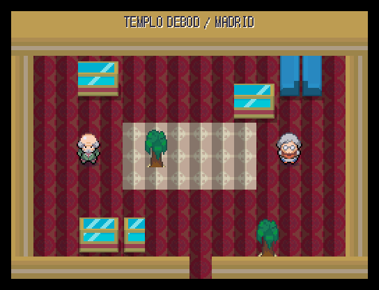 | 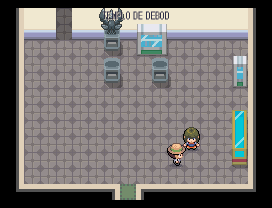 |
| Templo de Debod, naos | (no existía) | 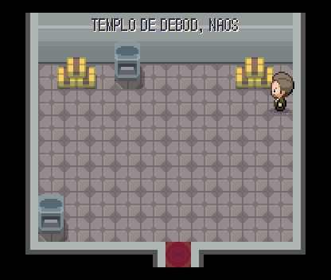 |
| Museo del Prado, vestíbulo | 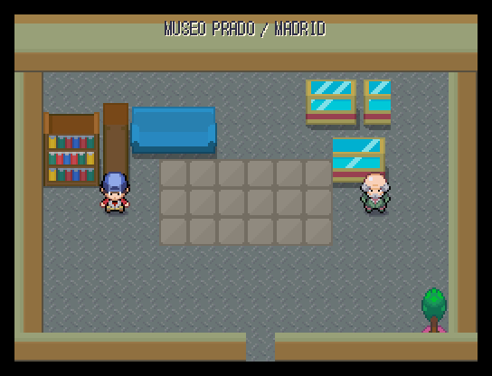 | 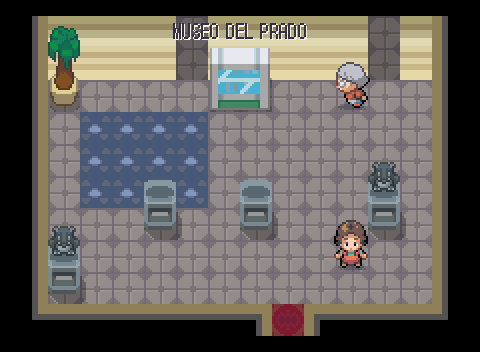 |
| Museo del Prado, sala de Velázquez | (no existía) | 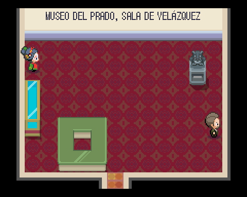 |
| Congreso, antesala | 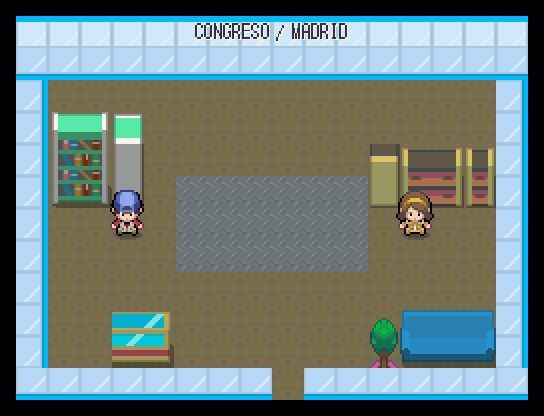 | 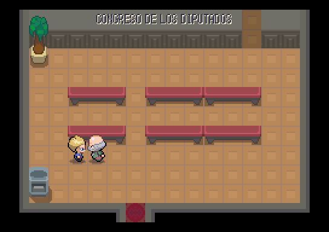 |
| Congreso, hemiciclo | (no existía) | 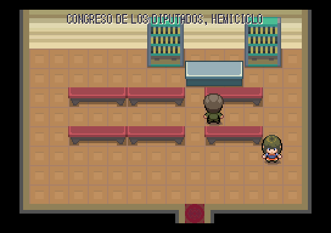 |
| Catedral de la Almudena | 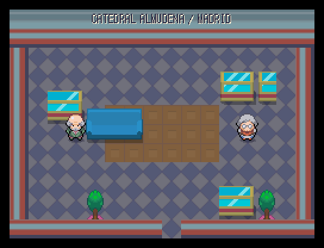 | 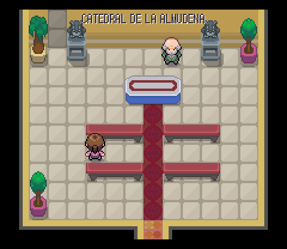 |
| Andén 0 de Chamberí | 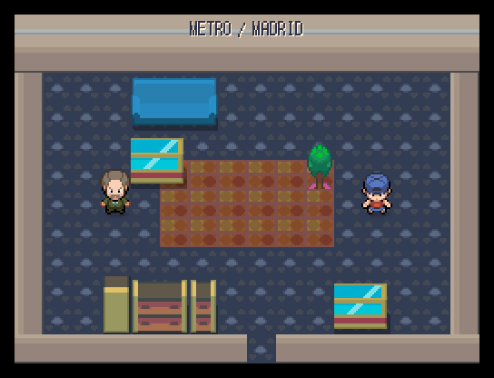 | 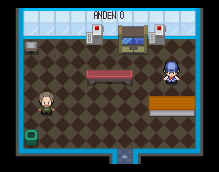 |
| Tienda oficial del Real Madrid | 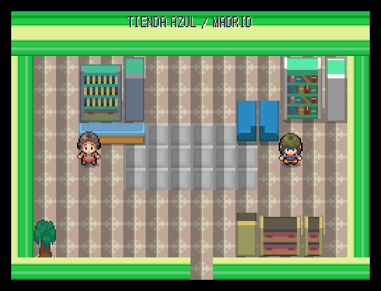 | 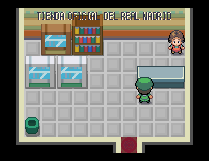 |

## Barcelona

| Sala | Antes | Después |
|---|---|---|
| Mercado de la Boqueria | 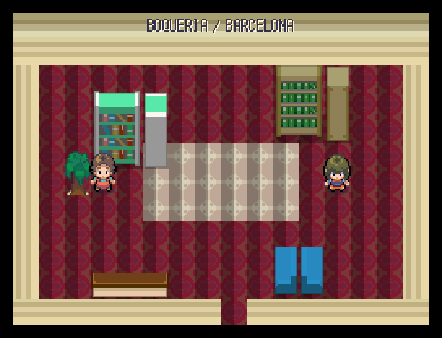 | 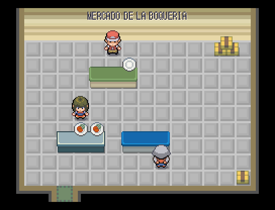 |
| Catedral de Barcelona | 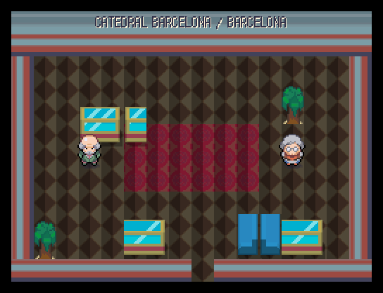 | 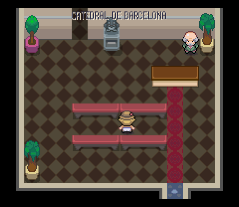 |
| Claustro de las ocas | (no existía) | 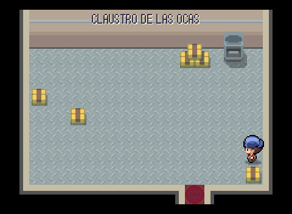 |
| Gran Teatre del Liceu | 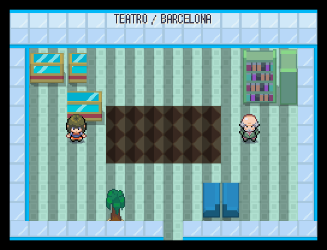 | 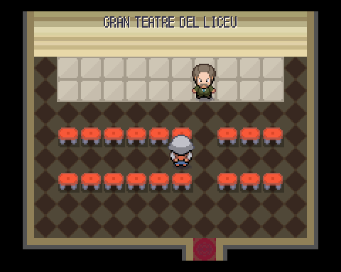 |
| Chiringuito de la Barceloneta | 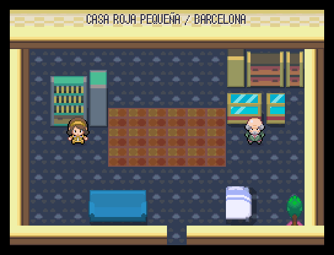 | 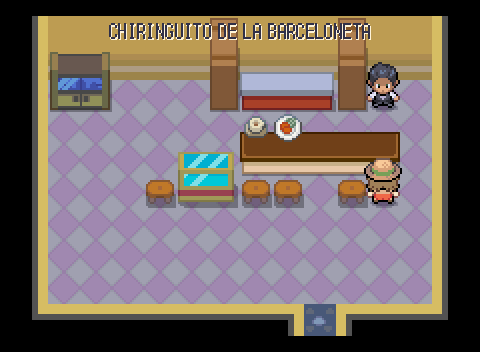 |
| Casa Batlló, entresuelo | 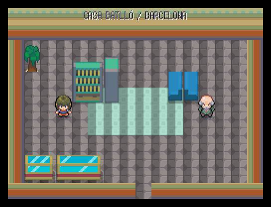 | 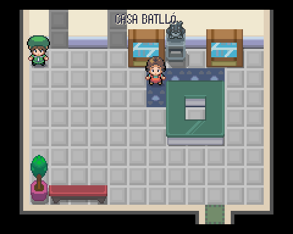 |
| Casa Batlló, azotea del dragón | (no existía) |  |
| La Pedrera, patio de luces |  |  |
| Sagrada Familia, las naves |  |  |
| Sagrada Familia, la cripta | (no existía) |  |
| La Masia |  |  |
| Bar de la penya culé |  |  |

## Valencia

| Sala | Antes | Después |
|---|---|---|
| Lonja de la Seda |  |  |
| Consulado del Mar | (no existía) |  |
| Catedral de Valencia |  |  |
| Micalet, cuerpo de campanas | (no existía) |  |
| Mercado Central, la nave |  |  |
| Mercado Central, la pescadería | (no existía) |  |
| Horchatería de Santa Catalina |  |  |
| Bar del esmorzaret |  |  |
| Casa de la paellera |  |  |
| Socorrismo de la Malvarrosa |  |  |
| Arrocería del paseo marítimo |  |  |
