# Interiores personalizados del resto del mapa · 2026-10-20

Continuación del encargo de Javier: un interior propio y con sentido para cada casa y edificio con puerta. Esta sesión cubre **361 salas** en 21 ciudades y pueblos y 9 rutas, además de dar gente propia a los **74 locales de servicio**. **Todo es provisional**: nombres, gente, frases y distribución, pendientes de Javier.

Cómo se hace: el contenido de cada sala se escribe a mano en `maps/_tools/contenido_interiores/<ciudad>.py`, se vuelca con `maps/_tools/rellenar_interiores.py` (conserva a quien da regalos) y se planifica y pinta con el sistema de interiores por datos (`planificar_interiores.py`, `pintar_interiores_datos.gd`). Los locales de servicio no se repintan: `maps/_tools/personalizar_servicios.py` cambia en la escena solo las frases del paciente o cliente, del visitante y de la placa.

Fuera, a propósito: el apeadero del AVE de San Miguel, las salas de hitos que pinta otro agente (Botín, Guggenheim, Café Iruña, ruinas de Rocafonda), las dos casas de Getafe con pruebas propias y las casas de las rutas que el agente de rutas aún está rehaciendo.

Capturas posteriores a 448×320 (las anteriores eran el interior genérico de cada pieza).

## Zaragoza (24 salas)

| 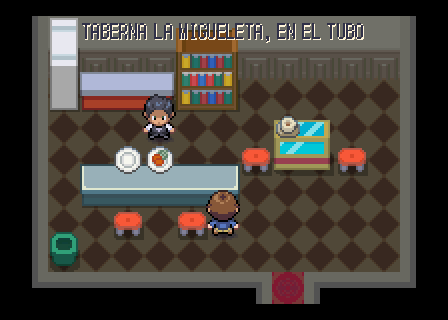 | 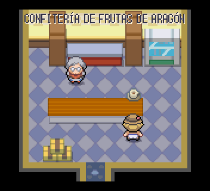 | 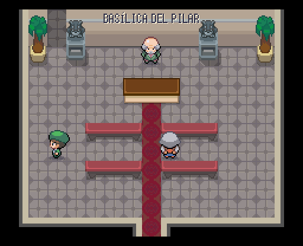 |
|---|---|---|
| Taberna La Migueleta, en El Tubo | Confitería de frutas de Aragón | Basílica del Pilar |

Todas: [Casa de la abuela del Tubo](interiores_2026-10-20/zaragoza/zaragoza__casa_1_despues.png), [Taberna La Migueleta, en El Tubo](interiores_2026-10-20/zaragoza/zaragoza__casa_2_despues.png), [Casa del baturro de la jota](interiores_2026-10-20/zaragoza/zaragoza__sala_calle_13_39_despues.png), [Casa de la familia del cierzo](interiores_2026-10-20/zaragoza/zaragoza__sala_calle_17_53_despues.png), [Confitería de frutas de Aragón](interiores_2026-10-20/zaragoza/zaragoza__sala_calle_23_53_despues.png), [Basílica del Pilar](interiores_2026-10-20/zaragoza/zaragoza__sala_calle_24_29_despues.png), [Santa Capilla del Pilar](interiores_2026-10-20/zaragoza/zaragoza__sala_calle_24_29_capilla_despues.png), [Bodega de vino de Cariñena](interiores_2026-10-20/zaragoza/zaragoza__sala_calle_28_53_despues.png), [Tasca de las madejas](interiores_2026-10-20/zaragoza/zaragoza__sala_calle_33_43_despues.png), [Piso de estudiantes de la Universidad](interiores_2026-10-20/zaragoza/zaragoza__sala_calle_33_53_despues.png), [Ayuntamiento de Zaragoza](interiores_2026-10-20/zaragoza/zaragoza__sala_calle_38_29_despues.png), [Casa de la Dolores](interiores_2026-10-20/zaragoza/zaragoza__sala_calle_38_43_despues.png), [Taller de los gigantes y cabezudos](interiores_2026-10-20/zaragoza/zaragoza__sala_calle_38_53_despues.png), [Casa del barquero del Ebro](interiores_2026-10-20/zaragoza/zaragoza__sala_calle_39_21_despues.png), [Casa de la familia de la Expo](interiores_2026-10-20/zaragoza/zaragoza__sala_calle_3_36_despues.png), [Catedral del Salvador, La Seo](interiores_2026-10-20/zaragoza/zaragoza__sala_calle_49_31_despues.png), [Museo de Tapices de La Seo](interiores_2026-10-20/zaragoza/zaragoza__sala_calle_49_31_tapices_despues.png), [Portal de la calle Alfonso](interiores_2026-10-20/zaragoza/zaragoza__sala_calle_4_46_despues.png), [Oficina de logística de Plaza](interiores_2026-10-20/zaragoza/zaragoza__sala_calle_4_56_despues.png), [Casa del aficionado del Real Zaragoza](interiores_2026-10-20/zaragoza/zaragoza__sala_calle_58_22_despues.png), [Portal del barrio de la Magdalena](interiores_2026-10-20/zaragoza/zaragoza__sala_calle_62_46_despues.png), [Basic-Fit de Zaragoza](interiores_2026-10-20/zaragoza/zaragoza__sala_calle_65_30_despues.png), [Piso de la familia del Actur](interiores_2026-10-20/zaragoza/zaragoza__sala_calle_65_56_despues.png), [Casa del jubilado del Puente de Piedra](interiores_2026-10-20/zaragoza/zaragoza__sala_calle_7_20_despues.png).

## Palma (18 salas)

| 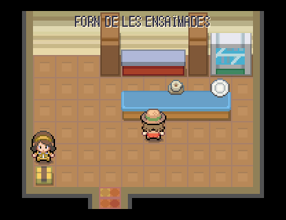 | 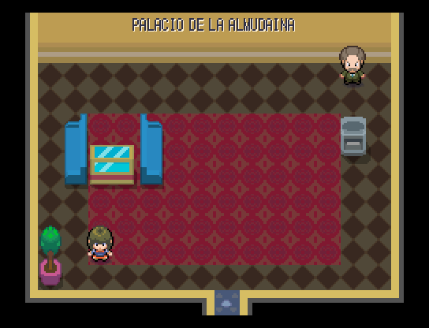 | 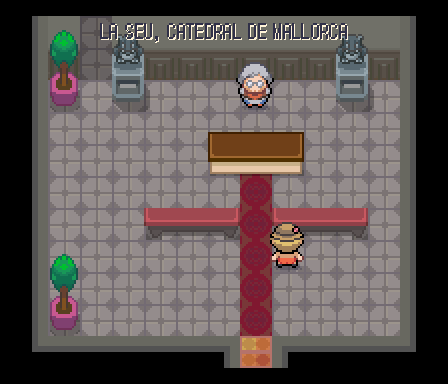 |
|---|---|---|
| Forn de les ensaïmades | Palacio de la Almudaina | La Seu, catedral de Mallorca |

Todas: [Casa de la madona del barrio de Santa Catalina](interiores_2026-10-20/palma/palma__casa_1_despues.png), [Forn de les ensaïmades](interiores_2026-10-20/palma/palma__casa_2_despues.png), [Casa del payés que vende sobrasada](interiores_2026-10-20/palma/palma__sala_calle_19_6_despues.png), [Piso de temporada de la camarera de hotel](interiores_2026-10-20/palma/palma__sala_calle_21_27_despues.png), [Palacio de la Almudaina](interiores_2026-10-20/palma/palma__sala_calle_32_40_despues.png), [Casa del regatista jubilado](interiores_2026-10-20/palma/palma__sala_calle_3_38_despues.png), [La Seu, catedral de Mallorca](interiores_2026-10-20/palma/palma__sala_calle_42_41_despues.png), [Capilla del Santísimo de Miquel Barceló](interiores_2026-10-20/palma/palma__sala_calle_42_41_barcelo_despues.png), [Casa del vecino del Molinar](interiores_2026-10-20/palma/palma__sala_calle_44_12_despues.png), [Basic-Fit de Palma](interiores_2026-10-20/palma/palma__sala_calle_45_26_despues.png), [Piso turístico del Paseo Marítimo](interiores_2026-10-20/palma/palma__sala_calle_54_30_despues.png), [Casa de la pintora del barrio de la Llotja](interiores_2026-10-20/palma/palma__sala_calle_57_21_despues.png), [Portal de la calle Jaume III](interiores_2026-10-20/palma/palma__sala_calle_59_43_despues.png), [Consell de Mallorca](interiores_2026-10-20/palma/palma__sala_calle_61_30_despues.png), [Piso del chef de un restaurante de la playa](interiores_2026-10-20/palma/palma__sala_calle_66_43_despues.png), [Portal de las Avenidas](interiores_2026-10-20/palma/palma__sala_calle_67_13_despues.png), [Casa del músico que toca a Chopin](interiores_2026-10-20/palma/palma__sala_calle_67_29_despues.png), [Castell de Bellver](interiores_2026-10-20/palma/palma__sala_calle_7_14_despues.png).

## Alicante (24 salas)

| 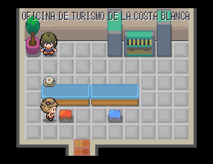 | 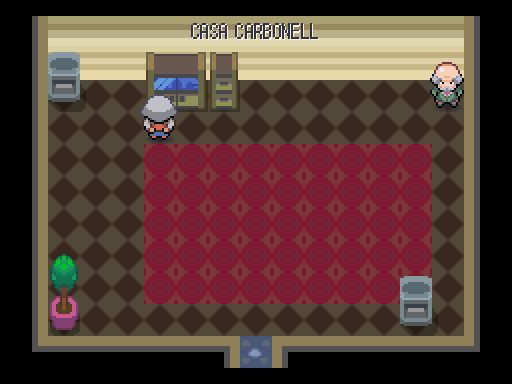 | 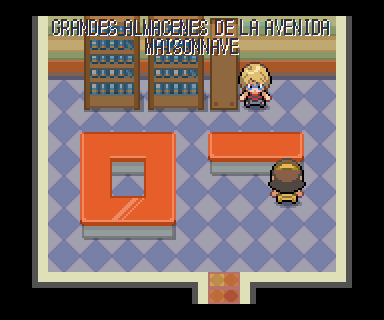 |
|---|---|---|
| Oficina de turismo de la Costa Blanca | Casa Carbonell | Grandes almacenes de la avenida Maisonnave |

Todas: [Oficina de turismo de la Costa Blanca](interiores_2026-10-20/alicante/alicante__sala_calle_12_9_despues.png), [Casa de la foguerera](interiores_2026-10-20/alicante/alicante__sala_calle_19_32_despues.png), [Casa Carbonell](interiores_2026-10-20/alicante/alicante__sala_calle_20_43_despues.png), [Grandes almacenes de la avenida Maisonnave](interiores_2026-10-20/alicante/alicante__sala_calle_22_9_despues.png), [Basic-Fit de Alicante](interiores_2026-10-20/alicante/alicante__sala_calle_24_20_despues.png), [Concatedral de San Nicolás](interiores_2026-10-20/alicante/alicante__sala_calle_28_33_despues.png), [Teatro Principal de Alicante](interiores_2026-10-20/alicante/alicante__sala_calle_29_20_despues.png), [Piso del jubilado inglés](interiores_2026-10-20/alicante/alicante__sala_calle_31_8_despues.png), [Puesto del Mercado Central](interiores_2026-10-20/alicante/alicante__sala_calle_32_12_despues.png), [Casa del turronero de Jijona](interiores_2026-10-20/alicante/alicante__sala_calle_42_19_despues.png), [Piso con cúpula frente al puerto](interiores_2026-10-20/alicante/alicante__sala_calle_42_42_despues.png), [Casa del vigilante del faro](interiores_2026-10-20/alicante/alicante__sala_calle_42_8_despues.png), [Ayuntamiento de Alicante](interiores_2026-10-20/alicante/alicante__sala_calle_44_32_despues.png), [Portal de la avenida de Alfonso el Sabio](interiores_2026-10-20/alicante/alicante__sala_calle_4_9_despues.png), [Casa encalada del Barrio de Santa Cruz](interiores_2026-10-20/alicante/alicante__sala_calle_50_26_despues.png), [Casa del costalero de Semana Santa](interiores_2026-10-20/alicante/alicante__sala_calle_50_31_despues.png), [Heladería de turrón de la Explanada](interiores_2026-10-20/alicante/alicante__sala_calle_51_43_despues.png), [Casa del guitarrista del Barrio](interiores_2026-10-20/alicante/alicante__sala_calle_55_26_despues.png), [Casa de la abuela de los gatos](interiores_2026-10-20/alicante/alicante__sala_calle_55_31_despues.png), [Puesto de artesanía de la Explanada](interiores_2026-10-20/alicante/alicante__sala_calle_56_42_despues.png), [Castillo de Santa Bárbara](interiores_2026-10-20/alicante/alicante__sala_calle_58_12_despues.png), [Caseta de socorrismo del Postiguet](interiores_2026-10-20/alicante/alicante__sala_calle_68_36_despues.png), [Club de artes marciales de la plaza de los Luceros](interiores_2026-10-20/alicante/alicante__sala_calle_6_19_despues.png), [Piso de la estudiante de la Universidad de Alicante](interiores_2026-10-20/alicante/alicante__sala_calle_7_43_despues.png).

## Murcia (23 salas)

| 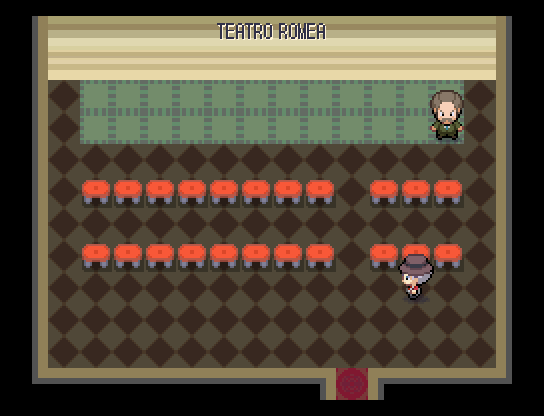 | 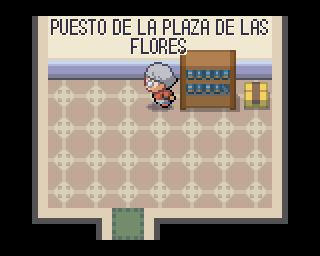 | 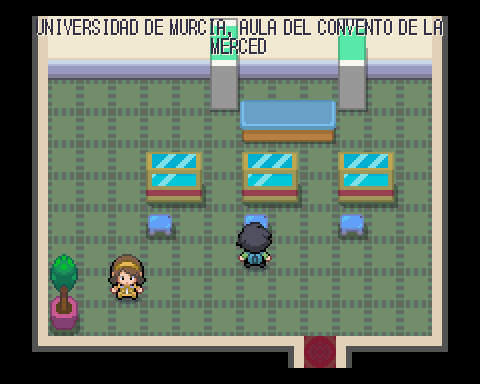 |
|---|---|---|
| Teatro Romea | Puesto de la plaza de las Flores | Universidad de Murcia, aula del Convento de la Merced |

Todas: [Teatro Romea](interiores_2026-10-20/murcia/murcia__sala_calle_11_12_despues.png), [Puesto de la plaza de las Flores](interiores_2026-10-20/murcia/murcia__sala_calle_12_25_despues.png), [Casa del huertano de la Vega](interiores_2026-10-20/murcia/murcia__sala_calle_13_53_despues.png), [Portal del barrio del Carmen](interiores_2026-10-20/murcia/murcia__sala_calle_20_54_despues.png), [Universidad de Murcia, aula del Convento de la Merced](interiores_2026-10-20/murcia/murcia__sala_calle_23_11_despues.png), [Real Casino de Murcia](interiores_2026-10-20/murcia/murcia__sala_calle_25_25_despues.png), [Piso con vistas al río Segura](interiores_2026-10-20/murcia/murcia__sala_calle_25_35_despues.png), [Pastelería de los paparajotes](interiores_2026-10-20/murcia/murcia__sala_calle_28_54_despues.png), [Puesto de limones de la plaza](interiores_2026-10-20/murcia/murcia__sala_calle_32_25_despues.png), [Catedral de Santa María de Murcia](interiores_2026-10-20/murcia/murcia__sala_calle_40_30_despues.png), [Sala de los Salzillos](interiores_2026-10-20/murcia/murcia__sala_calle_40_30_salzillo_despues.png), [Piso de la familia de la plaza Circular](interiores_2026-10-20/murcia/murcia__sala_calle_41_11_despues.png), [Edificio Moneo del Ayuntamiento](interiores_2026-10-20/murcia/murcia__sala_calle_48_35_despues.png), [Portal de la Gran Vía](interiores_2026-10-20/murcia/murcia__sala_calle_4_12_despues.png), [Piso del estudiante de Cartagena](interiores_2026-10-20/murcia/murcia__sala_calle_58_12_despues.png), [Basic-Fit de Murcia](interiores_2026-10-20/murcia/murcia__sala_calle_58_26_despues.png), [Barraca huertana](interiores_2026-10-20/murcia/murcia__sala_calle_59_34_despues.png), [Casa de la familia de la Fuensanta](interiores_2026-10-20/murcia/murcia__sala_calle_59_53_despues.png), [Floristería de la Vega](interiores_2026-10-20/murcia/murcia__sala_calle_5_26_despues.png), [Casa del cocinero del michirones](interiores_2026-10-20/murcia/murcia__sala_calle_63_25_despues.png), [Casa de la familia del Entierro de la Sardina](interiores_2026-10-20/murcia/murcia__sala_calle_65_11_despues.png), [Casa del agricultor del trasvase](interiores_2026-10-20/murcia/murcia__sala_calle_65_34_despues.png), [Casa de la bordadora de huertanos](interiores_2026-10-20/murcia/murcia__sala_calle_65_53_despues.png).

## Málaga (20 salas)

| 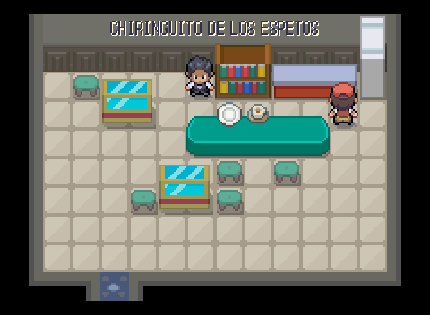 | 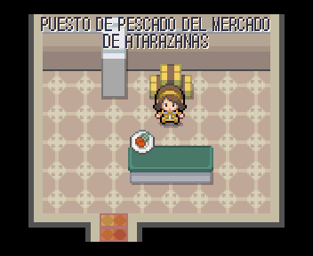 | 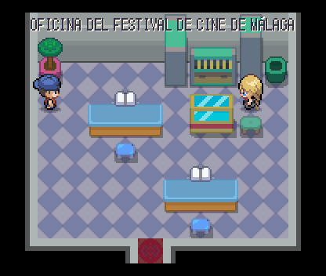 |
|---|---|---|
| Chiringuito de los espetos | Puesto de pescado del Mercado de Atarazanas | Oficina del Festival de Cine de Málaga |

Todas: [Casa de la abuela del barrio del Perchel](interiores_2026-10-20/malaga/malaga__casa_1_despues.png), [Chiringuito de los espetos](interiores_2026-10-20/malaga/malaga__casa_2_despues.png), [Puesto de pescado del Mercado de Atarazanas](interiores_2026-10-20/malaga/malaga__sala_calle_23_39_despues.png), [Oficina del Festival de Cine de Málaga](interiores_2026-10-20/malaga/malaga__sala_calle_25_54_despues.png), [Puesto de frutas tropicales de Atarazanas](interiores_2026-10-20/malaga/malaga__sala_calle_29_39_despues.png), [Casa de la familia de la Semana Santa](interiores_2026-10-20/malaga/malaga__sala_calle_31_7_despues.png), [Puesto de vinos dulces de Atarazanas](interiores_2026-10-20/malaga/malaga__sala_calle_35_39_despues.png), [Casa del vecino de los corralones de la Trinidad](interiores_2026-10-20/malaga/malaga__sala_calle_3_6_despues.png), [Catedral de la Encarnación, La Manquita](interiores_2026-10-20/malaga/malaga__sala_calle_48_35_despues.png), [Basic-Fit de Málaga](interiores_2026-10-20/malaga/malaga__sala_calle_50_42_despues.png), [Casa del pintor de la Plaza de la Merced](interiores_2026-10-20/malaga/malaga__sala_calle_58_10_despues.png), [Casa del cantaor de verdiales](interiores_2026-10-20/malaga/malaga__sala_calle_5_13_despues.png), [Alcazaba de Málaga](interiores_2026-10-20/malaga/malaga__sala_calle_60_35_despues.png), [Velero de alquiler del Muelle Uno](interiores_2026-10-20/malaga/malaga__sala_calle_67_70_despues.png), [Casa del vecino de la Malagueta](interiores_2026-10-20/malaga/malaga__sala_calle_72_8_despues.png), [Castillo de Gibralfaro](interiores_2026-10-20/malaga/malaga__sala_calle_76_16_despues.png), [Caseta de socorrismo de la Malagueta](interiores_2026-10-20/malaga/malaga__sala_calle_77_65_despues.png), [Portal del Paseo de Reding](interiores_2026-10-20/malaga/malaga__sala_calle_80_9_despues.png), [Casa del biznaguero](interiores_2026-10-20/malaga/malaga__sala_calle_83_64_despues.png), [Casa del extranjero de la Costa del Sol](interiores_2026-10-20/malaga/malaga__sala_calle_87_8_despues.png).

## Las Palmas (27 salas)

| 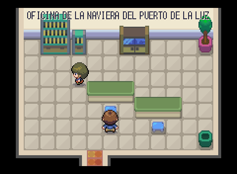 | 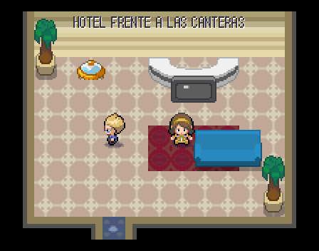 | 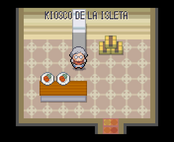 |
|---|---|---|
| Oficina de la naviera del puerto de La Luz | Hotel frente a Las Canteras | Kiosco de la Isleta |

Todas: [Oficina de la naviera del puerto de La Luz](interiores_2026-10-20/las_palmas/las_palmas__sala_canteras_24_46_despues.png), [Hotel frente a Las Canteras](interiores_2026-10-20/las_palmas/las_palmas__sala_canteras_25_32_despues.png), [Kiosco de la Isleta](interiores_2026-10-20/las_palmas/las_palmas__sala_canteras_26_19_despues.png), [Piso del surfista de La Cícer](interiores_2026-10-20/las_palmas/las_palmas__sala_canteras_33_32_despues.png), [Tienda de surf de Las Canteras](interiores_2026-10-20/las_palmas/las_palmas__sala_canteras_39_21_despues.png), [Piso de la familia canaria del Puerto](interiores_2026-10-20/las_palmas/las_palmas__sala_canteras_41_31_despues.png), [Portal del barrio de Guanarteme](interiores_2026-10-20/las_palmas/las_palmas__sala_canteras_41_46_despues.png), [Castillo de la Luz](interiores_2026-10-20/las_palmas/las_palmas__sala_canteras_43_15_despues.png), [Tienda de timples de la calle Mayor de Triana](interiores_2026-10-20/las_palmas/las_palmas__sala_vegueta_triana_11_8_despues.png), [Casa canaria de balcón de madera](interiores_2026-10-20/las_palmas/las_palmas__sala_vegueta_triana_18_30_despues.png), [Gabinete Literario](interiores_2026-10-20/las_palmas/las_palmas__sala_vegueta_triana_18_8_despues.png), [Casa del guagüero de Triana](interiores_2026-10-20/las_palmas/las_palmas__sala_vegueta_triana_19_19_despues.png), [Catedral de Santa Ana](interiores_2026-10-20/las_palmas/las_palmas__sala_vegueta_triana_21_38_despues.png), [Torre de la catedral de Santa Ana](interiores_2026-10-20/las_palmas/las_palmas__sala_vegueta_triana_21_38_torre_despues.png), [Casa de la murguera del Carnaval](interiores_2026-10-20/las_palmas/las_palmas__sala_vegueta_triana_24_19_despues.png), [Cafetería de la calle Mayor de Triana](interiores_2026-10-20/las_palmas/las_palmas__sala_vegueta_triana_25_8_despues.png), [Casa del platanero](interiores_2026-10-20/las_palmas/las_palmas__sala_vegueta_triana_31_27_despues.png), [Casa de Colón](interiores_2026-10-20/las_palmas/las_palmas__sala_vegueta_triana_31_37_despues.png), [Casa de la quesera de Flor de Guía](interiores_2026-10-20/las_palmas/las_palmas__sala_vegueta_triana_36_37_despues.png), [Casa del luchador canario](interiores_2026-10-20/las_palmas/las_palmas__sala_vegueta_triana_37_46_despues.png), [Casa del poeta de Vegueta](interiores_2026-10-20/las_palmas/las_palmas__sala_vegueta_triana_39_22_despues.png), [Casa de la abuela de los mojos](interiores_2026-10-20/las_palmas/las_palmas__sala_vegueta_triana_3_35_despues.png), [Casa del pescador de San Cristóbal](interiores_2026-10-20/las_palmas/las_palmas__sala_vegueta_triana_3_46_despues.png), [Puesto del Mercado de Vegueta](interiores_2026-10-20/las_palmas/las_palmas__sala_vegueta_triana_42_37_despues.png), [Casa de la familia del ron miel](interiores_2026-10-20/las_palmas/las_palmas__sala_vegueta_triana_42_46_despues.png), [Casa de la diseñadora de Triana](interiores_2026-10-20/las_palmas/las_palmas__sala_vegueta_triana_4_8_despues.png), [Bodega de vino del Monte Lentiscal](interiores_2026-10-20/las_palmas/las_palmas__sala_vegueta_triana_8_35_despues.png).

## Playa del Inglés (8 salas)

| 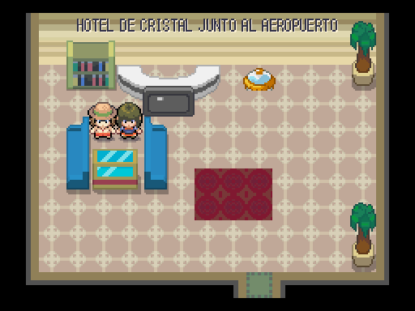 | 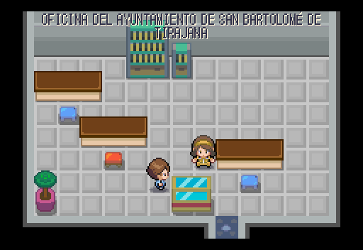 | 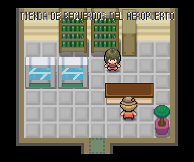 |
|---|---|---|
| Hotel de cristal junto al aeropuerto | Oficina del ayuntamiento de San Bartolomé de Tirajana | Tienda de recuerdos del aeropuerto |

Todas: [Hotel de cristal junto al aeropuerto](interiores_2026-10-20/playa_del_ingles/playa_del_ingles__sala_calle_16_18_despues.png), [Apartamento de la temporada de invierno](interiores_2026-10-20/playa_del_ingles/playa_del_ingles__sala_calle_24_21_despues.png), [Apartamento de la promotora del concierto](interiores_2026-10-20/playa_del_ingles/playa_del_ingles__sala_calle_33_20_despues.png), [Oficina del ayuntamiento de San Bartolomé de Tirajana](interiores_2026-10-20/playa_del_ingles/playa_del_ingles__sala_calle_39_21_despues.png), [Tienda de recuerdos del aeropuerto](interiores_2026-10-20/playa_del_ingles/playa_del_ingles__sala_calle_41_7_despues.png), [Caseta de socorrismo de Playa del Inglés](interiores_2026-10-20/playa_del_ingles/playa_del_ingles__sala_calle_53_11_despues.png), [Centro comercial Yumbo](interiores_2026-10-20/playa_del_ingles/playa_del_ingles__sala_calle_5_20_despues.png), [Faro de Maspalomas](interiores_2026-10-20/playa_del_ingles/playa_del_ingles__sala_calle_7_54_despues.png).

## Vigo (12 salas)

| 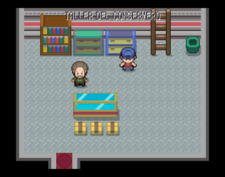 | 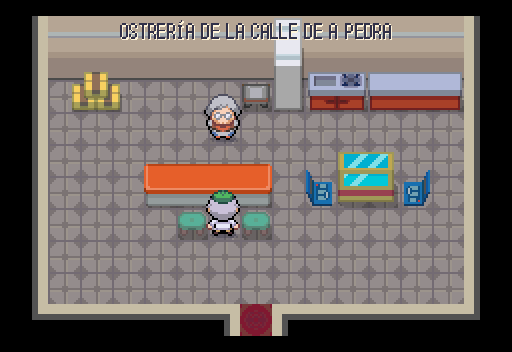 | 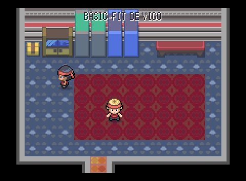 |
|---|---|---|
| Taller del conservero | Ostrería de la calle de A Pedra | Basic-Fit de Vigo |

Todas: [Casa de la mariscadora de Bouzas](interiores_2026-10-20/vigo/vigo__casa_1_despues.png), [Casa del trabajador de los astilleros](interiores_2026-10-20/vigo/vigo__casa_2_despues.png), [Taller del conservero](interiores_2026-10-20/vigo/vigo__casa_3_despues.png), [Casa del vecino de Teis](interiores_2026-10-20/vigo/vigo__casa_4_despues.png), [Casa de la pulpeira](interiores_2026-10-20/vigo/vigo__sala_calle_11_7_despues.png), [Casa de la gaiteira](interiores_2026-10-20/vigo/vigo__sala_calle_16_8_despues.png), [Ostrería de la calle de A Pedra](interiores_2026-10-20/vigo/vigo__sala_calle_17_29_despues.png), [Basic-Fit de Vigo](interiores_2026-10-20/vigo/vigo__sala_calle_33_18_despues.png), [Casa del aficionado del Celta](interiores_2026-10-20/vigo/vigo__sala_calle_3_6_despues.png), [Portal de la calle Príncipe](interiores_2026-10-20/vigo/vigo__sala_calle_42_18_despues.png), [Concello de Vigo](interiores_2026-10-20/vigo/vigo__sala_calle_42_32_despues.png), [Piso con vistas a las islas Cíes](interiores_2026-10-20/vigo/vigo__sala_calle_49_31_despues.png).

## Huelva (9 salas)

| 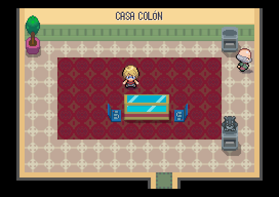 | 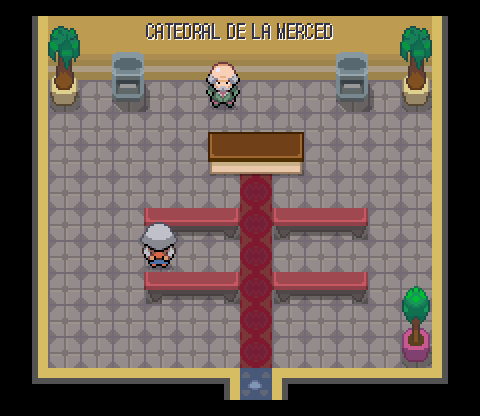 | 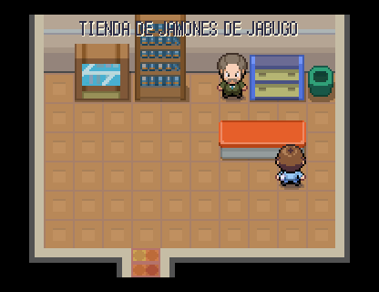 |
|---|---|---|
| Casa Colón | Catedral de la Merced | Tienda de jamones de Jabugo |

Todas: [Casa inglesa del Barrio Obrero](interiores_2026-10-20/huelva/huelva__casa_1_despues.png), [Casa del marisquero de gambas blancas](interiores_2026-10-20/huelva/huelva__casa_2_despues.png), [Casa Colón](interiores_2026-10-20/huelva/huelva__sala_calle_20_12_despues.png), [Catedral de la Merced](interiores_2026-10-20/huelva/huelva__sala_calle_31_12_despues.png), [Tienda de jamones de Jabugo](interiores_2026-10-20/huelva/huelva__sala_calle_39_27_despues.png), [Piso del trabajador del Polo Químico](interiores_2026-10-20/huelva/huelva__sala_calle_46_31_despues.png), [Casa de la familia del Rocío](interiores_2026-10-20/huelva/huelva__sala_calle_49_8_despues.png), [Casa del marinero de Palos](interiores_2026-10-20/huelva/huelva__sala_calle_53_17_despues.png), [Casa de la jornalera de la fresa](interiores_2026-10-20/huelva/huelva__sala_calle_55_8_despues.png).

## Valladolid (15 salas)

| 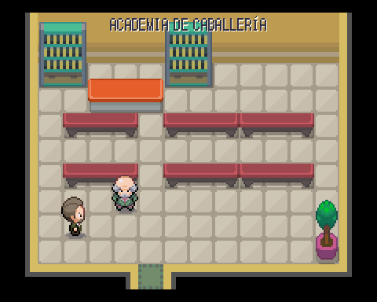 | 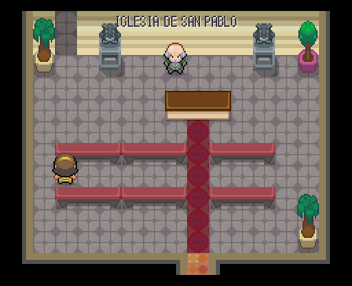 | 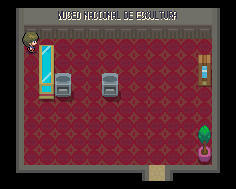 |
|---|---|---|
| Academia de Caballería | Iglesia de San Pablo | Museo Nacional de Escultura |

Todas: [Casa de la familia pucelana de la Plaza Mayor](interiores_2026-10-20/valladolid/valladolid__casa_1_despues.png), [Casa del cofrade de Semana Santa](interiores_2026-10-20/valladolid/valladolid__casa_2_despues.png), [Academia de Caballería](interiores_2026-10-20/valladolid/valladolid__sala_calle_20_51_despues.png), [Iglesia de San Pablo](interiores_2026-10-20/valladolid/valladolid__sala_calle_23_15_despues.png), [Museo Nacional de Escultura](interiores_2026-10-20/valladolid/valladolid__sala_calle_23_15_museo_despues.png), [Casa del lechazo asado](interiores_2026-10-20/valladolid/valladolid__sala_calle_3_18_despues.png), [Casa de la escritora de la calle Santiago](interiores_2026-10-20/valladolid/valladolid__sala_calle_3_6_despues.png), [Casa del bodeguero de la Ribera del Duero](interiores_2026-10-20/valladolid/valladolid__sala_calle_47_9_despues.png), [Confitería de las Delicias del Pasaje](interiores_2026-10-20/valladolid/valladolid__sala_calle_49_47_despues.png), [Casa del actor del Teatro Zorrilla](interiores_2026-10-20/valladolid/valladolid__sala_calle_50_26_despues.png), [Casa de la familia del Campo Grande](interiores_2026-10-20/valladolid/valladolid__sala_calle_56_48_despues.png), [Catedral de Valladolid](interiores_2026-10-20/valladolid/valladolid__sala_calle_59_16_despues.png), [Basic-Fit de Valladolid](interiores_2026-10-20/valladolid/valladolid__sala_calle_64_38_despues.png), [Casa del aficionado del Real Valladolid](interiores_2026-10-20/valladolid/valladolid__sala_calle_65_50_despues.png), [Portal de la calle Santiago](interiores_2026-10-20/valladolid/valladolid__sala_calle_66_14_despues.png).

## Puertollano (20 salas)

| 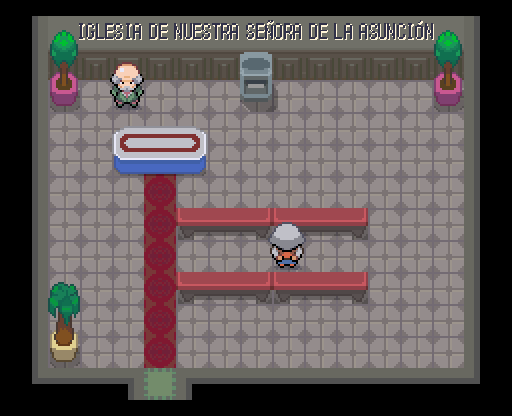 | 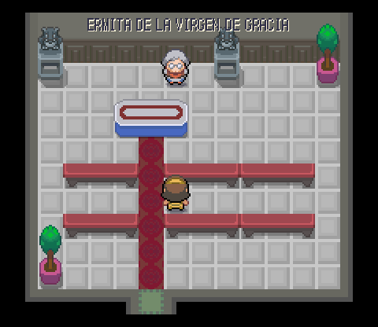 | 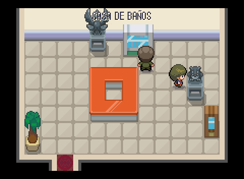 |
|---|---|---|
| Iglesia de Nuestra Señora de la Asunción | Ermita de la Virgen de Gracia | Casa de Baños |

Todas: [Casa de la familia minera](interiores_2026-10-20/puertollano/puertollano__casa_1_despues.png), [Casa del aficionado al agua agria](interiores_2026-10-20/puertollano/puertollano__casa_2_despues.png), [Iglesia de Nuestra Señora de la Asunción](interiores_2026-10-20/puertollano/puertollano__sala_calle_16_43_despues.png), [Casa del pastor manchego](interiores_2026-10-20/puertollano/puertollano__sala_calle_19_24_despues.png), [Casa de la familia de las Fiestas de Mayo](interiores_2026-10-20/puertollano/puertollano__sala_calle_21_60_despues.png), [Casa del soldador de la petroquímica](interiores_2026-10-20/puertollano/puertollano__sala_calle_22_42_despues.png), [Ermita de la Virgen de Gracia](interiores_2026-10-20/puertollano/puertollano__sala_calle_30_12_despues.png), [Casa del niño que quiere ser ingeniero](interiores_2026-10-20/puertollano/puertollano__sala_calle_37_21_despues.png), [Portal del barrio de las Seiscientas](interiores_2026-10-20/puertollano/puertollano__sala_calle_38_13_despues.png), [Casa de Baños](interiores_2026-10-20/puertollano/puertollano__sala_calle_44_35_despues.png), [Casa de la maestra jubilada](interiores_2026-10-20/puertollano/puertollano__sala_calle_51_6_despues.png), [Museo de la Minería](interiores_2026-10-20/puertollano/puertollano__sala_calle_51_60_despues.png), [Casa del ciclista del Cerro de Santa Ana](interiores_2026-10-20/puertollano/puertollano__sala_calle_59_7_despues.png), [Casa de la abuela de las tortas de Alcázar](interiores_2026-10-20/puertollano/puertollano__sala_calle_61_16_despues.png), [Oficina del complejo industrial](interiores_2026-10-20/puertollano/puertollano__sala_calle_62_33_despues.png), [Bar de los jubilados del pozo](interiores_2026-10-20/puertollano/puertollano__sala_calle_64_8_despues.png), [Basic-Fit de Puertollano](interiores_2026-10-20/puertollano/puertollano__sala_calle_65_51_despues.png), [Casa de la tejedora de encaje](interiores_2026-10-20/puertollano/puertollano__sala_calle_6_23_despues.png), [Estación de Puertollano](interiores_2026-10-20/puertollano/puertollano__sala_calle_6_36_despues.png), [Portal de la avenida Primero de Mayo](interiores_2026-10-20/puertollano/puertollano__sala_calle_7_61_despues.png).

## Getafe (16 salas)

| 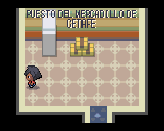 | 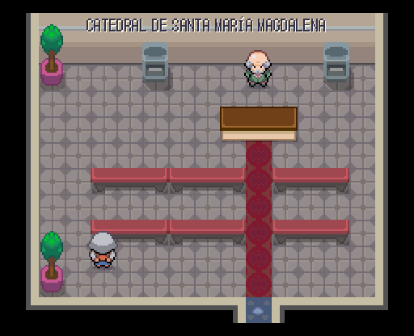 | 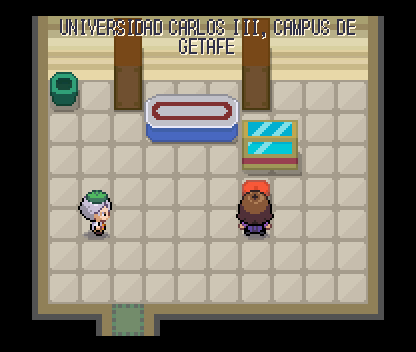 |
|---|---|---|
| Puesto del mercadillo de Getafe | Catedral de Santa María Magdalena | Universidad Carlos III, campus de Getafe |

Todas: [Casa del mecánico de aviones](interiores_2026-10-20/getafe/getafe__casa_2_despues.png), [Casa del concejal de fiestas](interiores_2026-10-20/getafe/getafe__sala_calle_16_20_despues.png), [Casa del aficionado del Getafe CF](interiores_2026-10-20/getafe/getafe__sala_calle_19_58_despues.png), [Casa de la familia del Sector III](interiores_2026-10-20/getafe/getafe__sala_calle_21_46_despues.png), [Puesto del mercadillo de Getafe](interiores_2026-10-20/getafe/getafe__sala_calle_25_27_despues.png), [Catedral de Santa María Magdalena](interiores_2026-10-20/getafe/getafe__sala_calle_27_21_despues.png), [Casa del hortelano de la vega del Manzanares](interiores_2026-10-20/getafe/getafe__sala_calle_30_58_despues.png), [Universidad Carlos III, campus de Getafe](interiores_2026-10-20/getafe/getafe__sala_calle_31_47_despues.png), [Basic-Fit de Getafe](interiores_2026-10-20/getafe/getafe__sala_calle_37_36_despues.png), [Casa del taxista del sur](interiores_2026-10-20/getafe/getafe__sala_calle_4_46_despues.png), [Casa de los primos del pueblo](interiores_2026-10-20/getafe/getafe__sala_calle_4_58_despues.png), [Casa de la piloto jubilada](interiores_2026-10-20/getafe/getafe__sala_calle_51_6_despues.png), [Ermita del Cerro de los Ángeles](interiores_2026-10-20/getafe/getafe__sala_calle_54_44_despues.png), [Casa del estudiante que comparte con su abuela](interiores_2026-10-20/getafe/getafe__sala_calle_55_23_despues.png), [Casa de la familia de la base aérea](interiores_2026-10-20/getafe/getafe__sala_calle_59_7_despues.png), [Oficina de la factoría aeronáutica](interiores_2026-10-20/getafe/getafe__sala_calle_5_9_despues.png).

## Leganés (15 salas)

| 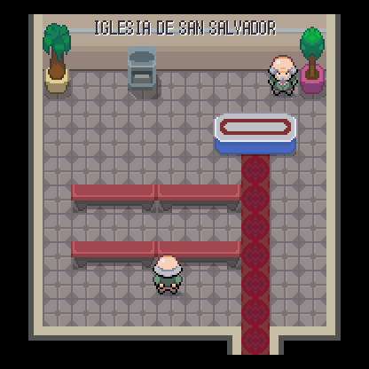 | 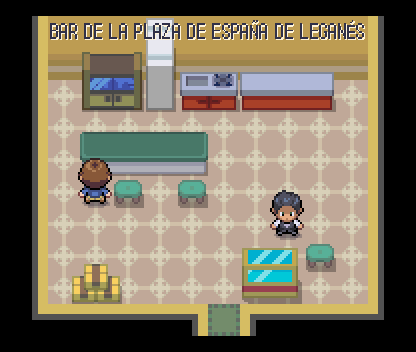 | 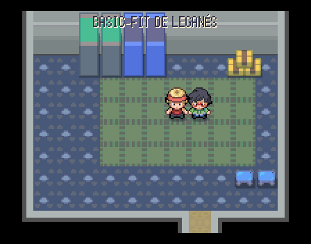 |
|---|---|---|
| Iglesia de San Salvador | Bar de la plaza de España de Leganés | Basic-Fit de Leganés |

Todas: [Casa de la abuela pepinera](interiores_2026-10-20/leganes/leganes__casa_1_despues.png), [Casa grande de la familia del Pepinero](interiores_2026-10-20/leganes/leganes__casa_2_despues.png), [Casa del escultor de la calle](interiores_2026-10-20/leganes/leganes__sala_calle_15_29_despues.png), [Casa de la familia de Zarzaquemada](interiores_2026-10-20/leganes/leganes__sala_calle_19_35_despues.png), [Iglesia de San Salvador](interiores_2026-10-20/leganes/leganes__sala_calle_20_21_despues.png), [Casa del profesor de la Carlos III](interiores_2026-10-20/leganes/leganes__sala_calle_26_36_despues.png), [Bar de la plaza de España de Leganés](interiores_2026-10-20/leganes/leganes__sala_calle_29_20_despues.png), [Casa de la ciclista del parque de Polvoranca](interiores_2026-10-20/leganes/leganes__sala_calle_37_35_despues.png), [Portal de la avenida de Fuenlabrada](interiores_2026-10-20/leganes/leganes__sala_calle_44_37_despues.png), [Casa de la enfermera del Severo Ochoa](interiores_2026-10-20/leganes/leganes__sala_calle_51_36_despues.png), [Casa del vendedor de la feria de agosto](interiores_2026-10-20/leganes/leganes__sala_calle_53_6_despues.png), [Basic-Fit de Leganés](interiores_2026-10-20/leganes/leganes__sala_calle_56_23_despues.png), [Casa del jubilado de las cigüeñas](interiores_2026-10-20/leganes/leganes__sala_calle_59_37_despues.png), [Oficina de atención al viajero de la C-5](interiores_2026-10-20/leganes/leganes__sala_calle_5_13_despues.png), [Cuartel de las Reales Guardias Valonas](interiores_2026-10-20/leganes/leganes__sala_calle_5_36_despues.png).

## Móstoles (19 salas)

| 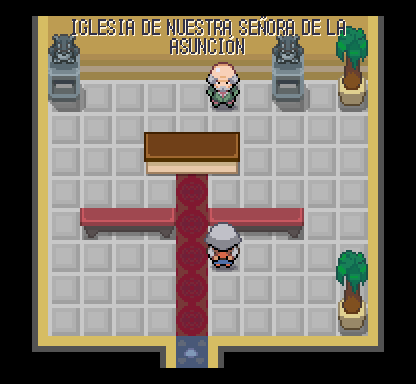 | 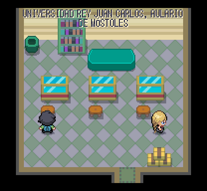 | 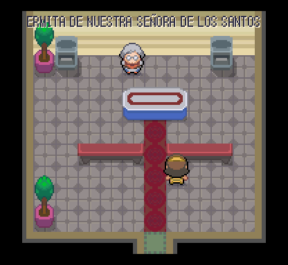 |
|---|---|---|
| Iglesia de Nuestra Señora de la Asunción | Universidad Rey Juan Carlos, aulario de Móstoles | Ermita de Nuestra Señora de los Santos |

Todas: [Casa de la abuela del bando de 1808](interiores_2026-10-20/mostoles/mostoles__casa_1_despues.png), [Casa del mostoleño de los ochenta](interiores_2026-10-20/mostoles/mostoles__casa_2_despues.png), [Casa de la investigadora del campus](interiores_2026-10-20/mostoles/mostoles__sala_calle_11_6_despues.png), [Iglesia de Nuestra Señora de la Asunción](interiores_2026-10-20/mostoles/mostoles__sala_calle_20_20_despues.png), [Universidad Rey Juan Carlos, aulario de Móstoles](interiores_2026-10-20/mostoles/mostoles__sala_calle_23_11_despues.png), [Casa del mostoleño que sabe de historia](interiores_2026-10-20/mostoles/mostoles__sala_calle_24_29_despues.png), [Casa de la familia del parque El Soto](interiores_2026-10-20/mostoles/mostoles__sala_calle_25_48_despues.png), [Ermita de Nuestra Señora de los Santos](interiores_2026-10-20/mostoles/mostoles__sala_calle_30_20_despues.png), [Bar de las tapas de Móstoles](interiores_2026-10-20/mostoles/mostoles__sala_calle_32_48_despues.png), [Casa de la pintora del Pradillo](interiores_2026-10-20/mostoles/mostoles__sala_calle_39_19_despues.png), [Casa del batería del grupo del barrio](interiores_2026-10-20/mostoles/mostoles__sala_calle_39_28_despues.png), [Ayuntamiento de Móstoles](interiores_2026-10-20/mostoles/mostoles__sala_calle_41_49_despues.png), [Casa del jubilado de la petanca](interiores_2026-10-20/mostoles/mostoles__sala_calle_47_15_despues.png), [Casa de la familia de Villafontana](interiores_2026-10-20/mostoles/mostoles__sala_calle_53_48_despues.png), [Casa pequeña del vecino solitario](interiores_2026-10-20/mostoles/mostoles__sala_calle_55_28_despues.png), [Basic-Fit de Móstoles](interiores_2026-10-20/mostoles/mostoles__sala_calle_56_37_despues.png), [Biblioteca del campus de Móstoles](interiores_2026-10-20/mostoles/mostoles__sala_calle_5_10_despues.png), [Casa Museo Andrés Torrejón](interiores_2026-10-20/mostoles/mostoles__sala_calle_5_23_despues.png), [Casa de la abuela de los torreznos](interiores_2026-10-20/mostoles/mostoles__sala_calle_7_34_despues.png).

## Santander (13 salas)

| 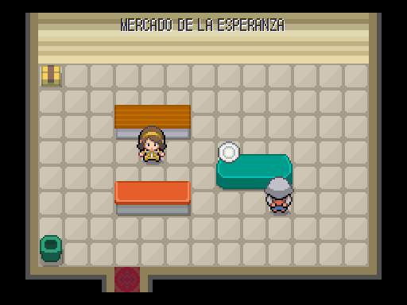 | 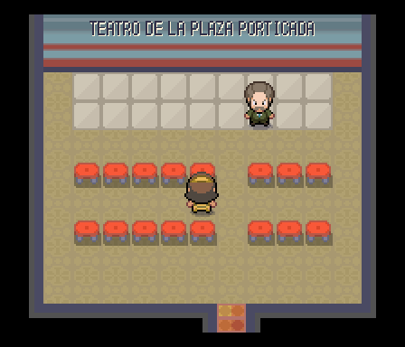 | 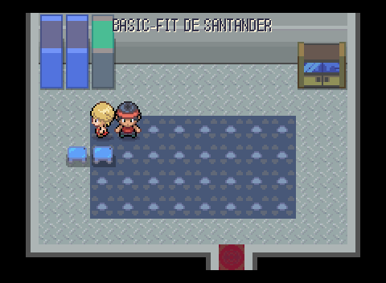 |
|---|---|---|
| Mercado de la Esperanza | Teatro de la Plaza Porticada | Basic-Fit de Santander |

Todas: [Villa de veraneo del Sardinero](interiores_2026-10-20/santander/santander__sala_calle_21_5_despues.png), [Mercado de la Esperanza](interiores_2026-10-20/santander/santander__sala_calle_30_18_despues.png), [Teatro de la Plaza Porticada](interiores_2026-10-20/santander/santander__sala_calle_32_29_despues.png), [Portal de la calle Burgos](interiores_2026-10-20/santander/santander__sala_calle_39_18_despues.png), [Basic-Fit de Santander](interiores_2026-10-20/santander/santander__sala_calle_41_29_despues.png), [Caseta de socorrismo del Sardinero](interiores_2026-10-20/santander/santander__sala_calle_45_6_despues.png), [Catedral de Nuestra Señora de la Asunción](interiores_2026-10-20/santander/santander__sala_calle_4_18_despues.png), [Iglesia del Cristo (cripta de la catedral)](interiores_2026-10-20/santander/santander__sala_calle_4_18_cristo_despues.png), [Floristería de los Jardines de Pereda](interiores_2026-10-20/santander/santander__sala_calle_4_29_despues.png), [Gran Casino del Sardinero](interiores_2026-10-20/santander/santander__sala_calle_53_11_despues.png), [Palacio de la Magdalena](interiores_2026-10-20/santander/santander__sala_calle_58_29_despues.png), [Casa del pejino de Puertochico](interiores_2026-10-20/santander/santander__sala_calle_5_11_despues.png), [Casa de la familia del Racing](interiores_2026-10-20/santander/santander__sala_calle_9_28_despues.png).

## Bilbao (14 salas)

| 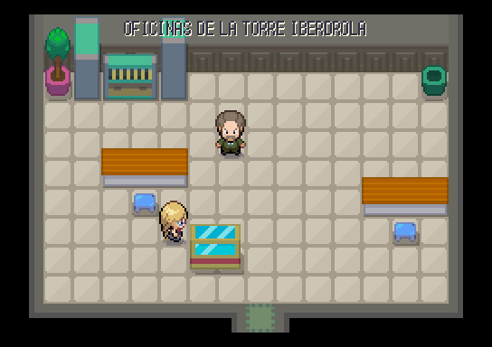 | 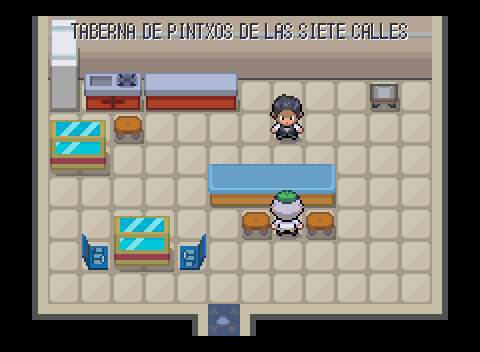 | 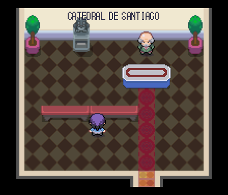 |
|---|---|---|
| Oficinas de la Torre Iberdrola | Taberna de pintxos de las Siete Calles | Catedral de Santiago |

Todas: [Oficinas de la Torre Iberdrola](interiores_2026-10-20/bilbao/bilbao__sala_calle_29_25_despues.png), [Taberna de pintxos de las Siete Calles](interiores_2026-10-20/bilbao/bilbao__sala_calle_34_42_despues.png), [Casa del remero de la trainera](interiores_2026-10-20/bilbao/bilbao__sala_calle_35_7_despues.png), [Piso de la familia de Abando](interiores_2026-10-20/bilbao/bilbao__sala_calle_38_26_despues.png), [Catedral de Santiago](interiores_2026-10-20/bilbao/bilbao__sala_calle_44_41_despues.png), [Basic-Fit de Bilbao](interiores_2026-10-20/bilbao/bilbao__sala_calle_46_14_despues.png), [Portal de la Gran Vía de Bilbao](interiores_2026-10-20/bilbao/bilbao__sala_calle_50_14_despues.png), [Teatro Arriaga](interiores_2026-10-20/bilbao/bilbao__sala_calle_53_27_despues.png), [Casa del aficionado del Athletic](interiores_2026-10-20/bilbao/bilbao__sala_calle_57_18_despues.png), [Mercado de la Ribera](interiores_2026-10-20/bilbao/bilbao__sala_calle_57_41_despues.png), [Sociedad gastronómica de las Siete Calles](interiores_2026-10-20/bilbao/bilbao__sala_calle_61_49_despues.png), [Casa de la etxekoandre](interiores_2026-10-20/bilbao/bilbao__sala_calle_64_48_despues.png), [Casa del trabajador del puerto de Santurtzi](interiores_2026-10-20/bilbao/bilbao__sala_calle_65_23_despues.png), [Caserío del baserritarra del monte Artxanda](interiores_2026-10-20/bilbao/bilbao__sala_calle_69_48_despues.png).

## Pamplona (10 salas)

| 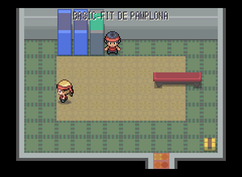 | 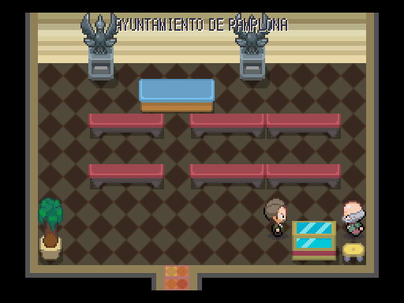 |  |
|---|---|---|
| Basic-Fit de Pamplona | Ayuntamiento de Pamplona | Catedral de Santa María la Real |

Todas: [Casa del corredor del encierro](interiores_2026-10-20/pamplona/pamplona__sala_calle_25_36_despues.png), [Basic-Fit de Pamplona](interiores_2026-10-20/pamplona/pamplona__sala_calle_26_17_despues.png), [Ayuntamiento de Pamplona](interiores_2026-10-20/pamplona/pamplona__sala_calle_40_17_despues.png), [Catedral de Santa María la Real](interiores_2026-10-20/pamplona/pamplona__sala_calle_50_17_despues.png), [Claustro gótico de la catedral](interiores_2026-10-20/pamplona/pamplona__sala_calle_50_17_claustro_despues.png), [Plaza de toros de Pamplona](interiores_2026-10-20/pamplona/pamplona__sala_calle_50_44_despues.png), [Pastelería de los garroticos](interiores_2026-10-20/pamplona/pamplona__sala_calle_53_29_despues.png), [Casa de la peña sanferminera](interiores_2026-10-20/pamplona/pamplona__sala_calle_55_39_despues.png), [Casa del cocinero de la txistorra](interiores_2026-10-20/pamplona/pamplona__sala_calle_58_17_despues.png), [Casa del aficionado de Osasuna](interiores_2026-10-20/pamplona/pamplona__sala_calle_59_29_despues.png).

## Rocafonda (3 salas)

|  |
|---|
| Mansión de Rocafonda |

Todas: [Casa de los vecinos del 304](interiores_2026-10-20/rocafonda/rocafonda__sala_calle_20_18_despues.png), [Casa del entrenador del campo del barrio](interiores_2026-10-20/rocafonda/rocafonda__sala_calle_25_17_despues.png), [Mansión de Rocafonda](interiores_2026-10-20/rocafonda/rocafonda__sala_calle_32_10_despues.png).

## San Miguel de Bernuy (14 salas)

|  |  |  |
|---|---|---|
| Bar del pueblo | Iglesia de San Miguel Arcángel | Ermita de la Virgen del Río |

Todas: [Casa de la abuela de la Plaza de España](interiores_2026-10-20/pueblo_inicial/pueblo_inicial__casa_1_despues.png), [Bar del pueblo](interiores_2026-10-20/pueblo_inicial/pueblo_inicial__casa_2_despues.png), [Casa del alquiler de canoas](interiores_2026-10-20/pueblo_inicial/pueblo_inicial__sala_calle_12_28_despues.png), [Casa del pastor de las Hoces](interiores_2026-10-20/pueblo_inicial/pueblo_inicial__sala_calle_13_46_despues.png), [Iglesia de San Miguel Arcángel](interiores_2026-10-20/pueblo_inicial/pueblo_inicial__sala_calle_19_14_despues.png), [Casa del vecino que volvió de Madrid](interiores_2026-10-20/pueblo_inicial/pueblo_inicial__sala_calle_25_29_despues.png), [Casa de la hortelana de la ribera](interiores_2026-10-20/pueblo_inicial/pueblo_inicial__sala_calle_25_39_despues.png), [Ermita de la Virgen del Río](interiores_2026-10-20/pueblo_inicial/pueblo_inicial__sala_calle_26_48_despues.png), [Ayuntamiento de San Miguel de Bernuy](interiores_2026-10-20/pueblo_inicial/pueblo_inicial__sala_calle_30_39_despues.png), [Casa de la peña de las fiestas](interiores_2026-10-20/pueblo_inicial/pueblo_inicial__sala_calle_31_29_despues.png), [Casa de la cestera](interiores_2026-10-20/pueblo_inicial/pueblo_inicial__sala_calle_36_14_despues.png), [Panadería del pueblo](interiores_2026-10-20/pueblo_inicial/pueblo_inicial__sala_calle_36_29_despues.png), [Casa del pescador del embalse](interiores_2026-10-20/pueblo_inicial/pueblo_inicial__sala_calle_36_39_despues.png), [Casa del agricultor de cereal](interiores_2026-10-20/pueblo_inicial/pueblo_inicial__sala_calle_38_21_despues.png).

## Pozuelo (7 salas)

|  |  |  |
|---|---|---|
| Chalet de la familia del pádel | Chalet de la influencer de Somosaguas | Chalet del abogado del Real Madrid |

Todas: [Chalet de la familia del pádel](interiores_2026-10-20/pozuelo/pozuelo__sala_calle_13_29_despues.png), [Chalet de la influencer de Somosaguas](interiores_2026-10-20/pozuelo/pozuelo__sala_calle_17_23_despues.png), [Chalet del abogado del Real Madrid](interiores_2026-10-20/pozuelo/pozuelo__sala_calle_21_11_despues.png), [Chalet de los abuelos de toda la vida](interiores_2026-10-20/pozuelo/pozuelo__sala_calle_22_29_despues.png), [Chalet del empresario de las criptomonedas](interiores_2026-10-20/pozuelo/pozuelo__sala_calle_31_29_despues.png), [Chalet de la familia numerosa](interiores_2026-10-20/pozuelo/pozuelo__sala_calle_37_12_despues.png), [Chalet de la jugadora de golf](interiores_2026-10-20/pozuelo/pozuelo__sala_calle_7_30_despues.png).

## Orcasitas (4 salas)

|  |
|---|
| Bazar de la plaza de Orcasitas |

Todas: [Piso de la familia del bloque cinco](interiores_2026-10-20/orcasitas/orcasitas__sala_calle_28_12_despues.png), [Bazar de la plaza de Orcasitas](interiores_2026-10-20/orcasitas/orcasitas__sala_calle_29_20_despues.png), [Piso del rapero del barrio](interiores_2026-10-20/orcasitas/orcasitas__sala_calle_36_9_despues.png), [Portal de la Asociación de Vecinos](interiores_2026-10-20/orcasitas/orcasitas__sala_calle_5_32_despues.png).

## Ruta 5 (7 salas)

|  |  |
|---|---|
| Universidad de Alcalá, Colegio de San Ildefonso | Palacio del Infantado de Guadalajara |

Todas: [Casa del mozo de almacén](interiores_2026-10-20/ruta_5/ruta_5__casa_1_despues.png), [Casa del repartidor de la A-2](interiores_2026-10-20/ruta_5/ruta_5__casa_2_despues.png), [Universidad de Alcalá, Colegio de San Ildefonso](interiores_2026-10-20/ruta_5/ruta_5__sala_calle_31_12_despues.png), [Casa natal de Cervantes](interiores_2026-10-20/ruta_5/ruta_5__sala_calle_47_11_despues.png), [Palacio del Infantado de Guadalajara](interiores_2026-10-20/ruta_5/ruta_5__sala_calle_56_12_despues.png), [Portal de Azuqueca de Henares](interiores_2026-10-20/ruta_5/ruta_5__sala_calle_58_27_despues.png), [Casa de las cigüeñas de Alcalá](interiores_2026-10-20/ruta_5/ruta_5__sala_calle_65_11_despues.png).

## Ruta 6 (7 salas)

|  |
|---|
| Mesón de Calatayud |

Todas: [Casa del último vecino](interiores_2026-10-20/ruta_6/ruta_6__casa_1_despues.png), [Casa de la señora de enfrente](interiores_2026-10-20/ruta_6/ruta_6__casa_2_despues.png), [Casa rural de Medinaceli](interiores_2026-10-20/ruta_6/ruta_6__sala_calle_32_16_despues.png), [Casa de la maestra de la escuela cerrada](interiores_2026-10-20/ruta_6/ruta_6__sala_calle_42_16_despues.png), [Casa del teletrabajador que repobló el pueblo](interiores_2026-10-20/ruta_6/ruta_6__sala_calle_47_16_despues.png), [Mesón de Calatayud](interiores_2026-10-20/ruta_6/ruta_6__sala_calle_61_16_despues.png), [Casa del pastor de los páramos](interiores_2026-10-20/ruta_6/ruta_6__sala_calle_65_15_despues.png).

## Ruta 8 (5 salas)

|  |  |
|---|---|
| Basílica de Montserrat | Celler de cava del Penedès |

Todas: [Masía de Santpedor](interiores_2026-10-20/ruta_8/ruta_8__casa_1_despues.png), [Casa de la familia de Sant Esteve Sesrovires](interiores_2026-10-20/ruta_8/ruta_8__casa_2_despues.png), [Basílica de Montserrat](interiores_2026-10-20/ruta_8/ruta_8__sala_calle_36_10_despues.png), [Casa del ciclista del Bages](interiores_2026-10-20/ruta_8/ruta_8__sala_calle_51_36_despues.png), [Celler de cava del Penedès](interiores_2026-10-20/ruta_8/ruta_8__sala_calle_56_36_despues.png).

## Ruta 16 (2 salas)

|  |  |
|---|---|
| Casa del bateeiro | Casa del vecino de Sanxenxo |

Todas: [Casa del bateeiro](interiores_2026-10-20/ruta_16/ruta_16__casa_1_despues.png), [Casa del vecino de Sanxenxo](interiores_2026-10-20/ruta_16/ruta_16__casa_2_despues.png).

## Ruta 21 (4 salas)

|  |  |
|---|---|
| Bar de pinchos de la calle Laurel | Calado de la bodega familiar |

Todas: [Casa del viticultor riojano](interiores_2026-10-20/ruta_21/ruta_21__casa_1_despues.png), [Bar de pinchos de la calle Laurel](interiores_2026-10-20/ruta_21/ruta_21__casa_2_despues.png), [Calado de la bodega familiar](interiores_2026-10-20/ruta_21/ruta_21__sala_calle_10_38_despues.png), [Casa de la Batalla del Vino](interiores_2026-10-20/ruta_21/ruta_21__sala_calle_33_38_despues.png).

## Ruta 22 (5 salas)

|  |  |  |
|---|---|---|
| Centro de visitantes de Atapuerca | Catedral de Santa María de Burgos | Crucero y cimborrio de la catedral |

Todas: [Casa de la familia burgalesa](interiores_2026-10-20/ruta_22/ruta_22__casa_1_despues.png), [Casa del peregrino del Camino Francés](interiores_2026-10-20/ruta_22/ruta_22__casa_2_despues.png), [Centro de visitantes de Atapuerca](interiores_2026-10-20/ruta_22/ruta_22__sala_calle_16_15_despues.png), [Catedral de Santa María de Burgos](interiores_2026-10-20/ruta_22/ruta_22__sala_calle_8_26_despues.png), [Crucero y cimborrio de la catedral](interiores_2026-10-20/ruta_22/ruta_22__sala_calle_8_26_cimborrio_despues.png).

## Ruta 24 (12 salas)

|  |  |  |
|---|---|---|
| Molino Bolero | Molino Sancho | Molino Rucio |

Todas: [Casa del agricultor de la Mancha](interiores_2026-10-20/ruta_24/ruta_24__casa_1_despues.png), [Casa de la recolectora de azafrán](interiores_2026-10-20/ruta_24/ruta_24__casa_2_despues.png), [Molino Bolero](interiores_2026-10-20/ruta_24/ruta_24__sala_calle_3_10_despues.png), [Molino Sancho](interiores_2026-10-20/ruta_24/ruta_24__sala_calle_7_10_despues.png), [Molino Rucio](interiores_2026-10-20/ruta_24/ruta_24__sala_calle_11_10_despues.png), [Molino del Verde Gabán](interiores_2026-10-20/ruta_24/ruta_24__sala_calle_15_10_despues.png), [Molino Mambrino](interiores_2026-10-20/ruta_24/ruta_24__sala_calle_19_10_despues.png), [Molino Burleta](interiores_2026-10-20/ruta_24/ruta_24__sala_calle_33_30_despues.png), [Molino Infanto](interiores_2026-10-20/ruta_24/ruta_24__sala_calle_37_30_despues.png), [Molino Sardinero](interiores_2026-10-20/ruta_24/ruta_24__sala_calle_41_30_despues.png), [Cueva bodega de Campo de Criptana](interiores_2026-10-20/ruta_24/ruta_24__sala_calle_35_40_despues.png), [Casa del quesero manchego](interiores_2026-10-20/ruta_24/ruta_24__sala_calle_4_28_despues.png).

## Ruta 25 (2 salas)

|  |  |
|---|---|
| Casa del guarda forestal de Despeñaperros | Venta del camino de Andalucía |

Todas: [Casa del guarda forestal de Despeñaperros](interiores_2026-10-20/ruta_25/ruta_25__casa_1_despues.png), [Venta del camino de Andalucía](interiores_2026-10-20/ruta_25/ruta_25__casa_2_despues.png).

## Ruta 26 (2 salas)

|  |
|---|
| Dolmen de Menga |

Todas: [Casa del guarda del Torcal](interiores_2026-10-20/ruta_26/ruta_26__casa_1_despues.png), [Dolmen de Menga](interiores_2026-10-20/ruta_26/ruta_26__sala_calle_9_9_despues.png).
