# Salas de dentro de los monumentos · 2026-10-21

Los monumentos grandes de las ciudades que solo tenían una sala ganan **20 salas de dentro**, como ya tenían el Pilar, la Seo o la Catedral de Murcia. Se entra por un paso en la pared de arriba de la sala principal, que se redistribuye para abrirlo (conserva su gente, sus frases y su entrada). **Todo es provisional** y sin famosos.

Cómo se hace: `data/interiores/<ciudad>.json` con la sala hija (`padre`), `planificar_interiores.py <ciudad> --solo <madre>` y después la ciudad entera para las hijas; `pintar_interiores_datos.gd -- <ciudad> --solo <sala>`. En las ciudades con contenido escrito a mano, las mismas salas se añaden al final de `contenido_interiores/<ciudad>.py`, para que `rellenar_interiores.py` las vuelva a crear.

Retoque a mano: en la galería de la mina de Puertollano, el planificador ponía un águila de piedra; se cambia por un montón de cajas (en `data/interiores/puertollano.json`).

### Real Alcázar, apeadero

| 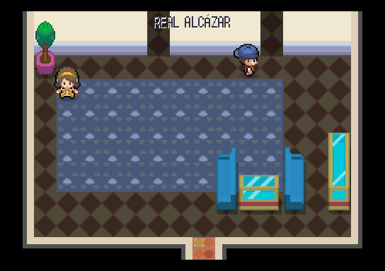 | 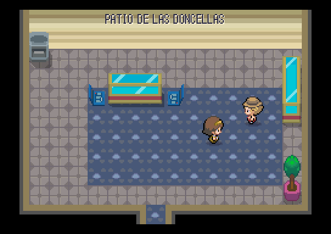 | 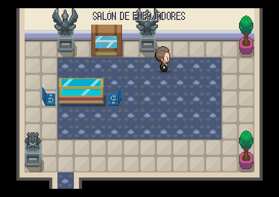 |
|---|---|---|
| Real Alcázar, apeadero (madre, redistribuida) | Patio de las Doncellas | Salón de Embajadores |

### Archivo General de Indias

| 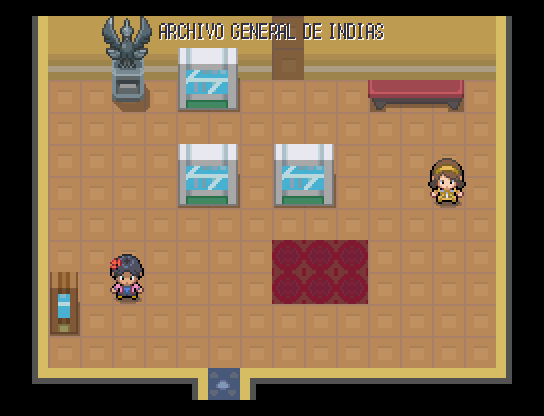 | 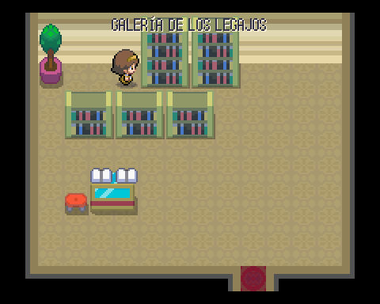 |
|---|---|
| Archivo General de Indias (madre, redistribuida) | Galería de los legajos |

### Basílica de Montserrat

| 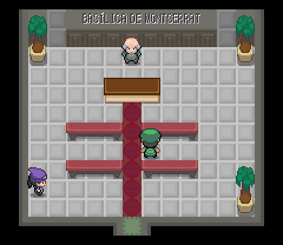 | 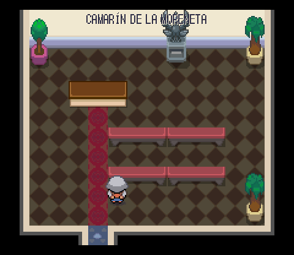 | 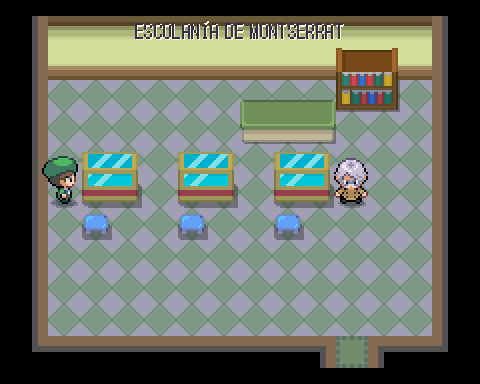 |
|---|---|---|
| Basílica de Montserrat (madre, redistribuida) | Camarín de la Moreneta | Escolanía de Montserrat |

### Alcazaba de Málaga

| 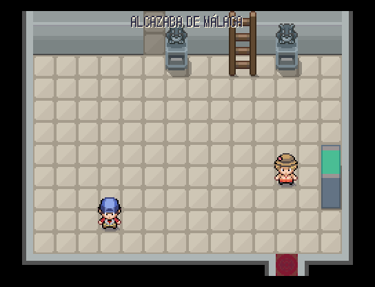 | 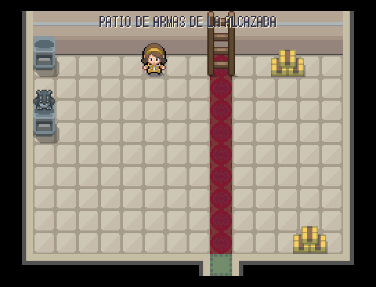 |
|---|---|
| Alcazaba de Málaga (madre, redistribuida) | Patio de Armas de la Alcazaba |

### Castillo de Gibralfaro

| 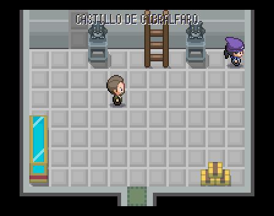 | 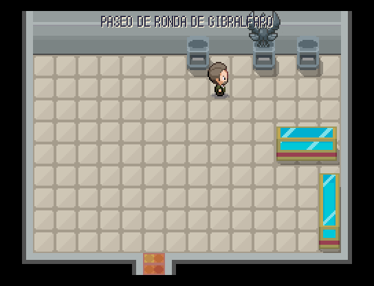 |
|---|---|
| Castillo de Gibralfaro (madre, redistribuida) | Paseo de ronda de Gibralfaro |

### Catedral de la Encarnación, La Manquita

| 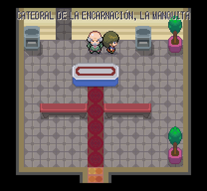 | 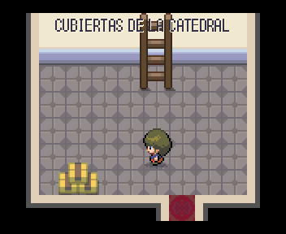 |
|---|---|
| Catedral de la Encarnación, La Manquita (madre, redistribuida) | Cubiertas de la Catedral |

### Palacio de la Almudaina

| 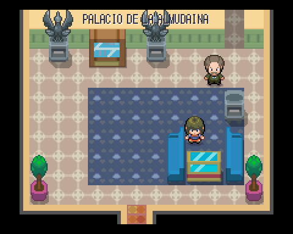 | 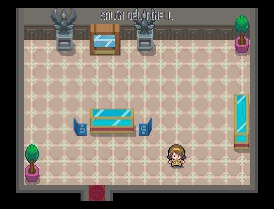 |
|---|---|
| Palacio de la Almudaina (madre, redistribuida) | Salón del Tinell |

### Castell de Bellver

| 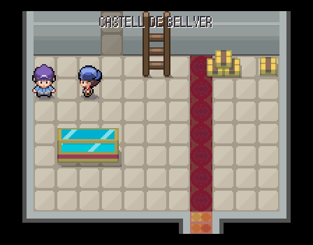 | 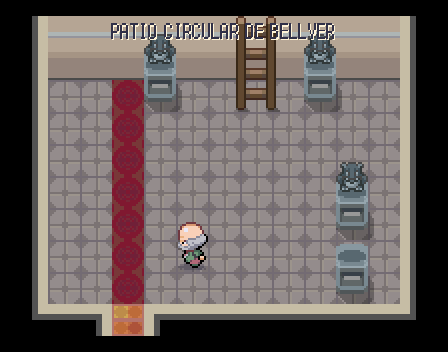 |
|---|---|
| Castell de Bellver (madre, redistribuida) | Patio circular de Bellver |

### Castillo de Santa Bárbara

| 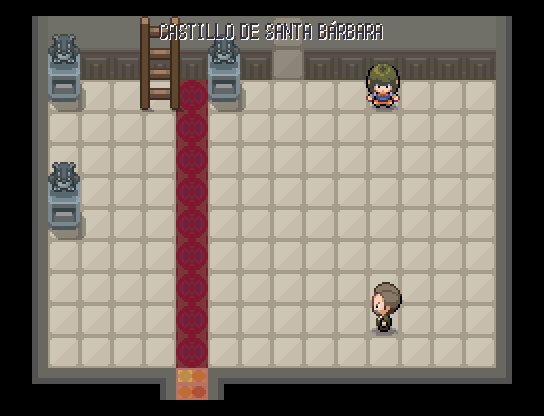 | 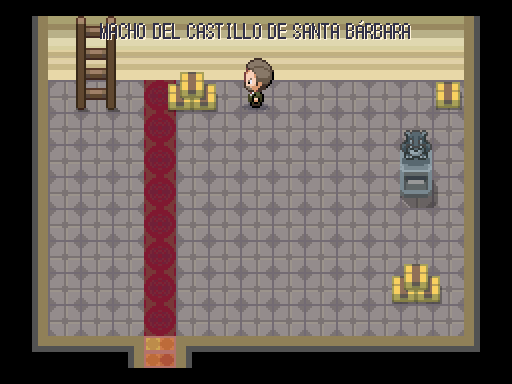 |
|---|---|
| Castillo de Santa Bárbara (madre, redistribuida) | Macho del castillo de Santa Bárbara |

### Gran Teatre del Liceu

| 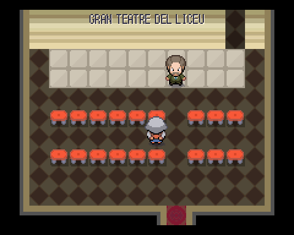 | 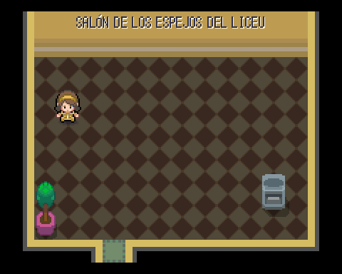 |
|---|---|
| Gran Teatre del Liceu (madre, redistribuida) | Salón de los Espejos del Liceu |

### Palacio de la Magdalena

| 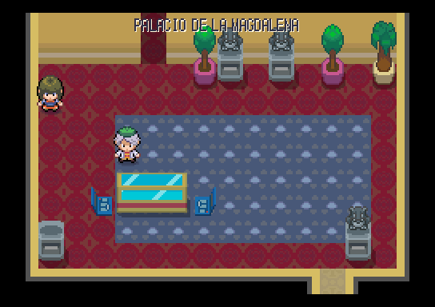 | 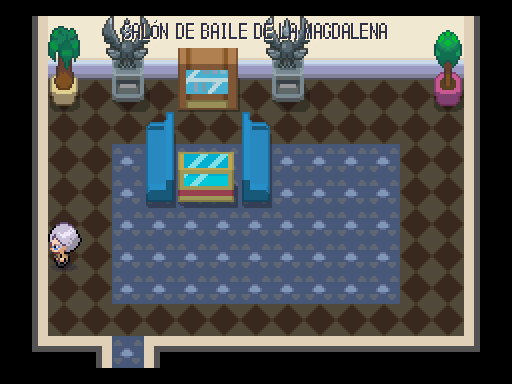 |
|---|---|
| Palacio de la Magdalena (madre, redistribuida) | Salón de baile de la Magdalena |

### Universidad de Alcalá, Colegio de San Ildefonso

| 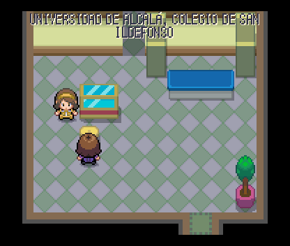 | 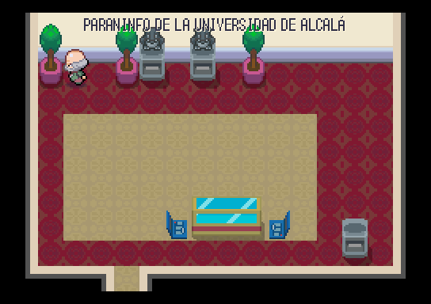 |
|---|---|
| Universidad de Alcalá, Colegio de San Ildefonso (madre, redistribuida) | Paraninfo de la Universidad de Alcalá |

### Palacio del Infantado de Guadalajara

| 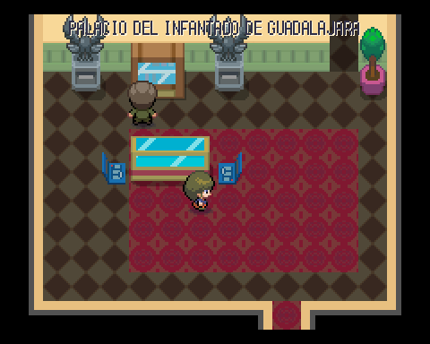 | 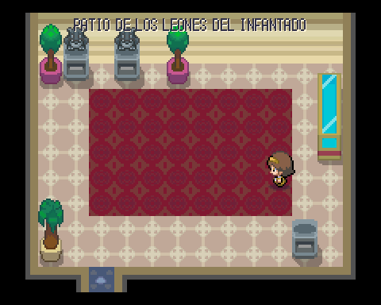 |
|---|---|
| Palacio del Infantado de Guadalajara (madre, redistribuida) | Patio de los Leones del Infantado |

### Catedral de Valladolid

| 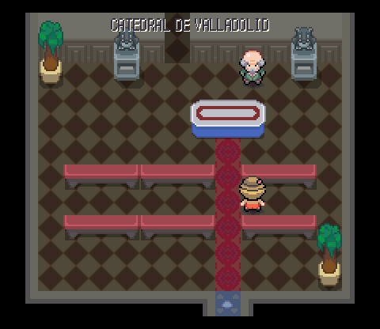 | 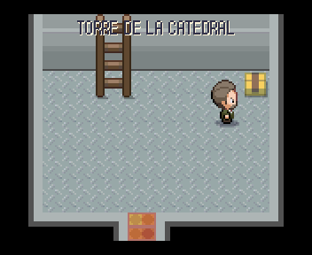 |
|---|---|
| Catedral de Valladolid (madre, redistribuida) | Torre de la Catedral |

### Museo de la Minería

| 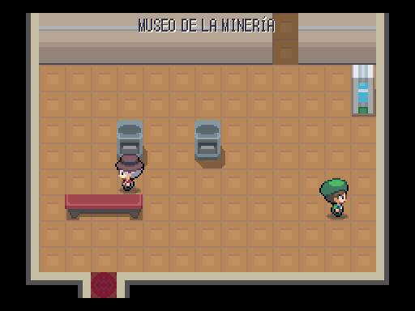 | 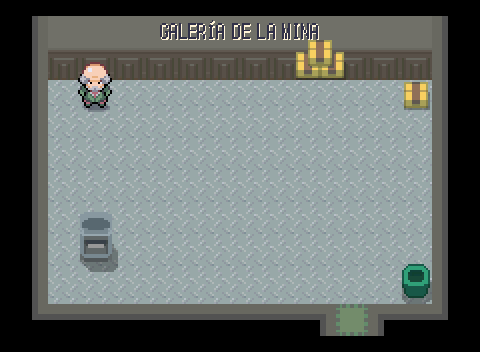 |
|---|---|
| Museo de la Minería (madre, redistribuida) | Galería de la mina |

### Centro de visitantes de Atapuerca

| 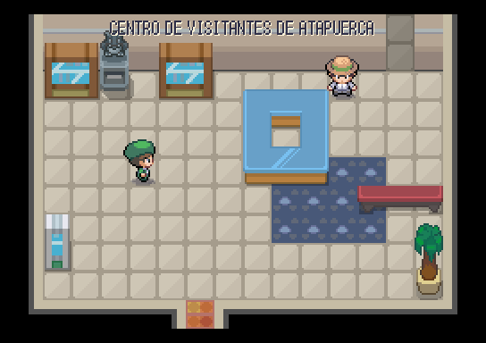 | 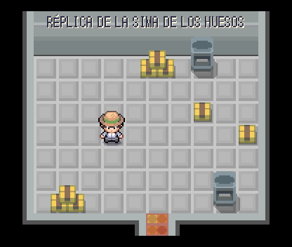 |
|---|---|
| Centro de visitantes de Atapuerca (madre, redistribuida) | Réplica de la Sima de los Huesos |

### Castillo de la Luz

| 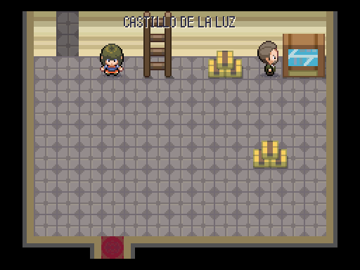 | 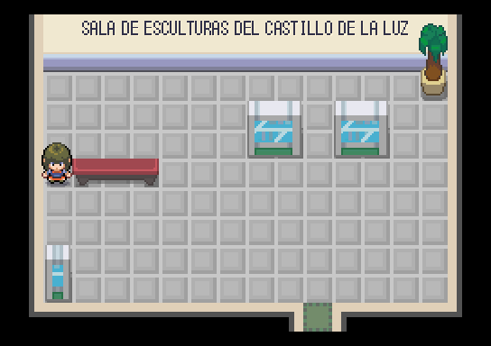 |
|---|---|
| Castillo de la Luz (madre, redistribuida) | Sala de esculturas del Castillo de la Luz |

### Catedral de Santiago

| 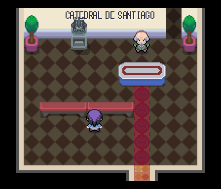 | 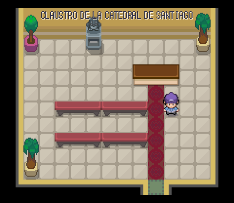 |
|---|---|
| Catedral de Santiago (madre, redistribuida) | Claustro de la Catedral de Santiago |
