# Interiores de las casas de ruta · 2026-10-20

Última tanda del encargo de Javier: un interior propio y con sentido para cada casa y edificio con puerta. Cubre las **93 salas** de las casas de ruta que seguían con el interior genérico, en 15 rutas. Con esto, **todas las casas y edificios con puerta del mapa tienen interior propio** (salvo los que tienen sala hecha a mano, que ya eran propios, y el Bernabéu, que aún no tiene puerta). **Todo es provisional**: nombres, gente, frases y distribución, pendientes de Javier.

El método es el de siempre: el contenido de cada sala está escrito a mano en `maps/_tools/contenido_interiores/ruta_N.py`, se vuelca con `rellenar_interiores.py` (conserva a quien da el regalo) y se planifica y pinta con `planificar_interiores.py` y `pintar_interiores_datos.gd`. Lo de dentro sigue a lo de fuera: el mesón del cochinillo está detrás de su cartel, la arrocería de El Palmar junto al suyo, el chalet del reality detrás del «chalet privado» y The Red Lion donde está Kevin.

**Para que Javier decida:**

- **Chalet de la colina** (Ruta 4, `ruta_4/sala_calle_38_28`): queda sin dueño, con un guardia civil en la puerta y las cajas de la mudanza sin abrir. Quién vive ahí es PENDIENTE JAVIER.
- **Basílica de Cuelgamuros** (Ruta 3): un guía, una forense de las exhumaciones y la nieta de una víctima, con datos reales y en tono serio; sin ningún famoso. Hay que confirmar si ese tono vale.
- La boda del Cortijo El Olivar (Ruta 12) sigue fuera, en el patio: dentro solo están la cortijera y su nieto.

Fuera, a propósito: el hórreo de la Ruta 17 y la basílica y la cueva de Covadonga (Ruta 18), que tienen sala hecha a mano en `pintar_salas_hitos.gd`.

Capturas a escala real.

## Ruta 2 (9 salas)

| 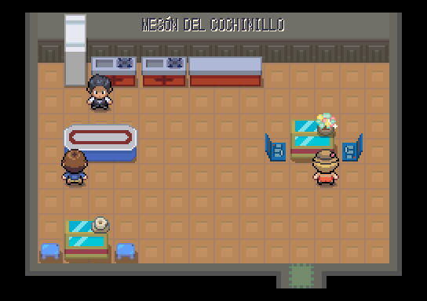 | 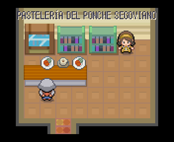 |
|---|---|
| Mesón del cochinillo | Pastelería del ponche segoviano |

Todas: [Casa del resinero de Cantalejo](interiores_2026-10-20/ruta_2/ruta_2__casa_1_despues.png), [Casa de la trillera](interiores_2026-10-20/ruta_2/ruta_2__casa_2_despues.png), [Casa del pastor de la cañada](interiores_2026-10-20/ruta_2/ruta_2__sala_calle_2_51_despues.png), [Mesón del cochinillo](interiores_2026-10-20/ruta_2/ruta_2__sala_calle_27_51_despues.png), [Pastelería del ponche segoviano](interiores_2026-10-20/ruta_2/ruta_2__sala_calle_2_61_despues.png), [Casa del cantero](interiores_2026-10-20/ruta_2/ruta_2__sala_calle_9_61_despues.png), [Piso de estudiantes del Azoguejo](interiores_2026-10-20/ruta_2/ruta_2__sala_calle_14_61_despues.png), [Casa de los madrileños del fin de semana](interiores_2026-10-20/ruta_2/ruta_2__sala_calle_27_61_despues.png), [Casa del guía del Acueducto](interiores_2026-10-20/ruta_2/ruta_2__sala_calle_33_61_despues.png).

## Ruta 3 (3 salas)

| 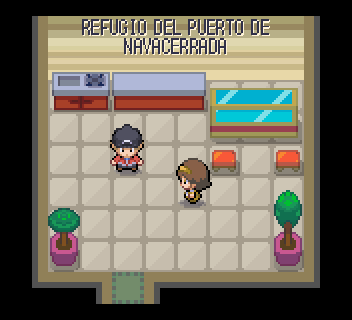 | 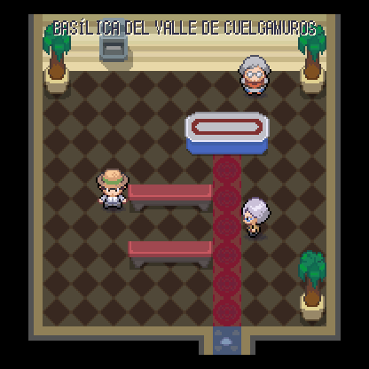 |
|---|---|
| Refugio del puerto de Navacerrada | Basílica del Valle de Cuelgamuros |

Todas: [Refugio del puerto de Navacerrada](interiores_2026-10-20/ruta_3/ruta_3__casa_1_despues.png), [Casa del conductor de la quitanieves](interiores_2026-10-20/ruta_3/ruta_3__casa_2_despues.png), [Basílica del Valle de Cuelgamuros](interiores_2026-10-20/ruta_3/ruta_3__sala_calle_6_66_despues.png).

## Ruta 4 (10 salas)

| 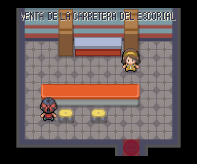 | 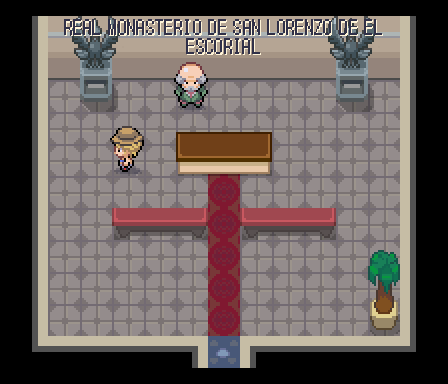 |
|---|---|
| Venta de la carretera del Escorial | Real Monasterio de San Lorenzo de El Escorial |

Todas: [Venta de la carretera del Escorial](interiores_2026-10-20/ruta_4/ruta_4__casa_1_despues.png), [Casa del guía del Monasterio](interiores_2026-10-20/ruta_4/ruta_4__casa_2_despues.png), [Casa del restaurador jubilado](interiores_2026-10-20/ruta_4/ruta_4__sala_calle_34_14_despues.png), [Chalet de la presidenta de la comunidad](interiores_2026-10-20/ruta_4/ruta_4__sala_calle_29_27_despues.png), [Chalet de la colina](interiores_2026-10-20/ruta_4/ruta_4__sala_calle_38_28_despues.png), [Chalet de la teletrabajadora](interiores_2026-10-20/ruta_4/ruta_4__sala_calle_45_28_despues.png), [Chalet del tertuliano](interiores_2026-10-20/ruta_4/ruta_4__sala_calle_30_38_despues.png), [Chalet de la familia del pádel](interiores_2026-10-20/ruta_4/ruta_4__sala_calle_38_39_despues.png), [Chalet de la familia del repartidor](interiores_2026-10-20/ruta_4/ruta_4__sala_calle_44_39_despues.png), [Real Monasterio de San Lorenzo de El Escorial](interiores_2026-10-20/ruta_4/ruta_4__sala_calle_9_24_despues.png).

## Ruta 9 (18 salas)

| 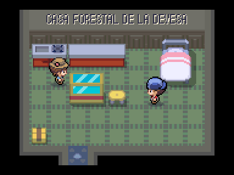 | 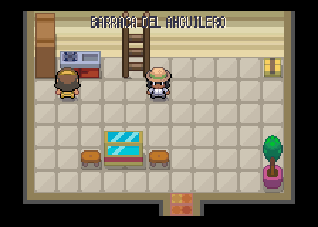 | 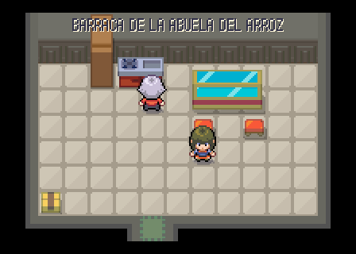 |
|---|---|---|
| Casa forestal de la Devesa | Barraca del anguilero | Barraca de la abuela del arroz |

Todas: [Casa forestal de la Devesa](interiores_2026-10-20/ruta_9/ruta_9__sala_calle_18_15_despues.png), [Barraca del anguilero](interiores_2026-10-20/ruta_9/ruta_9__sala_calle_16_24_despues.png), [Barraca de la abuela del arroz](interiores_2026-10-20/ruta_9/ruta_9__sala_calle_21_24_despues.png), [Barraca del barquero de vela latina](interiores_2026-10-20/ruta_9/ruta_9__sala_calle_17_33_despues.png), [Arrocería de El Palmar](interiores_2026-10-20/ruta_9/ruta_9__sala_calle_22_33_despues.png), [Puesto de tellinas y clóchinas](interiores_2026-10-20/ruta_9/ruta_9__sala_calle_22_40_despues.png), [Torre de apartamentos de Cullera](interiores_2026-10-20/ruta_9/ruta_9__sala_calle_19_56_despues.png), [Faro de Cullera](interiores_2026-10-20/ruta_9/ruta_9__sala_calle_34_55_despues.png), [Casa de la familia gandiense](interiores_2026-10-20/ruta_9/ruta_9__sala_calle_15_65_despues.png), [Horchatería de Gandía](interiores_2026-10-20/ruta_9/ruta_9__sala_calle_22_66_despues.png), [Chalet del reality de Gandía](interiores_2026-10-20/ruta_9/ruta_9__sala_calle_31_65_despues.png), [Palau Ducal dels Borja](interiores_2026-10-20/ruta_9/ruta_9__sala_calle_7_66_despues.png), [Caseta de socorrismo de la playa de Gandía](interiores_2026-10-20/ruta_9/ruta_9__sala_calle_41_67_despues.png), [Apartamento de los veraneantes de toda la vida](interiores_2026-10-20/ruta_9/ruta_9__sala_calle_5_74_despues.png), [Tienda de recuerdos del paseo](interiores_2026-10-20/ruta_9/ruta_9__sala_calle_11_74_despues.png), [Casa del DJ de verano](interiores_2026-10-20/ruta_9/ruta_9__sala_calle_17_74_despues.png), [Peluquería del paseo marítimo](interiores_2026-10-20/ruta_9/ruta_9__sala_calle_23_74_despues.png), [Heladería del Paseo](interiores_2026-10-20/ruta_9/ruta_9__sala_calle_32_74_despues.png).

## Ruta 10 (19 salas)

| 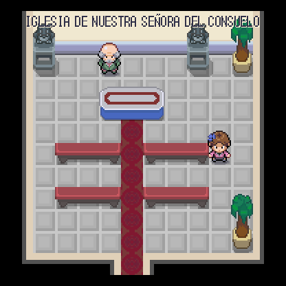 | 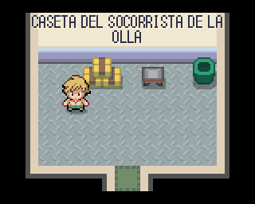 | 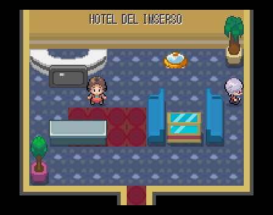 |
|---|---|---|
| Iglesia de Nuestra Señora del Consuelo | Caseta del socorrista de la Olla | Hotel del Imserso |

Todas: [Casa del pescador de Calp](interiores_2026-10-20/ruta_10/ruta_10__sala_calle_31_8_despues.png), [Casa de la jubilada holandesa](interiores_2026-10-20/ruta_10/ruta_10__sala_calle_35_8_despues.png), [Casa del escalador del Peñón](interiores_2026-10-20/ruta_10/ruta_10__sala_calle_31_13_despues.png), [Estudio del pintor de Altea](interiores_2026-10-20/ruta_10/ruta_10__sala_calle_16_20_despues.png), [Casa de la vecina del casco antiguo](interiores_2026-10-20/ruta_10/ruta_10__sala_calle_18_24_despues.png), [Iglesia de Nuestra Señora del Consuelo](interiores_2026-10-20/ruta_10/ruta_10__sala_calle_10_23_despues.png), [Caseta del socorrista de la Olla](interiores_2026-10-20/ruta_10/ruta_10__sala_calle_41_27_despues.png), [Apartamento de los jubilados ingleses](interiores_2026-10-20/ruta_10/ruta_10__sala_calle_6_40_despues.png), [Hotel del Imserso](interiores_2026-10-20/ruta_10/ruta_10__sala_calle_10_40_despues.png), [Portal del Intempo](interiores_2026-10-20/ruta_10/ruta_10__sala_calle_15_40_despues.png), [Apartamento de la despedida de soltero](interiores_2026-10-20/ruta_10/ruta_10__sala_calle_20_40_despues.png), [The Red Lion](interiores_2026-10-20/ruta_10/ruta_10__sala_calle_9_50_despues.png), [Supermercado británico](interiores_2026-10-20/ruta_10/ruta_10__sala_calle_16_50_despues.png), [Floristería de Benidorm](interiores_2026-10-20/ruta_10/ruta_10__sala_calle_22_50_despues.png), [Portal de los vecinos de Benidorm](interiores_2026-10-20/ruta_10/ruta_10__sala_calle_32_51_despues.png), [Chocolatería de La Vila](interiores_2026-10-20/ruta_10/ruta_10__sala_calle_7_60_despues.png), [Casa azul del pescador](interiores_2026-10-20/ruta_10/ruta_10__sala_calle_11_59_despues.png), [Casa del festero de Moros y Cristianos](interiores_2026-10-20/ruta_10/ruta_10__sala_calle_17_59_despues.png), [Casa roja de la familia del puerto](interiores_2026-10-20/ruta_10/ruta_10__sala_calle_23_60_despues.png).

## Ruta 11 (5 salas)

| 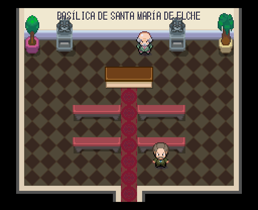 |
|---|
| Basílica de Santa María de Elche |

Todas: [Casa de la profesora de Orihuela](interiores_2026-10-20/ruta_11/ruta_11__sala_calle_11_27_despues.png), [Casa del huertano de la Vega Baja](interiores_2026-10-20/ruta_11/ruta_11__sala_calle_17_27_despues.png), [Casa de la familia del calzado](interiores_2026-10-20/ruta_11/ruta_11__sala_calle_23_27_despues.png), [Basílica de Santa María de Elche](interiores_2026-10-20/ruta_11/ruta_11__sala_calle_35_28_despues.png), [Casa del palmerero](interiores_2026-10-20/ruta_11/ruta_11__sala_calle_44_27_despues.png).

## Ruta 12 (1 salas)

| 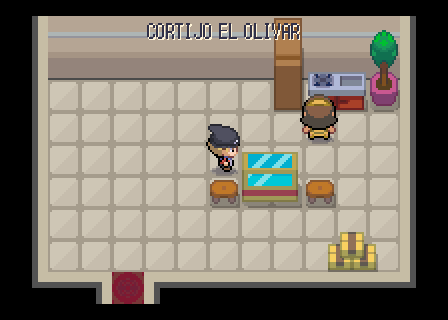 |
|---|
| Cortijo El Olivar |

Todas: [Cortijo El Olivar](interiores_2026-10-20/ruta_12/ruta_12__casa_1_despues.png).

## Ruta 13 (2 salas)

| 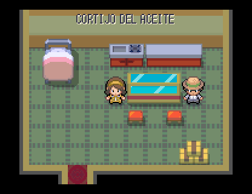 |
|---|
| Cortijo del aceite |

Todas: [Cortijo del aceite](interiores_2026-10-20/ruta_13/ruta_13__casa_1_despues.png), [Casa del patio cordobés](interiores_2026-10-20/ruta_13/ruta_13__casa_2_despues.png).

## Ruta 14 (6 salas)

| 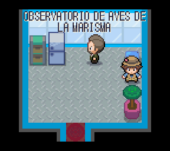 |
|---|
| Observatorio de aves de la marisma |

Todas: [Casa de hermandad de El Rocío](interiores_2026-10-20/ruta_14/ruta_14__casa_1_despues.png), [Casa del tamborilero](interiores_2026-10-20/ruta_14/ruta_14__casa_2_despues.png), [Observatorio de aves de la marisma](interiores_2026-10-20/ruta_14/ruta_14__sala_calle_34_13_despues.png), [Casa del guarda de Doñana](interiores_2026-10-20/ruta_14/ruta_14__sala_calle_53_17_despues.png), [Casa de la jornalera de la fresa](interiores_2026-10-20/ruta_14/ruta_14__sala_calle_53_9_despues.png), [Casa del yegüero de la saca](interiores_2026-10-20/ruta_14/ruta_14__sala_calle_57_9_despues.png).

## Ruta 15 (2 salas)

| 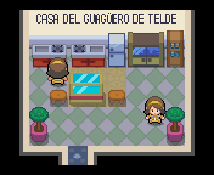 | 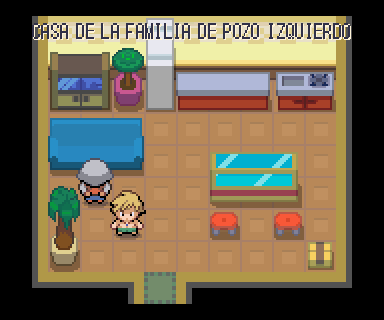 |
|---|---|
| Casa del guagüero de Telde | Casa de la familia de Pozo Izquierdo |

Todas: [Casa del guagüero de Telde](interiores_2026-10-20/ruta_15/ruta_15__casa_1_despues.png), [Casa de la familia de Pozo Izquierdo](interiores_2026-10-20/ruta_15/ruta_15__casa_2_despues.png).

## Ruta 17 (5 salas)

| 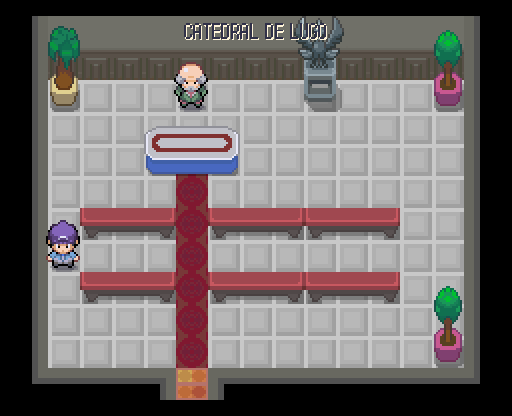 | 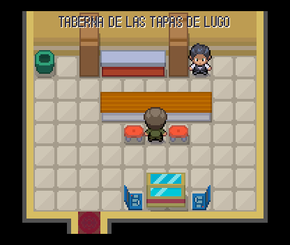 | 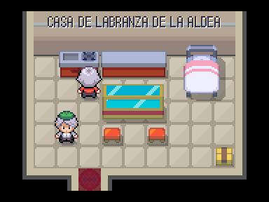 |
|---|---|---|
| Catedral de Lugo | Taberna de las tapas de Lugo | Casa de labranza de la aldea |

Todas: [Casa del vecino de la muralla](interiores_2026-10-20/ruta_17/ruta_17__sala_calle_27_12_despues.png), [Catedral de Lugo](interiores_2026-10-20/ruta_17/ruta_17__sala_calle_32_7_despues.png), [Taberna de las tapas de Lugo](interiores_2026-10-20/ruta_17/ruta_17__sala_calle_37_13_despues.png), [Casa de la costurera de Arteixo](interiores_2026-10-20/ruta_17/ruta_17__sala_calle_47_37_despues.png), [Casa de labranza de la aldea](interiores_2026-10-20/ruta_17/ruta_17__sala_calle_5_24_despues.png).

## Ruta 18 (3 salas)

| 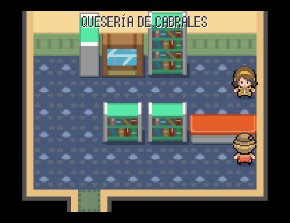 | 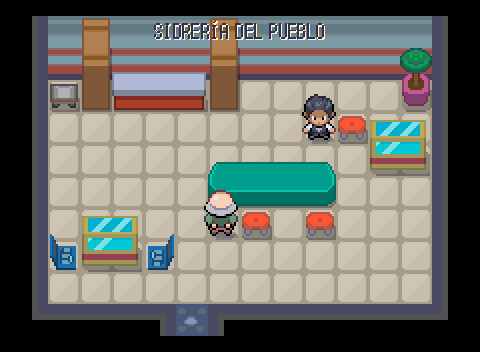 | 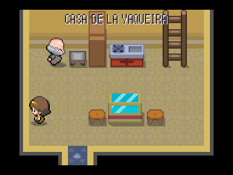 |
|---|---|---|
| Quesería de Cabrales | Sidrería del pueblo | Casa de la vaqueira |

Todas: [Quesería de Cabrales](interiores_2026-10-20/ruta_18/ruta_18__sala_calle_21_18_despues.png), [Sidrería del pueblo](interiores_2026-10-20/ruta_18/ruta_18__sala_calle_27_18_despues.png), [Casa de la vaqueira](interiores_2026-10-20/ruta_18/ruta_18__sala_calle_45_18_despues.png).

## Ruta 19 (4 salas)

| 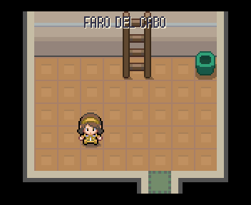 | 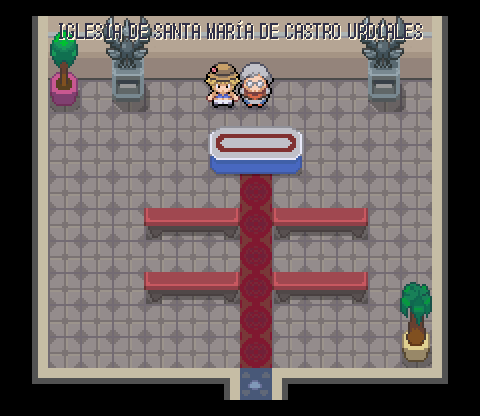 | 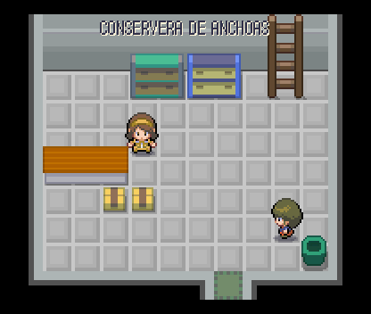 |
|---|---|---|
| Faro del cabo | Iglesia de Santa María de Castro Urdiales | Conservera de anchoas |

Todas: [Faro del cabo](interiores_2026-10-20/ruta_19/ruta_19__sala_calle_33_8_despues.png), [Iglesia de Santa María de Castro Urdiales](interiores_2026-10-20/ruta_19/ruta_19__sala_calle_46_11_despues.png), [Conservera de anchoas](interiores_2026-10-20/ruta_19/ruta_19__sala_calle_47_18_despues.png), [Casa del surfista de la playa](interiores_2026-10-20/ruta_19/ruta_19__sala_calle_52_17_despues.png).

## Ruta 20 (2 salas)

| 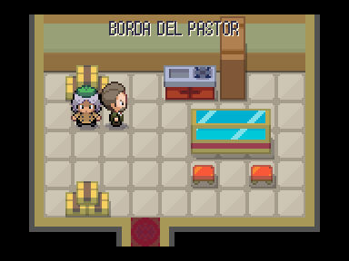 | 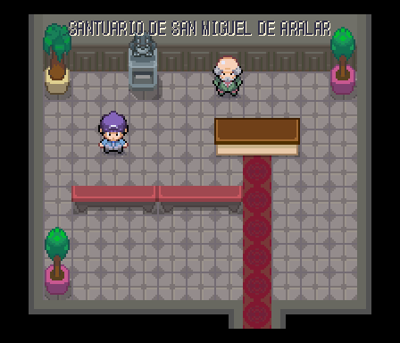 |
|---|---|
| Borda del pastor | Santuario de San Miguel de Aralar |

Todas: [Borda del pastor](interiores_2026-10-20/ruta_20/ruta_20__sala_calle_18_28_despues.png), [Santuario de San Miguel de Aralar](interiores_2026-10-20/ruta_20/ruta_20__sala_calle_20_5_despues.png).

## Ruta 23 (4 salas)

| 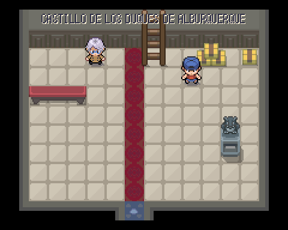 | 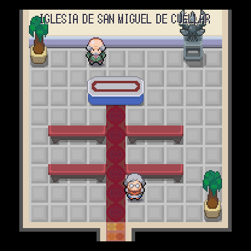 |
|---|---|
| Castillo de los Duques de Alburquerque | Iglesia de San Miguel de Cuéllar |

Todas: [Casa del caballista de los encierros](interiores_2026-10-20/ruta_23/ruta_23__casa_1_despues.png), [Casa de la piñonera](interiores_2026-10-20/ruta_23/ruta_23__casa_2_despues.png), [Castillo de los Duques de Alburquerque](interiores_2026-10-20/ruta_23/ruta_23__sala_calle_12_11_despues.png), [Iglesia de San Miguel de Cuéllar](interiores_2026-10-20/ruta_23/ruta_23__sala_calle_22_11_despues.png).
