# Animación propia para cada movimiento · 2026-10-14

Encargo de Javier: animaciones personalizadas para cada movimiento. **Arte provisional, pendiente de su revisión.**

## Qué hay

Los **951 movimientos** del catálogo (los 935 de WikiDex más variantes) tienen secuencia propia en `data/battle_motion_moves.json`. Antes eran 38; el resto usaba el efecto genérico de su tipo.

| Origen | Movimientos | Cómo se hace |
|---|---|---|
| A mano (anteriores) | 38 | Las secuencias del Agente 3, sin tocar. |
| Elite Battle DX | 457 | `tools/arte/animaciones_movimientos.py` lee la animación original de cada movimiento en el pack 17 (los scripts de EBDX): sus gráficos y recortes, cuántas partículas, si viajan del atacante al objetivo, el fondo que pone (color o imagen de 512×384), cómo tiñe al objetivo, si lo sacude y cuánto dura. |
| Por sus datos | 456 | Los que EBDX no tiene (muchos Z, Dinamax y de generaciones nuevas): tipo, categoría, a quién apunta, contacto, puño, mordisco, corte, sonido, viento, curación y subida de características. El gráfico es uno de los tres más usados por los ataques de su tipo en EBDX, elegido de forma estable por el id. |

Los movimientos que reutilizan la animación de otro en EBDX (Afilar o Avivar usan la de Danza Espada, por ejemplo) heredan la suya.

## Motor

`src/battle/scene/battle_move_animation.gd` admite ahora, además de las fases:

- `backdrop` (color) o `backdrop_asset` (imagen original de 512×384): el fondo del ataque, detrás de los Pokémon, con fundido de entrada y de salida.
- `target_tint` y `shake`: el objetivo se tiñe del color del golpe y tiembla en píxeles pares (`BattlePokemonSprite.react`). Vuelve a su color y a su sitio.

Sin rotar ni escalar los gráficos (BIBLIA §3). El modo rápido o de animaciones reducidas sigue sin crear nada.

## Gráficos

273 gráficos nuevos del pack 17, copiados sin modificar a `assets/sprites/ui/battle/moves/` y apuntados con su sha256 en `data/battle_motion_assets.json`. Se descartan los que habría que escalar (hojas enormes sin recorte que divida la hoja).

## Capturas

Hechas con `godot --path . res://tools/arte/capturar_movimientos.tscn -- <carpeta> <movimientos...>`, a mitad de la primera fase, del jugador al rival. El fondo de la captura es el de campo sin escalar (no ocupa toda la pantalla); en combate se ve el fondo real. En el juego: F9 → Pruebas → Galería → Animaciones.

| | | |
|---|---|---|
| 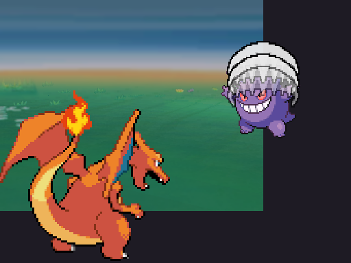 Mordisco (EBDX) | 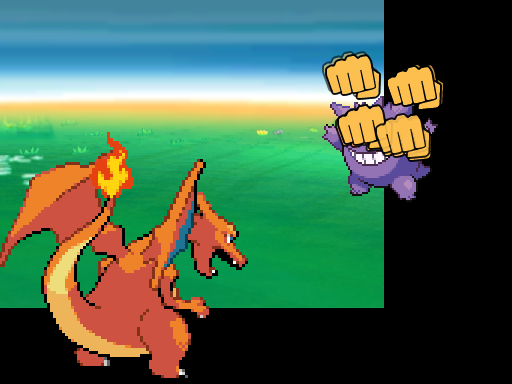 A Bocajarro (EBDX) | 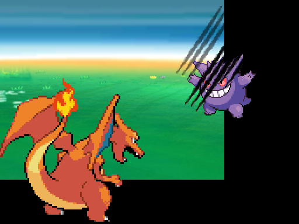 Garra Umbría (EBDX) |
| 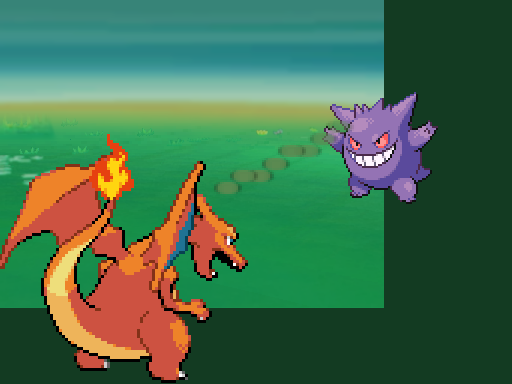 Energibola (EBDX) | 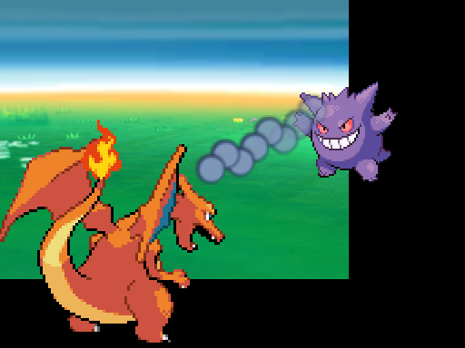 Cometa Draco (EBDX) | 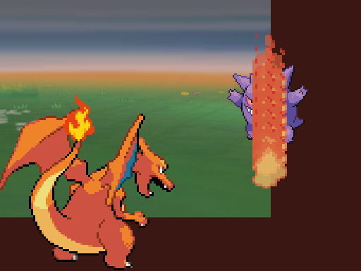 Colmillo Ígneo (EBDX) |
| 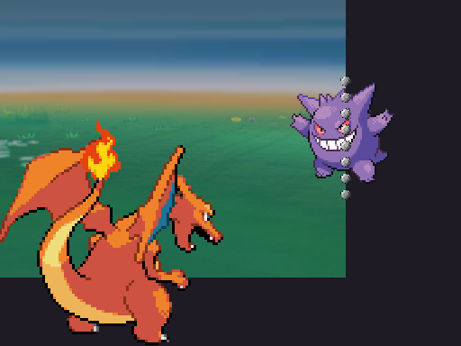 Triturar (EBDX) | 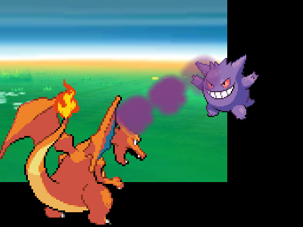 Bomba Lodo (EBDX) | 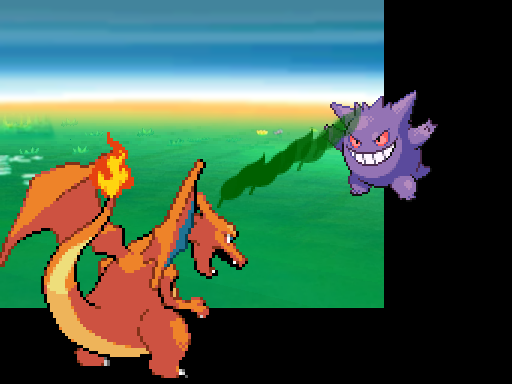 Lluevehojas (EBDX) |
| 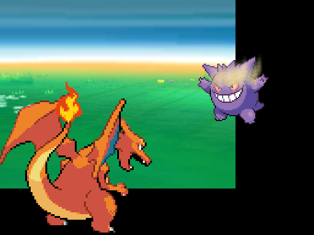 Trueno (datos) | 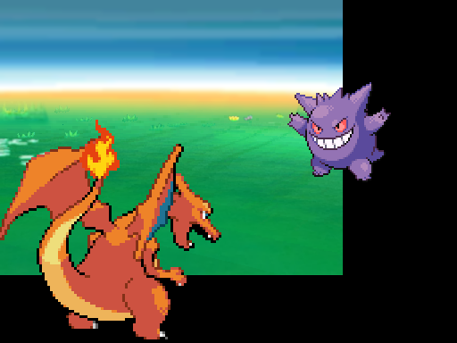 Psicorrayo (datos) | 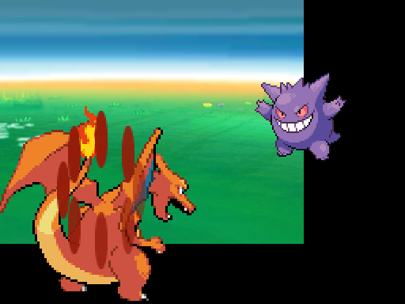 Corpulencia (EBDX) |

## Límites, sin maquillar

- Es una **traducción** de la animación original a los patrones de partículas del juego, no una copia fotograma a fotograma: EBDX gira y escala sprites, que aquí no se permite.
- Los 456 hechos por sus datos se parecen entre sí dentro de un mismo tipo. Los que más se ven en partida y no están en EBDX (Trueno, Psicorrayo, Cascada, Desarme…) son los primeros candidatos a una secuencia a mano.
- Los sonidos de EBDX (166 efectos de animación) no están importados todavía.
