# Personajes en su sitio y entrada al combate · 2026-10-15 (Agente 2)

Capturas reales del juego a 512×384 con `tools/mundo/capturar_personajes.gd` (necesita ventana): la entrada al combate con el retrato de cada personaje (`BattleEntryTransition` + `TrainerPortraits`) y el mapa con las colocaciones de `data/personajes_en_el_mapa.json`. Todo es **provisional** hasta que lo apruebe Javier: sitios, equipos, frases, los mapas nuevos y el coche de policía. Lista completa de entrenadores, sprites y sitios: [`docs/mundo/cobertura_personajes.md`](../../mundo/cobertura_personajes.md).

## Entrada al combate

| Personaje | Captura | Nota |
|---|---|---|
| Zapatero y Maduro (doble, Puerto de La Luz) | 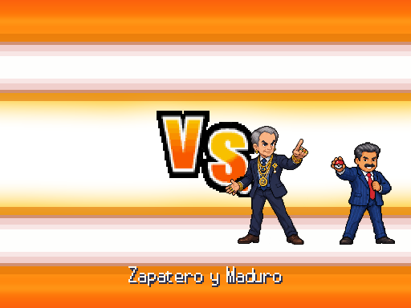 | Atlas de los dos; al ganar, Zapatero da las joyas |
| Trump (aeropuerto de Gran Canaria) | 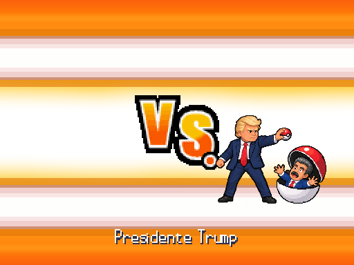 | Su atlas con Maduro capturado |
| Rufián (su piso del Eixample) | 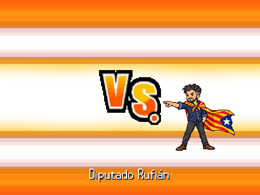 | Atlas con la estelada como capa |
| Javier (San Miguel, siete medallas) | 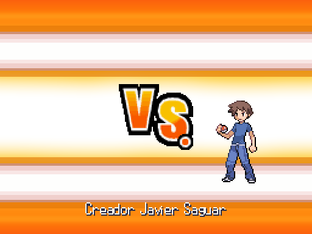 | **Sin atlas**: retrato del pack 11 provisional (PENDIENTE JAVIER: su aspecto). Su foto real sale si la pone en `assets/fotos_reales/javier.png` |
| Ábalos y Koldo (cárcel de Soto del Real) | 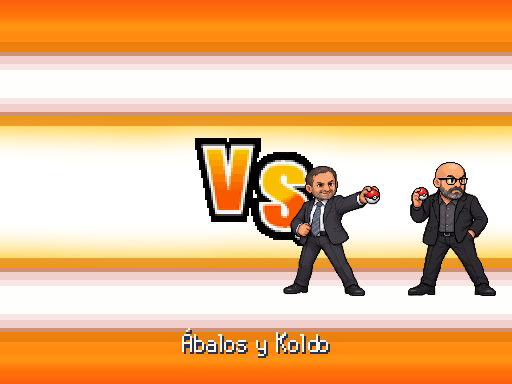 | Tercer encuentro; resuelven el atlas por su clase |
| Zona Gemelos (Getafe) | 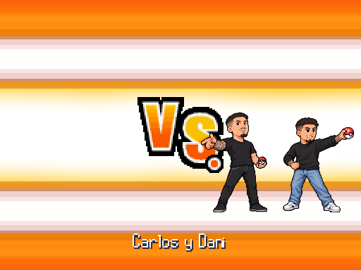 | Carlos y Dani, doble |
| Omar Montes (Madrid Río) | 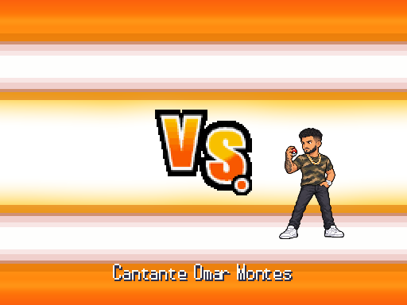 | |
| Paache (Ruta 17, Galicia) | 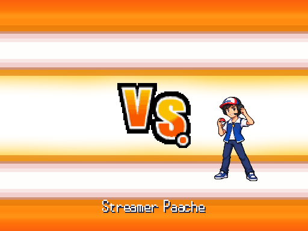 | |

## En su sitio

| Dónde | Captura | Quién |
|---|---|---|
| Piso de Rufián · salón (mapa nuevo) | 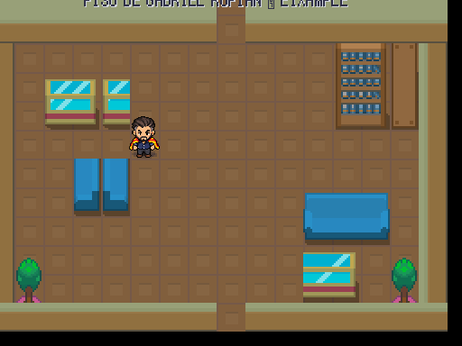 | Rufián |
| Piso de Rufián · habitación (mapa nuevo) | 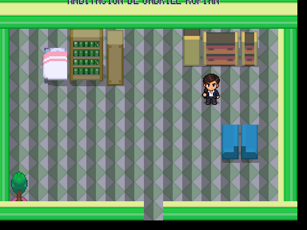 | Vito Quiles, junto al armario |
| Soto del Real · exterior (mapa nuevo) | 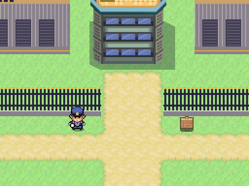 | La cárcel, al norte del Bernabéu |
| Soto del Real · módulo de ingresos (mapa nuevo) | 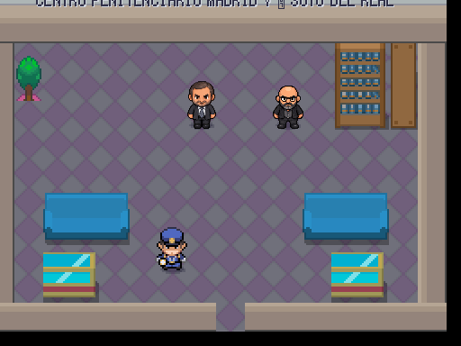 | Ábalos y Koldo, con seis medallas y después de la Albufera |
| La Albufera: la detención | 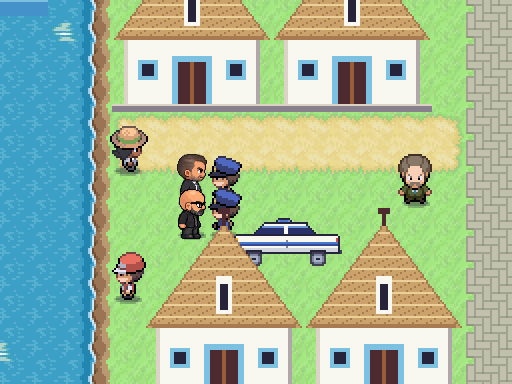 | Ábalos y Koldo con el coche de la Policía Nacional (dibujado a mano) y los agentes del pack 05, montados con los sprites del evento |
| Puerto de La Luz (Las Palmas) | 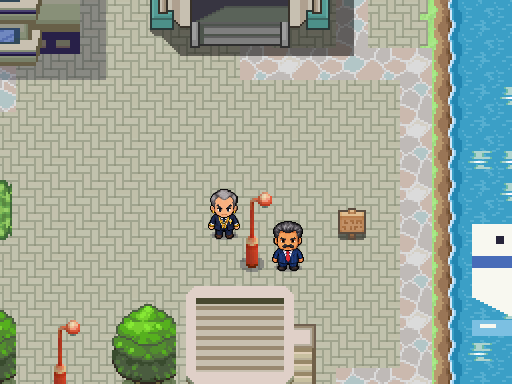 | Zapatero y Maduro |
| Aeropuerto de Gran Canaria | 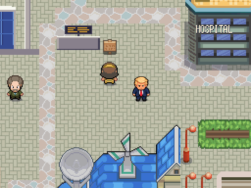 | Trump, después de ganar a Maduro |
| Getafe | 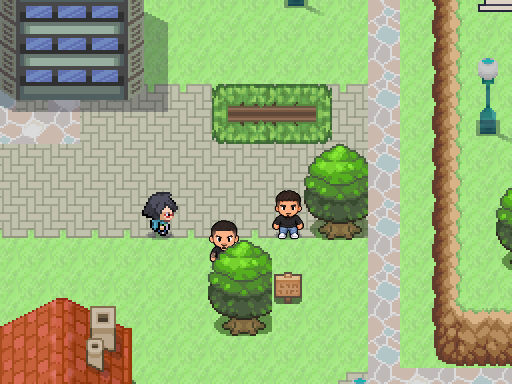 | Zona Gemelos |
| Móstoles («Mirador de Montepinar») | 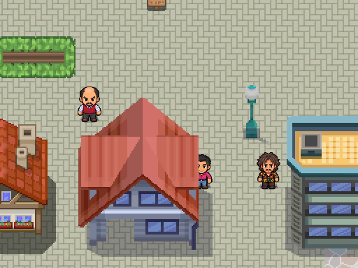 | Antonio Recio, Amador y Mente Fría |
| Rocafonda · la mansión | 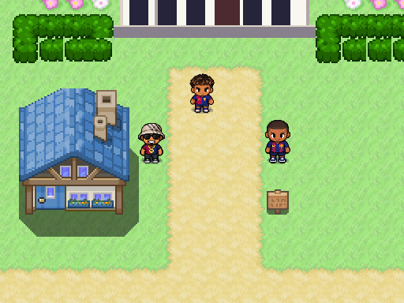 | Lamine, HustleHard304 y Keyne: tres combates seguidos con curación |
| Rocafonda · el campo | 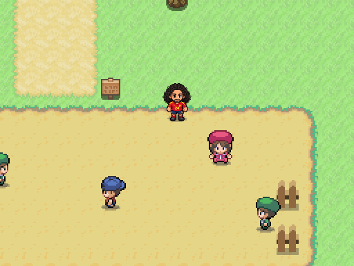 | Cucurella con los niños |
| San Miguel de Bernuy | 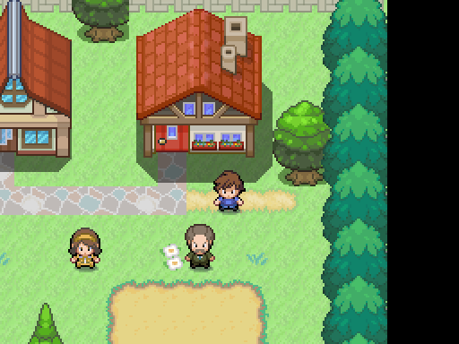 | Javier delante de su casa, con siete medallas |
| Port Vell (Barcelona) | 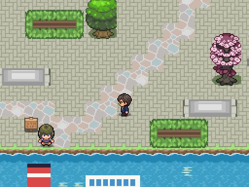 | Puigdemont, junto a los ferris |

Las salas de la Liga están pintadas en la rama `feat/agente2-liga` y no salen aquí: falta su entrada desde el interior del Palacio Real (petición 89 en `docs/ESTADO.md`).
