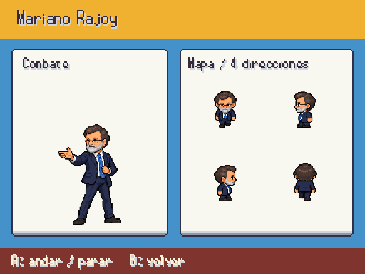
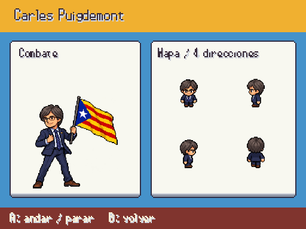
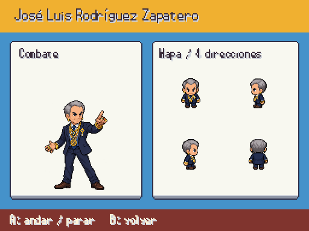
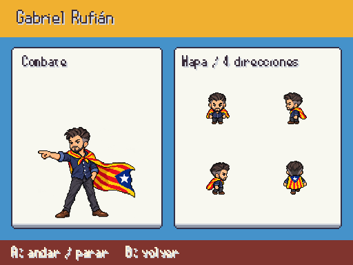
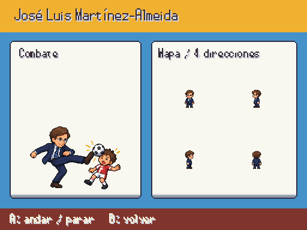
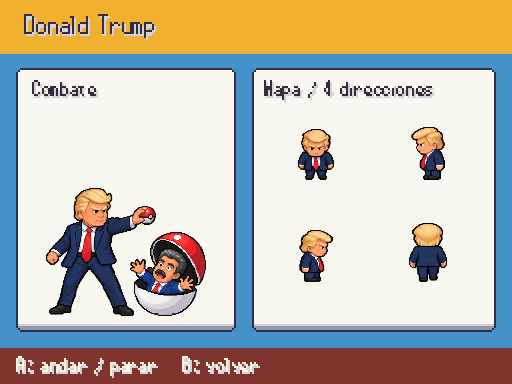
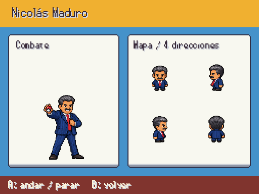

# Personajes de combate y mapa · entrega 1

Diseños nuevos a partir de retratos y referencias de Javier. Siete atlas originales, cada uno con una entrada de combate y dieciséis poses de mapa. Provisionales hasta revisión de Javier. Las fuentes y la lista completa se registran en [personajes_fotograficos.md](../personajes_fotograficos.md).

F9 → Galerías → Personajes / combate y mapa. A alterna caminar y parar; B vuelve. Disponible solo en debug, sin cambiar la partida.

## Rajoy

## Puigdemont

## Zapatero

## Rufian

## Almeida

## Trump

## Maduro

Las regiones de mapa recortan cada silueta por separado y añaden margen transparente de presentación: no arrastran píxeles de otros fotogramas. Escala proporcional por mitades con filtro nearest; PNG intactos. Almeida incluye el guiño del balonazo y Trump una escena ficticia de captura con Poké Ball.
