# Famosos · entrega 10

Felipe VI, Juan Carlos I, Vito Quiles, Bertrand Ndongo, Belén Esteban, Coto Matamoros, Ferran Torres, Juan Roig, Melendi, Vegetta777 y Willyrex: retrato de entrada y dieciséis poses por identidad. Capturas reales a 512×384; arte provisional hasta revisión.

F9 → Galerías → Personajes / combate y mapa.

Fuentes completadas en [personajes_fotograficos.md](../personajes_fotograficos.md). **Corrección de Javier:** Melendi es el de joven de su fotografía adjunta, con rastas, camiseta blanca sin mangas, vaqueros y tatuaje en el brazo derecho. Sustituye la primera versión con gorra/chándal; tatuaje lateral y dirección de Vegetta corregidos antes de importar. Los reyes conservan capas/coronas del guion; Juan Carlos su bastón. Juan Roig conserva gafas y barba blanca de la referencia.

## Entradas conjuntas

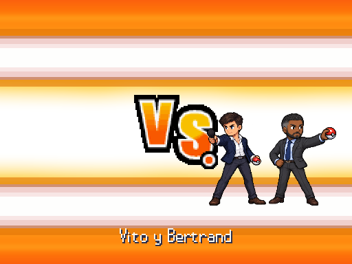

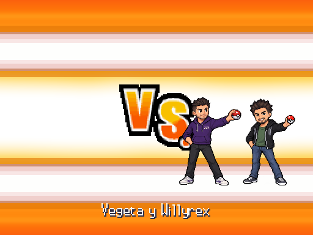

## Felipe VI

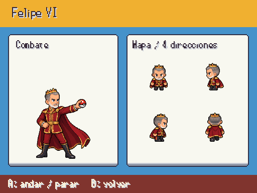

## Juan Carlos I

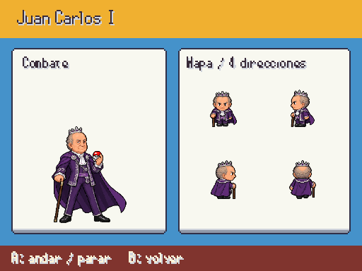

## Vito Quiles

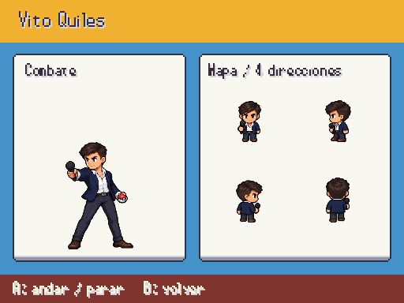

## Bertrand Ndongo

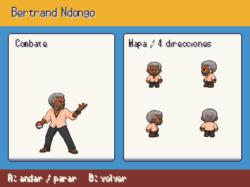

## Belén Esteban

## Coto Matamoros

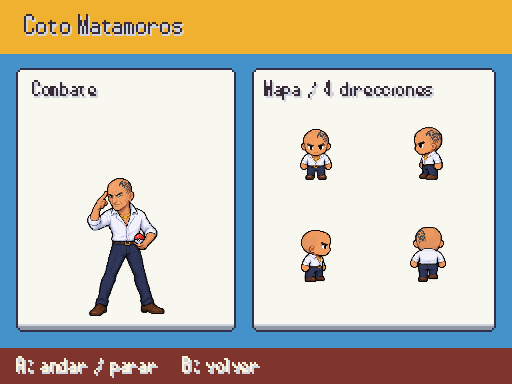

## Ferran Torres

## Juan Roig

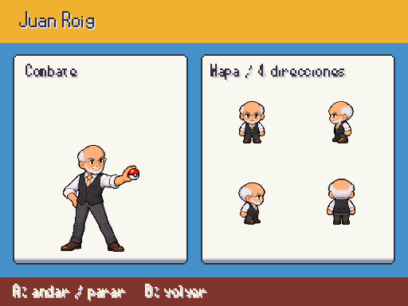

## Melendi

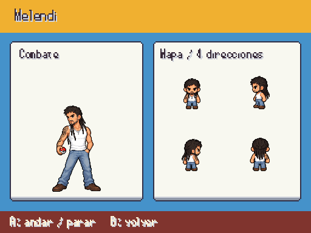

## Vegetta777

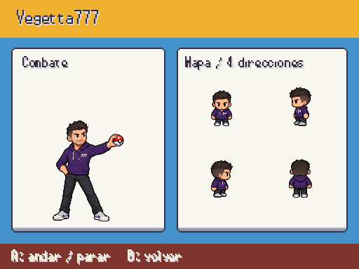

## Willyrex

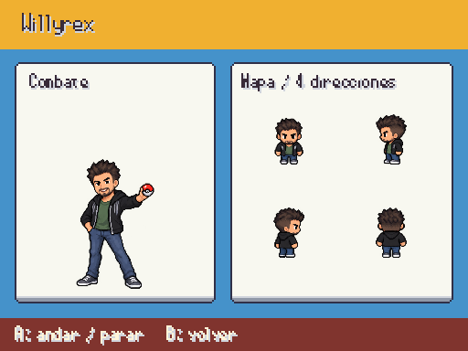
