# Personajes nuevos · entrega 11

Once entradas de la petición de Javier del 14 de octubre, doce identidades al separar los dos integrantes de Zona Gemelos. Cada atlas contiene retrato y dieciséis poses. Capturas reales a 512×384; arte provisional hasta revisión.

F9 → Galerías → Personajes / combate y mapa. Fuentes en [personajes_fotograficos.md](../personajes_fotograficos.md). Los retratos individuales de Carlos y Dani se verificaron en su web oficial. Maxi/Mente Fría, Amador y Recio corresponden a los personajes de La que se avecina.

Los equipos y emplazamientos nuevos siguen pendientes de decisión. La herramienta de captura admite los atlas sin entrenador registrado para revisar la entrada sin generar equipo ni modificar una partida. Se corrigió la separación de retratos en pareja: cada imagen dispone de su ancho máximo y ocho píxeles de hueco. Prueba específica de presentación **5/5**, 2.836 aserciones con los primeros cuatro atlas nuevos.

## Pablo Motos

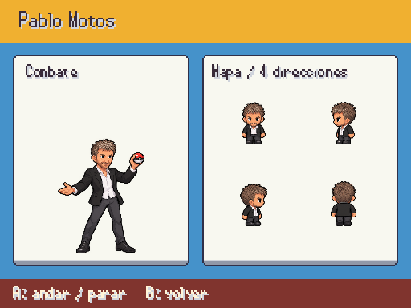

## Omar Montes

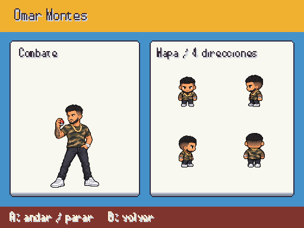

## Zona Gemelos: Carlos

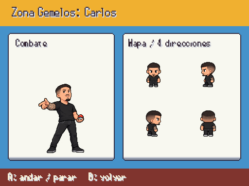

## Zona Gemelos: Dani

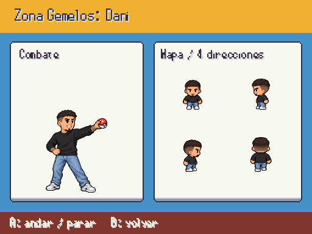

## El Churumbel de Málaga

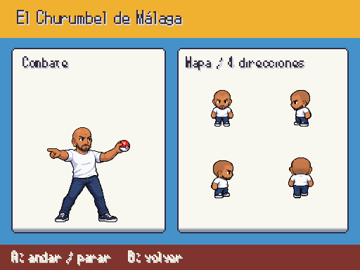

## Joan Pradells

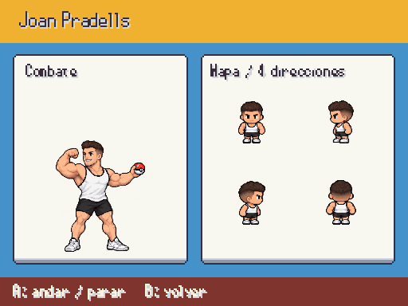

## JC Reyes

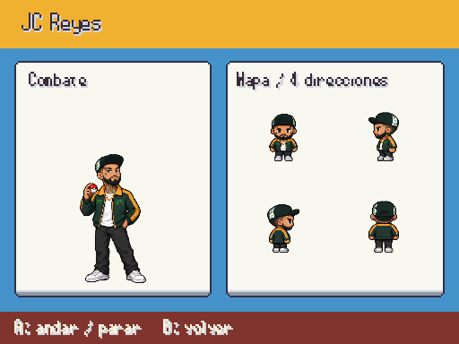

## Marc Cucurella

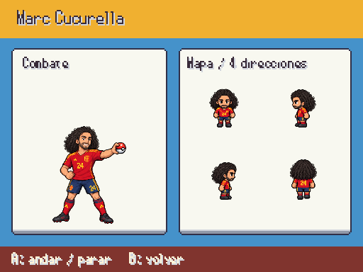

## David Bisbal

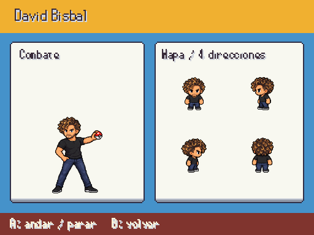

## Eduardo Gómez (Mente Fría)

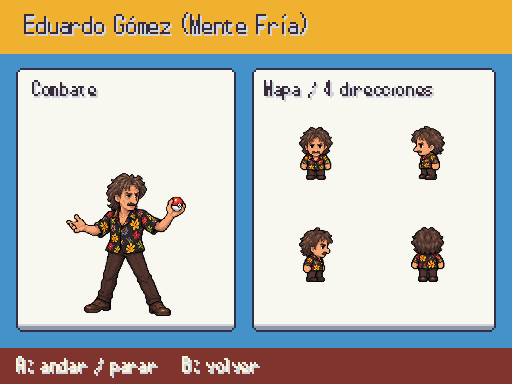

## Amador Rivas

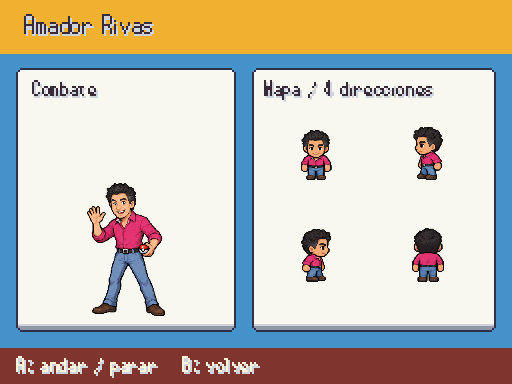

## Antonio Recio

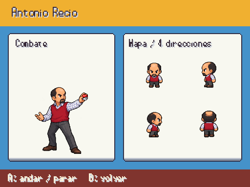

## Entradas revisadas

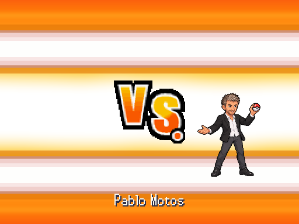

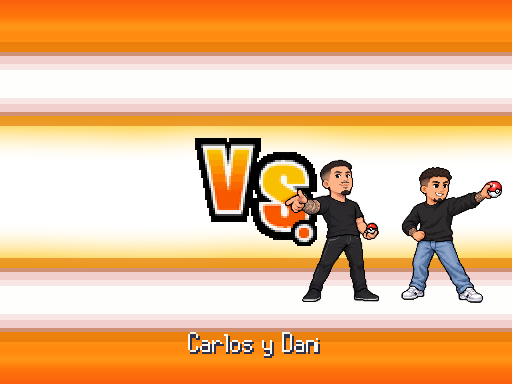

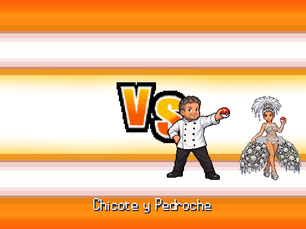
