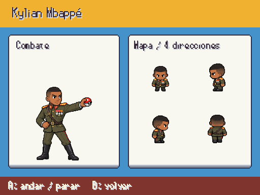
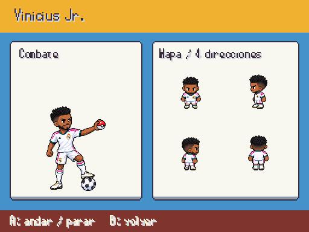
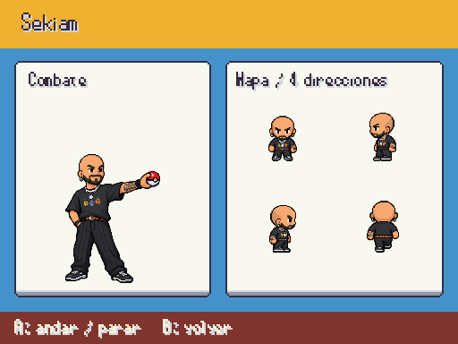
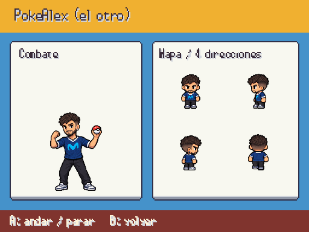
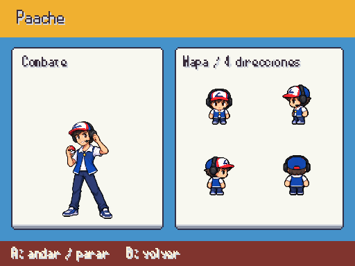
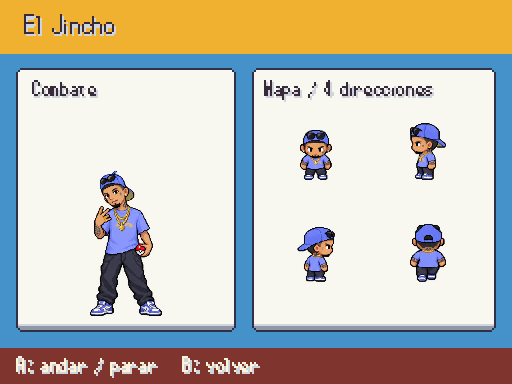

# Personajes de combate y mapa · entrega 2

Seis diseños según las fotos de Javier: Mbappé con uniforme militar, Vinicius con barba, Sekiam rapado, PokeAlex (el otro), Paache y El Jincho. Retrato y dieciséis poses por personaje, conservando los PNG originales. Provisionales hasta revisión. Fuentes en [personajes_fotograficos.md](../personajes_fotograficos.md).

F9 → Galerías → Personajes / combate y mapa; A para andar/parar y B para volver.

## Mbappe

## Vinicius

## Sekiam

## Pokealex

## Paache

## El jincho

