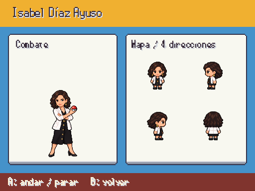
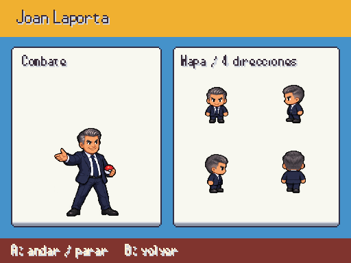
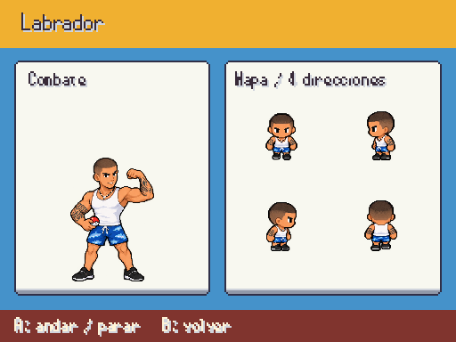
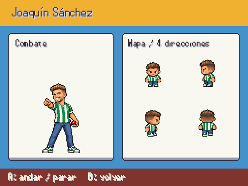
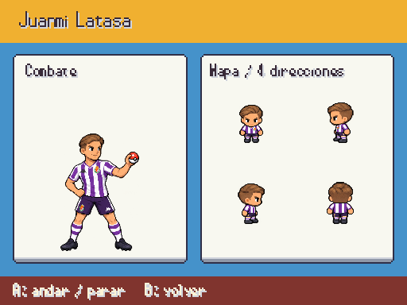
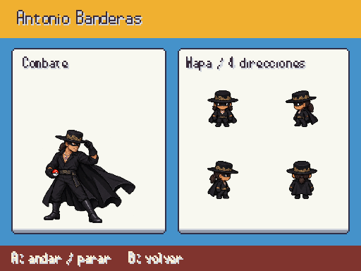
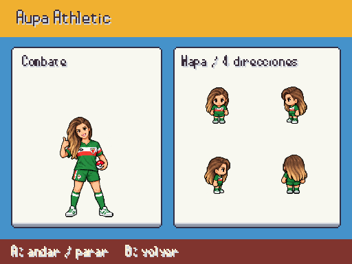

# Líderes · combate y mapa

Ocho diseños con referencia fotográfica, conservando los PNG intactos y las colocaciones de B. Provisionales hasta revisión de Javier. Fuente individual en [personajes_fotograficos.md](../personajes_fotograficos.md).

F9 → Galerías → Personajes / combate y mapa; A andar/parar, B volver.

## Ayuso

## Laporta

## Labrador

## Joaquin

## Quevedo

## Latasa

## Banderas

## Aupa athletic

La escala del mapa se calcula sobre el cuerpo visible; el margen transparente no hace saltar a una escala menor. Se mantienen nearest, proporciones y pies alineados.
