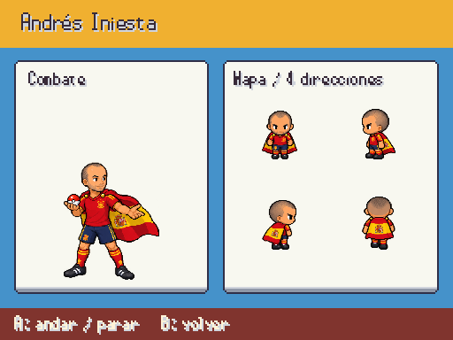
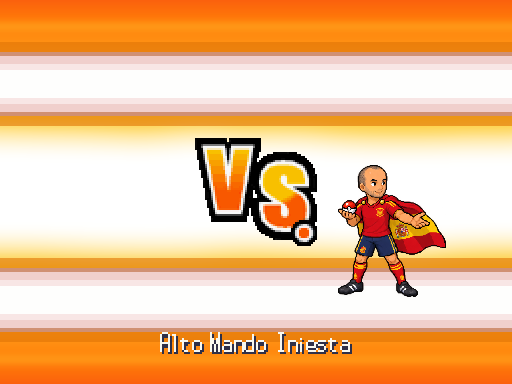
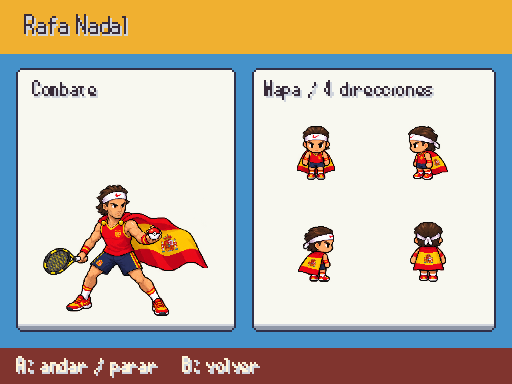
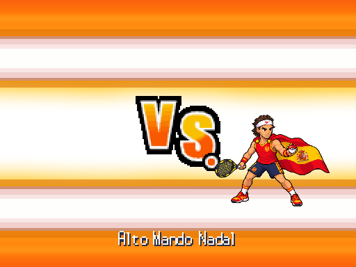
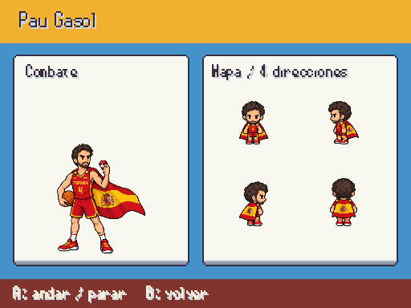
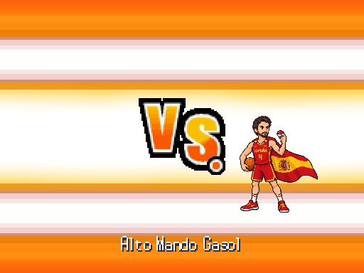
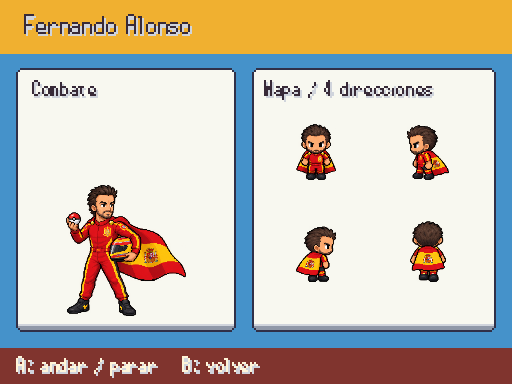
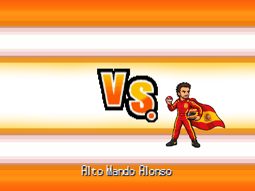

# Alto Mando · equipación española y bandera como capa

Decisión de Javier: los cuatro miembros del Alto Mando llevan indumentaria española y la bandera de España como capa. Se aplica tanto a la entrada de combate como a las dieciséis poses de mapa. Iniesta usa la equipación de fútbol roja y azul; Nadal, tirantes rojos de tenis y cinta; Gasol, uniforme rojo de baloncesto de España; Alonso, mono de piloto rojo y amarillo. Se conserva el rostro según referencia y el deporte de cada personaje. Provisionales hasta revisión de Javier.

Fuentes fotográficas en [personajes_fotograficos.md](../personajes_fotograficos.md). PNG originales intactos, regiones por silueta, nearest y escala proporcional. F9 → Galerías → Personajes / combate y mapa.

## Iniesta

## Nadal

## Gasol

## Alonso

La entrada admite hasta 176×180 px para mostrar la bandera y la raqueta sin reducir innecesariamente al entrenador. La propuesta blanca inicial de Iniesta queda descartada. No se cambian equipos ni colocaciones.
