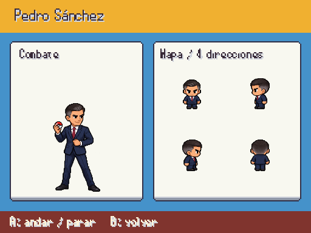
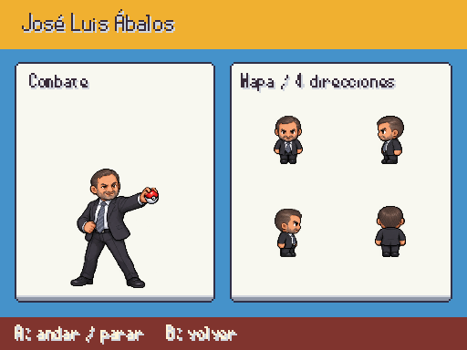
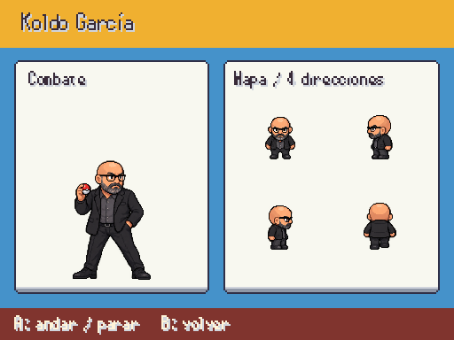
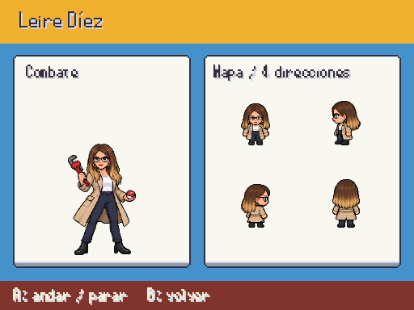
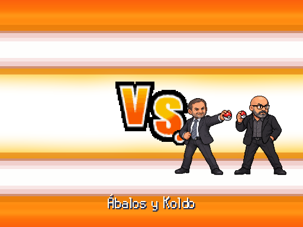

# Clan PSOE · retratos y sprites de mapa

Pedro Sánchez, Ábalos, Koldo y Leire Díez, con una entrada de combate y dieciséis poses por personaje. Identidad según foto, prendas previstas en el proyecto; Koldo conserva cabeza rapada, gafas y barba de la referencia actual. Provisionales hasta revisión. Fuentes en [personajes_fotograficos.md](../personajes_fotograficos.md).

F9 → Galerías → Personajes / combate y mapa.

## Pedro sanchez

## Abalos

## Koldo

## Leire diez

## Combate de Ábalos y Koldo

Los dos retratos entran y salen juntos; tienen espacio propio y apoyan los pies en la misma base. El nombre del dúo aparece una sola vez por personaje. La escena respeta la opción de fotos reales y conserva las imágenes anteriores si falta un atlas. Sin cambios de equipos ni colocaciones.
