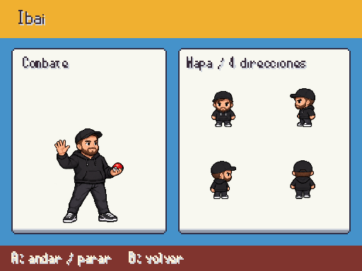
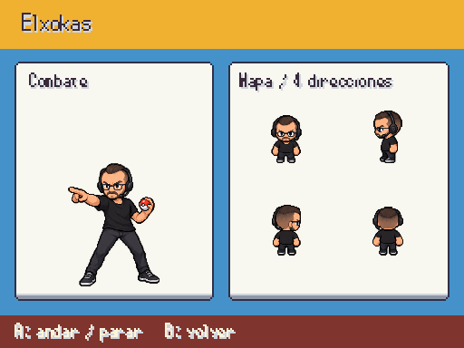
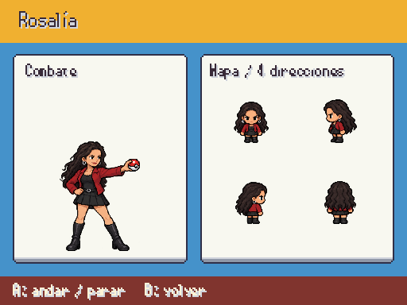
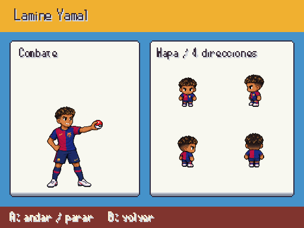
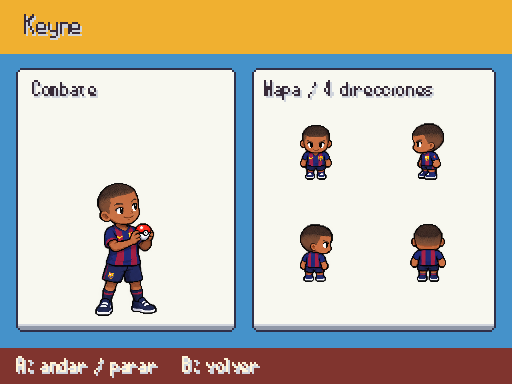
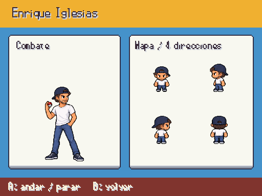
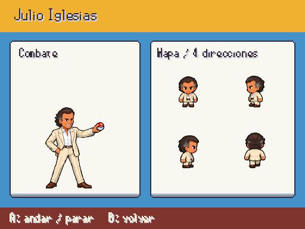

# Famosos · entrega 6

Ibai, Elxokas, Rosalía, Lamine, HustleHard304, Keyne, Enrique y Julio Iglesias: retrato de entrada y dieciséis poses por identidad. Capturas reales a 512×384; arte provisional hasta revisión.

F9 → Galerías → Personajes / combate y mapa. Fuentes en [personajes_fotograficos.md](../personajes_fotograficos.md).

La cara y el pelo siguen las fotos: HustleHard304 tiene pelo muy corto y perilla; Julio lleva pelo castaño con sienes canosas. Se conservan las prendas del proyecto. Keyne tiene proporciones infantiles. Se corrigió el paso frontal de Enrique y la transparencia del atlas.

## Ibai Llanos

## Elxokas

## Rosalía

## Lamine Yamal

## HustleHard304

## Keyne

## Enrique Iglesias

## Julio Iglesias

