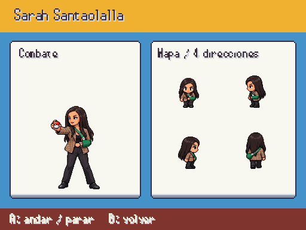
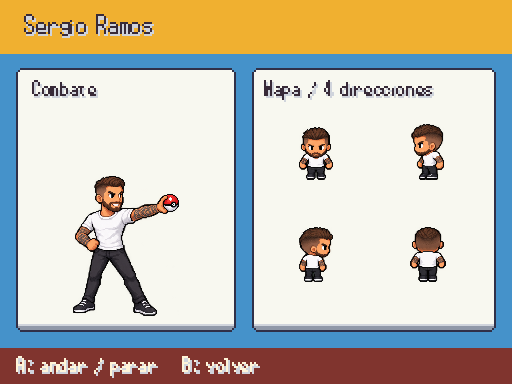
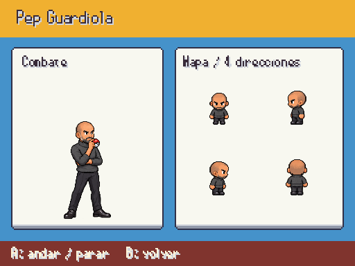
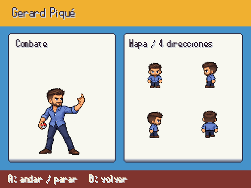
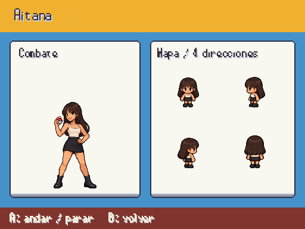
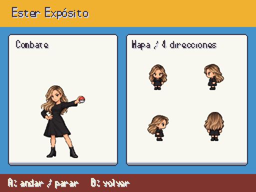
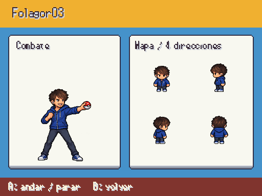

# Famosos · entrega 7

Sarah, Sergio Ramos, Guardiola, Piqué, Aitana, Ester Expósito, Folagor y Peereira7: entrada de combate y dieciséis poses por identidad. Capturas reales a 512×384; arte provisional hasta revisión.

F9 → Galerías → Personajes / combate y mapa. Fuentes en [personajes_fotograficos.md](../personajes_fotograficos.md).

Sarah lleva cabestrillo verde en el brazo izquierdo por indicación de Javier. El brazo apoyado conserva el soporte mientras camina; su mano derecha libre sostiene la Poké Ball. Melena oscura y americana de cuadros según foto. Aitana lleva pelo oscuro y flequillo, sustituyendo el rubio genérico del pack. Los equipos y las ubicaciones se conservan.

## Sarah Santaolalla

## Sergio Ramos

## Pep Guardiola

## Gerard Piqué

## Aitana

## Ester Expósito

## Folagor03

## Peereira7

