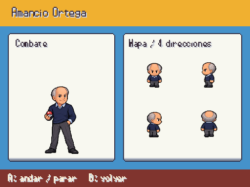
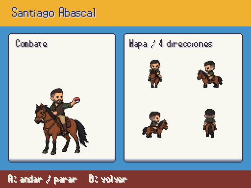
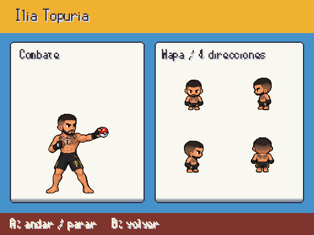
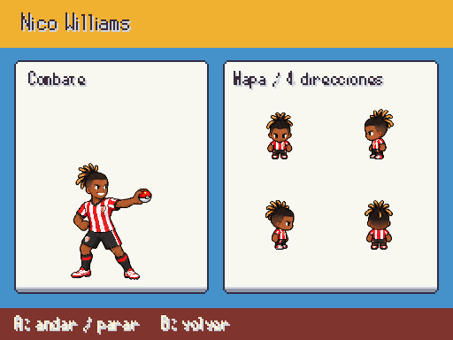
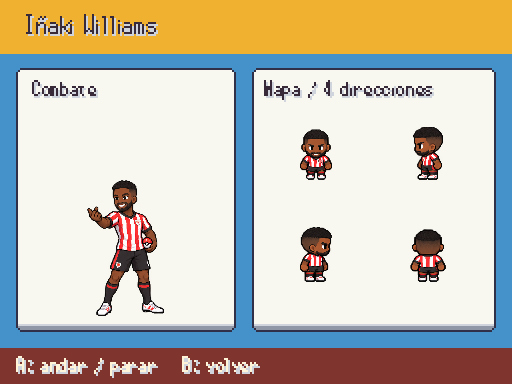
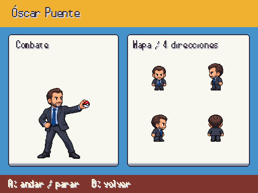
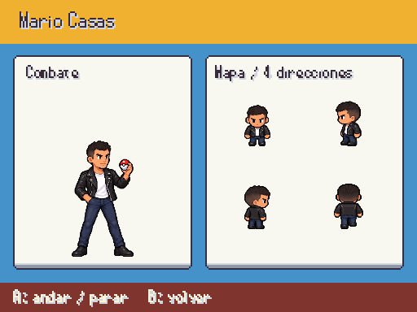
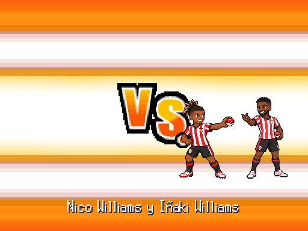

# Famosos · entrega 8

Amancio, Abascal, Topuria, Nico e Iñaki Williams, Broncano, Óscar Puente y Mario Casas: entrada de combate y dieciséis poses por identidad. Capturas reales a 512×384; arte provisional hasta revisión.

F9 → Galerías → Personajes / combate y mapa. Fuentes en [personajes_fotograficos.md](../personajes_fotograficos.md).

Abascal va a caballo como indica el guion; montura y jinete están en cada pose. Topuria lleva su indumentaria de MMA y tatuajes visibles de la referencia. Amancio y Óscar conservan su línea del pelo y barba reales, sustituyendo las piezas blancas genéricas. Se corrigieron las direcciones de Nico antes de importar. Los Williams conservan sus equipos y aparecen juntos con tamaño coherente.

## Amancio Ortega

## Santiago Abascal

## Ilia Topuria

## Nico Williams

## Iñaki Williams

## David Broncano

## Óscar Puente

## Mario Casas

## Entrada de los Williams

