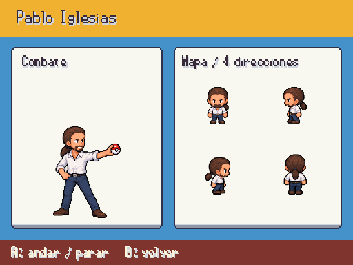
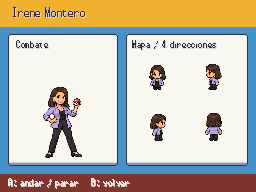
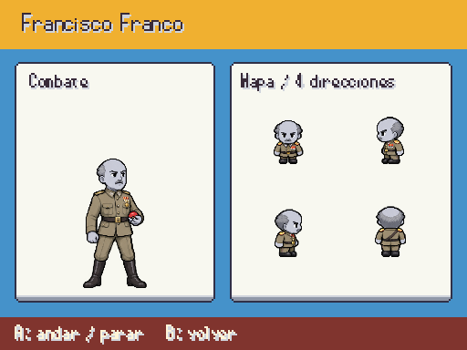
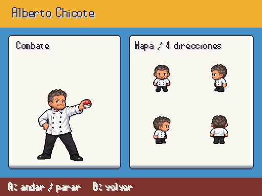
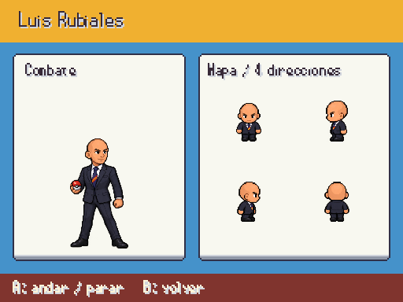
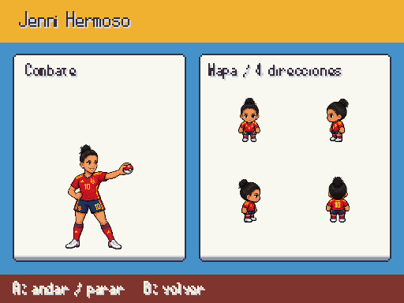
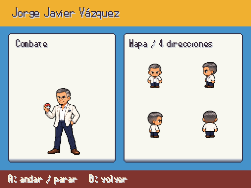
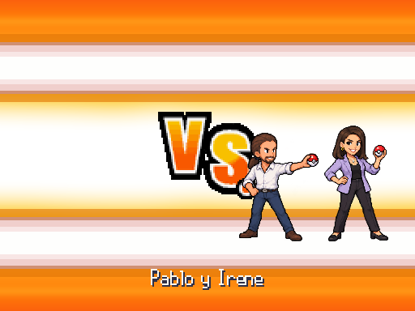
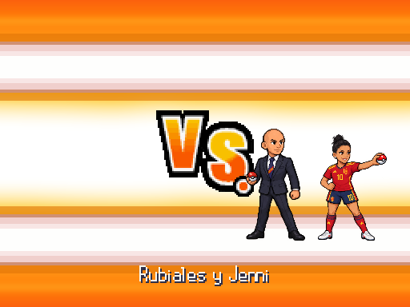

# Famosos · entrega 9

Pablo Iglesias, Irene Montero, Franco, Chicote, Pedroche, Rubiales, Jenni Hermoso y Jorge Javier: retrato de entrada y dieciséis poses por identidad. Capturas reales a 512×384; arte provisional hasta revisión.

F9 → Galerías → Personajes / combate y mapa. Fuentes en [personajes_fotograficos.md](../personajes_fotograficos.md).

Pablo conserva la coleta; se corrigieron las direcciones frontales y laterales antes de importar. Irene lleva la americana del retrato oficial. Franco tiene la palidez del fantasma del guion. Rubiales sustituye el pelo genérico por su cabeza rapada; Jorge Javier conserva gafas y ropa blanca de la fotografía. Jenni lleva equipación española y el pelo recogido de la referencia. Equipos, mapas y colocaciones conservados.

## Pablo Iglesias

## Irene Montero

## Francisco Franco

## Alberto Chicote

## Cristina Pedroche

## Luis Rubiales

## Jenni Hermoso

## Jorge Javier Vázquez

