# Personajes · revisión del 2026-10-14

Doce revisiones solicitadas por Javier, retrato y dieciséis poses por identidad. Referencias originales en `docs/arte/referencias/javier_2026-10-14/`. Capturas reales a 512×384, provisionales hasta revisión. F9 → Galerías → Personajes / combate y mapa.

Aitana lleva puntas azules y atuendo blanco; Belén incorpora detalles de rostro/joyas; Bertrand pelo gris, barba y camisa de la nueva foto; Broncano traje azul; Ester vestido blanco y pelo recogido; Ferran la equipación española; Folagor flequillo liso/sudadera; HustleHard sombrero/gafas/Barça; Óscar detalle facial y barba; Pedroche conjunto plateado con tocado; Peereira7 paletas/cola de castor; Quevedo camiseta blanca y tatuajes. Sarah mantiene su cabestrillo y el diseño existente.

Se corrigieron escala de espaldas de Ester y transparencia de Bertrand/Peereira7. Atlas originales conservados en el historial; capturas antes y después separadas para comparación.

## Aitana

| Antes | Después |
|---|---|
| 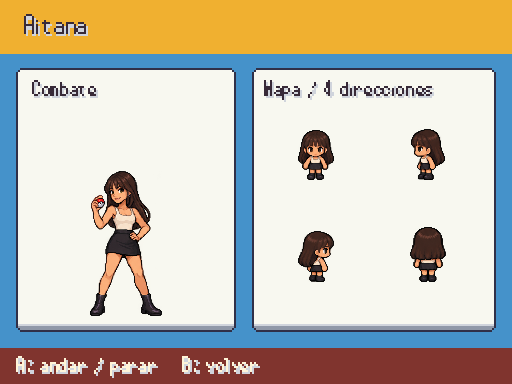 |  |

## Belén Esteban

| Antes | Después |
|---|---|
|  | 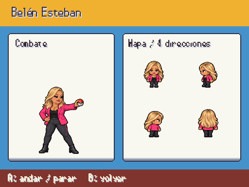 |

## Bertrand Ndongo

| Antes | Después |
|---|---|
| 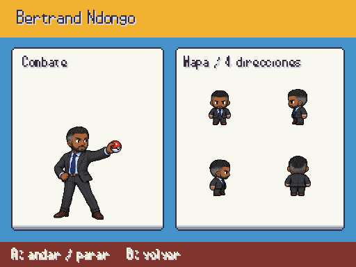 |  |

## David Broncano

| Antes | Después |
|---|---|
| 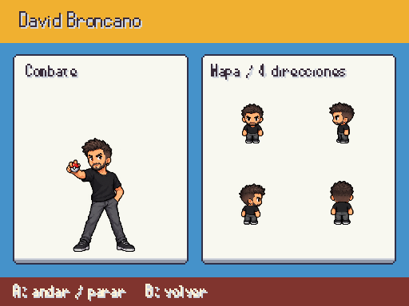 | 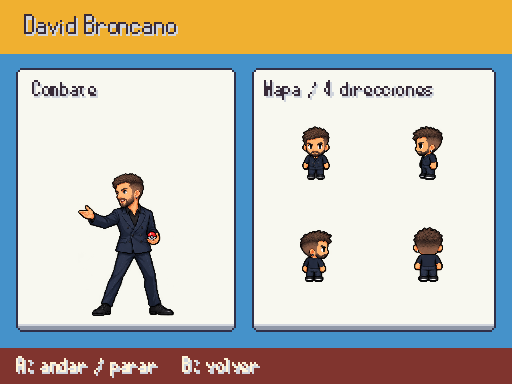 |

## Ester Expósito

| Antes | Después |
|---|---|
|  | 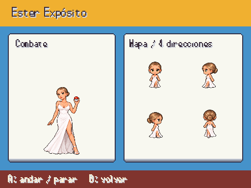 |

## Ferran Torres

| Antes | Después |
|---|---|
| 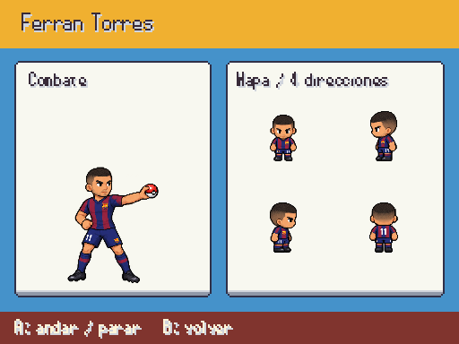 | 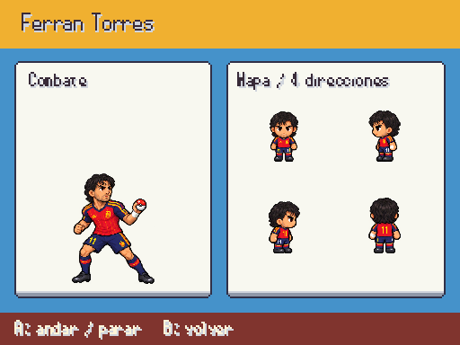 |

## Folagor03

| Antes | Después |
|---|---|
|  | 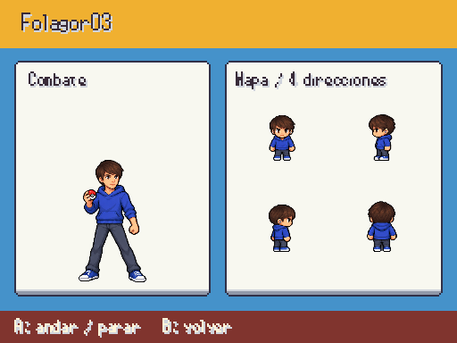 |

## HustleHard304

| Antes | Después |
|---|---|
| 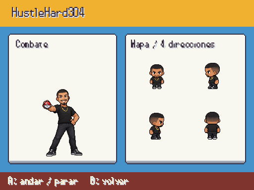 | 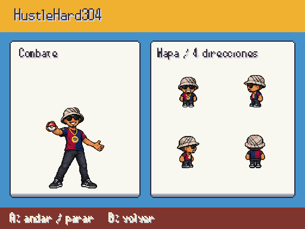 |

## Óscar Puente

| Antes | Después |
|---|---|
| 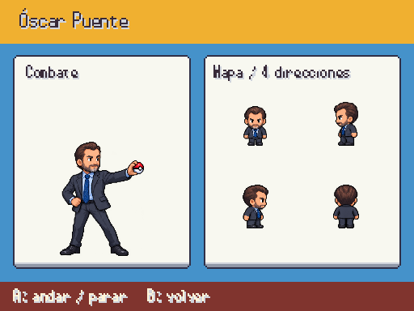 |  |

## Cristina Pedroche

| Antes | Después |
|---|---|
| 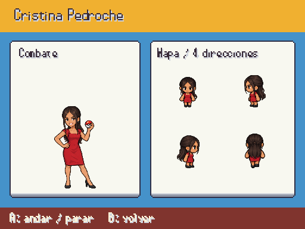 | 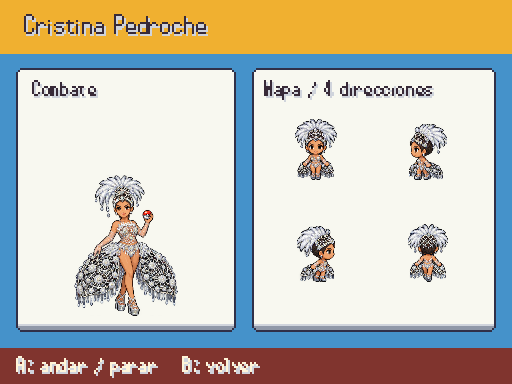 |

## Peereira7

| Antes | Después |
|---|---|
| 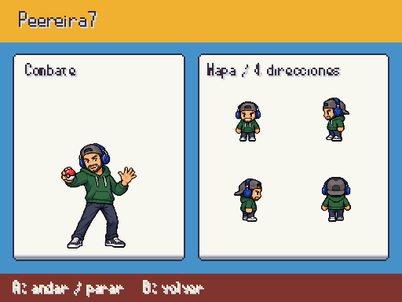 | 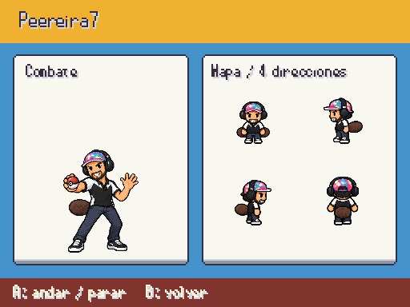 |

## Quevedo

| Antes | Después |
|---|---|
| 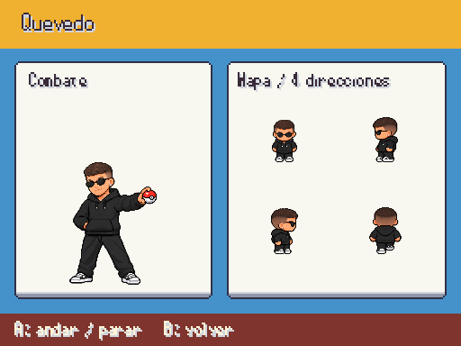 | 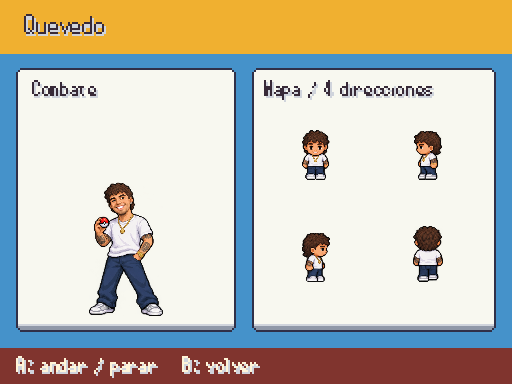 |

