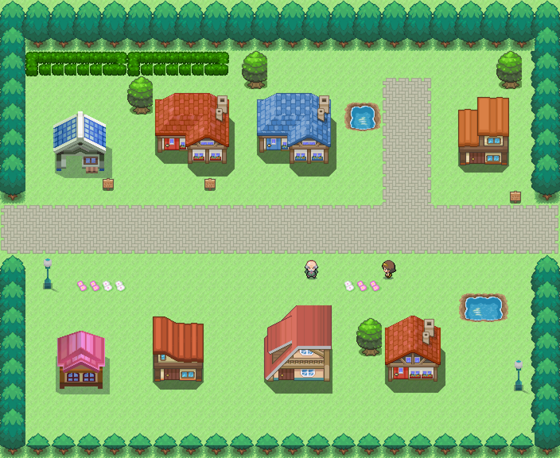
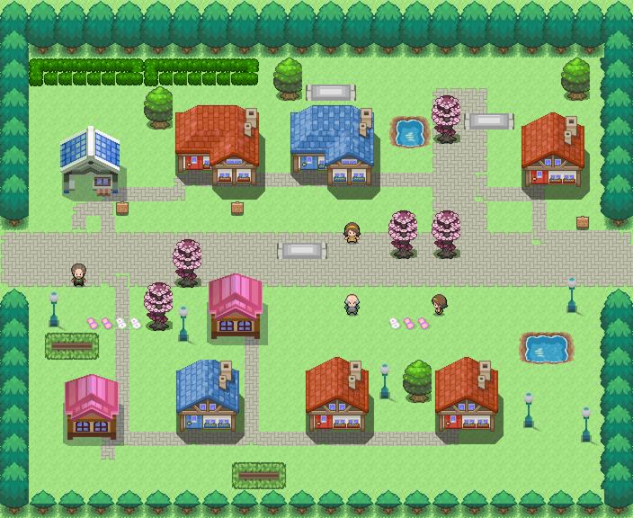
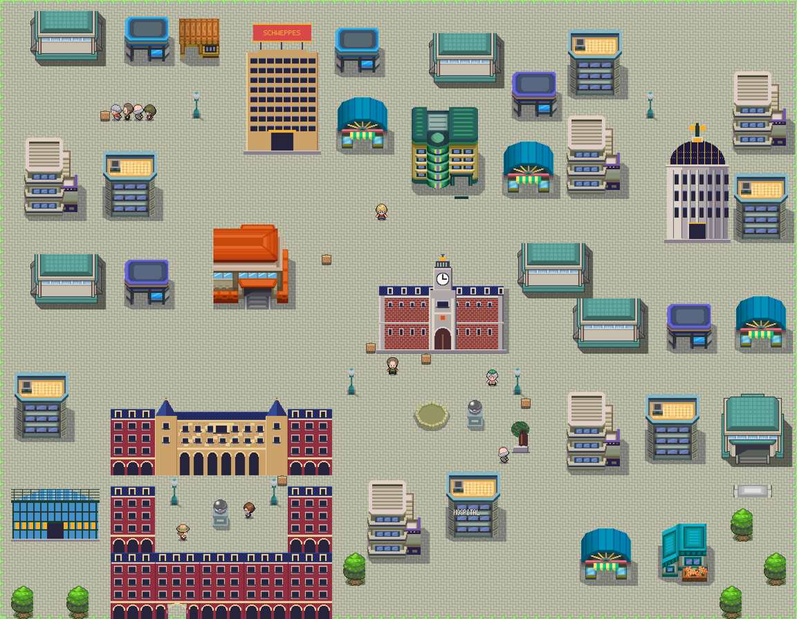
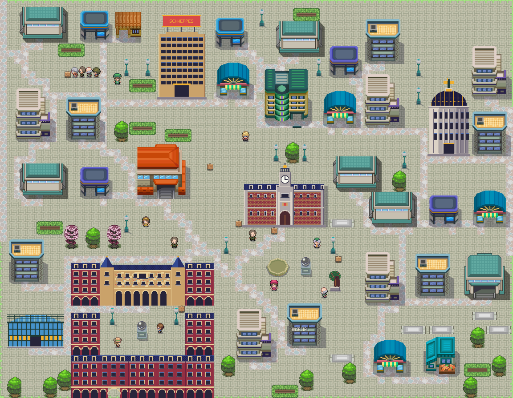

# Pueblos y ciudades más completos · 2026-10-14

Encargo expreso de Javier al terminar los personajes: llenar los pueblos y ciudades y corregir las casas cortadas. **Arte provisional**, pendiente de revisión visual de Javier.

Se detallan los **33 mapas urbanos existentes**, con **62 viviendas nuevas y sus 62 interiores**, **962 piezas de mobiliario o arbolado** y **99 vecinos ambientales**. Los paseos enlazan las entradas y las salidas de borde por casillas transitables. Los vecinos añadidos quedan fuera de la hierba de encuentros.

Las **89 casas cortadas** usaban cuatro módulos incompletos del pack DPPt (`casa_naranja`, `casa_madera`, `casa_granero` y `casa_tejado_rojo`). Se sustituyen por las piezas completas `casa_roja_chimenea` y `casa_azul_pequena`, del mismo pack, manteniendo exactamente la casilla de la puerta. También se corrigen sus usos en rutas y en los mapas de muestra. Cambian los colores de algunas fachadas; no se reconstruyen los módulos parciales ni se retocan sus píxeles.

Se editan las escenas actuales. Se conservan los monumentos, servicios, personajes colocados, entrenadores, puertas anteriores y puntos de aparición. Los interiores nuevos usan el método de interiores ya integrado, con mobiliario y dos vecinos, entrada y regreso. Los parques y playas reciben detalle sin añadir viviendas. No se rehacen desde los pintores antiguos.

La herramienta incremental está en `maps/_tools/detallar_ciudades.gd`; las casas se reparan con `completar_casas.gd`, y los vecinos del paseo se revisan con `ajustar_vecinos_paseo.gd`. La marca de escena `detalle_urbano` evita duplicar la ampliación. Para ver cada mapa en el juego: **F9 → Mapa de la región · viajar → pulsar su zona**.

Las pruebas de regresión comparan las conexiones y apariciones anteriores y comprueban físicamente la entrada y el regreso de las 62 viviendas nuevas. No se decide equipo, ubicación ni diálogo de los personajes famosos pendientes de Javier.

## Comparativa de ciudades y pueblos

| Mapa | Casas nuevas | Mobiliario/arbolado | Vecinos | Antes | Después |
|---|---:|---:|---:|---|---|
| Alicante (`alicante/exterior`) | 0 | 39 | 4 | [Ver](tejido_urbano_2026-10-14/alicante_exterior_antes.png) | [Ver](tejido_urbano_2026-10-14/alicante_exterior_despues.png) |
| Barcelona · Ciutat Vella (`barcelona/ciutat_vella`) | 2 | 39 | 4 | [Ver](tejido_urbano_2026-10-14/barcelona_ciutat_vella_antes.png) | [Ver](tejido_urbano_2026-10-14/barcelona_ciutat_vella_despues.png) |
| Barcelona · Eixample (`barcelona/eixample`) | 4 | 39 | 4 | [Ver](tejido_urbano_2026-10-14/barcelona_eixample_antes.png) | [Ver](tejido_urbano_2026-10-14/barcelona_eixample_despues.png) |
| Barcelona · Les Corts (`barcelona/les_corts`) | 3 | 27 | 2 | [Ver](tejido_urbano_2026-10-14/barcelona_les_corts_antes.png) | [Ver](tejido_urbano_2026-10-14/barcelona_les_corts_despues.png) |
| Getafe (`getafe/exterior`) | 2 | 37 | 4 | [Ver](tejido_urbano_2026-10-14/getafe_exterior_antes.png) | [Ver](tejido_urbano_2026-10-14/getafe_exterior_despues.png) |
| Huelva (`huelva/exterior`) | 1 | 27 | 2 | [Ver](tejido_urbano_2026-10-14/huelva_exterior_antes.png) | [Ver](tejido_urbano_2026-10-14/huelva_exterior_despues.png) |
| Ibiza (`ibiza/exterior`) | 2 | 32 | 4 | [Ver](tejido_urbano_2026-10-14/ibiza_exterior_antes.png) | [Ver](tejido_urbano_2026-10-14/ibiza_exterior_despues.png) |
| Las Palmas · Las Canteras (`las_palmas/canteras`) | 0 | 24 | 2 | [Ver](tejido_urbano_2026-10-14/las_palmas_canteras_antes.png) | [Ver](tejido_urbano_2026-10-14/las_palmas_canteras_despues.png) |
| Las Palmas · Vegueta y Triana (`las_palmas/vegueta_triana`) | 3 | 24 | 2 | [Ver](tejido_urbano_2026-10-14/las_palmas_vegueta_triana_antes.png) | [Ver](tejido_urbano_2026-10-14/las_palmas_vegueta_triana_despues.png) |
| Leganés (`leganes/exterior`) | 6 | 32 | 4 | [Ver](tejido_urbano_2026-10-14/leganes_exterior_antes.png) | [Ver](tejido_urbano_2026-10-14/leganes_exterior_despues.png) |
| Madrid · Sol y Gran Vía (`madrid/centro`) | 0 | 30 | 4 | [Ver](tejido_urbano_2026-10-14/madrid_centro_antes.png) | [Ver](tejido_urbano_2026-10-14/madrid_centro_despues.png) |
| Madrid · Chamberí (`madrid/chamberi`) | 0 | 19 | 2 | [Ver](tejido_urbano_2026-10-14/madrid_chamberi_antes.png) | [Ver](tejido_urbano_2026-10-14/madrid_chamberi_despues.png) |
| Madrid · Moncloa (`madrid/moncloa`) | 1 | 30 | 2 | [Ver](tejido_urbano_2026-10-14/madrid_moncloa_antes.png) | [Ver](tejido_urbano_2026-10-14/madrid_moncloa_despues.png) |
| Madrid · Retiro y Prado (`madrid/retiro`) | 0 | 39 | 2 | [Ver](tejido_urbano_2026-10-14/madrid_retiro_antes.png) | [Ver](tejido_urbano_2026-10-14/madrid_retiro_despues.png) |
| Madrid Río (`madrid_rio/exterior`) | 0 | 11 | 2 | [Ver](tejido_urbano_2026-10-14/madrid_rio_exterior_antes.png) | [Ver](tejido_urbano_2026-10-14/madrid_rio_exterior_despues.png) |
| Málaga (`malaga/exterior`) | 6 | 48 | 4 | [Ver](tejido_urbano_2026-10-14/malaga_exterior_antes.png) | [Ver](tejido_urbano_2026-10-14/malaga_exterior_despues.png) |
| Móstoles (`mostoles/exterior`) | 4 | 32 | 4 | [Ver](tejido_urbano_2026-10-14/mostoles_exterior_antes.png) | [Ver](tejido_urbano_2026-10-14/mostoles_exterior_despues.png) |
| Murcia (`murcia/exterior`) | 0 | 36 | 4 | [Ver](tejido_urbano_2026-10-14/murcia_exterior_antes.png) | [Ver](tejido_urbano_2026-10-14/murcia_exterior_despues.png) |
| Orcasitas (`orcasitas/exterior`) | 0 | 14 | 2 | [Ver](tejido_urbano_2026-10-14/orcasitas_exterior_antes.png) | [Ver](tejido_urbano_2026-10-14/orcasitas_exterior_despues.png) |
| Palma de Mallorca (`palma/exterior`) | 3 | 36 | 4 | [Ver](tejido_urbano_2026-10-14/palma_exterior_antes.png) | [Ver](tejido_urbano_2026-10-14/palma_exterior_despues.png) |
| Playa del Inglés (`playa_del_ingles/exterior`) | 0 | 30 | 2 | [Ver](tejido_urbano_2026-10-14/playa_del_ingles_exterior_antes.png) | [Ver](tejido_urbano_2026-10-14/playa_del_ingles_exterior_despues.png) |
| Pozuelo de Alarcón (`pozuelo/exterior`) | 1 | 14 | 2 | [Ver](tejido_urbano_2026-10-14/pozuelo_exterior_antes.png) | [Ver](tejido_urbano_2026-10-14/pozuelo_exterior_despues.png) |
| Puertollano (`puertollano/exterior`) | 6 | 41 | 4 | [Ver](tejido_urbano_2026-10-14/puertollano_exterior_antes.png) | [Ver](tejido_urbano_2026-10-14/puertollano_exterior_despues.png) |
| Sevilla · Centro (`sevilla/centro`) | 2 | 32 | 4 | [Ver](tejido_urbano_2026-10-14/sevilla_centro_antes.png) | [Ver](tejido_urbano_2026-10-14/sevilla_centro_despues.png) |
| Sevilla · Plaza de España (`sevilla/maria_luisa`) | 0 | 5 | 1 | [Ver](tejido_urbano_2026-10-14/sevilla_maria_luisa_antes.png) | [Ver](tejido_urbano_2026-10-14/sevilla_maria_luisa_despues.png) |
| Sevilla · Río y Triana (`sevilla/rio`) | 0 | 28 | 2 | [Ver](tejido_urbano_2026-10-14/sevilla_rio_antes.png) | [Ver](tejido_urbano_2026-10-14/sevilla_rio_despues.png) |
| Valencia · Ciutat Vella (`valencia/ciutat_vella`) | 3 | 32 | 4 | [Ver](tejido_urbano_2026-10-14/valencia_ciutat_vella_antes.png) | [Ver](tejido_urbano_2026-10-14/valencia_ciutat_vella_despues.png) |
| Valencia · Malvarrosa (`valencia/malvarrosa`) | 3 | 30 | 4 | [Ver](tejido_urbano_2026-10-14/valencia_malvarrosa_antes.png) | [Ver](tejido_urbano_2026-10-14/valencia_malvarrosa_despues.png) |
| Valencia · Jardín del Turia (`valencia/turia`) | 0 | 25 | 2 | [Ver](tejido_urbano_2026-10-14/valencia_turia_antes.png) | [Ver](tejido_urbano_2026-10-14/valencia_turia_despues.png) |
| Valladolid (`valladolid/exterior`) | 2 | 41 | 4 | [Ver](tejido_urbano_2026-10-14/valladolid_exterior_antes.png) | [Ver](tejido_urbano_2026-10-14/valladolid_exterior_despues.png) |
| Vigo (`vigo/exterior`) | 3 | 23 | 2 | [Ver](tejido_urbano_2026-10-14/vigo_exterior_antes.png) | [Ver](tejido_urbano_2026-10-14/vigo_exterior_despues.png) |
| Zaragoza (`zaragoza/exterior`) | 5 | 37 | 4 | [Ver](tejido_urbano_2026-10-14/zaragoza_exterior_antes.png) | [Ver](tejido_urbano_2026-10-14/zaragoza_exterior_despues.png) |
| San Miguel de Bernuy (`pueblo_inicial/exterior`) | 0 | 9 | 2 | [Ver](tejido_urbano_2026-10-14/pueblo_inicial_exterior_antes.png) | [Ver](tejido_urbano_2026-10-14/pueblo_inicial_exterior_despues.png) |

## Casas en rutas y muestras

| Mapa | Antes | Después |
|---|---|---|
| `muestras/pueblo` | [Ver](tejido_urbano_2026-10-14/muestras_pueblo_antes.png) | [Ver](tejido_urbano_2026-10-14/muestras_pueblo_despues.png) |
| `ruta_10/exterior` | [Ver](tejido_urbano_2026-10-14/ruta_10_exterior_antes.png) | [Ver](tejido_urbano_2026-10-14/ruta_10_exterior_despues.png) |
| `ruta_11/exterior` | [Ver](tejido_urbano_2026-10-14/ruta_11_exterior_antes.png) | [Ver](tejido_urbano_2026-10-14/ruta_11_exterior_despues.png) |
| `ruta_12/exterior` | [Ver](tejido_urbano_2026-10-14/ruta_12_exterior_antes.png) | [Ver](tejido_urbano_2026-10-14/ruta_12_exterior_despues.png) |
| `ruta_13/exterior` | [Ver](tejido_urbano_2026-10-14/ruta_13_exterior_antes.png) | [Ver](tejido_urbano_2026-10-14/ruta_13_exterior_despues.png) |
| `ruta_16/exterior` | [Ver](tejido_urbano_2026-10-14/ruta_16_exterior_antes.png) | [Ver](tejido_urbano_2026-10-14/ruta_16_exterior_despues.png) |
| `ruta_2/exterior` | [Ver](tejido_urbano_2026-10-14/ruta_2_exterior_antes.png) | [Ver](tejido_urbano_2026-10-14/ruta_2_exterior_despues.png) |
| `ruta_21/exterior` | [Ver](tejido_urbano_2026-10-14/ruta_21_exterior_antes.png) | [Ver](tejido_urbano_2026-10-14/ruta_21_exterior_despues.png) |
| `ruta_22/exterior` | [Ver](tejido_urbano_2026-10-14/ruta_22_exterior_antes.png) | [Ver](tejido_urbano_2026-10-14/ruta_22_exterior_despues.png) |
| `ruta_23/exterior` | [Ver](tejido_urbano_2026-10-14/ruta_23_exterior_antes.png) | [Ver](tejido_urbano_2026-10-14/ruta_23_exterior_despues.png) |
| `ruta_24/exterior` | [Ver](tejido_urbano_2026-10-14/ruta_24_exterior_antes.png) | [Ver](tejido_urbano_2026-10-14/ruta_24_exterior_despues.png) |
| `ruta_25/exterior` | [Ver](tejido_urbano_2026-10-14/ruta_25_exterior_antes.png) | [Ver](tejido_urbano_2026-10-14/ruta_25_exterior_despues.png) |
| `ruta_26/exterior` | [Ver](tejido_urbano_2026-10-14/ruta_26_exterior_antes.png) | [Ver](tejido_urbano_2026-10-14/ruta_26_exterior_despues.png) |
| `ruta_3/exterior` | [Ver](tejido_urbano_2026-10-14/ruta_3_exterior_antes.png) | [Ver](tejido_urbano_2026-10-14/ruta_3_exterior_despues.png) |
| `ruta_4/exterior` | [Ver](tejido_urbano_2026-10-14/ruta_4_exterior_antes.png) | [Ver](tejido_urbano_2026-10-14/ruta_4_exterior_despues.png) |
| `ruta_5/exterior` | [Ver](tejido_urbano_2026-10-14/ruta_5_exterior_antes.png) | [Ver](tejido_urbano_2026-10-14/ruta_5_exterior_despues.png) |
| `ruta_6/exterior` | [Ver](tejido_urbano_2026-10-14/ruta_6_exterior_antes.png) | [Ver](tejido_urbano_2026-10-14/ruta_6_exterior_despues.png) |
| `ruta_8/exterior` | [Ver](tejido_urbano_2026-10-14/ruta_8_exterior_antes.png) | [Ver](tejido_urbano_2026-10-14/ruta_8_exterior_despues.png) |

## Interiores nuevos

| Ciudad | Interior | Captura |
|---|---|---|
| `barcelona/ciutat_vella` | `barcelona/sala_ciutat_vella_13_36` | [Ver](tejido_urbano_2026-10-14/barcelona_sala_ciutat_vella_13_36_interior.png) |
| `barcelona/ciutat_vella` | `barcelona/sala_ciutat_vella_49_41` | [Ver](tejido_urbano_2026-10-14/barcelona_sala_ciutat_vella_49_41_interior.png) |
| `barcelona/eixample` | `barcelona/sala_eixample_25_6` | [Ver](tejido_urbano_2026-10-14/barcelona_sala_eixample_25_6_interior.png) |
| `barcelona/eixample` | `barcelona/sala_eixample_33_7` | [Ver](tejido_urbano_2026-10-14/barcelona_sala_eixample_33_7_interior.png) |
| `barcelona/eixample` | `barcelona/sala_eixample_15_50` | [Ver](tejido_urbano_2026-10-14/barcelona_sala_eixample_15_50_interior.png) |
| `barcelona/eixample` | `barcelona/sala_eixample_33_53` | [Ver](tejido_urbano_2026-10-14/barcelona_sala_eixample_33_53_interior.png) |
| `barcelona/les_corts` | `barcelona/sala_les_corts_53_6` | [Ver](tejido_urbano_2026-10-14/barcelona_sala_les_corts_53_6_interior.png) |
| `barcelona/les_corts` | `barcelona/sala_les_corts_21_23` | [Ver](tejido_urbano_2026-10-14/barcelona_sala_les_corts_21_23_interior.png) |
| `barcelona/les_corts` | `barcelona/sala_les_corts_53_22` | [Ver](tejido_urbano_2026-10-14/barcelona_sala_les_corts_53_22_interior.png) |
| `getafe/exterior` | `getafe/sala_calle_51_6` | [Ver](tejido_urbano_2026-10-14/getafe_sala_calle_51_6_interior.png) |
| `getafe/exterior` | `getafe/sala_calle_59_7` | [Ver](tejido_urbano_2026-10-14/getafe_sala_calle_59_7_interior.png) |
| `huelva/exterior` | `huelva/sala_calle_53_17` | [Ver](tejido_urbano_2026-10-14/huelva_sala_calle_53_17_interior.png) |
| `ibiza/exterior` | `ibiza/sala_calle_45_22` | [Ver](tejido_urbano_2026-10-14/ibiza_sala_calle_45_22_interior.png) |
| `ibiza/exterior` | `ibiza/sala_calle_37_41` | [Ver](tejido_urbano_2026-10-14/ibiza_sala_calle_37_41_interior.png) |
| `las_palmas/vegueta_triana` | `las_palmas/sala_vegueta_triana_39_22` | [Ver](tejido_urbano_2026-10-14/las_palmas_sala_vegueta_triana_39_22_interior.png) |
| `las_palmas/vegueta_triana` | `las_palmas/sala_vegueta_triana_31_27` | [Ver](tejido_urbano_2026-10-14/las_palmas_sala_vegueta_triana_31_27_interior.png) |
| `las_palmas/vegueta_triana` | `las_palmas/sala_vegueta_triana_18_30` | [Ver](tejido_urbano_2026-10-14/las_palmas_sala_vegueta_triana_18_30_interior.png) |
| `leganes/exterior` | `leganes/sala_calle_53_6` | [Ver](tejido_urbano_2026-10-14/leganes_sala_calle_53_6_interior.png) |
| `leganes/exterior` | `leganes/sala_calle_15_29` | [Ver](tejido_urbano_2026-10-14/leganes_sala_calle_15_29_interior.png) |
| `leganes/exterior` | `leganes/sala_calle_26_36` | [Ver](tejido_urbano_2026-10-14/leganes_sala_calle_26_36_interior.png) |
| `leganes/exterior` | `leganes/sala_calle_44_37` | [Ver](tejido_urbano_2026-10-14/leganes_sala_calle_44_37_interior.png) |
| `leganes/exterior` | `leganes/sala_calle_51_36` | [Ver](tejido_urbano_2026-10-14/leganes_sala_calle_51_36_interior.png) |
| `leganes/exterior` | `leganes/sala_calle_59_37` | [Ver](tejido_urbano_2026-10-14/leganes_sala_calle_59_37_interior.png) |
| `madrid/moncloa` | `madrid/sala_moncloa_29_32` | [Ver](tejido_urbano_2026-10-14/madrid_sala_moncloa_29_32_interior.png) |
| `malaga/exterior` | `malaga/sala_calle_3_6` | [Ver](tejido_urbano_2026-10-14/malaga_sala_calle_3_6_interior.png) |
| `malaga/exterior` | `malaga/sala_calle_31_7` | [Ver](tejido_urbano_2026-10-14/malaga_sala_calle_31_7_interior.png) |
| `malaga/exterior` | `malaga/sala_calle_72_8` | [Ver](tejido_urbano_2026-10-14/malaga_sala_calle_72_8_interior.png) |
| `malaga/exterior` | `malaga/sala_calle_80_9` | [Ver](tejido_urbano_2026-10-14/malaga_sala_calle_80_9_interior.png) |
| `malaga/exterior` | `malaga/sala_calle_87_8` | [Ver](tejido_urbano_2026-10-14/malaga_sala_calle_87_8_interior.png) |
| `malaga/exterior` | `malaga/sala_calle_5_13` | [Ver](tejido_urbano_2026-10-14/malaga_sala_calle_5_13_interior.png) |
| `mostoles/exterior` | `mostoles/sala_calle_11_6` | [Ver](tejido_urbano_2026-10-14/mostoles_sala_calle_11_6_interior.png) |
| `mostoles/exterior` | `mostoles/sala_calle_47_15` | [Ver](tejido_urbano_2026-10-14/mostoles_sala_calle_47_15_interior.png) |
| `mostoles/exterior` | `mostoles/sala_calle_32_48` | [Ver](tejido_urbano_2026-10-14/mostoles_sala_calle_32_48_interior.png) |
| `mostoles/exterior` | `mostoles/sala_calle_7_34` | [Ver](tejido_urbano_2026-10-14/mostoles_sala_calle_7_34_interior.png) |
| `palma/exterior` | `palma/sala_calle_19_6` | [Ver](tejido_urbano_2026-10-14/palma_sala_calle_19_6_interior.png) |
| `palma/exterior` | `palma/sala_calle_57_21` | [Ver](tejido_urbano_2026-10-14/palma_sala_calle_57_21_interior.png) |
| `palma/exterior` | `palma/sala_calle_3_38` | [Ver](tejido_urbano_2026-10-14/palma_sala_calle_3_38_interior.png) |
| `pozuelo/exterior` | `pozuelo/sala_calle_17_23` | [Ver](tejido_urbano_2026-10-14/pozuelo_sala_calle_17_23_interior.png) |
| `puertollano/exterior` | `puertollano/sala_calle_51_6` | [Ver](tejido_urbano_2026-10-14/puertollano_sala_calle_51_6_interior.png) |
| `puertollano/exterior` | `puertollano/sala_calle_59_7` | [Ver](tejido_urbano_2026-10-14/puertollano_sala_calle_59_7_interior.png) |
| `puertollano/exterior` | `puertollano/sala_calle_64_8` | [Ver](tejido_urbano_2026-10-14/puertollano_sala_calle_64_8_interior.png) |
| `puertollano/exterior` | `puertollano/sala_calle_38_13` | [Ver](tejido_urbano_2026-10-14/puertollano_sala_calle_38_13_interior.png) |
| `puertollano/exterior` | `puertollano/sala_calle_61_16` | [Ver](tejido_urbano_2026-10-14/puertollano_sala_calle_61_16_interior.png) |
| `puertollano/exterior` | `puertollano/sala_calle_37_21` | [Ver](tejido_urbano_2026-10-14/puertollano_sala_calle_37_21_interior.png) |
| `sevilla/centro` | `sevilla/sala_centro_27_6` | [Ver](tejido_urbano_2026-10-14/sevilla_sala_centro_27_6_interior.png) |
| `sevilla/centro` | `sevilla/sala_centro_45_49` | [Ver](tejido_urbano_2026-10-14/sevilla_sala_centro_45_49_interior.png) |
| `valencia/ciutat_vella` | `valencia/sala_ciutat_vella_21_16` | [Ver](tejido_urbano_2026-10-14/valencia_sala_ciutat_vella_21_16_interior.png) |
| `valencia/ciutat_vella` | `valencia/sala_ciutat_vella_41_25` | [Ver](tejido_urbano_2026-10-14/valencia_sala_ciutat_vella_41_25_interior.png) |
| `valencia/ciutat_vella` | `valencia/sala_ciutat_vella_35_36` | [Ver](tejido_urbano_2026-10-14/valencia_sala_ciutat_vella_35_36_interior.png) |
| `valencia/malvarrosa` | `valencia/sala_malvarrosa_3_44` | [Ver](tejido_urbano_2026-10-14/valencia_sala_malvarrosa_3_44_interior.png) |
| `valencia/malvarrosa` | `valencia/sala_malvarrosa_23_45` | [Ver](tejido_urbano_2026-10-14/valencia_sala_malvarrosa_23_45_interior.png) |
| `valencia/malvarrosa` | `valencia/sala_malvarrosa_27_44` | [Ver](tejido_urbano_2026-10-14/valencia_sala_malvarrosa_27_44_interior.png) |
| `valladolid/exterior` | `valladolid/sala_calle_3_6` | [Ver](tejido_urbano_2026-10-14/valladolid_sala_calle_3_6_interior.png) |
| `valladolid/exterior` | `valladolid/sala_calle_49_47` | [Ver](tejido_urbano_2026-10-14/valladolid_sala_calle_49_47_interior.png) |
| `vigo/exterior` | `vigo/sala_calle_3_6` | [Ver](tejido_urbano_2026-10-14/vigo_sala_calle_3_6_interior.png) |
| `vigo/exterior` | `vigo/sala_calle_11_7` | [Ver](tejido_urbano_2026-10-14/vigo_sala_calle_11_7_interior.png) |
| `vigo/exterior` | `vigo/sala_calle_16_8` | [Ver](tejido_urbano_2026-10-14/vigo_sala_calle_16_8_interior.png) |
| `zaragoza/exterior` | `zaragoza/sala_calle_7_20` | [Ver](tejido_urbano_2026-10-14/zaragoza_sala_calle_7_20_interior.png) |
| `zaragoza/exterior` | `zaragoza/sala_calle_39_21` | [Ver](tejido_urbano_2026-10-14/zaragoza_sala_calle_39_21_interior.png) |
| `zaragoza/exterior` | `zaragoza/sala_calle_58_22` | [Ver](tejido_urbano_2026-10-14/zaragoza_sala_calle_58_22_interior.png) |
| `zaragoza/exterior` | `zaragoza/sala_calle_3_36` | [Ver](tejido_urbano_2026-10-14/zaragoza_sala_calle_3_36_interior.png) |
| `zaragoza/exterior` | `zaragoza/sala_calle_13_39` | [Ver](tejido_urbano_2026-10-14/zaragoza_sala_calle_13_39_interior.png) |

## Comparativas visibles

| Pozuelo antes | Pozuelo después |
|---|---|
|  |  |

| Madrid antes | Madrid después |
|---|---|
|  |  |

## Validación

Suite completa **547/547**, **45.223 aserciones**, 423,85 s. Validador de arte: **11.079 PNG, 0 errores y 0 avisos**. Validador de datos: **0 errores, 2 avisos previos** (movimientos con efectos pendientes y estadísticas sin verificar contra WikiDex). Las tres pruebas nuevas cubren las conexiones anteriores, el acceso/regreso de las viviendas y los vecinos fuera de las zonas de encuentros.

Las expectativas de conexiones están en `conexiones_anteriores.json`. Si una puerta cambia por una decisión de Javier, su expectativa se actualiza explícitamente junto con la comparativa.
