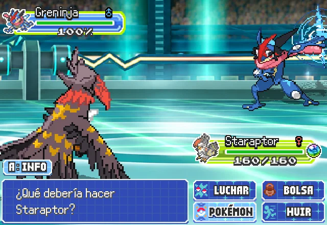

# Presentación visual · referencia de Javier del 25 de octubre de 2026

Javier aporta siete capturas que identifica como Pokémon World Frontier y pide mejorar la presentación del combate y sus ambientes. [Originales, tamaños y huellas SHA-256](referencias/javier_2026-10-25/README.md). Añil sigue siendo el mínimo de calidad; estas imágenes amplían la referencia de acabado. Esta guía se lee antes de la siguiente tarea visible de Combate/interfaz, Edificios y Rutas/interiores.

## Estado comprobado

Hay **25 escenas de combate implementadas**, con recursos y selección por mapa: ocho gimnasios, Alto Mando, campeón, hierba, bosque, olivar, palmeral, montaña, nieve, playa, desierto, agua, ciudad, dos cuevas, casa, edificio público y monumento. Cada gimnasio tiene un frente distinto; sus salas comparten el ambiente del gimnasio. Son variantes de escena y composición, no 25 ilustraciones completas dibujadas desde cero.

Los datos están en `data/battle_backgrounds.json`; `BattleBackgrounds` resuelve el ambiente y `BattleBackground` lo pinta. `SceneManager.prepare_battle()` aplica mapa, terreno y hora. F9 → Pruebas → Combate ofrece todas las escenas del registro. No hay que crear otro selector paralelo.

Comprobación sobre `2cc55828`: **11/11 pruebas, 2.073 aserciones** en `tests/combate/test_fondos_combate.gd`. Recorre los mapas, exige archivos presentes y asignaciones sin caída accidental al genérico, y comprueba gimnasios, Liga, terreno, Surf/pesca y hora. Esto acredita selección y recursos; **no acredita aprobación artística**.

## Qué muestran las referencias y qué falta aquí

| Aspecto | Referencia aportada | Estado observado en Spain | Trabajo concreto |
|---|---|---|---|
| Campo de combate | Suelo continuo, líneas en perspectiva, graderío y luz al fondo; rival separado del decorado | Los ambientes se distinguen, pero varios frentes son muebles u objetos de mapa sobre un fondo genérico | Componer cada escena como un espacio coherente: suelo, límite del campo, arquitectura y fondo. Mantener despejadas las siluetas y el espacio de ataques |
| Cajas de datos | Nombre, género, nivel, PS y estados compactos; marcos y color jerarquizan la información | Las capturas actuales de fondos usan paneles claros grandes y bastante neutros | Revisar marco, bordes, alineación y contraste; mantener todos los datos y comprobar nombres largos, dobles y estados |
| Acciones | Cuatro botones con iconos y selección reconocible, junto al mensaje | El capturador de fondos deja el mensaje vacío y no abre el menú de acciones | Añadir comparativa de un combate real con mensaje y cuatro acciones. No juzgar el menú a partir de una captura que no lo muestra |
| Luz y detalle | Luces y materiales apoyan la profundidad, con una zona central legible | Hay tintes por hora, público y niebla de EBDX; todavía se ve el origen de mosaico de algunos frentes | Unificar materiales y dirección de luz; reservar los detalles de contraste fuerte para límites y elementos reconocibles |
| Edificios | El barco y la entrada acristalada muestran volumen completo, umbral, escaleras y acceso claro | Los redibujos se van integrando, con muchas fachadas aún pendientes | Revisar pieza aislada y todos sus mapas; comprobar entrada, regreso y varias salas si corresponde |
| Calles e interiores | Calzada, acera y parterres tienen bordes continuos; los muebles acompañan el recorrido | El cierre del 21 de octubre mantiene ciudades empedradas sin separar calzada y acera | Aplicar el bordillo y las piezas urbanas existentes; delimitar sin cerrar accesos ni recorridos de NPCs |

Referencia principal de combate:

Capturas actuales de Spain, anteriores a este encargo:

| Interior del gimnasio de Madrid | Camp Nou | Cueva | Nieve |
|---|---|---|---|
| [Captura](comparativas/fondos_combate/gimnasio_madrid.png) | [Captura](comparativas/fondos_combate/gimnasio_barcelona.png) | [Captura](comparativas/fondos_combate/cueva.png) | [Captura](comparativas/fondos_combate/nieve.png) |

Son capturas existentes del renderizador de combate con Pokémon y cajas; no muestran una revisión gráfica realizada el 25 de octubre.

## Siguiente bloque de Combate e interfaz

1. **Separar terraza y sala interior de Madrid.** `madrid/atico_ayuso` es exterior, pero `mapas` le asigna `gimnasio_madrid`: el fondo `indoor_a`, escaños y alfombra de la antigua Casa de Correos. El nombre visible de la escena también conserva «Real Casa de Correos». Crear una variante de terraza con cielo, vistas y suelo exterior; conservar las salas de dentro y la identidad de Ayuso. Añadir prueba de asignación y hora para ambos espacios. No mover el personaje ni alterar su historia.
2. **Primera muestra completa:** pulir el campo del Camp Nou y capturar un turno con mensaje, cuatro acciones, foco seleccionado, ambos Pokémon y cajas. Utilizar césped, líneas de campo, gradas y luz coherentes con el lugar. Conservar su esencia española y los elementos ya decididos.
3. Aplicar esa composición, uno por uno, al resto de gimnasios: Akuarela/discoteca, Club de la Comedia/escenario, concierto de playa, San Mamés, salón de Valladolid y plató portuario. Después, Alto Mando y campeón. No asignar a todos una pista de estadio genérica.
4. Revisar familias de exteriores (ciudad, campo/bosque, costa/agua, desierto, montaña/nieve), cuevas e interiores. Casa, hospital/tienda y monumento deben conservar materiales y límites propios. Si un tipo necesita una variante, añadirla al registro existente y a F9 mediante ese mismo registro.
5. Cerrar cada muestra con antes/después y recorrido real: combate salvaje y entrenador, dobles, nombre largo, estado, PS bajos, clima/terreno y animación de un ataque; modo de movimiento reducido cuando haya luces o capas animadas.

La primera entrega es una muestra integrada y comprobable. El resto conserva el estado provisional hasta revisarse. No se marcan las 25 escenas como mejoradas por guardar estas referencias.

## Entrega a Edificios, Rutas e Interiores

- **Edificios:** seguir [el inventario actualizado](comparativas/edificios_pendientes_2026-10-25.md). En el barco y la entrada acristalada, estudiar proporciones, cubiertas, sombras, cristales y acceso, y trasladar ese acabado a cada edificio español. Conservar sus monumentos y materiales reconocibles. Todos los edificios visitables necesitan puerta visible y salida a su calle; los arcos y estatuas mantienen su función.
- **Rutas/ciudades:** las capturas de calles, plaza y acceso a Liga muestran recorridos legibles y límites continuos. Diferenciar pavimentos con bordillos y remates; no ocupar las aceras con decoración que bloquee puertas. Evitar explanadas abiertas sin una lectura clara de calle, parcela y entrada.
- **Interiores:** dar función a cada estancia, circulación, mobiliario y puntos de interacción; varias salas cuando lo exijan tamaño y uso. Usar las capturas del acceso y del edificio como referencia espacial, preservando los interiores ya enlazados.

Antes de editar un mapa, reservarlo en `docs/mapas/reservas.md`. La reserva actual del redibujo de edificios sigue vigente; esta publicación no toma ni libera mapas de otro frente. Las peticiones visuales quedan allí y en ESTADO para la siguiente sesión. No se ha enviado ningún mensaje a sesiones externas desde esta publicación.

## Condiciones de dibujo e integración

Resolución del proyecto **512×384**; las capturas de 640 o 1920 píxeles son referencias, no medidas para estirar la interfaz. Mantener píxeles nítidos, posiciones enteras, escalas enteras autorizadas y luz coherente. Arte propio mediante las fuentes manuales admitidas; packs originales sin modificar y procedencia registrada. No utilizar estas capturas como texturas del juego.

Conservar las reglas de combate, controles, equipos, lore y accesibilidad. No hace falta tocar el motor para cambiar el acabado de sus fondos o paneles. Comparativa con la referencia y captura real de Spain para cada entrega. Pruebas de fondos y de escena en verde, validadores sin errores y comprobación conjunta antes de integrar. Todo arte nuevo sigue pendiente de aprobación de Javier.

## Validación de la publicación

Suite completa: **771/771 pruebas. 92.186 aserciones. 631.772 s**. Fondos: **11/11, 2.073 aserciones**. Arte: **11.606 PNG, 0 errores, 0 avisos**. Datos: **0 errores y 0 avisos**. Grafo: **994 mapas, todos alcanzables y con vuelta**. Las fuentes y las capturas no se han modificado durante la suite.

Se incorporan referencias y guía de trabajo. La mejora visual de fondos y paneles sigue pendiente; esta publicación no modifica el motor ni los gráficos del juego.

## Corrección posterior del fondo de ciudad · 25 de octubre

Tras la publicación de las referencias, Javier señala los árboles cortados en la captura de ciudad. [Corregida su distribución, con antes y después de día y noche](comparativas/ciudad_arboles_2026-10-25/README.md). Las copas caben en el encuadre y no quedan cortadas por las cajas en esa composición. Esta corrección concreta no sustituye el resto del bloque visual pendiente. Las comprobaciones de la publicación de referencias citadas arriba corresponden a `61e5bf95`; la corrección tiene su validación propia en la comparativa.
