# Referencias de Javier · rutas y ciudades de Añil · 2026-10-15

Javier aporta estas **13 imágenes originales** y pide corregir la amplitud excesiva, la falta de límites y orientación y la hierba que se puede evitar en todas las rutas. Se toma su composición, densidad y claridad de recorrido para mantener la geografía, localidades, personajes, monumentos y comercios de Pokémon Spain.

Son **referencias internas**, no gráficos autorizados para incorporar al juego. No se trocean para extraer tiles, fachadas ni personajes. Algunas imágenes contienen comparativas y rótulos: se estudia el mapa mostrado sin tratar la parte anterior ni el montaje como diseño nuevo del proyecto. No se atribuyen nombres de localidades a capturas no identificadas.

[Análisis del estado publicado y guía para los cinco agentes](../../../mundo/guia_composicion_anil_2026-10-15.md). [Originales, dimensiones y SHA-256](manifest.json). Las dimensiones son las de los archivos recibidos, sin reducirlos al tamaño de la vista del chat.

| # | Original conservado | Tamaño | Qué estudiar |
|---|---|---|---|
| 01 | [01_ruta_costera_vertical.png](01_ruta_costera_vertical.png) | 360×1029 | Recorrido vertical contenido por cantiles, escaleras y bosque; los puentes tienen una función de conexión. |
| 02 | [02_ruta_bosque_desniveles.png](02_ruta_bosque_desniveles.png) | 340×606 | Bosque como masa que talla un camino con cambios de cota y pasos por hierba. |
| 03 | [03_ruta_nevada_retorno.png](03_ruta_nevada_retorno.png) | 1120×1200 | Desvíos, objetos y retorno en una ruta nevada; composición y barreras coherentes con su bioma. |
| 04 | [04_ruta_antes_despues_puentes.png](04_ruta_antes_despues_puentes.png) | 2048×1363 | Comparativa incluida en la imagen: el recorrido se articula con orillas, bosque, puentes y accesos. |
| 05 | [05_ruta_antes_despues_bosque.png](05_ruta_antes_despues_bosque.png) | 1280×1760 | Comparativa incluida en la imagen: la línea directa se transforma en una secuencia de claros, pasos y pequeñas decisiones. |
| 06 | [06_paso_montana_vertical.png](06_paso_montana_vertical.png) | 147×300 | Paso de montaña estrecho; aproximación al servicio y continuidad vertical. |
| 07 | [07_ruta_antes_despues_excavacion.png](07_ruta_antes_despues_excavacion.png) | 2000×1360 | Comparativa incluida en la imagen: sectores conectados por escaleras, excavación diferenciada y desvíos con propósito. |
| 08 | [08_ciudad_compacta_barrios.png](08_ciudad_compacta_barrios.png) | 800×577 | Ciudad compacta: fachadas alineadas, plaza delimitada, servicios visibles y salidas claras. |
| 09 | [09_ciudad_antes_despues_desniveles.png](09_ciudad_antes_despues_desniveles.png) | 1950×1008 | Comparativa incluida en la imagen: manzanas, cotas, calles y recintos que dan estructura a la ciudad. |
| 10 | [10_ciudad_manzanas_plazas.png](10_ciudad_manzanas_plazas.png) | 1200×1120 | Manzanas y fachadas continuas, plaza, canal y puente; jerarquía entre calle y espacio de estancia. |
| 11 | [11_pueblo_rio_molinos.png](11_pueblo_rio_molinos.png) | 1200×933 | Pueblo con río y molinos: identidad local integrada en el recorrido, patios, escaleras y parcelas. |
| 12 | [12_ciudad_recintos_servicios.png](12_ciudad_recintos_servicios.png) | 1280×880 | Servicios y recintos conectados por un eje reconocible; cada puerta tiene una aproximación legible. |
| 13 | [13_region_itinerario.png](13_region_itinerario.png) | 360×240 | Itinerario regional de la referencia; solo orienta sobre la lectura de conexiones, no cambia el mapa de Spain. |

01 · Recorrido vertical contenido por cantiles, escaleras y bosque; los puentes tienen una función de conexión.

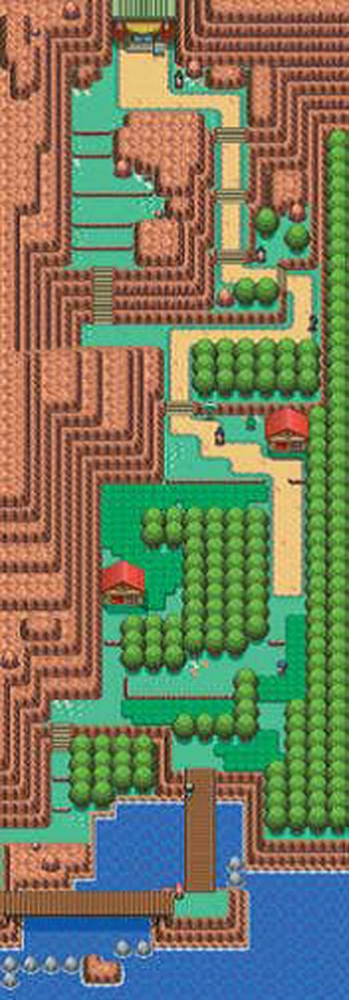

02 · Bosque como masa que talla un camino con cambios de cota y pasos por hierba.

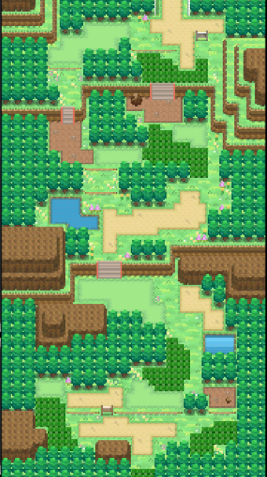

03 · Desvíos, objetos y retorno en una ruta nevada; composición y barreras coherentes con su bioma.

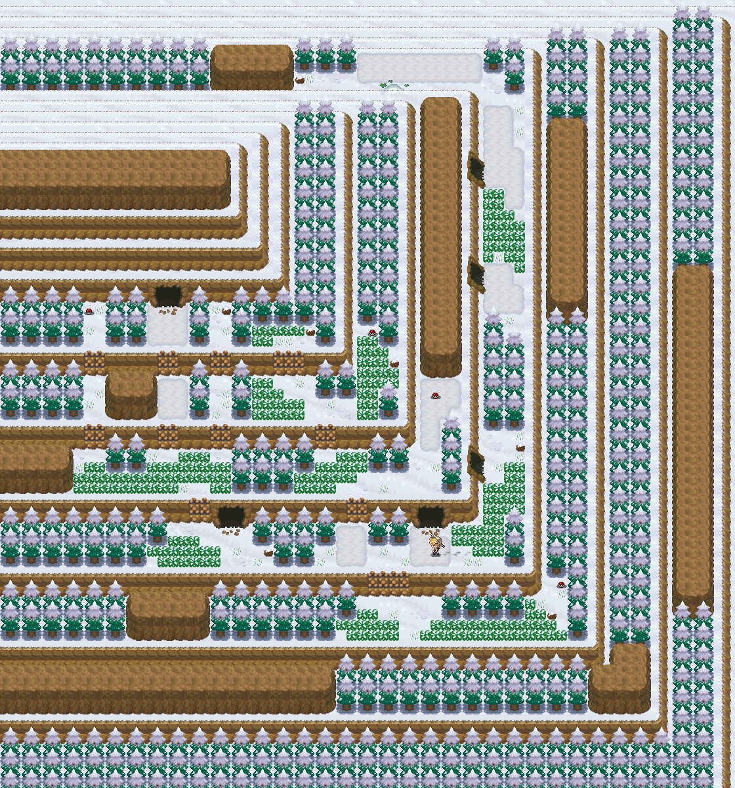

04 · Comparativa incluida en la imagen: el recorrido se articula con orillas, bosque, puentes y accesos.

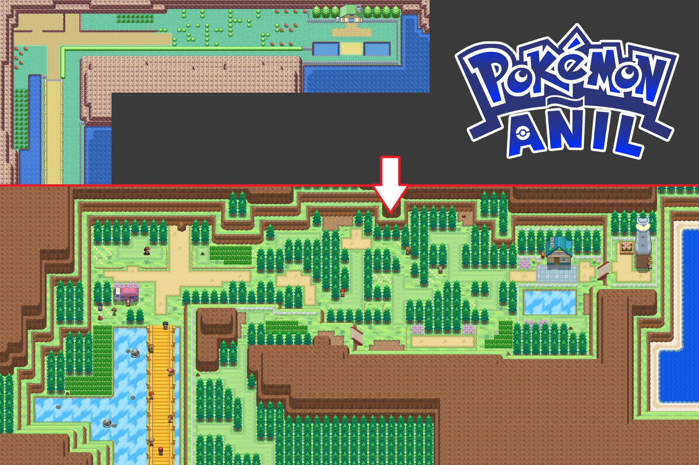

05 · Comparativa incluida en la imagen: la línea directa se transforma en una secuencia de claros, pasos y pequeñas decisiones.

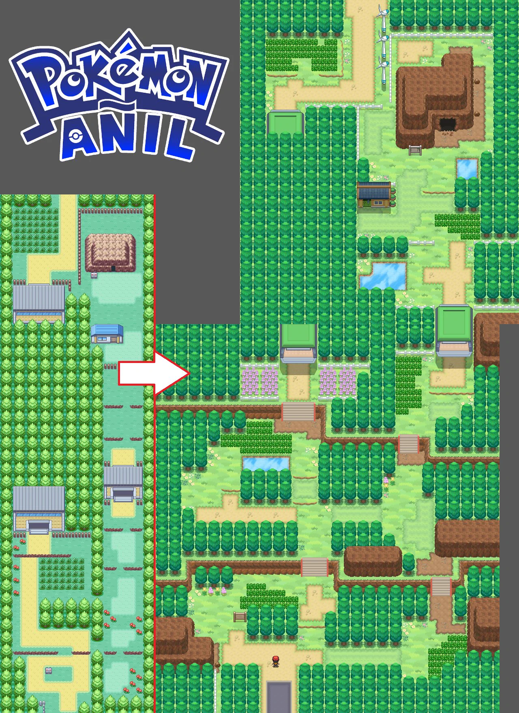

06 · Paso de montaña estrecho; aproximación al servicio y continuidad vertical.

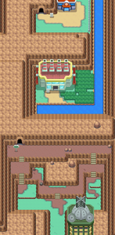

07 · Comparativa incluida en la imagen: sectores conectados por escaleras, excavación diferenciada y desvíos con propósito.

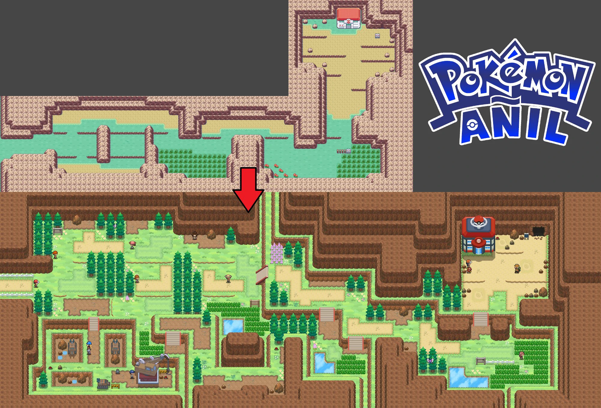

08 · Ciudad compacta: fachadas alineadas, plaza delimitada, servicios visibles y salidas claras.

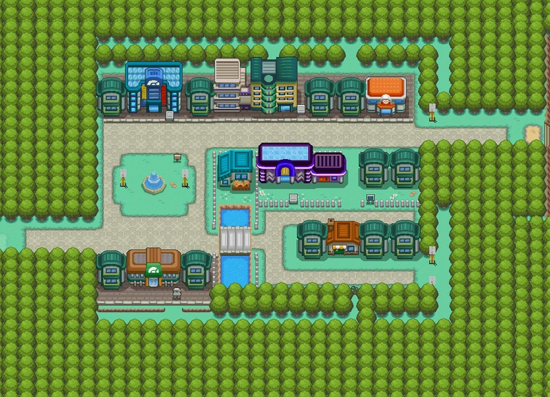

09 · Comparativa incluida en la imagen: manzanas, cotas, calles y recintos que dan estructura a la ciudad.

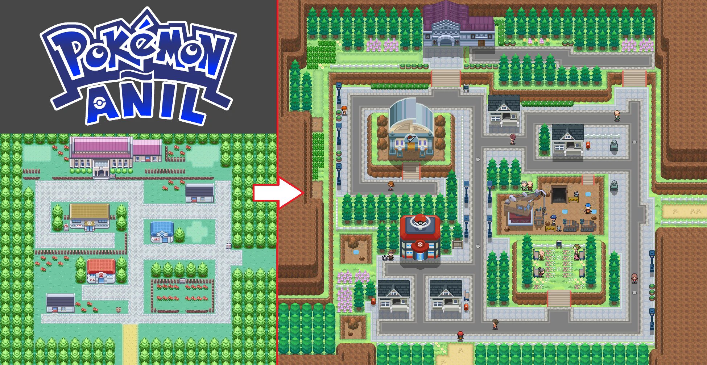

10 · Manzanas y fachadas continuas, plaza, canal y puente; jerarquía entre calle y espacio de estancia.

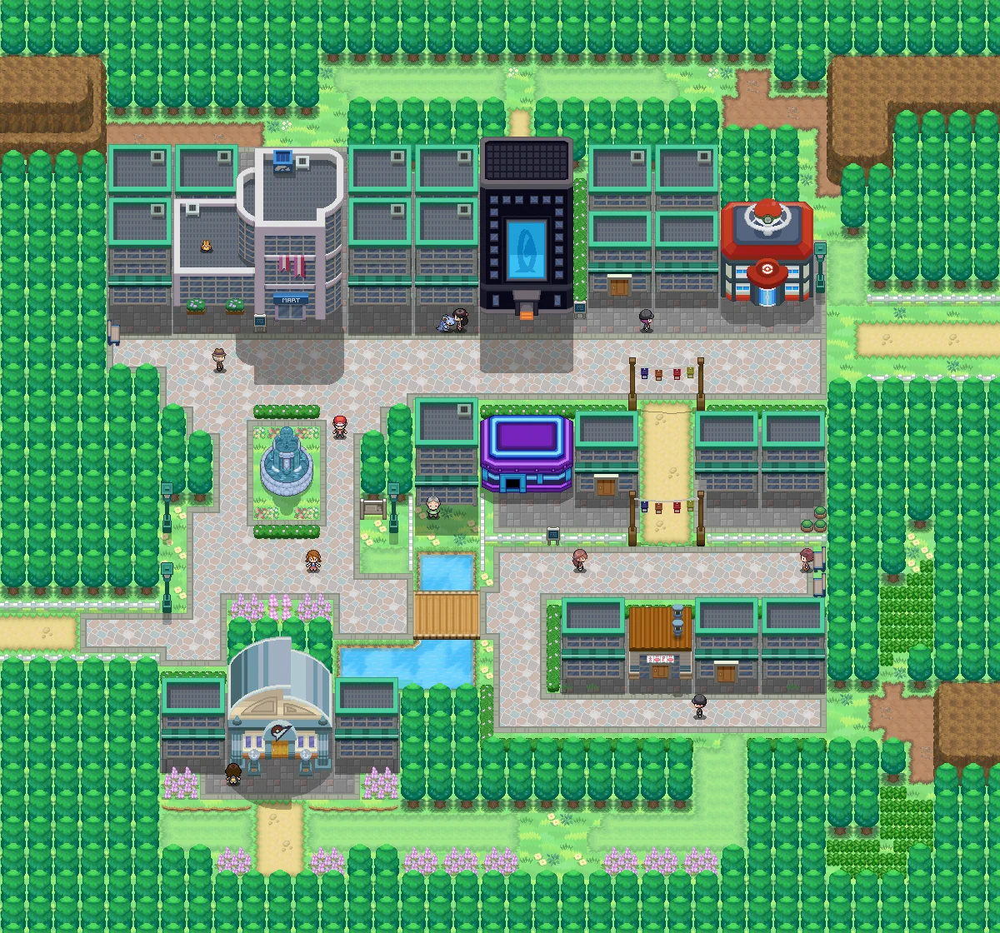

11 · Pueblo con río y molinos: identidad local integrada en el recorrido, patios, escaleras y parcelas.

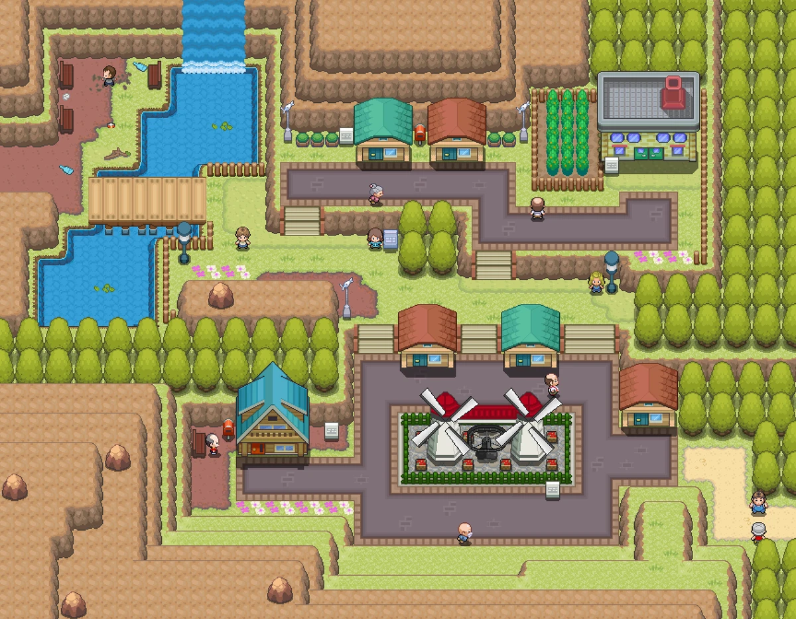

12 · Servicios y recintos conectados por un eje reconocible; cada puerta tiene una aproximación legible.

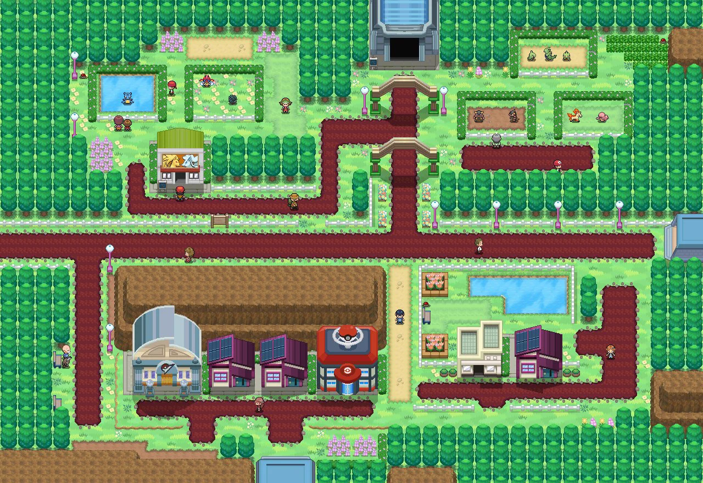

13 · Itinerario regional de la referencia; solo orienta sobre la lectura de conexiones, no cambia el mapa de Spain.

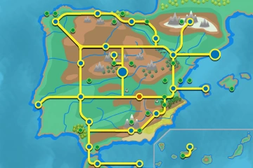

