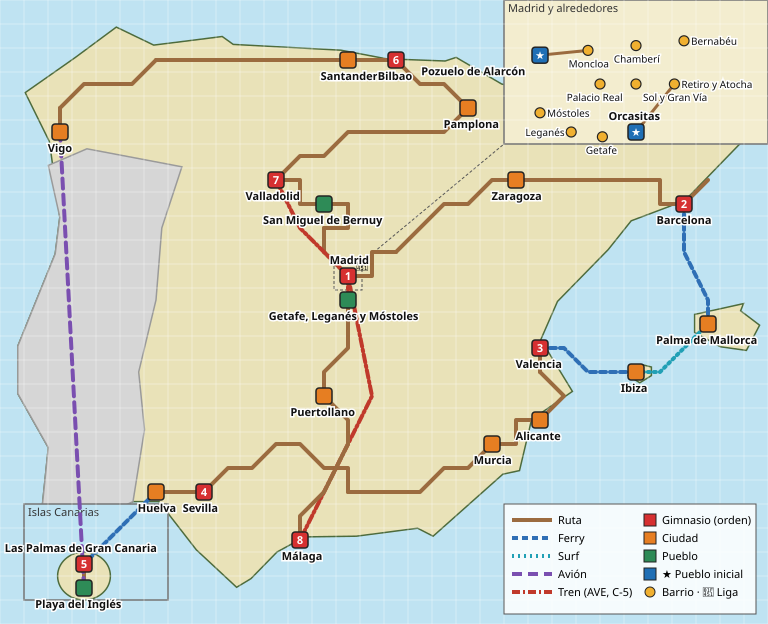

# La región: mapa y orden de la aventura

> Ciudades, gimnasios y su orden: **decisión de Javier**. Las rutas intermedias, los transportes, la curva de niveles y la trama del Clan PSOE son **propuestas** para que las apruebe o cambie.

La región es **España entera**, con las ciudades en su sitio real. El jugador sale de **Pozuelo de Alarcón** (cayetano o cayetana) o de **Orcasitas** (cani o choni), llega a Madrid por su ruta inicial (Casa de Campo → Moncloa o Madrid Río → Atocha) y recorre la península en el orden de los gimnasios ([decisiones del 2026-10-13, §7](../DECISIONES_JAVIER_2026-10-13.md)). El orden de Javier obliga a volver a Madrid al final (Málaga es el 8.º gimnasio y la Liga está en Madrid), así que el recorrido es un **gran círculo** que pasa por San Miguel de Bernuy, el pueblo de Javier, a la vuelta (Ruta 23) y termina bajando por La Mancha.

**Acceso comprobado (2026-10-15):** los 908 mapas se alcanzan desde Pozuelo y desde Orcasitas, desde todos se puede volver y solo hay una unión de ida a propósito (la bajada de la terraza del ático de Ayuso). Detalle, cortes por medallas y camino a cada ciudad: [`conexiones.md`](conexiones.md) (`python3 tools/mundo/grafo_mundo.py`); test: `tests/mundo/test_acceso_mundo.gd`.

**PENDIENTE JAVIER · Surf y el gimnasio 3:** con Surf en la 3.ª medalla (decisiones del 2026-10-13, §2), Valencia no se alcanza con dos medallas: el único camino de Barcelona a Valencia es el ferry a Palma, la Ruta marítima 1 con Surf hasta Ibiza y el ferry a Valencia; el otro camino pasa por las obras de la A-6 (7.ª medalla). Propuestas: dar Surf con la 2.ª medalla (y Golpe Roca con la 3.ª), poner un ferry Palma–Valencia o una barca de Palma a Ibiza hasta tener Surf. Mientras Javier decide, el juego no da Surf (su objeto clave sigue sin decidir).

**Observación:** con la 1.ª medalla se abre el C-5 y se puede bajar por La Mancha hasta Málaga (gimnasio 8) sin más cortes. Si Javier quiere que el sur sea lo último, haría falta un corte en la Ruta 24 (PENDIENTE JAVIER).

## Recorrido de la aventura (propuesta)

| Tramo | De → a | Por dónde (paisaje real) | Qué pasa |
|-------|--------|---------------------------|----------|
| 1 | **Pozuelo de Alarcón** u **Orcasitas** | — | Pueblo inicial según el personaje (decisiones del 2026-10-13, §2 y §7): casa del jugador y del rival |
| 2 | → Casa de Campo → Moncloa, o → Madrid Río → Atocha | Rutas iniciales cortas (niveles 2–6); El Jincho en el Puente de Toledo | Laboratorio de Unicoos en Moncloa: el inicial aleatorio |
| 3 | **Madrid** | — | Primer encuentro con el **Clan PSOE** en la Moncloa. La salida de Moncloa a la Ruta 4 está cortada por las obras de la A-6 hasta la 7.ª medalla |
| 4 | Madrid (gimnasio 1, **Ayuso**) | — | Ferraz, la Gran Vía, el Bernabéu, el Retiro... |
| 4b | Madrid ⇄ **Getafe, Leganés y Móstoles** | Cercanías C-5 (retrasos de Óscar Puente) | Zona opcional al principio; obligatoria al final para bajar al sur |
| 5 | Madrid → Ruta 5 → Ruta 6 → **Zaragoza** | Corredor del Henares (Alcalá, Guadalajara) y la Ruta de Medinaceli y Calatayud | El Pilar y el Ebro |
| 6 | Zaragoza → Ruta 7 → Ruta 8 → **Barcelona** | Los Monegros (desierto) y Montserrat | |
| 7 | Barcelona (gimnasio 2, **Laporta**) | — | Camp Nou en obras, Sagrada Familia... |
| 8 | Barcelona → *ferry* → **Palma de Mallorca** | Mar Balear | |
| 9 | Palma → **Surf** → **Ibiza** | Canal de Ibiza (Ruta marítima 1) | Necesita Surf (decisión de Javier) |
| 10 | Ibiza → *ferry* → **Valencia** | | |
| 11 | Valencia (gimnasio 3, **Labrador**) | — | Akuarela, en la playa de la Malvarrosa |
| 12 | Valencia → Ruta 9 → Ruta 10 → **Alicante** | La Albufera, Gandía (guiño a *Gandía Shore*) y la Costa Blanca (Benidorm) | |
| 13 | Alicante → Ruta 11 → **Murcia** | Palmeral de Elche (Vito Quiles) y la Vega Baja | |
| 14 | Murcia → Ruta 12 → Ruta 13 → **Sevilla** | Sierra Nevada y Granada (la boda de Rubiales) y el mar de olivos de Jaén y Córdoba | |
| 15 | Sevilla (gimnasio 4, **Joaquín**) | — | Giralda, Plaza de España, Triana... |
| 16 | Sevilla → Ruta 14 → Huelva → *ferry* → **Las Palmas** | Doñana; el ferry Huelva–Canarias existe de verdad | |
| 17 | Las Palmas → Ruta 15 → **Playa del Inglés** (gimnasio 5, **Quevedo**) | Costa este de Gran Canaria hasta las dunas de Maspalomas | |
| 18 | Gran Canaria → *avión* → **Vigo** | Hay vuelos directos Gran Canaria–Vigo | Luces de Navidad de Abel Caballero |
| 19 | Vigo → Ruta 16 → Ruta 17 → Ruta 18 → **Santander** | Rías Baixas (Sanxenxo: regatas del rey emérito), Galicia interior y Asturias (Picos de Europa) | |
| 20 | Santander → Ruta 19 → **Bilbao** (gimnasio 6, **la chica del *Aupa Athletic***) | Costa de Cantabria (Castro Urdiales) | San Mamés, Guggenheim |
| 21 | Bilbao → Ruta 20 → **Pamplona** | Sierra de Aralar | San Fermín |
| 22 | Pamplona → Ruta 21 → Ruta 22 → **Valladolid** (gimnasio 7, **Latasa**) | Viñedos de La Rioja y Burgos (Atapuerca) | Plaza Mayor |
| 23 | Valladolid → Ruta 23 → **San Miguel de Bernuy** | Tierra de Pinares (Cuéllar) | **Vuelta a casa**: combate contra Javier |
| 23b | San Miguel → Ruta 1 → Ruta 2 → Ruta 3 → Ruta 4 → Moncloa | Hoces del Duratón, Tierra de Pinares y el **Acueducto de Segovia**, Navacerrada y Cuelgamuros, El Escorial y Galapagar | Las rutas del antiguo principio, con niveles de después de la 7.ª medalla (48–55); las obras de la A-6 ya han terminado |
| 24 | San Miguel → Madrid (vuelo o AVE) → Getafe → Ruta 24 → **Puertollano** | La Mancha (molinos de Consuegra) | Complejo industrial y minas |
| 25 | Puertollano → Ruta 25 → Ruta 26 → **Málaga** (gimnasio 8, **Banderas**) | Despeñaperros (Sierra Morena) y la Ruta de Antequera (El Torcal) | |
| 26 | Málaga → AVE → Madrid → **Calle de la Victoria** → **Palacio Real** | La calle de la Victoria existe (junto a Sol): es la *Calle Victoria* del juego | Alto Mando y Líder Supremo |

### Transportes

| Transporte | Dónde | Cómo funciona (propuesta) |
|------------|-------|---------------------------|
| **Ferry** | Barcelona → Palma, Ibiza → Valencia, Huelva → Las Palmas | Escena de embarque en el puerto; pide el billete (objeto clave) |
| **Surf** | Palma → Ibiza | Como en los juegos: mar abierto con encuentros de agua (decisión de Javier) |
| **Avión** | Las Palmas → Vigo (y luego vuelo libre) | Aeropuerto con control de seguridad (chiste con los líquidos). Más tarde, Vuelo normal |
| **AVE / Cercanías** | Madrid ⇄ sur, Valladolid ⇄ Madrid, Madrid ⇄ Málaga | Viaje rápido entre estaciones ya visitadas. Siempre llega con retraso (Óscar Puente) |

**Hecho (2026-10-14):** cada ferry y el avión tienen mapa propio (`maps/transporte/`, pintados por `maps/_pintura/pintar_transportes.gd`). La pasarela del puerto lleva al salón del barco; al entrar salta el viaje (`src/events/viaje_event.gd`: aviso de salida, trayecto con fundido y aviso de llegada) y la puerta de abajo desembarca en el destino. El avión sale de una terminal (`playa_del_ingles/aeropuerto`, `vigo/aeropuerto`) con facturación, el control de seguridad con el chiste de los líquidos (`src/events/control_seguridad_event.gd`, paso obligado para embarcar) y un aficionado que señala el Falcon por la ventana; se baja en la otra terminal por llegadas, sin volver a pasar el control. **AVE:** las estaciones de Atocha (`madrid/sala_retiro_20_58`), Campo Grande (`valladolid/sala_calle_52_59`) y María Zambrano (`malaga/sala_calle_5_57`) son vestíbulos con taquilla, panel y andenes; los trenes (`transporte/ave_*`) van Madrid ⇄ Valladolid y Madrid ⇄ Málaga, siempre con retraso. Cada andén lo tapa un revisor hasta haber estado en el destino (`visited_map:...`), que es el viaje rápido entre estaciones ya visitadas. **Falta:** el billete como objeto clave (de momento no se pide), el «vuelo libre» de después y el AVE desde San Miguel. Test: `tests/mundo/test_transportes.gd`.

### El Clan PSOE (propuesta de trama)

Imita al Team Rocket: un dúo que aparece una y otra vez, una base por zona y el jefe al final.

| Dónde | Qué |
|-------|-----|
| Moncloa (entrada a Madrid) | Primer encuentro con **Ábalos y Koldo**, el dúo fijo (los "Jessie y James" del juego) |
| Sede de **Ferraz** (Madrid) | Primera base. Se entra tras el gimnasio 1 |
| **Cloacas de Madrid** | Mazmorra de **Leire Díez, "la fontanera"** |
| Aeropuertos | El **Falcon** del Líder Supremo aparece aparcado en los aeropuertos que visitas |
| Ruta 20 (Pamplona) | Koldo en su tierra |
| Palacio Real | **Pedro Sánchez**, Líder Supremo de la Liga y jefe del Clan |

## Curva de niveles (propuesta)

| Momento | Niveles de los rivales | As del líder |
|---------|------------------------|--------------|
| Ruta 1–2 | 2–6 | — |
| Gimnasio 1, Madrid | 10–13 | 14 |
| Gimnasio 2, Barcelona | 17–20 | 21 |
| Gimnasio 3, Valencia | 23–26 | 27 |
| Gimnasio 4, Sevilla | 29–32 | 33 |
| Gimnasio 5, Las Palmas | 35–38 | 39 |
| Gimnasio 6, Bilbao | 40–43 | 44 |
| Gimnasio 7, Valladolid | 44–47 | 48 |
| Gimnasio 8, Málaga | 49–52 | 53 |
| Alto Mando | 55–59 | 60 |
| Líder Supremo | 60–63 | 65 |

## Tipos de los líderes (propuesta, PENDIENTE JAVIER)

| Líder | Tipo | Por qué | As propuesto |
|-------|------|---------|--------------|
| Ayuso | Fuego | Terrazas, cañas y "libertad"; el Madrid que no se apaga | Arcanine |
| Laporta | Acero | Palancas económicas, grúas y el estadio eternamente en obras | Copperajah |
| Labrador | Lucha | El cachas de *Gandía Shore* | Machamp |
| Joaquín | Planta | Verdiblanco del Betis | Meowscarada |
| Quevedo | Agua | Playa del Inglés y *Quédate* | Palafin |
| Chica del *Aupa Athletic* | Lucha/Fuego | Rojiblanca, como los altos hornos de Bilbao | Infernape |
| Latasa | Hielo | El frío de Valladolid | Baxcalibur |
| Banderas | Siniestro | *El Zorro* | Zoroark |
| Iniesta (Alto Mando) | Psíquico | La visión de juego | Gardevoir |
| Nadal (Alto Mando) | Tierra | El rey de la tierra batida | Garchomp |
| Gasol (Alto Mando) | Dragón | El más alto de la Liga | Dragonite |
| Alonso (Alto Mando) | Eléctrico/Acero | La Fórmula 1 y el "33" | Regieleki |
| Pedro Sánchez (Líder Supremo) | Variado | *Manual de resistencia*: aguanta lo que le echen | Kingambit |

La chica del *Aupa Athletic* repite tipo Lucha con Labrador; si Javier lo prefiere, su gimnasio puede ser de tipo Fuego puro. Los equipos completos están en [`personajes.md`](personajes.md).

## Coordenadas del mapa regional

Rejilla de **32 × 26** casillas (el norte arriba), calculada desde la latitud y longitud reales: `x = (longitud + 9,5) × 2,4`, `y = (44 − latitud) × 3`. Dos recuadros con sus propias casillas: **Canarias**, abajo a la izquierda (casillas 1–6 × 21–24), y **Madrid y alrededores**, arriba a la derecha (casillas 21–31 × 0–5), con los pueblos iniciales, las rutas iniciales, los seis barrios de Madrid y Getafe, Leganés y Móstoles. Están en `data/region.json` (con el mapa de cada lugar en `map` y `maps`) para el mapa regional, el menú F9 y el Vuelo; el esquema `mapa_region.svg` se genera con `python3 tools/mundo/mapa_region_svg.py`.

| Lugar | Tipo | x | y | Latitud, longitud reales |
|-------|------|---|---|--------------------------|
| Pozuelo de Alarcón | Pueblo inicial (recuadro de Madrid) | 22 | 1,8 | 40,43, −3,81 |
| Orcasitas | Pueblo inicial (recuadro de Madrid) | 26 | 5 | 40,37, −3,71 |
| Moncloa, Chamberí, Bernabéu, Palacio Real, Sol y Gran Vía, Retiro y Atocha | Barrios de Madrid (recuadro) | 24–28 | 1,2–3 | — |
| Móstoles, Leganés y Getafe | Pueblos al sur de Madrid (recuadro) | 22–24,6 | 4,2–5,2 | — |
| Huelva | Ciudad (puerto del ferry a Canarias) | 6 | 20 | 37,26, −6,95 |
| Playa del Inglés | Pueblo (recuadro de Canarias; gimnasio 5 y aeropuerto) | 3 | 24 | 27,76, −15,57 |
| San Miguel de Bernuy | Pueblo | 13 | 8 | 41,40, −3,93 |
| Madrid | Ciudad (gimnasio 1, Liga) | 14 | 11 | 40,42, −3,70 |
| Getafe, Leganés y Móstoles | Pueblos | 14 | 12 | 40,31, −3,75 |
| Zaragoza | Ciudad | 21 | 7 | 41,65, −0,88 |
| Barcelona | Ciudad (gimnasio 2) | 28 | 8 | 41,39, 2,17 |
| Palma de Mallorca | Ciudad | 29 | 13 | 39,57, 2,65 |
| Ibiza | Ciudad | 26 | 15 | 38,91, 1,43 |
| Valencia | Ciudad (gimnasio 3) | 22 | 14 | 39,47, −0,38 |
| Alicante | Ciudad | 22 | 17 | 38,35, −0,48 |
| Murcia | Ciudad | 20 | 18 | 37,99, −1,13 |
| Sevilla | Ciudad (gimnasio 4) | 8 | 20 | 37,39, −5,98 |
| Las Palmas de Gran Canaria | Ciudad (gimnasio 5) | 3 | 23 | 28,12, −15,43 (recuadro) |
| Vigo | Ciudad | 2 | 5 | 42,24, −8,72 |
| Santander | Ciudad | 14 | 2 | 43,46, −3,80 |
| Bilbao | Ciudad (gimnasio 6) | 16 | 2 | 43,26, −2,93 |
| Pamplona | Ciudad | 19 | 4 | 42,81, −1,64 |
| Valladolid | Ciudad (gimnasio 7) | 11 | 7 | 41,65, −4,72 |
| Puertollano | Ciudad | 13 | 16 | 38,69, −4,11 |
| Málaga | Ciudad (gimnasio 8) | 12 | 22 | 36,72, −4,42 |

Las rutas y sus casillas también están en `data/region.json` (`routes`).

## Fuentes

- [San Miguel de Bernuy (Hispanopedia)](https://es.hispanopedia.com/wiki/San_Miguel_de_Bernuy) y [Escapada Rural](https://www.escapadarural.com/que-hacer/san-miguel-de-bernuy).
- Fichas de cada ciudad en [`ciudades/`](ciudades/), con sus fuentes.
